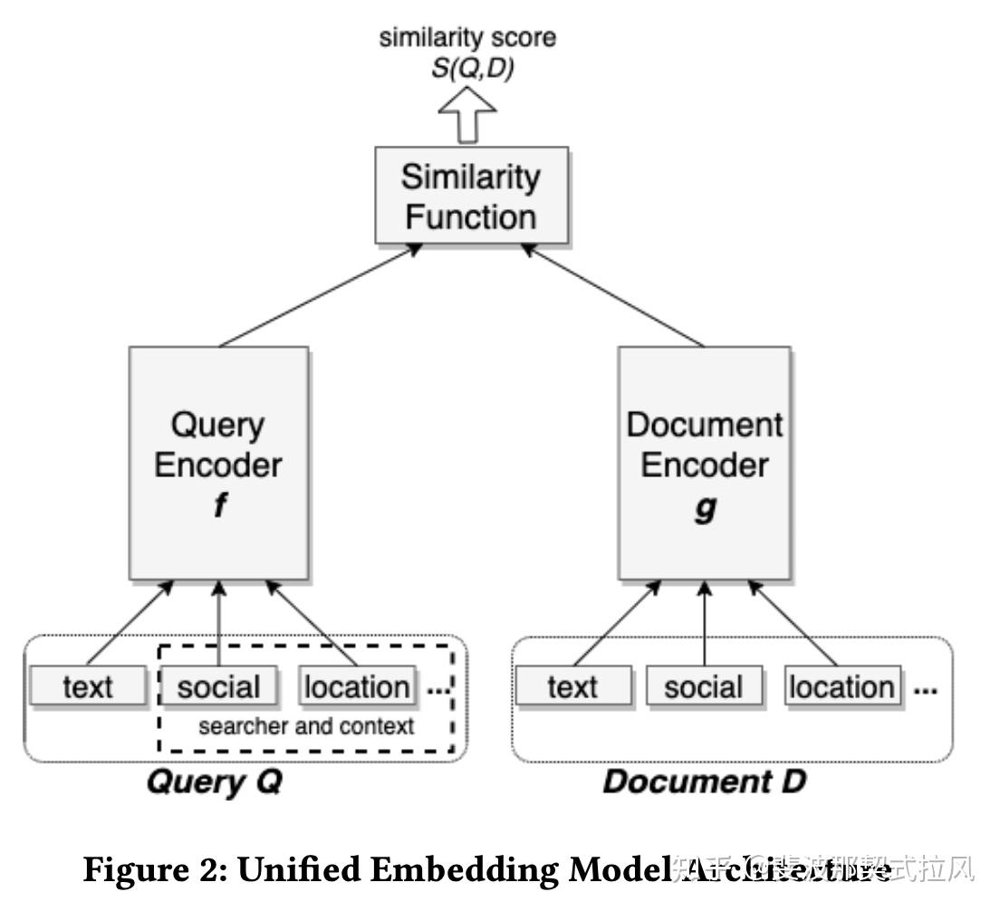
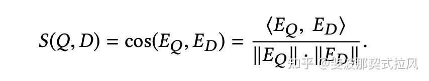
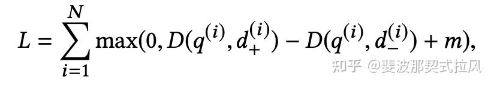
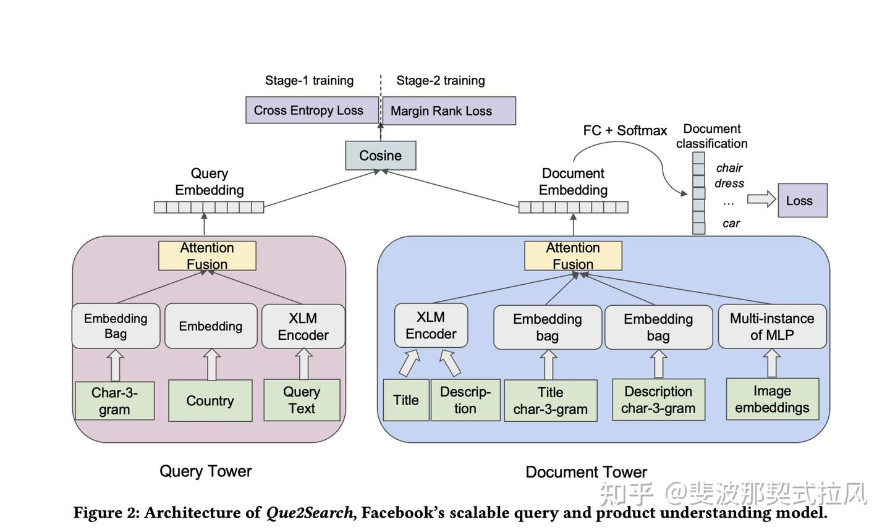
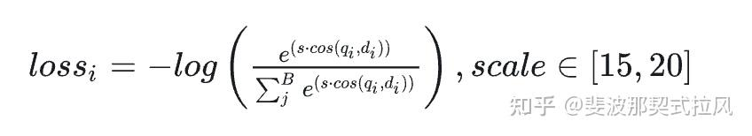
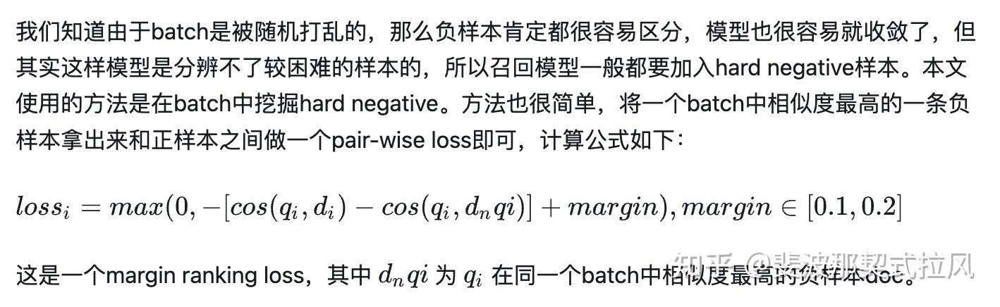

### 2020年进展

2020年: [青枫拂岸：[论文精读]02—KDD2020：Embedding-based Retrieval in Facebook Search](https://zhuanlan.zhihu.com/p/407069910)

原文：[Embedding-based Retrieval in Facebook Search](https://link.zhihu.com/?target=https%3A//arxiv.org/pdf/2006.11632.pdf)

#### 1.核心

改文章属于召回早期作品，直指召回层的关键问题——**训练数据正负样本判定。**

#### **2.结构**

召回层的模型结构，就是经典的双塔结构，左侧user塔包括用户的检索 query，以及用户位置、用户社交关系等上下文特征，document 塔的输入包括文档本身text，以及文档的social特征(这里指使用facebook群组搜索来获取相关群组的社交集群)、位置等特征。相似度函数用直接取query和doc的embedding的Cos操作。

#### **3.Loss**

定义三元组函数，

其中，D是距离函数， q^{(i)} 是第i个样本的query， d_{+}^{(i)} 是第i个样本的正样本， d_{-}^{(i)} 是负样本，N是样本数量，m是Margine value。损失函数的理解：正负样本的距离差在一定的范围内(|m|时，损失函数增加，为了最小化损失函数，再次拉远此时的正负样本。故损失函数的主要目的是将正负样本更好的远离。

值得一提的是Loss中的 距离函数 D与相似度值S的关系为： **D=1-S=1-cos** 。由于cos的取值范围为[-1,1]，故D的取值范围为[0,2]。即与query越相似，则距离D值越大。

#### 4.样本选择(负样本)

**用曝光未点击作为负样本，离线训练的整体数据样本与线上生产数据分布非常不一致。因此，**随机采样，对每个query，**在doc池**中进行随机采样作为负样本，才会有比较好的负样本效果

#### 5.样本选择(正样本)

此外，当负样本确定后，文章还对正样本的选择进行了探讨：

- 点击 作为正样本
- 曝光 作为作为正样本
- 曝光+点击 都作为正样本
经过一段时间的观察，发现结果差不多。

#### 6.进一步的优化

- Hard Mining

- 为什么要进行HardMining？文章发现很多时候同语义召回的结果，大部分都是相似的(有相同的名字)，而且没有区分度，最相似的结果往往还排不到前面，即使加入了social feature，这说明了模型没有更好的利用这些特征，因为负样本是随机采样的，导致训练样本太简单了，模型学习不充分。***所以需要挖掘出hard negative ，加入模型中，增强模型的识别能力。***

- Hard positive mining

- 除了用户点击作为正样本外，文章还试图在失败的搜索sessions的活动日志中找到潜在未被识别的正样本。文章发现使用这种正样本在训练集只有原来的4%时，可得到相似的recall

- Embedding ensemble

### 2021年进展

2021年：[MECH：Que2Search（上）：FaceBook新一代query搜索召回模型分享](https://zhuanlan.zhihu.com/p/615284379)

原文 : Que2Search: Fast and Accurate Query and Document Understanding for Search at Facebook

**

#### 1.核心问题

- 在线指标提升用户参与度、离线指标提升Query、Product相关性
- FaceBook面向的多国家多语言对齐问题。
- 商品内容理解难的问题。

#### 2.挑战

- 相关性如何评判，想要建模目标，正样本如何定义。
- 既然要提升相关性，多语言对齐和query精细化理解很重要，论文中使用了XLM这个模型，这个模型目前可以直接把它看成Bert，这也就意味着他们面临线上的推理延迟问题。
- 商家文案水平参差不齐，充满噪音。想要提升相关性，如何充分挖掘、理解商品内容，充分利用现有的多模态信息就很重要。

#### 3.结构

我们先看看Que2Search的整体架构，仍然是经典的双塔结构，query塔侧的输入信息相对较少，结构也比较简单。作者主要在document塔侧下了很大的功夫，这些都是为了解决提到的商品理解的问题。

query塔侧有三个输入，分别是：

- query字符串的所有3-gram特征，embedding list做一个pooling，将其变成一个embedding
- 国家的embedding。
- 用XLM将query encode成embedding，想了解XLM的同学可以看看[这篇文章](https://link.zhihu.com/?target=https%3A//arxiv.org/abs/1901.07291)，XLM可以理解为一个多国语言对齐的Bert，不想纠结在这里的同学完全可以理解为Bert就行。
Doc塔侧有五个（三类）输入特征，分别是：

- 多模态。**doc塔侧引入了共享XLM和图片多模态特征，算是下足了功夫来对商品内容进行理解
- **增加辅助loss。**在doc塔这一侧增加了一个辅助的多标签多分类任务，这个任务非常有意思，具体做法是统计一段时间用户输入的头部4.5w个query作为类别，让doc侧的embedding直接用一个FC + softmax去做一个4.5w分类的任务。***该辅助loss的出发点就是强制使doc去预测用户的头部query来达到挖掘商品和语义的关系的目的，用来解决前面提到的商品描述噪声太大的问题***
- 商品title的3-gram和商品描述文案的3-gram，特征处理方式同query塔，这里title和描述的EmbeddingBag不同。
- 商品title和描述文案的文本通过XLM encode成embedding，因为doc塔可以离线计算，因此不需要考虑耗时问题，在这里使用了六层XLM，title和描述共享XLM权重，这样产出的embedding就在同一向量空间，信息是对齐的。
- 使用GrokNet模型获取商品图片的预训练向量表征，商品会有多张图片，可以得到一个embedding集合，然后再接一个MLP层，最后用Deep Sets方法来融合多个图片向量得到融合后的图片表征embedding。
- 备注

- GrokNet是作者的另一篇KDD，可以理解为一个图像领域的预训练模型，想了解的请移步这篇文章。
- DeepSets是2018年提出的针对集合机器学习任务建模的算法，输入是一个embedding set输出是一个embedding，它可以保证排列不变性，作者在这里特别指出DeepSets对图像集合的融合非常有效。想了解DeepSets的请移步[这篇文章](https://link.zhihu.com/?target=https%3A//arxiv.org/abs/1703.06114)。如果不想了解也没关系，不会影响本文的阅读，你可以先将其简单的理解为将多个embedding pooling成一个embedding，比如sum pooling。

多路embedding融合方法

        不论是query塔还是doc塔，可以看到他们都是多路embedding信息表征的方式，那如何将这些表征融合在一起形成一个embedding来表示query或doc呢？毕竟线上检索只能用一个embedding。一般来说多模信息融合有early fusion、mid fusion、late fusion三种，而本文属于late fusion。

作者实验了多种方法：concat + mlp、sum pooling、attention fusion等，***最后发现attention fusion最好***

#### 4.Loss

loss1：batch softmax

loss2：pair-wise loss

基于困难样本的pair-wise loss

#### 5.样本选择

对于样本如何获取的问题，作者从业务出发，对正样本进行了设计：

- 少量有监督数据：找一批query和product的交互数据，让人工标注，这部分数据只参与评估，不参与训练。
- 大量弱监督数据：在日志中，如果一个query在短时间（如24小时）内对一个product做过以下所有操作： 用户搜索查询、点击产品、向卖家发送信息、卖家回复信息。那么就认为该query和product有相关性，是正样本。

#### 6.进一步的优化

为了更好地训练模型，作者引入了课程学习（Curriculum Training）的范式，***即第一阶段先用简单负样本train至early stop，然后第二阶段再进行困难负样本的挖掘和训练***，作者说课程学习就像人学习一样，先学简单的，再学困难的，然后作者对比了不使用课程学习（即两阶段直接混在一起train）和使用课程学习的方式训练，发现课程学习可以带来很大收益提升。

### 2023年进展

2023年：[SmartMindAI：Facebook 2023：揭秘Que2Engage，创新向量召回技术，兼顾相关性与吸引力，引领新趋势](https://zhuanlan.zhihu.com/p/664379789)

[张成成成成：[WWW'23][Facebook] Que2Engage: 兼顾相关性与交互性的基于Embedding的商品检索](https://zhuanlan.zhihu.com/p/609359496)

原文 [Que2Engage: Embedding-based Retrieval for Relevant and Engaging Products at Facebook Marketplace](https://link.zhihu.com/?target=https%3A//arxiv.org/pdf/2302.11052.pdf)
