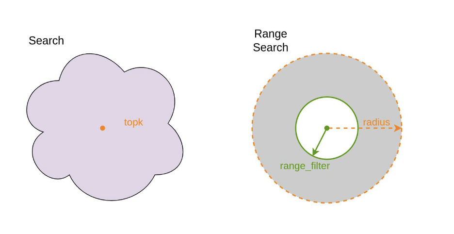
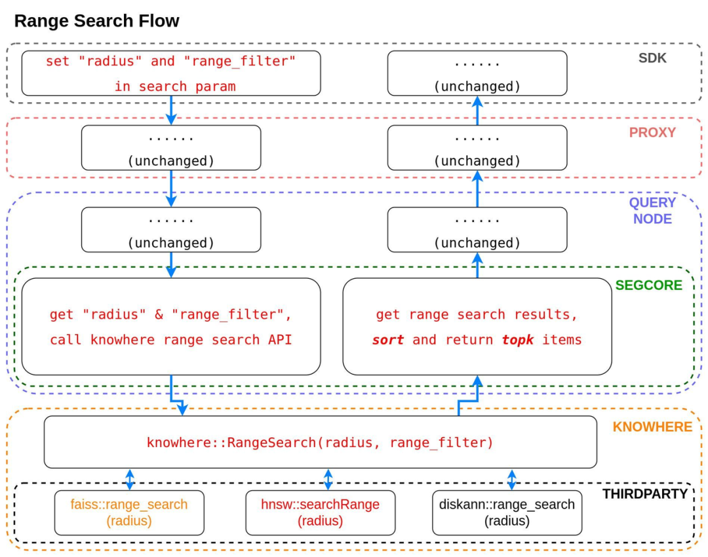
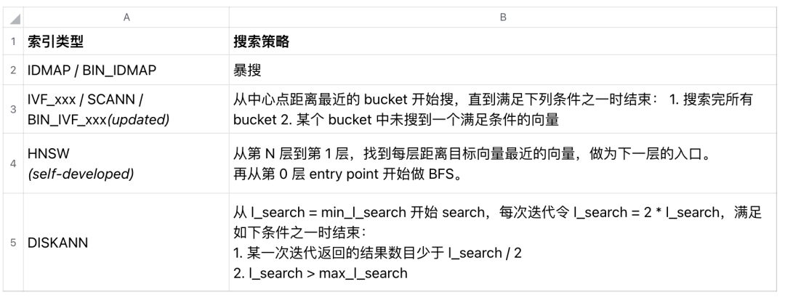
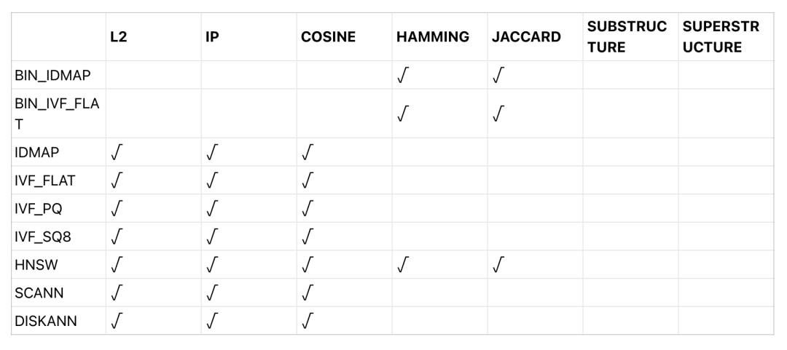
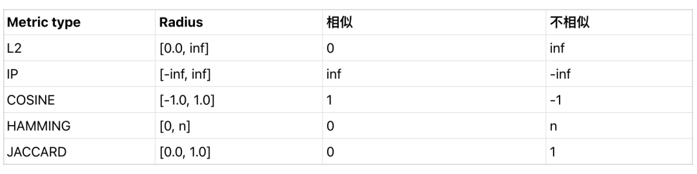

Range Search 功能诞生于社区。

某天，一位做系统推荐的用户在社区提出了需求，希望 Milvus 能提供一个新功能，可以返回向量距离在一定范围之内的结果。而这不是个例，开发者在做相似性查询时，经常需要对结果做二次过滤。

为了帮助用户解决这一问题，Milvus 推出了全新功能—— Range Search（范围搜索）。本文将带各位详解这一新功能，包括 Range Search 的基本介绍、使用场景及其背后的技术细节。

### **01.什么是 Range Search？**

顾名思义，Range Search 即范围搜索。不同于 KNN Search 返回最相似的 TOP-K 个结果，Range Search 会返回向量距离落于某一区间的 TOP-K 个结果。

那么，何时选择 Range Search 而非 Top-K 搜索？

Range Search 最典型的应用场景就是推荐系统。比如商品推荐，一个好的推荐系统，返回的应该是与用户点击的商品有一定相似度，但又不太相似的结果。太相似或太不相似的推荐都会导致推荐效果不尽如人意。

在有 Range Search 功能之前，做推荐系统的用户只能先执行一次 KNN Search，再在 Milvus 系统之外对查询结果进行二次过滤。如今，有了 Range Search 功能，他们可以直接调用 Range Search，一次性得到所需要的结果。

Range Search 新增了 2 个参数，分别是：

- radius（半径） - 指相似性的外边界** 
- range_filter（范围过滤器） - 指相似性的内边界
 

### 02.Range Search 的技术实现细节**

接下来，我们深入 Range Search 功能的架构和算法，探讨其优势、局限性以及 Range Search 与第三方算法库集成。

Range Search 重用了现有的搜索流程，二者在上层所有数据通路几乎完全是一样的。以下是接收到搜索请求时所采取的步骤：

- SDK 接到一个用户的查询请求，在 search param 中包含了 radius 和 range_filter 信息；** 
- proxy 在收到这个查询请求后，生成一个 SearchTask 传给 querynode；
 
- querynode 在收到 SearchTask 后，通过 cgo 调用 segcore 的 Search 接口；
 
- segcore 会解析 search_param 中带的参数，如果有 radius，则调用 knowhere::RangeSearch；
 
- knowhere 再根据索引类型调用到对应的第三方库的 range_search 函数。
 

目前，所有的第三方库索引都只支持单边 Range Search，也就是只接收一个参数 radius，而且返回的结果是全量未排序的结果。下表概述了不同索引类型的 Range Search 策略“

对于 binary 类型的索引，HAMMING 和 JACCARD 全部都支持 Range Search，SUBSTRUCTURE/SUPERSTRUCTURE 由于返回值是 true/false，不满足 Range Search 的语义，所以不支持 Range Search。其余 float 类型索引，对于 L2/IP/COSINE 全部支持 Range Search。

下表是所有支持 Range Search 的索引类型和 metric type：

### 03.Range Search 使用方法**

如需使用 Range Search，只需要修改搜索请求中的搜索参数。接下来我会讲一下的详细使用指南，在指南的最后还提供了 Python 示例代码。

#### **开始前**

请确保已安装并运行 Milvus。

请确保已创建 1 个 Collection，并为该 Collection 创建索引。

#### **Range Search 参数**

- radius：必要参数。决定搜索请求将执行 Range Search 还是 KNN Search。** 
- range_filter：可选参数。如果设置该参数，函数将对结果进行二次过滤。
 
通过上述两个参数，我们可以根据不同应用场景和需求微调 Range Search 的行为。以下为示例代码：

`default_index = {"index_type": "HNSW","metric_type": "L2","params": {"M":48,"efConstruction":500}
}
collection.create_index("float_vector", default_index)
search_params = {"metric_type": "L2","limit": TOPK,
                 "params": {"ef":32,"range_filter":1.0,"radius":2.0}
}
res = collection.search(vectors[:nq], "float_vector", search_params, limit)`

### 04.参数检查**

下表列出了所有 metric type 对应的 radius 合法值范围：

由于不同 metric type 对应的 radius 合法值范围不同，Milvus 不会检查 radius 的合法性，而是只检查 radius 和 range_filter 的相对合法性：

- 对于 L2/Hamming/Jaccard，range_filter  radius
 

### 05.总结**

Milvus 的 Range Search 功能不仅限于推荐引擎，还可以广泛应用在内容匹配、异常检测和 NLP 搜索等任务中。通过利用 radius 和 range_filter 两个参数，用户可以精准定制查询，满足不同用例的需求。

Range Search 现已正式登陆 Zilliz Cloud Beta 版！如需体验 Range Search 功能，请将 Zilliz Cloud（https://zilliz.com.cn/cloud） 集群升级至 Beta 版或下载 Milvus 2.3.x（https://milvus.io/docs/install_cluster-milvusoperator.md）。另外，如果大家在使用 Range Search 功能中遇到任何问题或者建议，欢迎向我们反馈！
