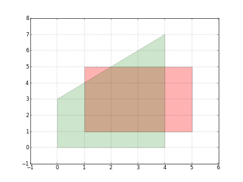

（此文仅供参考）

1.资料汇总网站，基本有关多面体优化的资料都可以在这里找到：

Polyhedral Compilationpolyhedral.info/

2.好的项目和工具推荐：

isl的python库（isl的代码不好阅读，可以直接基于此库开发）

[Home - islpy 2020.2.2 documentationdocumen.tician.de/islpy/index.html](https://link.zhihu.com/?target=https%3A//documen.tician.de/islpy/index.html)

一个可视化工具，对于教学和理解多面体有很大帮助，可以基于此多做实验

[https://github.com/tobiasgrosser/islplotgithub.com/tobiasgrosser/islplot](https://link.zhihu.com/?target=https%3A//github.com/tobiasgrosser/islplot)

论文与书籍：

（TODO）
