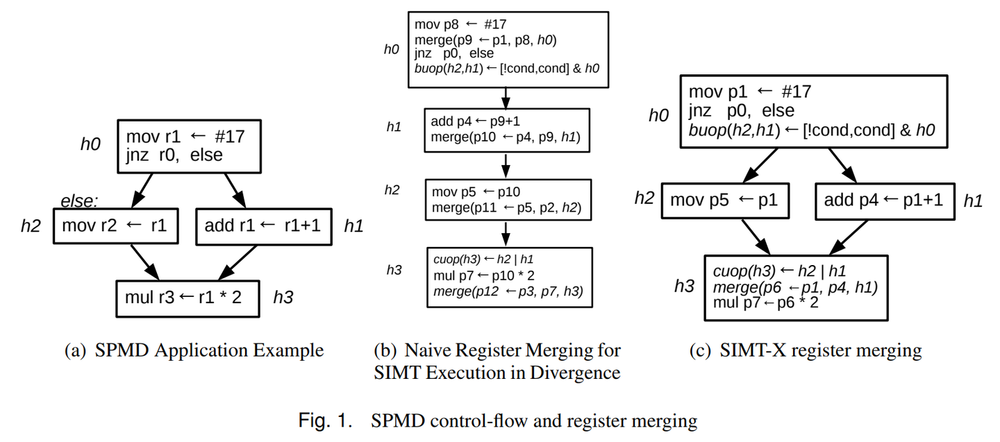
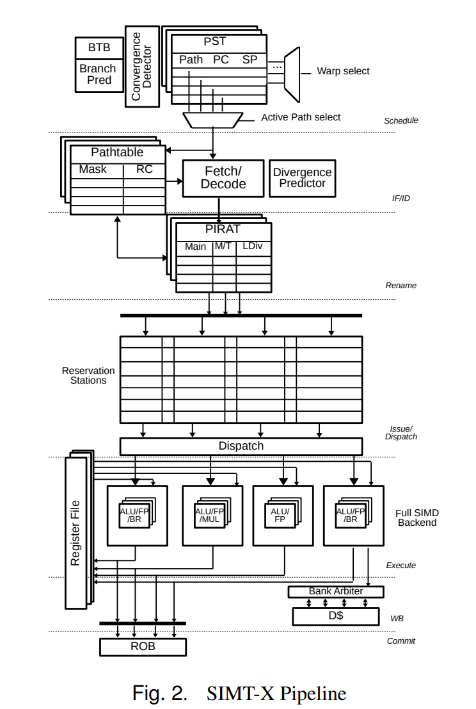
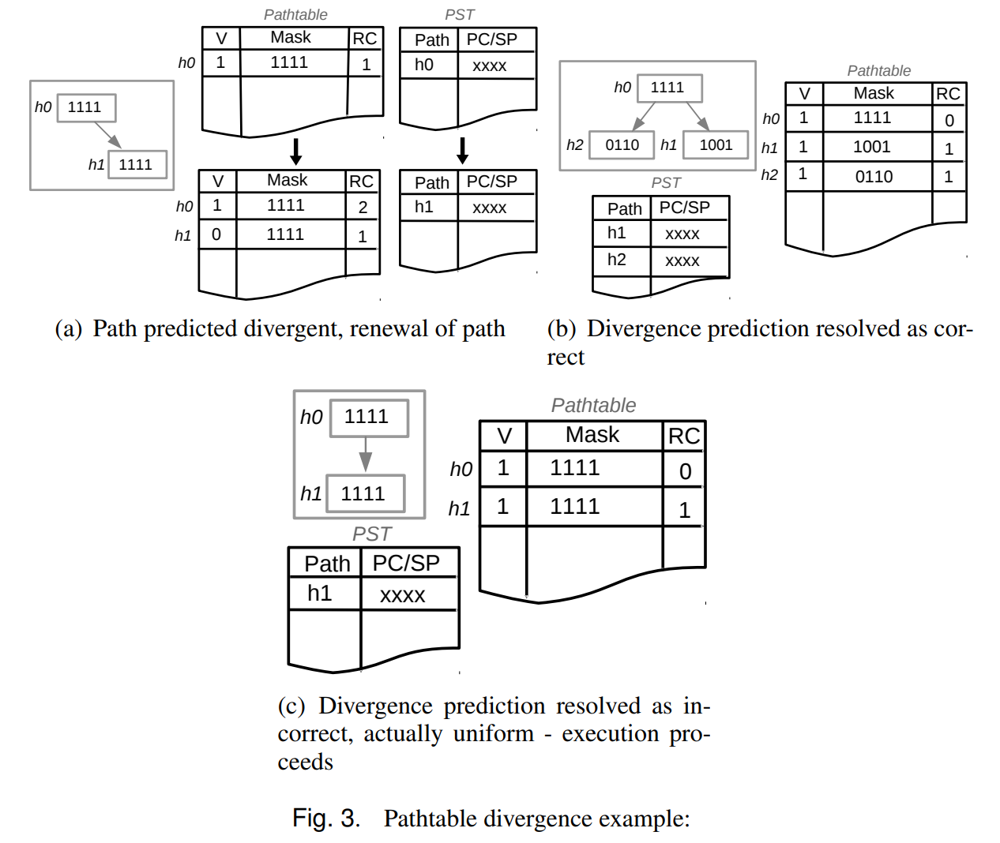
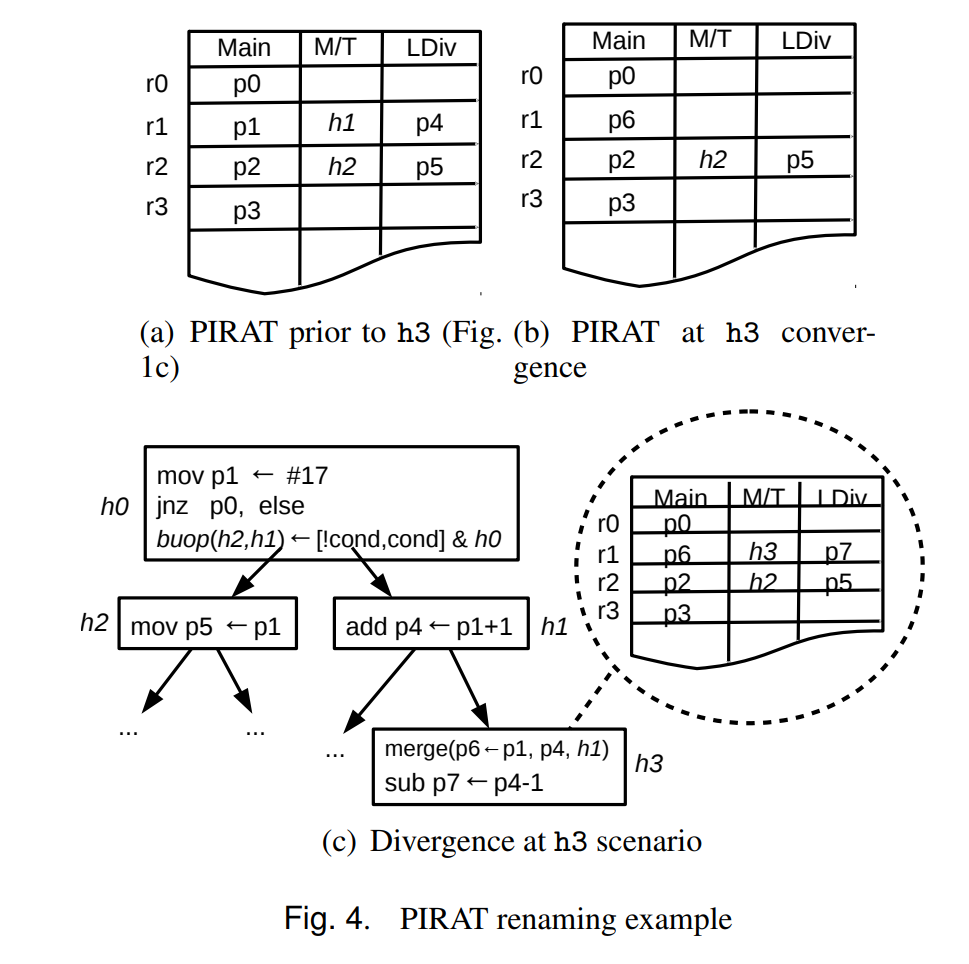

论文：https://inria.hal.science/hal-02542333

作者之一： Caroline Collange。这个作者挺有意思，论文发的不多，但是一直在研究，研究目标：
I aim at improving both the efficiency and the programmability of throughput-oriented processors through architecture changes and compiler techniques.

期待有一天，以GPU为首的加速器会被异构CPU取代。那时候不用开发复杂的驱动，不用学各种花式ISA 。

这篇论文介绍了 SIMT-X，一种新型的通用 CPU 微架构。它通过以下特性实现了高吞吐量和高效性能：

- GPU 式 SIMT 执行和乱序执行的混合: SIMT-X 能够像 GPU 一样，让同一程序的多个线程并行执行指令，大大提升吞吐量。同时，它还保留了乱序执行的优势，降低了指令执行的延迟。

- 高效利用现有资源: SIMT-X 巧妙地利用现有的 SIMD 执行单元，在一个核心上就能实现类似 CPU 和 GPU 的混合处理，并且开销很低。

- 兼顾 OoO 执行和可编程性: 虽然 SIMT-X 采用了有限形式的乱序执行，但它通过最多两个并发的寄存器映射就能捕捉到大部分激进 OoO 执行的优势。此外，它还能处理部分依赖关系问题，并支持通用指令集架构 (ISA)，让程序员更容易编写代码。

总而言之，SIMT-X 结合了 GPU 的并行性和 CPU 的可编程性，在单个核心上高效执行多线程任务，同时保持易于使用的特性。这是一种新颖的微架构设计，有望提升未来 CPU 的性能和效率。

### 简介

异构多核处理器是标准的计算架构设计。乱序 (OoO) 处理器是实现常见应用延迟敏感性能的首选计算模型，而图形处理器 (GPU) 则使用单指令多线程 (SIMT) 模型来提高并行计算性能。由这两种类型的内核组成的异构系统旨在平衡吞吐量和延迟导向的性能。然而，由于 CPU 和 GPU 拥有截然不同的架构和计算模型，这种协作计算仍然是一个挑战。因此，编写异构平台的软件在可编程性和效率方面都存在成本。例如，异构平台算法所产生的通信和同步开销抵消了异构系统的能效优势。同样，GPU 提供的串行性能也对整体系统性能产生影响。为了减轻异构问题，OoO CPU 集成了越来越强大的单指令多数据 (SIMD) 指令集，例如 Intel AVX-512 和 ARM SVE，用于并行应用程序的矢量化处理。然而，利用这些 SIMD 扩展需要编译器支持或手动矢量化，这会增加程序员的负担。

在本文中，我们通过引入一种微架构支持，在多线程 OoO 流水线中支持整个通用 ISA 的透明 SIMT 风格跨 CPU 线程矢量化，从而推动了延迟/带宽权衡的极限。它使得现有为通用处理器编译的多线程二进制文件能够动态矢量化，无需任何编译器干预。我们的 SIMT Express (SIMT-X) 微架构在一个核心上紧密耦合了延迟和吞吐量导向的计算，使用一种受限形式的 OoO 执行，充分捕获了激进推测执行的大部分优势。我们目前并未发现任何先前将 SIMT 和 OoO 执行结合在一起的工作。我们认为这是由于迄今为止阻碍 SIMT 架构中寄存器重命名和推测执行的两个挑战：

- 寄存器重命名： SIMT 架构通常缺乏动态寄存器重命名，这对于避免线程之间的数据依赖性至关重要。
- 推测执行： 在 SIMT 架构中实现推测执行具有挑战性，因为一个线程的错误预测可能会影响其他线程的执行。
SIMT-X 通过一种巧妙的设计克服了这些挑战，使 OoO 的延迟优势与 SIMT 的吞吐量优势结合起来，为通用多线程编程提供了一种新的高效手段。

### 背景

#### 再看紧耦合的并行加速器

异构多处理器系统被视为一种融合单线程和多线程效率的方法。然而，CPU 和 GPU 的架构和编程模型截然不同，在混合计算中带来了诸多挑战，包括编程模型和软件堆栈的低效性。例如，混合 CPU-GPU 算法会产生内存传输和同步开销。对于较小的批处理规模，GPU 单独实现已证明在混合并行/串行算法上提供更好的整体能效。同样，GPU 任务和数据通信的延迟已被证明是影响混合性能的重要因素。

将紧耦合的 SIMD 或向量扩展集成到超标量内核中的架构，有望解决这些粗粒度异构架构的缺陷。紧密耦合并行加速器的概念并不新鲜：乱序向量处理器最初在 20 世纪 90 年代后期提出，随后应用于 Tarantula 设计。然而，SIMD 和向量架构长期以来一直分裂为支持强大 SIMD/向量指令集和掩码执行的专用顺序架构（例如 GPU）和拥有短向量 SIMD 指令集且不提供掩码支持的通用乱序内核（例如 Intel AVX2）。最近出现的紧密耦合向量/SIMD 引擎，包括 Intel AVX-512、ARM SVE 和 RISC-V 向量扩展，终于在通用内核中实现了掩码执行。

通过与超标量内核紧密集成，向量单元受益于一系列微架构机制，包括动态调度、寄存器重命名、分支预测和内存消歧义。通过多重计算，向量指令的粗粒度抵消了乱序逻辑的开销。

#### 以线程为中心的并行

并行计算领域随着多核 CPU 和 GPU 的出现发生了翻天覆地的变化。1990 年代流行的向量式编程模型逐渐被如今的线程中心模型所取代。OpenMP 和 OpenACC 为基于指令的语言提供了流行的编程平台，CUDA 和 OpenCL 则专用于显式并行语言。这些编程模型都属于单程序多数据 (SPMD) 范畴，即使用多个线程运行同一程序处理不同数据，从而实现并行计算。

基于 SPMD 的并行程序非常适合于多核处理器、硬件多线程和/或向量执行。对于向量执行，细粒度的线程（或工作项）被静态分组为 warp。执行 SPMD 程序的运行时系统会在 SIMD 单元的单个通道上运行 warp 中的每个线程。不同线程的控制流差异则通过掩码执行来实现。根据具体实现，掩码可以由编译器或微架构进行管理。无论哪种方式，指令都会使用活动掩码寄存器进行显式或隐式谓词判定。

#### 向量掩码阻碍重命名

尽管向量掩码和 SIMD 执行非常适合顺序执行的核心，但乱序执行（OoO）架构却面临着挑战。

乱序执行处理器使用寄存器重命名来消除假依赖并提供灵活的指令调度。 这个重命名过程会为每个指令的目的寄存器分配一个新的物理寄存器，同时根据之前的物理到架构寄存器映射来重命名其源寄存器。

当考虑乱序执行模型的控制流执行时，屏蔽 SIMD 指令只会影响目的寄存器的一个子集，而屏蔽的通道保持不变。 在这种情况下，会存在同一个架构寄存器的多个定义：空闲的通道必须保留目的架构寄存器的旧内容，而活跃的通道现在有新内容，将存储到新分配的物理寄存器中。

OoO 屏蔽 SIMD 执行的这个挑战与在乱序执行带谓词的标量指令时出现的多定义问题有相似之处。 为了解决标量指令的多定义问题，屏蔽 SIMD 执行需要将活跃通道的结果与之前的寄存器值进行合并，而不是简单地选择源。实际上，为了在通道间保留单一寄存器定义，指令会将旧的物理目的寄存器作为输入，并使用指令产生的掩码向量将内容与新值进行合并。这使得指令在数据上既依赖于通过路径掩码的较旧分支，也依赖于对架构目的寄存器的先前写入。

在重命名阶段引入这种额外的人工数据依赖可能会影响性能。 例如，针对 Skylake 微架构的 Intel 软件优化参考手册警告说：“使用掩码可能会导致比相应的非掩码代码更低的性能。这可能是由于使用合并掩码时对目的地的依赖造成的。”

因此，对屏蔽指令进行标准的寄存器重命名会引入人为的写后写（WAW）依赖链，序列化寄存器访问并破坏寄存器重命名的目的。 采用这种系统性的谓词化方法会为 OoO SIMT 引入部分依赖问题，因此考虑到可能同时存在的多个 warp 分歧和活跃线程，这种方法是不切实际的。

### SIMT-X微架构

SIMT 微架构公开了一组硬件线程，这些线程被静态地划分为 warp，以便 warp 的大小与 SIMD 后端的向量宽度相匹配。 warp 中的每个线程在其指定的通道上执行，并保持多个 warp 处于飞行状态，以隐藏延迟。从流水线后端的角度来看，每个 SIMT warp 本质上等价于运行 SIMD 指令的 SMT 线程。 然而，warp 中的线程可能遍历不同的执行路径。因此，给OoO SIMT 架构（如 SIMT-X）的概念带来了两个主要挑战：

- 以最小的序列化处理部分寄存器依赖关系。
- 考虑类似 warp 的推测执行，管理多条分歧和融合的控制流路径。
SIMT-X 微架构为寄存器重命名和路径跟踪都提供了解决方案，以实现 OoO SIMT 的适用性。

为了解决部分依赖问题，SIMT-X 为类似 SIMD 的指令分配全向量寄存器，但仅在必要时才进行寄存器合并。 SIMT-X 合并背后的关键思想是使用微架构动态生成的微指令将相关的控制流转换为数据流。

为了管理 warp 内的线程分歧和重新融合，SIMT-X 引入了使用两个简单硬件结构的活动路径跟踪概念：

- 避免依赖掩码。
- 消除指令中的掩码元数据。
- 在分歧和/或误猜测期间轻松地使非活动执行路径无效。

#### 从SMPD控制流到SIMD控制流

Image

图1(a)提供了一个典型的SPMD应用中的if-then-else条件结构。路径对应于在相同掩码下执行的一系列指令，每个路径都分配了一个向量掩码寄存器。该示例具有四个路径掩码寄存器，命名为h0到h3。如图所示，寄存器r1在代码开头被设置，并且在分歧期间只被一侧的分支（路径h1）覆盖。当warp路径h1和h2在h3重新汇合时，寄存器r1必须合并以保持单一寄存器定义。warp中不同的线程可能会覆盖路径h1和h2。

SIMT-X的动态微架构使用两个微操作（µops）来管理路径：分支µops（buops）用于创建分歧路径，收敛µops（cuop）用于重新汇合路径，在第3.5节将进一步详细说明。这些µops由微架构动态注入到流水线中，以在执行时计算实际路径掩码，并在退役时执行状态簿记。这利用了乱序引擎根据实际数据和控制依赖性调度这些µops的能力。假设在示例中，最初将体系结构寄存器r0到r3映射到它们各自的物理寄存器p0到p3。

图1(b)显示的简单情况演示了µops如何用于管理路径，以及在每次寄存器写入后如何天真地合并寄存器以维持单一寄存器定义属性。这种天真的方法根据写入-读取依赖性使指令序列化，因为一次只有一个物理定义可以表示一个体系结构寄存器，因此将h1和h2序列化。这种序列化破坏了寄存器重命名的目的和OoO SIMT所寻求的数据流执行。（读者解释：图1B就是简单的把分支代码平铺成一段代码， 所有的分支都会执行，但在merge时只会合并有效结果到目标寄存器。也就是说每个线程会执行所有分支代码，但是只有一个分支的代码是有意义的，比较浪费处理器性能。）

图1(c)展示了SIMT-X微架构所采用的寄存器重命名方法。在这个例子中，寄存器r1在“if”分支（h1）上被映射到p4，在“else”分支（h2）上被映射到p1。因此，多个物理寄存器定义可以与单个体系结构寄存器同时关联。实施多个寄存器关联的技术允许独立处理控制流，同时促进OoO SIMT执行的数据流。如图所示，在路径重新汇合时读取寄存器r1，因此只需要在路径h3处将p1和p4合并以维持单一向量寄存器定义p6，基于路径掩码h1。因此，SIMT-X的目标是仅在必要时推迟寄存器合并，以减少合并次数，其中多个物理定义可以同时分配给每个体系结构寄存器。

### SIMT-X实现

Image

图 2 展示了用于乱序 SIMT 执行的 SIMT-X 微架构。 SIMT-X 中的流水线阶段与传统的乱序同步多线程 (SMT) 处理器类似，包括：调度、指令抓取和解码、重命名、发布/分派、执行、写回和提交。

从图中可以看出，前端部分由以下组件构成：

- 用于调度 warp 路径的路径调度表 (PST)。
- 用于促进路径重新融合的融合检测器。
- 用于跟踪路径分歧和重新融合时路径掩码的路径表。
- 用于预测 warp 分歧的预测器。
- 用于协调 SIMT-X 重命名的路径识别寄存器别名表 (PIRAT)。
SIMT-X 能够执行由编译器生成的静态矢量化 SIMD 指令，以及由微架构从标量线程中动态形成的指令。 为了满足同步 warp 执行，PIRAT、路径表和 PST 在 warp 之间进行划分，每个 warp 可以监控其各自的路径，每个流水线阶段都对矢量指令（即指令实例的矢量）进行操作。标量功能单元也被复制，以便 SIMT-X 的后端可以利用标量化功能单元和通用 SIMD 单元来执行隐式矢量化指令。

物理寄存器文件由所有 warp 共享，并包含 warp 大小的矢量寄存器。 每个子文件对应于给定 warp 中一个标量线程的寄存器上下文。微操作由 SIMT-X 动态生成，以管理控制流依赖关系。

以下部分将提供有关列出的微架构特性的详细信息。

### 路径跟踪

传统的乱序处理器为每个线程维护一个推测指令流和一个已提交指令流。 这种核心依赖于顺序的程序排序来从错误推测中恢复并保持一致的架构状态。
考虑到 SIMT 模型，warp 中的线程可能会融合和分歧，为给定应用程序创建和遍历不同的执行路径（流）。 正如某些 GPU 的情况一样，对于所有分歧的路径强加任意的串行排序会使推测变得困难，并在考虑通用乱序核心的情况下使恢复成本高昂。相比之下，SIMT-X 微架构集成了动态机制，可以独立跟踪所有并发执行路径的推测状态和已提交状态，同时支持传统的软件堆栈。

尽管 warp 中的线程预计具有相似的控制流，但它们在运行时仍可能遵循不同的执行路径。 为了跟踪分歧的路径，SIMT-X 集成了一个路径表，该路径表维护每个 warp 的所有活跃路径及其推测或已提交状态。

在微架构中通过分歧或重新融合创建每个路径时，都会为其分配一个路径表索引或路径 ID。 此后，路径 ID 在整个流水线中用于通过索引路径表来推断路径的状态。该表允许路径推测执行其指令，并在执行时解析实际的掩码。路径表允许 SIMT-X 轻松地使 warp 线程失效和/或更新，而无需在整个流水线中缓冲掩码元数据。

### 路径调度

SIMT-X 使用路径调度表 (PST) 在前端调度活跃路径。 由于路径表跟踪路径掩码，PST 只需维护路径 PC 和调度所需的类似信息，例如调用-返回深度和屏障。PST 中的每个条目都可以使用其各自的路径 ID 直接推断其路径的状态。

SIMT-X 调度器使用的抓取引导策略基于 MinSP-PC 的修订启发式算法。 MinSP-PC 是一种简单的抓取策略，用于在 warp 的线程之间获得高效的同步执行。具有最深调用堆栈的路径具有最高优先级。如果两条路径具有相同的最小堆栈指针，则使用最小 PC 标准。因此，MinSP 监控调用深度以促进重新融合，而 MinPC 允许细粒度的同步。

考虑到通用并行应用程序，MinSP-PC 可能会导致活锁。 因此，Kalathingal 等人提出了一种混合轮询 (RR) 方法，以保证每 (m+1)×n 个周期定期激活的前进，其中 m 是线程/warp 的数量，总共有 n 个 warp。

SIMT-X 采用这种 RR/MinSP-PC 策略，应用传统的 RR 算法来交错和调度单个 warp。 然而，原始的 RR/MinSP-PC 策略被 warp 的路径使用以保证前进和同步执行。

### 控制流微码

SIMT-X 生成的微操作 (µops) 通过操作路径表维护的掩码来管理乱序 SIMT 依赖关系。 µops 不需要对现有 ISA 进行更改或扩展，并保持二进制、编译器和软件兼容性。相反，SIMT-X µops 是在流水线的解码和重命名阶段动态生成的。动态生成利用了大多数分支不会分歧的事实，仅在必要时计算谓词掩码并合并向量寄存器，从而节省执行资源。

SIMT-X 采用三种类型的 µops：

融合 µops (cuops) 和分支 µops (buops)，分别在融合和分歧后计算每个路径掩码。
合并 µops（merge），动态执行寄存器合并以保留单个寄存器定义。
图 1(c) 提供了一个示例：

一个 buop，它根据 h0 和分支条件 (cond) 计算路径 h2 和 h1。
一个 cuop，它根据 h2 和 h1 计算路径 h3。
一个合并 uop，根据掩码 h1 将寄存器定义 p1 和 p4 合并到 p6 中。

**分支分歧微操作 (buop)**  为了准备可能出现的分歧路径，预测会分歧的分支将转换为 buop。必须为分歧路径创建一个新路径，并获得一个新的路径 ID，并在路径表中分配其相应的条目。buop 有两个源操作数：

- 前一个路径 ID (hi) 和指令的分支条件 c，用于计算路径的新掩码 (hj)。
- 前一个路径操作数用于保证前一个路径在执行之前是有效的，其中 c 用于计算新的路径掩码。
- buop 计算路径掩码和 c 的按位 AND，使得 hj ← hi ∧ c，其中备用路径（一旦解析为分歧）可以计算为 hk ← hi ∧¬c。
**融合微操作 (cuop)**  SIMT-X 在调度阶段在前端进行融合检查。如果检测到两个路径之间的融合，则会获得一个新的路径 ID，并在路径表中为新的重新融合路径分配条目。此时，还会将融合微操作 (cuop) 注入流水线，将两个路径 ID 作为其源操作数 (hi, hj)，并将新路径 ID (hk) 作为其目标操作数。cuop 保证路径 hi 和 hj 在 hk 验证之前是有效的。在执行时，cuop 使用按位 OR 操作合并路径掩码，使得 hk ← hi ∨ hj。

**合并微操作（merge）**  鉴于许多活跃路径可能同时穿越流水线，并有多个正在进行中的体系结构寄存器定义，它们的物理寄存器映射必须（根据需要）合并，以动态维护给定消费者路径的单定义属性。合并 µops 允许 SIMT-X 仅在必要时动态管理和推迟合并。合并 uop 有三个源操作数：要合并的两个寄存器地址 (Ri 和 Rj) 和相应的路径 ID (hi)。合并 uop 包含一个目标操作数 Rk，代表源寄存器将在所有操作数有效后移动其内容的目标寄存器。因此，合并 uop 计算为 Rk ← (¬hi ∧ Ri) ∨ (hi ∧ Rj)。

### 融合检测

如前所述，SIMT-X 采用了 Kalathingal 等人实现的 RR/MinSP-PC 策略来进行路径重新融合检测，但使用 PST 硬件以适用于乱序 SIMT 架构。 指令 PC 是在前端根据分支历史和给定路径中的第一个活动标量线程进行推测的。这些 PC 与 PST 中的其他路径 PC 进行比较，如果匹配，则表示两个路径可以合并，并将 cuop 注入流水线，详见第 3.5.2 节。

对于重新融合的两个路径，会获得一个新的路径 ID，并相应地更新 PST 和路径表。 由于在 hi 和 hj 融合之前 PST 中存在两个活跃路径，因此一个 PST 条目被新的活跃融合路径 hk 覆盖，而备用路径被逐出。

### 分歧和分支预测

Image

当遇到分支指令时，会发生分歧，这意味着有可能会改变 warp 内的线程路径。 SIMT-X 分歧和分支预测的关键思想是，引导前端不需要知道所有线程的分支条件向量。相反，它只需要对整个 warp 进行单一预测，以估计以下三种情况中哪种更有可能：（1）warp 的所有线程都将采用分支，（2）没有线程会采用分支，或者（3）分支会分歧。

**路径表和分歧**  图 3 说明了 SIMT-X 在分歧预测期间的路径表和 PST 功能，对应于图 1(a) 中提供的示例。在此示例中，路径 h0 是非推测性的（即路径表中的 v = 1）并且完全融合。在图 3(a) 的情况下，在该路径上遇到一个分支并预测分歧，其中推测路径 ID h1 在路径表中分配。由于此时尚不清楚在分歧时遵循路径 h1 的确切线程集，因此 h1 的推测掩码是保守地从 h0 复制的。为了将前端引导到新的活动路径，PST 中的 h0 条目被新路径 ID h1 覆盖，其中 h1 可被所有后续 warp 指令用于引用其路径状态。此时也会将一个分支微操作 (buop) 注入流水线，其中 h0 的引用计数器会随着 buop 引用了路径而递增。

如果分支在执行后被解析为分歧（图 3(b)），则会为备用路径创建一个新的路径表条目 h2，同时更新 h1 和 h2 的掩码以反映线程的结果。 还为 h2 分配了一个新的 PST 条目，以便可以在前端进行调度。一旦 buop 提交，两个 ID 都被标记为有效，表示非推测路径。然后路径 h0 被路径完全取消引用，并且可以安全地逐出，因为后续指令依赖于新路径。

因此，在分歧预测期间更新 warp 的路径允许轻松创建备用路径，而无需调整其他路径。

如果假设分支预测正确，则会误预测分歧，如图 3(c) 所示，会创建一个无用的路径表条目。 在这种情况下，会更新分歧预测器的误预测，其中路径 h1 仍然有效，并且一旦 uop 提交，h0 就会被取消引用。因此，这种路径更新技术避免了在误预测时刷新流水线的需要，可以继续执行。

如果在给定的路径表中存在多个分歧和推测路径，则会维护一个空闲指针和提交指针来跟踪较年轻的路径条目。 因此，当分歧路径被解析并计算出掩码时，保守地从给定路径复制其掩码的较年轻条目也可能使其非活动线程通道无效。

**处理误预测和异常** 根据 SIMT-X 的实现，预测路径分歧比一致更安全。 也就是说，如果预测分支会分歧，则会在路径表中更新路径以准备新路径。在最坏的情况下，会为错误地预测为分歧的一致路径创建一个无用的条目。另一方面，我们发现平均只有 1.4% 的分支出现分歧（第 4 节中描述的协议），因此将所有分支视为分歧会导致过多的簿记操作。

为了适应这些特性，SIMT-X 集成了一个偏向于分歧的全局双模态分歧预测器，即除非预测器表明分支是强一致的，否则总是预测分歧。？？？？？

其他分支/分歧预测结果总结如下：

- 预测分歧，实际一致： 在这种情况下，在分歧预测期间创建的路径掩码在路径表中无效，并从 PST 中删除。前端使用更新的掩码创建并从新的正确路径获取。之前在错误路径上获取的指令最终会以空掩码提交，但不会影响 SIMT-X 的体系结构状态。

- 预测非分歧且正确，分支方向正确： 执行正常进行。

- 预测非分歧且正确，但分支方向错误，或预测非分歧且错误： 如同传统的乱序分支误预测的情况，SIMT-X 必须回滚到错误分支之前的检查点状态并刷新流水线。

因此，只有完全分歧误预测或一致分支误预测才需要 SIMT-X 回滚到给定 warp 在错误分支之前的检查点状态。为了在回滚时考虑给定 warp 的误预测和异常，PIRAT 和 PST 拥有退休副本。然而，路径表不需要退休副本，因为它可以在清空流水线时简单地使路径掩码无效并将其置为空。

### 寄存器重命名

Image

在流水线中监控 warp 状态和路径对于确保乱序 SIMT 中的单个寄存器定义非常重要。 SIMT-X 使用路径识别寄存器别名表（PIRAT）来管理多个物理寄存器映射，并将每个映射与其体系结构定义相关联。PIRAT 类似于传统的寄存器别名表（RAT），但该结构允许考虑合并的 SPMD 线程的各种控制路径，多个寄存器定义可以同时存在。

与之前关于多重重命名的工作不同，我们选择每个体系结构寄存器最多允许两个物理寄存器。 虽然这两个物理寄存器分配可能会限制乱序执行，但它大大简化了乱序 SIMT 重命名，并限制了 uop 中的操作数数量。正如第 4 节的实验结果所证明的，PIRAT 在没有成本合并的情况下实现了 3.86% 的理论乱序 SIMT 模型的性能。我们的实验还表明，将 PIRAT 限制为两个条目可以显着减少合并 uop 的数量，并比简单的（RAT）方法产生更高的 IPC。

由于大多数读后写依赖发生在指令之间没有分歧/重新融合点的短距离内，因此 PIRAT 在质量和数量上都针对乱序 SIMT 执行进行了优化。 每个 PIRAT 条目使用的两个物理寄存器称为 Main 和 Leading Divergent（LDiv），如图 4 所示。为了记录给定体系结构寄存器的单个线程映射，LDiv 映射要么与一个掩码（一旦生产者指令退休并且实际掩码已知）或引用给定路径表条目的路径 ID（当生产者仍在流水线中带有推测掩码时）相关联。寄存器的掩码反映在条：目的掩码/标记（M/T）字段映射中。掩码中的活动位表示给定线程的 LDiv 寄存器的最新物理映射，而补充线程由 Main 寄存器表示。

让以下术语表示 PIRAT 条目：（Pmain，Path，Pld）其中 Pmain 是 Main 寄存器映射，Path 是 LDiv 寄存器的路径 ID（h）或掩码（m），Pld 是 LDiv 寄存器映射。 如第 3.5 节所述，SIMT-X 中路径的推测掩码 Wmask 被构造为等于或超集实际掩码。由于路径之间的收敛是在前端早期检测到的，因此只有分歧会在指令获取阶段之后影响执行掩码。因此，路径掩码可能只会变得不那么密集，即 Wmask ⊇ ActualMask。此属性在源重命名的情况下很有用：只要物理向量寄存器的有效通道覆盖指令掩码的超集，就可以将其用作源操作数。对于目标重命名，必须保持更强的等式属性，使得 Wmask = ActualMask。

**PIRAT重命名规则**  为了简化乱序 SIMT 重命名，PIRAT 的主要目标是用给定的物理寄存器定义来控制消费者指令的路径，以便 warp 中的所有线程可以使用由 Main 或 LDiv 寄存器定义表示的重命名映射。 此条件保证消费者指令访问每个源操作数的单个物理寄存器。相反，生产者指令可以写入单个物理寄存器定义，而不依赖于之前的体系结构寄存器映射。因此，如果 warp 中的活动线程不直接属于一个寄存器定义，微体系结构会通过寄存器合并执行动态簿记以维护单定义属性。假设所有体系结构寄存器在启动时最初都映射到它们对应的物理（Main）寄存器。以下小节指定了 SIMT-X 用于重命名的一组规则。

读取和重命名源操作数： 当给定的体系结构寄存器的 PIRAT 条目仅由 Main 寄存器映射组成时，则 warp 中的所有线程共享相同的物理到体系结构寄存器映射。 在这种情况下，Main 字段中指定的物理寄存器用于读取给定 warp 的源操作数。

如果体系结构源寄存器的 PIRAT 条目同时包含 Main 和 LDiv 寄存器映射，则微体系结构必须检查哪个（些）条目拥有活动路径线程的有效物理映射。 必须将 PIRAT 的最后知道的掩码（Register Mask，Rmask）（以 M/T 字段中的路径 ID 或掩码表示）与当前路径的推测掩码（Wmask）进行比较：

- 如果 Wmask ⊆ Rmask，则 LDiv 寄存器条目用于源的重命名。
- 如果 Wmask ⊇ Rmask，则 Main 寄存器条目用于源的重命名。
- 否则，源操作数映射到 Main 和 LDiv 物理寄存器。 必须获取一个新的物理寄存器 Pφ，并在合并 uop 中用作目标。uop 被注入流水线，以便两个寄存器定义可以合并到 Pφ，其中指令的源操作数也使用 Pφ 重命名。
当合并 uop 被注入流水线时，除了第 3.5.3 节讨论的路径之外，还将 Main、LDiv 和新分配的“合并”寄存器映射作为操作数。 让合并的寄存器表示为 Pφ，其中合并 (φ) uop 表示为 Pφ ← φ(Pmain, m, Pld)（对于给定的（立即）掩码），或 Pφ ← φ (Pmain, h, Pld)（在路径 ID 的情况下）。然后将 Pφ 映射到 Main 寄存器，其中在 PIRAT 中更新 Pathtable 中的 LDiv 条目和路径/掩码，使得 φ(Pmain, h/m, Pld) → (Pφ, -, -)。

重命名目标操作数： 如果在目标重命名期间，给定的体系结构目标寄存器的 PIRAT 条目仅由有效的 Main 寄存器组成，则可以从空闲列表 Pdest 中获取一个空闲的物理寄存器来重命名指令并更新 PIRAT 的 LDiv 定义，使得 (Pmain, -, -) → (Pmain, h/m, Pdest)。

如果给定体系结构目标寄存器的 PIRAT 条目同时包含 Main 和 LDiv 寄存器，则必须查询 M/T 位以确定 warp 当前是遍历推测路径还是已提交路径。 如果重命名寄存器的 PIRAT 条目由 Pmain、Pld 和一个掩码组成，即 (Pmain, m, Pld)，那么：

- 如果不存在待处理的分歧，且 Wmask ⊇ m：
可以使用空闲物理寄存器 Pdest 安全地覆盖 LDiv 寄存器 Pld，使得 (Pmain, m, Pld) → (Pmain, h, Pdest)

- 如果不存在待处理的分歧，且 Wmask ⊆ m：
Main 的内容替换为 Pld，其中 LDiv 更新为 Pdest 以反映新的路径，使得 (Pmain, m, Pld) → (Pld, h, Pdest)

- 否则，结果的回写可能与 Pmain 和 Pld 重叠，或者存在待处理的分歧。在这种情况下：

必须合并寄存器 Pmain 和 Pld。从空闲列表中获取两个空闲寄存器 Pdest 和 P0 dest，并将合并 uop 注入流水线，使得 Pdest ← φ(Pmain, m, Pld)，其中 m(h) ⊇ m
- 目标使用 P0 dest 重命名，其中 PIRAT 更新为 (Pmain, m, Pld) → (Pdest, h, P0 dest)。后续的消费者指令重命名为 P0 dest。

如果给定体系结构目标寄存器的 PIRAT 条目由 Main 和 LDiv 寄存器映射以及路径 ID h 组成，使得 (Pmain, h, Pld)，则必须使用路径 ID h 从 Pathtable 获取掩码，然后应用与掩码情况相同的规则。

PIRAT 重命名的示例在图 4(a) 和 4(b) 中给出，参考图 1(a) 和 1(c) 中提供的 SPMD 应用程序示例。 在这个例子中，路径 h1 用 p4 重命名 r1，PIRAT 通过用路径 ID h1 更新 M/T 字段，用寄存器 p4 更新 LDiv 字段来反映这一点。在这种情况下，与体系结构寄存器 r1 关联的两个物理映射如图 4(a) 所示。每个路径可以同时使用它们各自的 r1 寄存器定义。类似地，路径 h2 将体系结构寄存器 r2 重命名为 p5，并在 PIRAT 的 LDiv 条目中更新以反映新的物理映射。h1 和 h2 重新汇合后，h3 随后需要 r1。由于 h3 对 r1 的定义映射到 Main 和 LDiv 定义，因此必须使用合并 uop 和新的寄存器定义 p6 合并寄存器，并在 Main 字段中更新，如图 4(b) 所示。

图 4(c) 说明了图 1(c) 的示例，但考虑了路径 h2 之后的另一个分歧；因此，h2 处的 PIRAT 与图 4(a) 中的相同。 在 h3 处发生分歧的情况下，该路径继承了 h1 的掩码，其中 h3 包含指令 sub r1 ← r1-1。在重命名期间，PIRAT 将 r1 的源映射反映为 p4，使得 h3 ⊇ h1。由于在重命名目标寄存器时存在待处理的分歧，因此从空闲列表中获取两个新寄存器（p6 和 p7），将 p1 和 p4 合并到 p6，使得 p6 ← φ (p1, h1, p4)，用 p7 重命名目的地 r1，用于 sub p7 ← p4-1，得到图 4(c) 的 PIRAT。

**预测重命名时的分歧** 为了跟踪推测分歧（称为待处理分歧），SIMT-X 采用了全局分歧计数器。当在前端预测到分歧时，计数器会增加，并将 buop 注入流水线。同样，当 buop 被提交时，计数器会递减。如果计数器没有保持零状态，则可以假定流水线中存在待处理的分歧。考虑到分歧预测错误，可以转换给定分支（转换为 buop 或转换回分支），并更新分歧计数器以反映正确的结果，然后在流水线中继续进行，直到提交。PIRAT 使用该计数器在推测执行期间维护其重命名属性，如第 3.8.1 节所述。

**流水线和物理实现** PIRAT 用于重命名的物理实现类似于传统的流水线 RAT 实现，但它还必须根据需要对目标写入和源读取执行自动合并。
类似于传统的重命名流水线 [Safi et al. 2011]，一旦操作数被解码，WAW 和 RAW 冲突会与源读取同时检测到。
在下一个周期，PIRAT 可以根据任何存在的 RAW 更新写入和读取，并处理合并 uop 生成。
然而，如果为给定的体系结构条目生成了多个合并，PIRAT 必须暂停，即如果：
给定重命名块的给定体系结构寄存器需要多个源和/或目标合并，或者
WAW 需要为给定体系结构寄存器进行合并和/或 LDiv 写入。
在这种情况下，PIRAT 必须序列化其合并以保证体系结构寄存器的正确重命名，这是一个有意限制，以保持低重命名复杂度。
尽管如此，第 4 节中介绍的结果表明，这些情况很少发生，并且不会影响性能，因为重命名暂停通过流水线缓冲得到了充分隐藏。

**PIRAT 寄存器释放**  类似于传统的 OoO 模型，SIMT-X 维护一个 Commit PIRAT 来释放物理寄存器。在经典的重命名模型中，物理寄存器不能被释放，直到后续指令在提交时覆盖给定的体系结构寄存器条目。SIMT-X 遵循类似的规则，但考虑了 PIRAT 的结构和重命名过程。
只有掩码被放置在 Commit PIRAT 中，因为指令是非推测性的，并且退休的合并 uop 会根据需要释放寄存器定义。
类似于前端的重命名过程，当获得物理寄存器 Pdest 的指令提交时，如果给定体系结构寄存器的 Commit PIRAT 仅由 Main 寄存器 Pmain 组成，则 Pdest 可以放置在 LDiv 字段中，使得 (Pmain, -, -) → (Pmain,m, Pdest)。
如果 Main 和 LDiv 字段都拥有寄存器映射，后续指令将：
根据非推测指令和寄存器掩码释放 Main 或 LDiv 的物理寄存器，或者
在合并 uop 的情况下释放两个寄存器，使得 (Pmain, m, Pld)→ (Pdest,-, -)。

### 支持向量 SIMD 和线程 SIMD 向量化指令执行

SIMT-X 能够执行由编译器生成的静态矢量化 SIMD 指令以及由微体系结构隐式形成的矢量指令。跨线程矢量化的指令可以在可用时在矢量化 ALU 功能单元和/或 FP/SIMD 单元上执行。 为了支持在 SIMD 单元上进行静态矢量指令和线程扭曲执行，SIMT-X 的寄存器文件使用 DITVA 架构使用的自由银行方法进行存储。使用自由银行方法，哈希函数（XOR）用于建立跨通道的切片分布，为每个线程提供唯一的顺序。也就是说，对于给定的线程 i，通道 j 将负责执行线程 i XOR j。使用这种方法，扭曲的给定线程将被分配到同一存储区，并且不依赖于寄存器索引。

对于 SIMT-X 跨线程矢量化的标量指令，所有通道都可以并发发出，每个通道从矢量寄存器文件的一个实例读取并写回另一个实例。 128 位 SSE 指令经过哈希处理，因此通道 0 和 2 或 1 和 3 可以在同一周期内执行。因此，根据由两个或更少线程组成的扭曲掩码，SSE 指令可以在单个时钟周期内执行（即，掩码为 0101 或 1010 的扭曲），而由两个或多个活动线程/扭曲组成的扭曲可能需要最多两个时钟周期来执行一组 SSE 指令。

完整的 256 位 AVX 指令在 SIMT-X 中被串行化，一次一个线程，类似于传统的 SMT 处理器。 在这种情况下，由 m 个线程组成的矢量指令被串行化以在流水线功能单元上最多发出 m 个连续周期，其中不活动的线程使用时间压缩跳过。

### 数据内存访问

基于加载和存储的指令需要并发访问缓存行，其中 k 个线程/warp 可能同时请求最多 k 个不同的缓存行和/或虚拟页。 实现完全多端口数据缓存和/或 TLB 来支持这些并发访问是不可行的。出于这个原因，SIMT-X 采用了存储区数据缓存。SIMT-X 中的存储区划分在缓存行粒度上进行，其中加载支持对不同存储区的并发访问。考虑到虚拟索引的 L1 缓存，从集合号的哈希中选择存储区以减少存储区冲突。如 [Kalathingal et al. 2017] 所示，该技术充分减少了页面边界上线程堆栈底部的数据访问对齐冲突。

与传统的 SMT OoO 内核类似，SIMT-X 使用加载存储队列 (LSQ) 来管理缓存未命中。 所有标量线程监视加载存储队列以观察总存储顺序一致性。在常规内存操作中访问相同元素的 warp 线程只会发出单个缓存请求，以有效减少所需的加载和存储次数。经历跨越多个周期的原子内存操作冲突的线程必须在流水线中停止并缓冲，直到解决。

如 [Kalathingal et al. 2017] 所示，具有四个通道的 64 条目拆分 TLB 提供了与使用类似 SIMT 模型的 256 条目统一多端口 TLB 相同的性能。 具有 k 个线程/warp 的 SIMT-X 遵循这种方法，将 SMT TLB 替换为 k 个较小的独立单端口数据 TLB。

> 本文使用 [Zhihu On VSCode](https://zhuanlan.zhihu.com/p/106057556) 创作并发布
