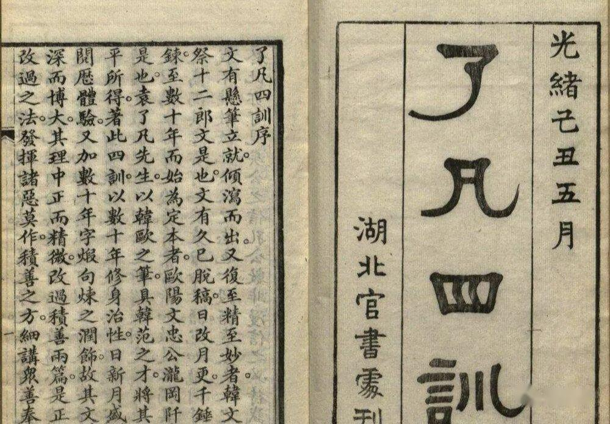

《了凡四训》是古代著名劝善书，作者是明朝著名官员、思想家袁黄。全文通过立命之学、改过之法、积善之方、谦德之效分四个部分来讲解如何改变命运。

作者以亲身经历，讲述了改变命运的过程。原本为教训自己的儿子，故取名《训子文》；其后为启迪世人，遂改今名。

**​第一篇：立命之学**

我童年时父亲就去世了，母亲要我放弃学业，改行学医术，她说行医可以谋生，也可以治病救人。并且精通一门技艺而后扬名天下，正是你父亲的愿望。

后来我在慈云寺碰到一位修髯伟貌、飘飘若仙的老人家，就恭敬地向他行礼。老人家对我说：“你是官场中人，明年就可考中秀才，你为什么不读书呢？”我就把母亲叫我放弃读书而去学习医术的缘故告诉他，又请问老人家的姓名籍贯等事。老人家说：“我姓孔，是云南人，学得宋朝邵康节先生《皇极经世》的真传。因为缘分，我应该把《皇极经世》传给你。”我就带老人家到家里。母亲要我好好侍侯他。

孔先生推算的事情很详尽，连细节问题也应验无误。因此我相信孔先生的推算，动了读书的念头，就和表哥沈称商量。表哥说：“我的好朋友郁海谷先生在沈友夫家里开馆授徒，送你过去寄读很方便。”于是我便拜郁海谷先生为师。

孔先生推算我县考时考第十四名，府考时考第七十一名，提学考时考第九名。第二年，我参加考试，三次考试所得名次和孔先生推算的完全相符。

孔先生又替我推算终生的命数：某年考取第几名，某年补廪生，某年做贡生，又在贡后某年，被选为四川某县县令，做县令三年半后，最好辞官回乡，五十三岁那年八月十四日丑时，就寿终正寝，可惜命中没有儿子。这些话我都作了记录，并牢记在心。

从此以后，凡是参加考试，所考名次先后，都不出孔先生所算。唯独算我做廪生领到九十一石五斗米时才能出贡这件事起了波折，当我领到七十一石米时，学台屠宗师就批准我补贡，我当时就怀疑孔先生的推算不灵了。

谁知后来学台代理杨宗师驳回屠宗师的批准，不准我补贡生。直到丁卯年，殷秋溟宗师查看考场的“备选试卷”时，看到我的试卷，动情地说：“这份卷子所做的五篇策论，竟有奏议的水准。怎么可以让这么有学问的读书人埋没到老呢？”于是他就吩咐县官写申请公文，准我补了贡生。我这段时间领的廪米，加上以前那部分，刚好是九十一石五斗。

经过这番波折，我更加相信命数的存在，即使屠宗师提前让我补贡，因为不符合命数，必然要被杨公驳回，当符合命数要求时，自然有殷宗师帮我补贡。所以，我把一切事情都看淡了，变得无所追求。

补贡以后，我到北京国子监读书一年。这一年里，我整天都在静坐，也不看书写字。到了己巳年，回南京国子监，还没报到时，我先到栖霞山拜见云谷禅师。我同禅师在禅房里对坐，三天三夜没有闭过眼睛。

云谷禅师问我：“普通人不能成为伟人，只是因为妄念一个接着一个，束缚了自己的行动。而你静坐三天，我没见过你起一个妄念，这是什么缘故呢？”

我说：“我的命运早被孔先生算定了，一生中生死荣辱都有定数，没有办法改变。想也是白想，真要想也不知该想些什么。”

云谷禅师笑着说：“我还以为你是个豪杰，谁知也不过是个凡夫俗子。”

我问他为什么这么说。云谷禅师说：“普通人未能进入‘无心’境界，一定要被命数控制，怎能说没有命数呢？但是只有普通人，才会被命数所束缚，大善人或者大恶人，命数是控制不住他的。二十年来你被孔先生算死，不能改变一分一毫。你不是凡夫，是什么？”

我问云谷禅师：“人真能摆脱命运的束缚吗？”

禅师说：“命由我造，福自己求。诗书中说的，的确是至理名言。佛家经典也说，诚心追求富贵可得到富贵，诚心追求儿女可得到儿女，诚心追求长寿可得到长寿。说谎是佛家大戒，佛菩萨可能说假话吗？”

我还是不明白，又问：“孟子曾说，‘求则得之，是求在我者也’，我内心的道德仁义可以通过自己的努力修来，功名富贵等身外之物，怎么求得到呢？”

云谷禅师说：“孟子的话没错，是你理解错了。你看六祖慧能大师也说，‘一切福田，不离方寸，从心而觅，感无不通’，在自己的心田里求，既可求得内心的道德仁义，又能求得身外的功名富贵，就是‘内外双得’，就说明求有助于得，求则得之。反之，若不立足自心福田，经常检讨反省自己，而是盲目向外攀缘，追求名利福寿，那么只能听天由命了，就是‘内外双失（失就是失控，自己作不了主的意思）’，正说明求无益于得，自己根本无法摆脱命运的束缚。”

云谷禅师又问：“孔先生算你终身的命运如何？”我将孔先生的推算和盘托出。云谷禅师说：“你自己仔细想想，你应该考得功名吗？应该有儿子吗？”

我想了很久才说：“我不应该考得功名，也不应该有儿子。因为有功名的人都有福相，而我相薄福浅。第一，没有行善积德，以增长福报；第二，性格急躁，怕麻烦，气量小，不能包容别人；第三，恃才傲物，锋芒毕露，经常用自己的才华去贬低别人，说话直来直去，经常信口开河，滔滔不绝。这些都是福薄的表现，怎么能考得功名呢？

“我也不应该有儿子，第一，地之秽者多生物，水之清者常无鱼，而我有洁癖的毛病；第二，和气能育万物，我却脾气暴躁，经常生气发怒；第三，爱为生生之本，忍（残忍）为不育之根，而我却执著自己的名节，不能舍己为人，助人为乐；第四，我说话总是口若悬河滔滔不绝，容易耗费元气；第五，我嗜酒，经常喝得酩酊大醉，容易消散精神；第六，我喜欢整夜长坐，不睡觉，不晓得保护元气养育精神。其它还有许多过失，说也说不完。”

云谷禅师说：“岂只是功名，你得不到的事情还多着呢！世上拥有千金家产的人，一定有享用千金的福报，拥有百金家产的人，一定有享用百金的福报；应该饿死的，一定是要受饿死报应的人。上天不过根据他本来的材质进行雕琢加工，什么时候强加过丝毫意思？就像生儿子，譬如一个人积了一百代的功德，就一定有一百代的子孙来保住他的福；积了十代的功德，就一定有十代的子孙来保住他的福；积了三代或者两代的功德，就一定有三代或者两代的子孙来保住他的福；至于绝后，那是因为他的功德极薄。

“你既然知道自己的问题，就应该把你得不到功名，以及不生儿子的种种不良行为习惯，彻底改过来。一定要行善积德，一定要大度包容，一定要和气待人，一定要爱惜精神。从前有害身体健康，折损福报的行为习惯都要彻底改掉，从今天开始要脱胎换骨，做一个明白事理，懂得用正确方式追求幸福的人。我们这个血肉之躯，尚且还有命运定数，通达命运的人，怎么不能感动上天，改变自己的命运呢？

“《书经·太甲篇》上说，‘天作孽，犹可违，自作孽，不可活’（意思是：天降给你的灾祸，或者可以避开；而自己造的孽，一定要自己受报应），《诗经》也说，‘永言配命，自求多福’（意思是：人要随时检讨自己的行为是否符合天道的要求，幸福的生活要自己去创造）。孔先生算你不得功名，命中无子，这就是上天降给你的灾祸，还可以改变！你只要研究宇宙人生的真相，提到自己的道德水平，多做善事多积阴德，加大自己的福报，哪有享受不到自己福报的道理？

“《易经》帮助正人君子趋吉避凶，如果命运真的不能改变，那么吉祥怎么追求，凶险如何避免？《易经》开头就将核心思想揭示出来，‘积善之家，必有余庆’（意思是：经常行善的家庭，不仅自家有福报，还能福荫子孙），你相信这个道理吗？”

我相信云谷禅师的话，拜谢他的教诲，同时把以前所做的错事所造的罪业，到佛前检讨忏悔，还写了一篇疏文，祈求能考得功名，并发誓要做三千件善事，来报答天地祖先的恩德。

云谷禅师听了我的誓言，就拿出功过格给我，要我将所做的善事恶事，逐日逐条记录在功过格上，做了善事可加分，做了恶事要扣分。云谷禅师还教我念准提咒，确保我能达成所愿。

云谷禅师又说：“孟子讲立命的道理时说，‘夭寿不贰’（意思是短命和长寿没有分别）。短命和长寿怎能说没有分别呢？要晓得婴儿还在娘胎里时，谁晓得这孩子是短命还是长寿？孩子出生时，立即带上前生前世的业因果报，就有了短命和长寿的分别。要改变自己的命运，就要利用因果报应的规律，通过破迷断恶、行善积德来积累福报，将短命变成长寿。这个道理推而广之，就是丰收跟歉收、穷困跟通达、短命跟长寿本来相同，只因业缘不同而有差别，通过断恶修善就可改变或贫穷或富裕、或尊贵或卑贱，或生存或死亡的命运。人生在世，最重要的事情就是生死问题，明白了如何面对生死，也就能从容应对人生中的一切顺境逆境。

“孟子说，‘修身以俟之’（意思是：自己只管修心养性、行善积德，机缘成熟，上天一定会安排福报的降临），说的是行善积德，向天祈祷的事。说到修字，就是自己身上所有的过失罪恶，都要彻底改掉。讲到俟（等待）字，就是连一丝一毫的非份之想、攀缘念头（如走后门走捷径等），都要彻底根除。能够这样，就可算是走上通往‘无心’，即将成圣成贤的康庄大道了。这才是人世间最实在最受用的学问。

“你虽然还达不到‘无心’的水平，但若能念准提咒，一遍一遍念下去，不要记数，不要间断，念到极熟的时候，自然就会口里在念，心里不觉得在念，在不念的时候，心里不觉仍在念，到了念头不起时，就可暂时得到‘无心’的体验，这时你就会有许多意想不到的收获。”

我原来的名号叫做“学海”，今天改为“了凡”。因为我超越了世俗的观念，明白了立命的道理，不愿再做普通人了。从此以后，我就整天小心谨慎，感觉和以前大不相同。以前整天糊里糊涂，无所事事。现在变得谨小慎微，战战兢兢，如履薄冰，如临深渊。在暗处无人监管时，我也常恐怕得罪天地鬼神；受到别人嗔恨诽谤，我也能安然接受，而不斤斤计较，争论是非曲直。

第二年，我参加礼部科考，孔先生算定我应该考第三名，结果却是第一名，孔先生的话开始不灵了。秋天我又参加乡试，竟然中了举人，这是我命里本来没有的。我改造命运的计划初见成效，就更加相信云谷禅师的话，深信命运是可以改造的！

我虽然改了不少毛病，却很不彻底，还有很多不足之处。例如做好事的行动不够坚决，帮助别人时自己还会犹豫，做了好事喜欢四处张扬，清醒时还能严格要求自己，酒醉后又放肆胡来。虽然做了善事，又在不断犯错，将功抵过，就这样虚度光阴，从己巳年发愿，直到己卯年，十年时间才把三千件善事做完。

当时，我正和李渐庵先生，从关外回来，没来得及把三千件善事回向。到了庚辰年，我从北京回到南方，才请性空、慧空两位大和尚，借东塔禅堂完成回向的心愿。这时，我又起了求生儿子的心愿，就许下再做三千件善事的大愿。到了辛巳年，生了你，取名“天启”。

我每做一件善事，都用笔记下来。你母亲不识字，她每做一件善事，都用鹅毛管，印一个红圈在日历上，或是送食物给穷人，或是买活物放生，都要印圈。有时她一天可印十几个红圈呢！到癸未年八月，三千件善事才做完。我又请性空和尚等，在家里做回向。到那年九月十三，我又起求中进士的愿，并许下做一万件善事的大愿。到了丙戌年，居然中了进士，吏部就让我补了宝坻县县令的缺。

我做县令时，准备了一本有空格的小册子，我称之为《治心篇》，就是要治理内心的邪思歪念的意思。每天早晨坐堂审案时，我叫家里人拿《治心篇》给差役，将我每天所做的善事恶事，不管大小都详细记录在《治心篇》上。到晚上，我就在家里庭院中摆下桌子，效仿宋朝的铁面御史赵阅道，焚香祷告天帝。

你母亲见我所做的善事不多，常常皱著眉头说：“我从前在家帮你做善事，所以三千件善事能够做完。现在你许了做一万件善事的心愿，在衙门里又没什么善事可做，要等到什么时候才能做完呢？”

我也犯了愁，有次晚上睡觉我做梦，梦中遇到一位天神，我就将一万件善事不易做完的事告诉天神，天神说：“只算你当县令减轻田赋这件事，就可抵一万件善事。”宝坻县的田赋，本来每亩要收银两分三厘七毫，我觉得百姓负担太重，就把全县的田地重新清理测算，并将每亩应缴的田赋减少到一分四厘六毫。虽然确有其事，但我心里还是有疑惑。

恰好幻余禅师从五台山来到宝坻，我就把梦境告诉了禅师，并问禅师这件事的可信度。幻余禅师说：“做善事若能存心真切，不图回报，那么一件善事跟一万件善事没有差别。况且你减轻全县的田赋，全县得到恩惠的何止万人？我听了禅师的话，就捐出我的俸银薪水，请禅师在五台山替我斋僧一万人，并将功德回向。

孔先生算我只能活到五十三岁，我没有向天祈寿，五十三岁那年竟然平安无事，现在已经六十九岁了。《书经》上说：“天难谌，命靡常”（意思是天道难测，命运无常）。又说：“惟命不于常”（意思是人的命运并非一成不变）。这些话一点都不假，因此我相信，命运由自己决定是圣人的观点，命运由天注定是世俗人的观点。

你的命运不知究竟怎样。就算命中应该兴旺发达，也要以不得意相看待；就算行运顺风顺水，也要以不称心相看待；就算眼前衣食无忧，也要以贫困相看待；就算旁人敬重你，也要诚惶诚恐、小心谨慎；就算你家世显赫，也要以出身低微相看待；就算你学识渊博，也要以肤浅相看待。

长远看，要努力发扬祖先的德气；近处看，要尽力弥补父母的过失；向上，要热爱祖国，时刻准备为国家作贡献；对下，要尊老爱幼，为全家人造福；对外，要乐于助人；对内，要检讨反省自己。

你每天都要发现自己的缺点并立即改正，若有一天没有发现缺点，或者没有改正错误，那这一天算是白过了。天下许多有才气的人，到最后学问却不见得有多高深，事业也没多大成就，就是因为他们因循守旧，得过且过，以至虚度年华，耽搁一生。

云谷禅师所说的话，包含着精妙深邃，至真至正的道理，你要深入研究，努力践行，千万不要浪费光阴！

《了凡四训》原文及译文（经典）

第二篇 改过之法

春秋时期，各诸侯国的高级官吏，能从一个人的言谈举止、气质神态，判断出他的命运祸福，而且判断没有不灵验的。《左传》和《国语》等史书有许多这方面的记载。通常情况下吉祥和凶险的预兆，都从心里发出而体现在人的言谈举止、气质神态上。譬如某人厚道稳重，就说明他的福报已近，某人刻薄*，就说明他的灾祸不远。普通人不会看气色面相，就说祸福无常，命运无法预测。人心至诚无妄，就能与天道互相感应，这样的人就能通过他人的言谈举止来预测他的祸福情况。如一个人福报即将来临时，他的行为多半是善的，灾祸就要降临时，他的行为多半是不善的。所以，人要想生活幸福，远离灾难，就要多做善事。但是在做善事之前，一定要先要把自己的过失改掉。

改过的方法，第一要发“羞耻心”。想想古时圣贤，和我一样，都是男子汉大丈夫，为什么他们可以流芳百世、为人师表，而我却碌碌无为、贱如破瓦？就是因为我贪图享乐，偷偷做了种种不应该做的事，还以为旁人不知道，毫无惭愧之心，就这样渐渐沉沦下去，变成禽兽自己还不知道。世界上没有比这件事更令人羞耻的了。孟子说：“耻之于人大矣”（意思是羞耻心对人最重要）。人懂得羞耻，就可以成为圣贤；若不晓得羞耻，就跟禽兽无异。培养羞耻心，就是改过的关键。

改过的第二个方法，是要发“敬畏心”。举头三尺有神明。在大家看不到的地方干了坏事，天地鬼神看得清清楚楚。过失重的，种种灾祸立即降临；过失轻的，也要折损现在的福报，这怎么能不怕呢？

不仅如此，就是在自己家里也离不开神明的监察，我虽然把过失遮盖得十分严密，掩饰得十分巧妙，但实际上，我的言谈举止、气质神态早已表现出来，出卖了我。若是被人看破，人格更是变得一文不值，这又怎能不畏惧呢？

再说，人还活着时，就算犯下滔天罪过，还是可以忏悔改过的。古时候就有人，作了一辈子坏事，临终前悔悟，发一个善念而得善终。这就是说，人转一个真切勇猛的善念，便可以把百年所积的罪恶洗净。譬如千年黑暗的山谷，只要一盏灯就可以把千年的黑暗除尽。所以过失不论长久新近，能改就行。但是，绝对不可以认为平时犯过无所谓，临终前改了就没事。因为世事无常，谁知自己的死期？那天一口气缓不过来，怎么去改过？明的报应，在阳间你要承担千百年的恶名，即使有孝子贤孙也不能替你洗清恶名；暗的报应，在阴间还要千百劫沉沦在地狱里受无量无边的苦难，即使碰到圣贤、佛菩萨也无从救拔接引。这又怎能不怕呢？

第三，要发“勇猛心”。一个人之所以有过不改，多是因为得过且过，不肯振作奋发而自甘堕落的缘故。改过一定要下定决心、振奋精神、勇往直前。小的过失，像尖刺戳在肉里一样要赶紧挑掉；大的过失，像手指头被见血封喉的毒蛇咬到一样要立即切掉，不能有丝毫犹疑，如迅雷不及掩耳要越快越好。

如果具备“羞耻心”、“敬畏心”、“勇猛心”这三种心，那么就能有过即改了，就像春天里的薄冰碰到太阳光一样，能不立即融化吗？改过有从事上着力，有从理上着力，也有从心上着力的，三种方法不同，所得到的效验也不一样。

第一，从事上着力。譬如前天杀生，今天起不再杀生了。前天发火骂了人，今天起不再发火骂人了。这些就是在事上着力来改过。这是从外部施加压力，难度比较大，而且病根没有根除，很容易旧病复发，不是彻底改过的方法。

第二，从理上着力。善于改过的人，未采取行动时，先搞清道理。譬如一个人犯了杀生的罪过，就要这样想：上天有好生之德，凡是动物都爱惜自己的生命。杀它的生命来养我的身体，自问心能安吗？而且动物在入口前还要受屠宰之痛，烧煮煎熬之苦，各种痛苦一直透进骨髓。实际上，人活着，各种美味佳肴吃了之后，便成渣滓，什么都没有了；而蔬菜素食素汤等，也吃得饱，为什么一定要伤害生命，造杀生的罪孽，减自己的福报呢？又想，凡是有血气的东西，都有灵性知觉，既然都有灵性知觉，那么和我本来一体，就算自己不能将道德修到极高的境界，使它们都来尊重我、亲近我，也不能天天伤害它们，使它们与我结仇，以致冤冤相报无尽期呀！能想到这些，就会吃不下桌上那些本来有血肉，有生命的菜肴。

又譬如喜欢发怒，应该想到：如果是对方不懂事，我应该哀怜他才对；如果是对方不讲道理，那错在他，与我有什么关系呢？本来就不值得发怒生气呀！又想到：天下没有自以为是的英雄豪杰，也没有专门用来怨天尤人的学问。因此一个人做事不称心，都是因为自己的道德没修好，功德没修满，无法感化别人，所以要时刻反省检讨自己。别人诽谤我，反而变成磨炼我、成就我。我应该愉快地接受别人对我的批评，哪里还有怨恨呢？如果被诽谤而不生气，那么不管诽谤有多厉害，烧上天了也不怕，最后一定要熄灭；如果因诽谤而生气，那么就是百般辩解也无济于事，就如作茧自缚，越解释越混乱，越描越黑。可见，生气不但无益，而且有害。

其它各种过错，也都要像上面讲的那样，先从道理上搞清楚，道理明白了，过错自然就改过来了。

第三，从心上着力。人各种各样的过失，都是由心造出来的，我的心要是不动，那么过失从何而生？凡是读书人，或是喜欢美色，或是喜欢名声，或是喜欢财物，或是喜欢发火，各种各样的过失，不必一一列出。只要心善，至诚无妄，那么各种邪念妄想，自然就污染不了了，譬如丽日当空，所有妖魔鬼怪都不敢出现，这就是最精妙绝伦的修心补过诀窍。过失由心而造，也要由心而改，正像斩除毒树一样，只要直接砍断树根就行了，又何必一枝一枝地裁剪，一叶一叶地摘掉呢？

改过最高明的方法是修心。如果心地清净，邪念起时自己已经觉察到，只要消掉邪念就不会犯错了；做不到心清净，就要在理上下功夫，搞清道理，也不会轻易犯错；理上功夫做不到，只好在事上加把劲，有错就改，又错又改，尽量弥补过失。这三种方法也可同时使用，犯了错就改，同时搞清道理，还要历事练心，提高修心的功夫。若是只知从事上改过，而不在理上问个所以然，更不修心；或者虽然明白了事理，却不修心，都不能从根本上改正过失，更不能通达生命，了脱生死，成就伟业。

发愿改过，最好能得到多方帮助。日常生活中，要有良师益友在身边时时提醒；心灵深处，要树立坚定的信仰，要对着自己的信仰虔诚忏悔，从早到晚，绝不放松，经过一个七天，两个七天，直到一个月，两个月，三个月……这样坚持下去，一定会有意想不到的效验！

改过忏悔后，会有各种体验。例如你会觉得精神舒畅，心旷神怡；或觉得突然智慧大开，灵感涌动；或是虽然处在复杂沉闷的环境里，心中静如止水，又无所不通；或碰到冤家仇人时，能将怨恨转为欢喜；或是梦见自己吐出黑物；或是梦见受到古时圣贤的提携牵引；或是梦见自己在太空中漫步；或是梦见各种彩旗华盖。出现诸如此类各种各样的好征兆，都是说明你已经消除掉好多罪过业障了。但是也不能因此而骄傲自满、固步自封，还要百尺竿头、更进一步。

春秋时代卫国的贤大夫蘧伯玉在二十岁时，已经能反醒过去的过失，作深刻检讨并彻底改过了。到了二十一岁，又觉得以前所改的过失并不彻底；到了二十二岁，再回忆二十一岁时，还像在梦中一般，就这样一年一年地过去，一年一年地改过；直到五十岁时，还觉得过去的四十九年，仍然有不足。古人改过就是这样孜孜不倦，永不停息。

我们都是平凡人，过失罪恶，就像刺猬身上的刺一样，满身都是。回想过去却经常看不到自己的过失，简直就是心粗眼患病。

如果人业障深重、罪孽缠身，也会有各种不好的体验。例如：整天精神恍惚，萎靡不振，魂不守舍；或者是健忘，遇事转头就忘；或者是莫名其妙自生烦恼；或者是见到品德高尚的人就觉得无地自容，自惭形秽，垂头丧气；或者是听到光明正大的道理，却不开心；或者是有恩惠给别人，对方却不领情反生怨恨；或者是夜里噩梦不断，甚至语无伦次，好像中邪一样。如此种种都是不正常的现象，都是干了坏事的表现。假使你有上面所说的某种情形，更应该即刻振作精神，奋发向上，努力改过，重新开始一条人生的康庄大道，希望你不要耽误自己！

《了凡四训》原文及译文（经典）

第三篇 积善之方

《易经》上说：“积善之家，必有余庆”（意思是：积善的家庭，一定会有很多喜庆的事，还能福荫子孙）。从前姓颜的人家，要把女儿许配给孔子的父亲叔梁纥，就将孔家先祖所积之德一件一件罗列出来，由此推知，孔家子孙一定有大有作为的人，后来果然出了孔子。还有，孔子称赞舜的孝行时说：“他会进宗庙供子孙祭祀，且世代不断，子孙还能长久得到他的福荫。”这些都是确实无误的，我们还能在历史记录中找到很多相同的例子。

当朝少师（太子的老师）杨荣，是福建省建宁人，他家祖上世代以摆渡为生。有一次，连日下雨以至山洪暴发，洪水冲毁了上游不少民房，被淹的人顺流而下。别的船都去捞取水上漂来的财物，只有少师的曾祖父和祖父，专门去救灾民，而财物一件都不捞。乡人都笑他们是傻瓜。等到少师的父亲出生时，家里开始渐渐宽裕起来。有一位神仙化做道士模样，跟少师的父亲说，你的祖父和父亲，积了许多阴功，子孙应该发达做大官。你可以将你的先祖葬在某处。少师的父亲就把祖父和父亲移葬在道士所说的地方。这座坟就是现在大家都知道的白兔坟。后来少师出生了，二十岁就中进士，不断升迁，直到位列三公。皇帝还追封他的曾祖父、祖父、父亲。而且少师的子孙，都非常兴旺，直到现在还有许多贤能之士。

浙江宁波人杨自惩，起初在县衙做书办，他心地厚道，遵纪守法，做事公正。当时的县官，为人严厉方正，有一次发怒把一个囚犯打得血流满地，还不解恨。杨自惩就跪下替囚犯求情，请县官饶过囚犯。县官说：“这个囚犯不守法律，违背常理，实在是太可恶了，由不得人不生气啊！”杨自惩一边叩头一边说：“现在朝廷失却正理，政治黑暗*，人心散失已经很久了。审出案情时应该替他们伤心，可怜他们不明事理，误蹈法网，而不能雀跃欢喜。欢喜尚且不可，又怎么可以发火呢？”县官听了杨自惩的话，非常感动，态度和缓下来，气也消了！

杨自惩家其实很穷困，别人送他东西，他却一概不受。碰到囚犯缺粮时，他就想方设法弄些米来救济他们。有一次来了几个新囚犯，没有东西吃，非常饥饿。他自己家里刚好米也不多，若是拿来给囚犯吃，自家人就要挨饿；要是自己吃，囚犯又饿得很可怜。实在没办法，就跟妻子商量。妻子问他：“犯人从什么地方来的？”“从杭州来的，他们一路挨饿，现在饿得脸上一点血色都没有。”两夫妇就从自家锅里撤出一些米，用来煮稀饭给新来的囚犯吃。后来他们生了两个儿子，大的叫守陈，小的叫守址，分别当了南北吏部侍郎，大孙子当刑部侍郎，小孙子当四川按察使。两个儿子，两个孙子都是名臣，当朝两个名人楚亭和德政，也是杨自惩的后代。

明朝英宗正统年间，邓茂七在福建一带造反。福建有很多读书人和老百姓跟随他造反。皇帝派出曾经担任都御使的鄞县人张楷，去搜捕围剿造反者。张楷用计捉住了邓茂七，又委派福建布政司谢都事去屠杀造反余党。谢都事不肯乱杀人，就向各处收集造反者名册，凡不在名册上的人就暗中给一面小白旗，要他们在官兵搜查贼党时把小白旗插在家门口，并且禁止官兵乱杀好人。就这样保存了一万多人的性命。后来谢都事的儿子谢迁，就中了状元，官至宰相，孙子谢丕，也中了探花。

福建省浦田县的林家，上辈中有一位老太太喜欢做善事，经常用米粉做粉团给穷人吃。只要有人向她要，她就立刻给，而且毫不厌烦。有一位仙人，变作道士，每天早晨向她讨六七个粉团。老太太每次都给他，一连三年，天天如此。仙人晓得她作善事的诚心，就跟她说：“我吃了你三年的粉团，要怎样报答你呢？这样吧，你家后面有一块地，若是你死后葬在这块地上，将来子孙有官爵的，就会像一升麻子那样多。”后来老太太去世了，她的儿子依照仙人的指示，把老太太安葬下去。林家子孙第一代发科甲的，就有九人。后来世世代代，做大官的人非常多。因此福建省竟有“无林不开榜”（意思是林家参加考试的人很多，发榜时榜上也不会没有姓林的人）的民谣。

冯琢庵太史的父亲还在县学里做秀才时，一个寒冬早上他去县学，路上碰到一个人倒在雪地里，就快冻死了。冯老先生马上脱下皮袄替他穿上，并扶他到家里取暖施救。冯老先生救人后，有一晚上梦见一位天神告诉他：“你救人一命完全出自至诚之心，所以我要派韩琦投生到你家，做你的儿子。”后来老先生生了儿子琢庵，就起名为“冯琦”(韩琦是宋朝一位文武双全的贤能宰相，现在天神安排他来投胎转世，当冯老先生的儿子)。

浙江台州有一个应大猷尚书，壮年时在山中读书，晚上，鬼常聚在一起吼叫吓人，只有应公不怕。有一夜，应公听到一个鬼说：“有一个妇人，丈夫出远门好久没回来，公婆认定儿子已经死了，逼妇人改嫁，但是妇人要守节不肯改嫁，准备明晚在这里上吊。真开心，我终于可以找到替身了。”应公听到这些话，就暗中卖田，并以妇人丈夫的名义写信回家，随信附上卖田所得的四两银子。那人的父母看信以后，因为笔迹不像怀疑信是假的，后来看到银子就说：“信可以是假的，但是银子假不了！儿子一定还活着，平安无事。”所以他们就不再逼媳妇改嫁了。后来他们的儿子真的回来了，夫妇得以保全，像新婚一样甜甜蜜蜜过日子。

又有一次，应公听到那个鬼说：“我本来可以找到替身的，可惜这个秀才坏了我的好事。”

旁边一个鬼说：“你为什么不去害死他？”

那个鬼说：“天帝因为这个人心好有阴德，已经派他去做阴德尚书了，我怎么害得了他？”

应公听了两个鬼所说的话，就更加努力，善事一天一天去做，功德也一天一天在增加。碰到荒年时，就捐米谷救人；碰到亲戚有急难，也想尽办法助其渡过难关；碰到不如意的事，就反省检讨自己，心平气和地接受事实。因为应公这样为人处世，所以他的子孙得到功名官位的，到现在已经连成串了！

江苏省常熟县有一位徐凤竹先生，他的父亲很富有，也很有善心，碰到荒年，就先把自家应收的田租完全免去，做全县有田人的榜样，而后还捐出自家稻谷救济穷人。有一天夜里，他听到一群鬼在门口唱：“千不诓，万不诓，徐家秀才，做到了举人郎。”那些鬼连续不断呼叫，夜夜不停。这一年，徐凤竹去参加乡试，果然考中了举人。他的父亲因此更加努力不倦地做善事积功德。例如修桥铺路，施斋饭供养出家人。凡是对别人有好处的事情，无不尽心尽力去做。后来他又听到鬼在门口唱：“千不诓，万不诓，徐家举人，直做到都堂。”后来徐凤竹果然当了两浙巡抚。

浙江省嘉兴县有一位叫屠康僖的人，起初在刑部里做主事，夜里就住在监狱里，经常仔细盘问囚犯，结果发现被冤枉的有不少人。但是屠公并不觉得自己有功劳，只是秘密地把这件事上报刑部堂官。后来秋审提堂时，刑部堂官根据屠公所提供的材料，纠正了很多冤假错案，释放了十几个被冤枉的人，囚犯们没有不心服口服的。因此京城里的百姓都称赞刑部尚书明察秋毫。

后来屠公又上公文给堂官说：“在天子脚下，尚且有这么多被冤枉的人，全国这样大的地方，哪会没有被冤枉的人？所以应该定期派出减刑官，到各省去核实罪案，纠正冤假错案。”尚书代为上奏皇帝，皇帝批准了他的建议，派出减刑官到各省去查察，刚巧屠公也在委派之列。

有一天晚上屠公梦见天神告诉他说：“你命里本来没有儿子，但是因为你提出减刑的建议，正与天心相合，所以天帝赐给你三个儿子，将来都可以穿紫袍、束金带、做大官。”这天晚上，屠公的夫人就有了身孕，后来生下了应埙、应坤、应竣三个儿子，果然都作了高官。

有一位嘉兴人，叫包凭，字信之。他的父亲是安徽池州府太守，有七个儿子，包凭最小。包凭被平湖县姓袁的人家招赘为女婿，和我父亲常有来往，交情很深。他学识渊博，才华横溢，对佛道之学也很有研究，但是每次考试都考不中。

有一天，他向东去卯湖游玩，偶然到乡村一个破落的佛寺，看见观世音菩萨的圣像露天而立，被雨淋湿了。当时就掏出十两银子给寺里的住持和尚，叫他修理寺院房屋。和尚说：“修寺的工程大，银子太少，不够用，没法完工。”他又拿出四匹松江出产的布料，再从竹箱里捡出七件衣服给和尚。这七件衣服里，有一件是用麻料做的新夹衣，佣人要留下来，但是包凭说：“只要观世音菩萨的圣像能够安好，不被雨淋，我就是赤身露体又有什么关系呢？”和尚听后流着眼泪说：“施送银两和衣服布匹，还不算难事，只是这一片诚心，岂是谁都有的？”

后来房屋修好了，包凭就拉着父亲同游这座佛寺，并且住在寺中。那天晚上，包凭梦见寺里的护法神跟他说：“你做了这些功德，你的子孙可以世世代代享受官禄了。”后来他的儿子包汴，孙子包柽芳，都中了进士，做了高官。

浙江省嘉善县有一个叫做支立的人，他的父亲在县衙的刑房当书办。有一个囚犯被人陷害，判了死罪。支书办可怜他，有意帮他伸冤。那囚犯晓得支书办的好意之后，跟妻子说：“支公的好意，我们无法报答，明天请他到乡下，你就嫁给他，他或许会在念这份情上鼎力相助，那么我就有活命的机会了。”他的妻子哭着答应了。第二天，支书办到乡下，囚犯妻子出来劝支书办喝酒，并且把丈夫的意思告诉他。支书办不答应，但最后还是尽力相助，把案子*了。囚犯出狱后，夫妻到支书办家里叩头拜谢说：“您这样厚德的人实在少有。现在您没有儿子，我有一个女儿，愿意许给您做扫地的小妾。”这在情理上是说得通的，支书办就预备了礼物，把囚犯的女儿迎娶回家，后来生了儿子支立，才二十岁就中了举人，为官至翰林院的书记，后来支立的儿子支高，支高的儿子支禄，都被保荐做州县学里的教官，而支禄的儿子支大纶，也考中进士。

以上十个故事，每人所做的各不相同，但都是在行善积德，福荫子孙。若是进一步说明，那么做善事有真的假的，有直的曲的，有阴的阳的，有是的不是的，有偏的正的，有半满的圆满的，有大的小的，有难的易的。这些都要仔细辨别。若是做了善事，却没有深入考究，只知盲目苦干，要真的把善事办成恶事，那就是白费苦心，得不到一点益处啊！

第一，真假。元朝时有几个读书人，去拜见天目山高僧中峰和尚，问道：“佛家讲善恶因果报应，如影随形，为什么现在某人不停地在行善，他的子孙反而不兴旺，而某人作恶多端，家里反而发达得很呢？佛说的因果报应有凭据吗？”

中峰和尚回答说：“平常人被世俗的见解所蒙蔽，看不到事实真相，经常把真的善行反认为是恶的，把真的恶行反认为是善的。他们不反思自己颠倒是非，却去怀疑因果报应规律。”

大家又说：“善就是善，恶就是恶，善恶怎么会反过来呢？”

中峰和尚听了之后，便叫他们把自认为是善的、恶的事情各说几件出来。有一个人说：“骂人、打人是恶，恭敬人、礼貌待人是善。”

中峰和尚回答说：“你说的不一定对喔！”

另外一个人说：“贪财、乱要钱财是恶，不贪财、清清白白守正道是善。”

中峰和尚说：“你说的也不一定对喔！”

那些读书人，讲了好多善恶的行为，但是中峰和尚都说不一定。他们就问和尚其中的道理。中峰和尚说：“做有益于人的事情是善，只为自己就是恶。若是做的事情可以使别人受益，那怕是骂人打人也都是善；而有益于自己，那怕是恭敬人礼貌待人，也都是恶。所以一个人做善事，使旁人得到利益的就是公，公就是真；只考虑自己的利益，就是私，私就是假。还有，从心上发出来的善行是真，只不过做个样子的是假。还有，为善不求报答、不露痕迹的是真，为了某一目的才去做善事的是假。像这些都要仔细地考察。”

第二，端曲。现在人们称谨小慎微的人是善人，也很器重这类人。而古时圣贤却更欣赏积极向上、独立特行的人，他们评价谨小慎微的人，即使全乡人都喜欢他，也不过是伤害道德的贼。这样看来，世俗人的善恶观念，分明跟圣人相反。

依此类推，世俗人的种种善恶取舍，都跟圣人的观点相反。然而天地鬼神庇佑善人惩罚恶人，却和圣人的看法一致，而跟世俗人的观点相反。所以凡是要积功德，绝对不可以被世俗的观点所影响，一定要在起心动念的隐微之处，默默洗净自己的心，千万不可让污浊的环境污染了自己的真心。

纯是救济世人的心，是直；如果存有一丝讨好世俗的念头，就是曲。纯是爱人的心，是直；如果有一丝一毫对世人怨恨不平的念头，就是曲。纯是恭敬别人的心，就是直；如果有一丝玩弄世人的念头，就是曲。这些都应该仔细分辨清楚。

第三，阴阳。凡是一个人做善事被人知道，就叫阳善；做善事而别人不知道，就叫阴德。有阴德的人，由上天给他降福；有阳善的人，由世间给他美名。享受好名声，虽然也是福，但是名声这个东西，为天地所忌讳。如果一个人在世上享受极大的名声，实际上却名不副实，那么他很有可能要遭遇横祸；如果一个人并没有过失差错而被冤枉，或者无缘无故被人栽上恶名，那么他的子孙常常会忽然间发达起来。阴德和阳善的分别很微妙！

第四，是非。春秋时鲁国有一法律，凡出资赎回被别国抓去做奴隶的鲁国人的，可以到官府领取赏金。但是孔子的学生子贡，虽然也赎了人回来，却不肯接受赏金。孔子听到之后，很不高兴地说：“这件事子贡做得不对，凡是圣贤无论做什么事情，都要考虑能否移风易俗，以教化引导百姓做好人，而不能只考虑自己的名声。现在鲁国富人少，穷人多，若是受了赏金就算是贪财，那么谁还愿意去赎人？恐怕从此以后，鲁国再没有人向其他国家赎人了。”

有一次子路救了一个溺水的人，那个人就送一头牛来答谢子路，子路欣然接受。孔子知道了，很欣慰地说：“从今以后，鲁国就会有很多人，愿意到深水大河中救人了。”

用世俗的眼光看，子贡不接受赏金是好的，子路接受牛是贪婪。孔子反而称赞子路而责备子贡。由此看来，判断一件事的善恶，不能只看当前的行为，而要看对以后的影响；不能只论一时的是非，而是要看长远的影响；不能只论个人的得失，而是看它对天下大众的影响。

现在的行为，虽然是善的，却会危害后人，那就是表面是善而实际上不是善；现在的行为，虽然不是善，但是流传下去却能够利益后人，那就是表面不善而实际上是善！这不过是举一个例子而已，其它种种，如“非义之义，非礼之礼，非信之信，非慈之慈”都要仔细分辨清楚。

第五，偏正。明朝宰相吕文懿刚辞官回乡时，所有人都很敬佩他，唯独一个乡下人，喝醉酒后大骂吕公。吕公并没有生气，他对佣人说：“这个人喝醉酒了，不要和他计较。”吕公就关门不理睬他。过了一年，这个人犯了死罪入狱，吕公方才懊悔地讲：“若是当时稍微惩治一下，把他送到官府治罪，藉小惩罚而施大儆戒，他就不至于犯下死罪了。我当时只想心存厚道，那知道，反而养成他天不怕地不怕的恶性。”这就是存善心，反而做了恶事的例子。

也有存恶心反而做了善事的例子。像有一个大富人家，碰到荒年，穷人大白天在市场上抢米。这个大富人家便告到县官那里，县官偏偏不受理这个案子，穷人因此更加肆无忌惮。于是大富人家就把抢米的人捉起来关在一起，辱骂他们。那些抢米的人反而安定下来，否则就天下大乱了。这就是存恶心反而做了善事的例子。

大家都知道善是正，恶是偏。善心办恶事，叫正中的偏，恶心办善事，叫偏中的正，这道理大家不能不知。

第六，半满。《易经》说：“善不积，不足以成名，恶不积，不足以灭身。”（意思是一个人不积善不会成就好名声，不积恶则不会引来杀身之祸）《书经》上说：“商罪贯盈，如贮物于器。”（意思是商朝的罪孽，用绳索串起来也能穿满，用器皿装起来也能装满）如果你很勤奋地积福，那么日积月累，总有一天你会积满福来改变自己地命运；如果你很懒惰，三天打鱼两天晒网，那么你很难积够福。这是讲半善满善的第一种说法。

从前有一户人家的女子，到佛寺里去，准备捐点香油钱，可惜身上只有两文钱，就都捐了出来。虽然只是两文钱，寺里的首席和尚竟然亲自替她在佛前回向，求忏悔灭罪。后来这位女子进皇宫做了贵妃，富贵之后便带几千两银子来寺里布施，但是主僧只安排徒弟替她回向。那女子有些不解，就问主僧说：“我从前不过布施两文钱，师父就亲自替我忏悔。现在我布施了几千两银子，而师父不替我回向，不知是什么道理？”主僧说：“从前布施的银子虽然少，但是你布施的心，很真切虔诚，所以非我老和尚亲自替你忏悔，便不足以报答你布施的功德；现在布施的钱虽然多，但是你布施的心，不像从前那么真切，所以叫人代你忏悔，也就够了。”这就是为什么几千两银子的布施只能算是半善，而两文钱的布施却是满善的道理。这是讲半善满善的第二种说法。

汉朝人钟离送金丹给吕洞宾，让他用金丹点白铁，使白铁变成黄金，再用黄金救济世上穷人。吕洞宾问钟离说：“这些金子最后会不会变回铁呢？”钟离说：“五百年以后，仍旧要变回铁。”吕洞宾又说：“这样就会害了五百年以后的人，我不做这样的事。”钟离见吕洞宾心地善良，就对他说：“修仙要积满三千件功德，听你这句话，你的三千件功德已经做圆满了。”这是讲半善满善的第三种说法。

一个人做善事，而内心没有叨念，若无其事、了无牵挂，那么不管做什么善事，都算功德圆满；若是做善事，心就牢记着这件善事，虽然一生都很勤勉的做善事，也只不过是半善而已。譬如拿钱去救济人，要内不见布施的我，外不见受布施的人，中不见布施的钱，这才叫三轮体空，也叫一心清净。如果能够这样布施，那么纵使布施一斗米，也可以种下无边无际的福了；即使布施一文钱，也可以消除一千劫所造的罪业。如果这个心，不能够忘掉所做的善事，那么即使用二十万两黄金去救济别人，还是不能够得到圆满的福报。这是讲半善满善的第四种说法。

第七，大小。从前有一个人叫做卫仲达，在翰林院里做官，有一次他的魂魄被鬼卒引到阴间。阴间的主审判官，吩咐手下的书办，把他在阳间所做的善事、恶事两种册子送上来。等册子送到一看，他的恶事册子，竟然摊满了整个院子，而善事的册子，只不过像一支筷子那样小。主审官又吩咐拿秤来过秤，那摊满院子的恶册子反而比较轻，而像筷子那样小的善册子反而比较重。卫仲达就问说：“我年纪还不到四十岁，怎会犯下这么多的罪过？”主审官说：“只要一个念头不正，就是罪过，不必等到你去实施。”卫仲达又问善册子里记的是什么事。主审官说：“有一次皇帝要大兴土木，修三山地方的石桥。你上奏劝皇帝不要修，免得劳民伤财，这是你的奏章底稿。”卫仲达说：“我虽然讲过，但是皇帝不听，最后还是动工了。我的奏章并没有发生作用，怎么还有这么重呢？”主审官说：“皇帝虽然没有听从你的建议，但是你这个念头，目的是要使千万百姓免去劳役。倘使皇帝听从你的建议，那善的重量就更大了！”所以立志做善事是为了利益天下百姓，那么不管善事多么小，功德都很大。假使只是为了自己，那么不管善事有多少，功德都很小。

第八，难易。从前读书人都说，克制自己的私欲，要从最困难的地方开始。孔子也讲，仁道要在最难的地方下工夫。孔子所说的难，也就是除掉私心，并应该先从最难做，最难克除的地方做起。一定要像江西的舒老先生，用自己教书两年所得的薪水，帮助一户穷人还清欠官府的债务，使他们夫妇不被拆散。或者像河北邯郸县的张老先生，用自己十年的积蓄，替一位穷人赎回妻儿，使妻儿能生活下去。像舒老先生和张老先生，都是在最难以布施的地方布施。又像江苏镇江的靳老先生，年老没有儿子，因不忍心误了邻家少女的青春，而拒绝纳其为妾。这就是在最难忍的地方忍。所以上天赐给这几位老先生的福，也特别的丰厚。

凡是有财有势的人要立些功德，比平常人来得容易，但是容易做，却不肯做，那就是自暴自弃了；而没钱没势的穷人，要积些福，相对比较因难，难却能做到，这才真是可贵啊！

我们为人处事，应该顺着因缘去救济众人，救济众人的种类很多，可以简单地归纳为十类：

第一，与人为善。古时候，舜在雷泽湖边看渔夫捕鱼。看到那些年轻力壮的都占据水深流缓鱼多的地方，而那些年老体弱的只能在水浅流急鱼少的地方，舜心里就很不舒服。他想了一个方法，自己也去捕鱼，见到那些占据好地方的人，不吭声，见到那些让出好地方的年轻人，便到处称赞他，拿他作榜样。就这样过了一年，年轻力壮的渔夫都能主动让出鱼多的地方给老年渔夫了。像舜那么深明事理的人，为什么就不能说几句中肯的话来教化众人，而一定要亲自参与呢？舜不用言语来教化众人，而是率先垂范、以身作则，使人自觉渐愧而主动改正错误，这真是用心良苦啊！

我们生在末法时代、多元社会里，千万不要用自己的长处掩盖别人的短处；也不要用自己的善行彰显别人的恶习；也不要用自己的才华使别人难堪；要虚怀若谷、大智若愚，时刻收敛自己的聪明才智；看到别人有过失，要包容他，帮他掩盖，这样一方面给他改过自新的机会，另一方面促使他有所顾忌而不敢太过放肆；看到旁人的小长处小善行，都要放下自己的成见，虚心向他学习，并且称赞他，替他广为传扬。一个人若能在日常生活的一言一行，一举一动中，彻底去除自私自利的念头，只留下为社会大众谋福利、做贡献、树榜样的心，那么他就是胸怀天下的伟人。

第二，爱敬存心。君子与小人，简单从言谈举止上看很容易混淆，但只要分析他们的本心（好像我们讲的世界观价值观）善恶，就会发现他们的差别其实很大，简直就是黑白分明。所以孟子说：“君子所以异于人者，以其存心也。”（意思是说君子与常人不同的地方就在他们的本心）

君子的本心，是爱人敬人的心。人虽然有亲近、疏远、尊贵、低微、聪明、愚笨、高尚、下流等种种不同，但都是我们的同胞，本来跟我们一体，哪一个不该爱敬呢？爱敬众人，就是爱敬圣贤人。能够明白众人的意思，就是明白圣贤的意思。这是为什么呢？因为圣贤本来希望全世界的人都能安居乐业，生活幸福美满。我们若能处处爱人敬人，使我们周围的人，都能生活得幸福美满，也就是帮助圣贤达成所愿。

第三，成人之美。一块未经雕刻的玉石，如果随便丢弃，那么它将与瓦片碎石无异。如果加以雕刻琢磨，那么它将变成宝物圭璋。人要成才，也离不开正确的教育劝导，所以看到别人要做善事，或者别人追求上进，而且天资不错时，就要尽力引导帮助他，使他得成所愿。或者夸奖赞扬，或者激励扶持，如果他受了冤屈，就要替他辩解冤屈、澄清诽谤，一定要使他立身于社会，这才算是尽了我的心意。

常人都讨厌与他不同类型的人，我们世俗人的习性善少恶多，所以善人处在世俗里，常常被人孤立。况且豪杰多数刚正不屈，且不拘小节，很容易落人口实，受人攻击。所以世间善事常要失败，善人也常被诽谤。只有仁人长者，才能坚持正义，主持公道，纠正歪风邪气，帮助善人得以成就。成人之美的功德实在宏大！

第四，劝人为善。人生在世，哪一个没有良心？然而世道坎坷，社会上人人都在追求名利权势，因而障蔽真心迷失自性。一个人如果没有足够的定力，很容易受影响而走上歪路。所以，有缘跟迷失自性的人相处共事时，一定要随机提醒他，使他破除迷惑走上正道。就如当他做梦时叫醒他，使他清醒过来，觉悟真理，又如在他烦恼时，使他摆脱困境，重拾舒畅轻松心情。这些恩惠功德最为广博。

从前韩文公说：“一时劝人以口，百世劝人以书。”（意思是以口来劝人，只在一时，以书来劝人，可以流传百世）劝人为善跟前面讲的与人为善比较起来，虽然是有所为而为之，带着较强的目的性和功利色彩，然而却能对症下药，经常会有特殊的效果，这种方法也不可以放弃。如果劝人时话不投机，或者如对牛弹琴对方毫无反应，或者对方并不接受甚至反唇相讥，就要检讨自己是否操之过急。

第五，救人危急。陷入困境或者颠沛流离的生活，人一辈子中难免要遇上。偶然碰到身处困境的人，要当作发生在自己身上一样，赶快相助解救。或者用话语帮助他申辩冤屈，或者想方设法帮他渡过难关。明朝崔子曾经说：“惠不在大，赴人之急可也。”（意思是恩惠不要求大，只要能在别人危急时施以援手就行）这句话真正是仁者的话呀！

第六，兴建大利。小至一个乡，大到一个县，凡是有益公众的事，最适宜开展。或是开辟沟渠来引水灌溉农田；或是建筑堤岸来预防水灾；或是修筑桥梁以方便人们出行；或是施送茶饭以救济饥饿口渴的路人。只要有机会，就要劝导大家，同心协力，共商义举，不要因为避嫌、怕辛苦、担心受埋怨而退缩不作。

第七，舍财作福。佛门里有万种善行，以布施最为重要。讲到布施，实际上就一个“舍”字。真正明白“舍”的道理的人，什么都“舍”得掉。对内能舍掉眼睛、耳朵、鼻子、舌头、身体、念头等六种感官的功能，对外不受色、声、香、味、触、法六种感觉的影响，一切东西感觉念头没有舍不掉的。若能如此，那就身心清净，了无牵挂，潇洒自由，生死自在了。如果没有这种功夫，就从钱财布施着手吧！世间人都把穿衣吃饭，看得像生命一样重要，因此钱财上的布施也最为重要。如果我能够痛痛快快地施舍钱财，那么对内我们可以破除吝啬小气的毛病，对外我们可以救济别人的急难。布施钱财也不容易做到，刚开始时有些勉强，坚持下去也就自然了。这种方法最有利于消除贪念私欲，也可以除掉自己对钱财的执著与依赖。

第八，护持正法。法就是真理，就是千万年来有灵性有生命的众生的眼目。如果没有正法，天地如何造化万物？万物如何生化成长？人们如何摆脱束缚走向自由世界？又如何治理天下，脱离生死轮回的苦海？所以凡是看到圣贤的寺庙、雕像、经典、遗训，都要加以敬重，有破损不全的，要进行修补整理。至于宣传佛法，报答佛恩，就更应该全力以赴地进行了。

第九，敬重尊长。对家里的父亲、兄长，国家的君王、长官，以及年岁、道德、职位、见识高的人，都要虔诚敬重、细心侍奉。在家里侍奉父母，要有深爱父母的心，要委婉和顺、心平气和并习以为常，因为和气可以感动天心；在外服务人民，处理政事，不能以为别人不知道就肆意妄为；审理罪犯疑人，也不能以为别人不知道就耀武扬威；服务人民，要像面对上天一样恭敬。这是古人所订立的规矩，跟阴德的关系最大。不信你看，凡是忠孝人家的子孙，没有不长久发达、兴旺昌盛的，所以一定要小心谨慎地去做。

第十，爱惜物命。人之所以为人，就在于他有一片恻隐之心。求仁的，就是求这一片恻隐之心，积德的，也是积这一片恻隐之心。《周礼》说：“孟春之月，牺牲毋用牝。”（意思是每年正月时，祭品不能用雌性的）孟子说：“君子远庖厨。”（意思是君子不肯住在厨房附近）这都是要保全自己的恻隐之心。所以，前辈有四种肉不吃的禁忌：动物被杀时听到声音的不吃，被杀时看见的不吃；自己养大的不吃，因为我而杀的不吃。后辈的人一下子断不了荤食，也应该从不吃这四种肉开始减少吃荤食。渐渐地减少吃肉，慈悲心也在渐渐地增加。不但杀生应戒，就是昆虫等有生命的动物，都不应该伤害它们的性命。像用丝来做衣服，就要把蚕茧放在水里煮，锄地种田也会杀害地下生物的性命。想想我们穿的衣服、吃的饭都要由牺牲很多生命而换来。所以糟蹋粮食，浪费东西的罪孽，跟杀生的罪孽差不多。至于随手误伤的生命，脚下误踏而死的生命，又不晓得有多少，这都要设法防止。宋朝的苏东坡写的诗说：“爱鼠常留饭，怜蛾不点灯。”（意思是说担心老鼠会饿死，就为老鼠留些饭；哀怜飞蛾会扑到灯上烫死，所以不点灯）这话多么仁厚慈悲呀！

善事无穷无尽，哪能说得完？只要把上边说的十件事，推广发扬，那么无数的功德就能圆满了。

《了凡四训》原文及译文（经典）

第四篇 谦德之效

《易经·谦卦》说：“天道亏盈而益谦，地道变盈而流谦，鬼神害盈而福谦，人道恶盈而好谦。”（意思是天道使盈满的受亏损，让谦虚的得益；地道使盈满的改变，使而谦虚的滋润；鬼神之道，使盈满的受害，使谦虚的得福；人之道，厌恶骄傲自满的人，喜欢谦虚谨慎的人）《易经》上六十四卦，每一卦爻中都有凶有吉，唯有这个谦卦，每一爻都是吉祥的。《书经》上也讲到：“满招损，谦受益。”（意思是：自满就会遭到损害，谦虚却能受益。）我多次参加考试，经常看到那些将要高中的贫寒读书人，脸上都洋溢着一片谦和安详的光彩。

辛未年（公元1571年），我到京城参加会试，嘉善同乡大约有十个人，丁敬宇最年轻也最谦虚，我告诉费锦坡说：“这位老兄，今年一定考中。”费锦坡问我怎么看出来的。我说：“只有谦虚的人才可以承受福报。你看我们十人当中，有像敬宇这样的吗？诚实厚道、不抢人先，恭恭敬敬、逆来顺受、小心谨慎，受人侮辱而不回应，被人诽谤而不争辩。一个人能够做到这样，就是天地鬼神也要保佑他，岂有不发达的道理？”等到放榜时，丁敬宇果然考中了。

丁丑年（公元1577年）我在京城里，和冯开之住在一起，看见他总是虚心自谦，面容和顺，大大改变了他小时候的习气。他有一位正直又诚实的朋友季霁岩，经常当面指责他的缺点，他都能平心静气地接受，从来不反驳一句话。我告诉他说：“一个人有福，一定有福的根苗；有祸，也一定有祸的预兆。只要能够谦虚，上天一定会帮助他的，你老兄今年必定能够登第！”后来冯开之果然考中了。

赵裕峰，名光远，山东省冠县人。不满二十岁就中了举人，后来参加会试却多次不中。他的父亲做嘉善县的主任秘书，裕峰随同父亲上任。裕峰非常倾慕嘉善县的名士钱明吾的学问，就拿自己的文章去见他。那晓得钱先生，竟然将他的文章都涂掉了。裕峰不但不发火，还心服口服地把自己文章的缺失改过来。如此虚心用功的年轻人实在是少有，第二年，裕峰就考中了。

壬辰年（公元1592年）我入京城觐见皇帝，见到一位叫夏建所的读书人，说法低声下气，脸上洋溢着谦虚的光彩。我回来告诉朋友说：“凡是上天要使让人发达，在没有发他的福时，一定先发他的智慧，智慧一发，浮滑的人也会变得诚实，放肆的人也会自动收敛。夏建所温和善良到这种地步，一定是发了智慧，上天就要发他的福了。”等到放榜时，夏建所果然考中了。

江阴有一位读书人，名叫张畏岩。他的学问很深，文章写得很好，在读书人当中颇有名声。甲午年（公元1594年）南京乡试，他借住在一处寺院里。放榜时榜上没有他的名字，他不服气，大骂考官瞎了眼，看不到他的文章好。那时候有一个道士在旁微笑，张畏岩马上把怒火发到道士身上。道士说：“你的文章一定不好。”张畏岩愤怒地说：“你没有看到我的文章，怎么知道我的文章不好？”道士说：“我听人说，写文章最要紧是要心平气和，现在听到你大骂考官，表示你的心非常不平，气这么冲，你的文章怎么会好呢？”张畏岩听了道士的话，不觉屈服了，就转过头来向道士请教。道士说：“考功名全靠命运，命里没有的，文章再好也没用，这时候想考中，就一定要改变自己的命运。”

张畏岩问道：“既然是命，怎样能改变呢？”道士说：“造命的虽然是天，但立命的却是你自己。只要你肯努力去做善事，多积阴德，什么福求不到呢？”

张畏岩说：“我是一个穷书生，能做什么善事呢？”

道士说：“行善事，积阴功，都是从你的心做出来的。只要常有做善事、积阴德的心，功德就无量无边了。就像谦虚这件事，又不要花钱，你为什么不自我反省，反而去骂考官不公平呢？”

张畏岩听了道士的话，就降低身份，克制自己，天天加功夫去修善积德。到了丁酉年（公元1597年），有一天，他梦中到了一处很高的房屋，看到一本名册，中间有许多的缺行。他看不懂，就问旁边的人。那个人说：“这是今年考试录取的名单。”张畏岩问：“为什么名册内有这么多缺行？”那个人回答说：“阴间每三年要考查一次那些可以高中的人，有积德没过失的，这册里才会有名字。名册前面的缺额，就是那些本该考中，但最近造了罪业而被除名的人。”那个人又指着一行说：“你三年来能严格要求自己，也许有机会补上这个缺，希望你珍重自爱！”果然张畏岩就在这次会考中，考中第一百零五名。

从上面所讲的看来，举头三尺高，一定有神明在监察每个人的行为。趋吉避凶，绝对是由自己决定的。自己只有存善心，约束一切不善的行为，丝毫不得罪天地鬼神，谦虚自处，总是委屈自己成就他人，使天地鬼神时时哀怜自己，这样才可以加固福报的根基。那些心高气傲的人，一定难成大器，就算能发达，也不会长久。稍有见识的人，一定不肯把自己的肚量弄得很狭窄，而拒绝自己本来可得的福报。况且谦虚的人，经常可以得到别人的教导，学习别人的长处。尤其是进德修业的人，更不能缺少谦虚的品格。

古话说：“有志于功名者，必得功名；有志于富贵者，必得富贵。”（意思是，有心要求功名的，一定可以得到功名；有心要求富贵的，一定可以得到富贵。）人要有远大的理想，就像树要有根一样。意志坚定，还要每一个念头、每一次行动都与人方便，这样就能感动天地，就能为自己造福从而改变自己的命运了。可惜现在那些求取功名的人，没有真正用心的，不过是一时的兴致罢了，心血来潮时就去行善积德，兴致退了就停止。

孟子对齐宣王说：“王之好乐甚，齐其庶几乎？”（意思是，大王这么喜好音乐，那么齐国也应该很兴旺了吧？）我看待科名，也是这样种态度。科名跟富贵、健康、幸福、轻松自在一样，都是有定数的，只有通过断恶修善积德，才能积累足够的福报而得成所愿。
