**本文为我们刚刚被TPAMI接收的工作“Learnability Enhancement for Low-Light Raw Image Denoising: A Data Perspective”的分享报告。[Homepage][Paper][[Github](https://link.zhihu.com/?target=https%3A//github.com/megvii-research/PMN/tree/TPAMI)][Baidu Netdisk]

### 前言

这个工作是我们ACMMM 2022中获得Best Paper Runner-Up Award的工作PMN[[1]](#ref_1)的拓展版。在会议版中，我们已经提出了可学习性增强的思路，并详细地介绍了践行该思路的两个具体方案——增加数据量的Shot Noise Augmentation（SNA）和降低数据复杂度的Dark Shading Correction（DSC）。

期刊版的增量主要为以下几个部分：

- 面向现有的数据集存在的数据质量问题，我们提出了一套新的数据采集流程**，并收集了一套高质量的**手机低光去噪数据集**，尽量避免让数据自带可学习性缺陷。
- 我们深入分析了SNA在应用时的缺陷，并基于SFRN贴黑图的思想**改进了SNA的应用策略**。弥补了缺陷的SNA可以让降噪后图像呈现更多的细节。
- 我们**拓展了线性dark shading模型**，并深入**分析了DSC的鲁棒性与泛化性**。基于我们提供的噪声标定数据，我们**探索并讨论了DSC与噪声建模的结合方式**，以及这种结合所带来的巨大性能增益。
去年我写过一篇文章来介绍会议版PMN内容的细节：

在本篇中，我希望可以从更宏观的角度分享本文背后的思考，用更深入的剖析解释本文拓展增量的重要性，让这波抛砖引玉更有价值，故而本篇可能会淡化一些会议版中介绍过的方法细节。如对方法部分（SNA、DSC）的细节更有兴趣，欢迎各位看官移步会议版的解读文章~~

**【温馨提示】
PMN系列工作本质上更适合工业界，是一种能拿到相机采Raw数据的前提下做上限的工作**。如果连相机采raw的权限都拿不到，那PMN大概没法用的。我们的目标是在数据的使用效率上做到极致，让数据可以被合理地高效地用于构建去噪网络。
### 潜藏在数据之下的拟合危机

得益于AI计算算力的快速提升，学习类去噪算法已是当前非极端低算力设备的主流选择。**学习类去噪算法本质上是在学习真实数据间的映射关系，因此数据是至关重要的**。可学习性指代的是数据映射被神经网络逼近的难度，增强数据映射的可学习性是提升去噪性能最有效的方法之一。然而，大多数关于图像去噪的研究都集中在定制复杂的神经网络以拟合数据映射，却忽视了**数据映射本身的可学习性问题**，即数据的问题。

真实配对数据按理说反映了最真实的去噪映射关系，理论上这是做上限的方法。然而，当下真实配对数据间数据映射的可学习性往往严重不足，这导致这一“上限”实际上往往并不成立。从数据视角来看，图像去噪中数据映射的可学习性在很大程度上取决于**噪声分布的复杂性**、**配对数据的数据量**和**配对真实数据的质量**，而这正对应当下真实配对数据所存在的问题：

- **配对真实数据的数据量太少，数据映射难以被学习准，即精准度有限。****受物理环境限制，实拍是没有办法无限地采集下去的，时间久了很容易由于环境变化出现各种亮度错位和空间错位，这是数据集制作时就难以避免的。
- 相机真实噪声的复杂度太高，数据映射难以被学习到，即准确度不足。****本质上是全局不一致的FPN影响到了nn去噪的性能，感受野有限的nn没法高效解决这种全局不一致的FPN。（4000*3000的整图上用Transformer也不合适……切块的话则有同样的问题）
- 真实数据的质量有待提高，数据映射难以准确表征真实去噪映射，即可靠性不足。****数据集有几个关键的评价指标（数据量、多样性、配对性），低光下的数据采集难点很多，往往会顾此失彼，尤其是配对性经常被牺牲，导致训练数据和实际场景不是同分布的，nn学习的根本不是纯粹的去噪映射。
本工作致力于解决数据的问题，以支撑任意神经网络能够从注定有限的配对真实数据中学习到精确的、准确的、可靠的去噪映射。

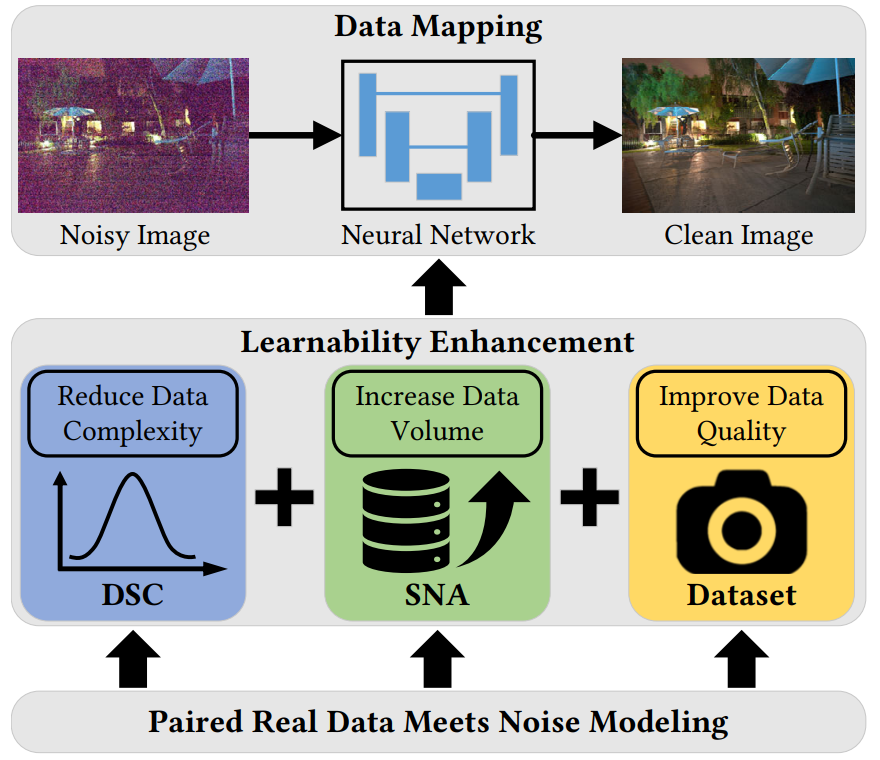

### 对现有数据的可学习性增强

#### 纯粹噪声建模的困境

噪声建模类的方法尝试绕过真实配对数据去合成数据。对于背靠噪声模型的合成数据而言，一组数据样本只要从模型分布中采样一次就唾手可得，数据量基本上是无穷无尽的。数据质量也不是问题，适配特定相机的数据对不好找，但干净的高质量图像网上有的是。噪声建模似乎就是那个完美的解决方案。然而，噪声建模方案在实战中常常会倒在“求不得”的路上**。

从噪声的层面上来说，每款sensor的构造都是独特的。**噪声模型（尤其是读噪声模型）与sensor的电路设计息息相关，这本身就是很复杂的事情。sensor厂商一般不会把他们电路设计公开，这就使得我们做算法的只能把sensor当成黑盒来处理。
最尴尬的是，sensor厂商可能会自己设计一些功能性电路，在一些对做算法的人而言未知的条件下切换电路模式以提高画质，导致噪声模型突变。厂商这么做自然是没错的，毕竟Raw图的质量确实上升了，但这种对外黑箱的操作确实会给后续噪声建模带来很大的麻烦。（Quad Bayer、RGBW等新式CFA的噪声建模困境类似）

从建模的层面上来说，不同的噪声建模路线各自有各自的缺陷。
物理类噪声建模的思路是基于sensor的物理特性和统计分布建模，即抓住可解析的主要特征来建模，代表作为ELD[[2]](#ref_2)。这个思路自然是好的，但极暗是个放大镜，ELD的噪声建模仍然难以准确cover复杂的真实噪声模型。在没有额外传感器信息的前提下，面对没法完全解析的复杂真实噪声，物理类噪声建模显得总是力不从心**。**学习类噪声建模的思路是从数据中学习噪声模型。现有的学习类噪声建模普遍是在拟合clean (+noise)到noise (or noisy)的映射，希望通过nn拟合数据映射的伟力来完成物理类噪声建模未经的事业。然而这里面其实有些容易被忽略的问题。众所周知，深度学习的成功依赖于大量数据。假如我们有大量clean-to-noise(noisy)的配对真实数据了，那真的还有那么迫切得需要噪声建模么？如果数据量不足的话，复杂的噪声模型我们真的学得到么？就算数据量充足，现有的方法能保证准确学到噪声模型而不是过拟合于数据集么？学习类噪声建模工作普遍在回避数据的问题，而为其赋能的往往正是大量的配对真实数据——噪声建模意图取代的那个东西**。

总而言之，基于纯噪声建模的合成噪声目前与真实噪声仍然存在显著的gap，使得合成数据训练的模型在极暗场景下表现不佳。因此，纯噪声建模暂时还无法绕过可学习性瓶颈。

#### 当配对真实数据遇到噪声建模

一般认为，基于噪声建模的合成数据 与 基于相机实拍的真实数据 间是存在竞争关系的。即使是温和的调和派，往往也只是把一方当做另一方的补充，充当提高性能的工具。然而实际上合成数据与真实数据并不是非此即彼的关系。我们完全可以用物理类噪声建模的手段解析一半的噪声，剩下的一半用真实数据来取代。

一个典型的例子就是SFRN（Sample From the Real Noise）[[3]](#ref_3)。SFRN利用了物理类噪声建模的信号相关部分（shot noise），信号无关的读噪声则直接使用实拍的暗帧来顶替。这个方法简单实用，但也存在一些缺陷，即噪声的多样性很容易不足——采样过于离散了。SFRN原工作弥补了其中一部分（指高比特重建），然而我们丰富了暗帧的多样性后，发现还能有额外的提升（TPAMI版复现的SFRN比MM版好不少），这说明靠采样取代读噪声的思路对采样的多样性需求其实并不低。更关键的是，放弃“解析读噪声”其实也会丧失一部分利用噪声模型辅助降噪的机会（指应用DSC）。

我们的PMN与SFRN又有所不同，采取了一种更尊重真实噪声模型的思路——在不破坏噪声模型的基础上，利用噪声建模来改造真实配对数据。

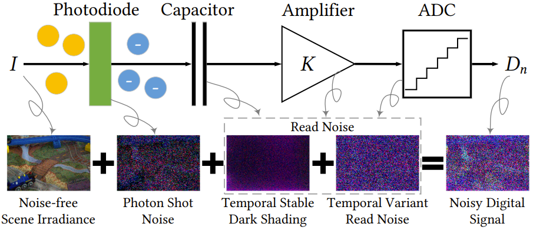

简化的噪声模型。我们将噪声模型解析成了四个部分，配对真实数据对应最左侧的干净图和最右侧的噪图。本文提出了一种用于低光Raw图去噪的可学习性增强策略。我们从数据视角出发，利用噪声建模来改造真实配对数据，使其能够提供可学习性更好的数据映射供神经网络学习。

基于光子散粒噪声可以被泊松分布准确建模这一认识，我们提出了Shot Noise Augmentation（SNA）来增加真实配对数据的数据量。得益于数据量的增加，可学习性增强后的数据映射可以促使去噪图像具有更清晰的纹理。**在期刊版中，我们把暗帧也视为一种noisy image，可以用于作为SNA增广的对象。这部分本质上就是把SFRN揉进可学习性增强的范式内，用“无限暗的暗帧”补偿SNA只能“往更亮的方向增广”的缺陷。

基于dark shading是读噪声的时域稳定成分这一认识，我们提出了Dark Shading Correction（DSC）来降低真实噪声分布的复杂度。得益于噪声复杂度的降低，可学习性增强后的数据映射可以促使去噪图像具有更准确的颜色。
在期刊版中，我们额外建模了和dark shading曝光时间的关系。根据我实验的观察，在可见光相机中一般主要是黑电平（对应BLE）会随着曝光时间变化，FPN相对稳定。

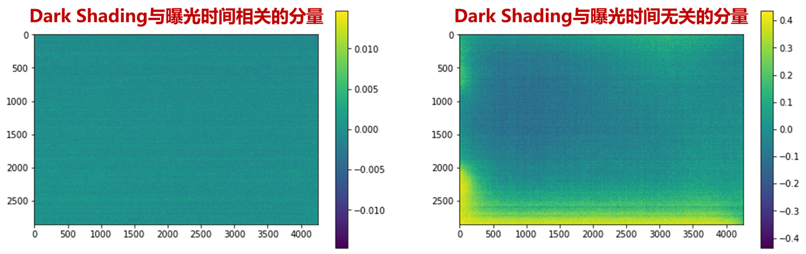

以曝光时间t为自变量标定FPN，会发现曝光时间t与FPN基本线性无关（注：该现象可能和sensor类型相关）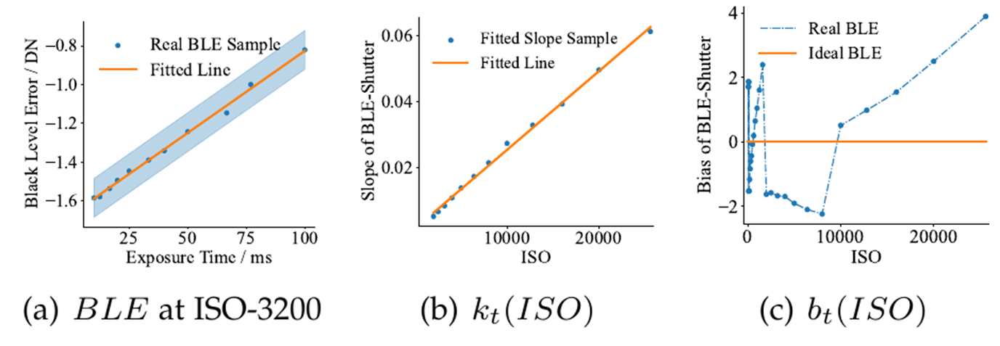

以曝光时间t为自变量标定BLE，会发现曝光时间t与BLE基本为线性关系（注：可能会由于电路未知突变而呈现分段线性）
### 构造鲜有可学习性缺陷的数据

#### 魔鬼都在数据里

在做噪声建模工作的时候，一直存在一些我不是很能理解的反常现象——为什么配对真实数据训练出来的去噪网络在ELD数据集上表现比SID[[4]](#ref_4)数据集差如此之多（相对ELD建模低2dB）？
数据分析是算法升级的不二法门。结合实验的数值指标、输出结果与数据集原图，我发现SID数据集的问题其实不小——我们实际上用SID的配对真实数据训练的网络并不算是纯粹的去噪网络。SID数据集其实充满了各种数据缺陷，使其数据从去噪的意义上而言并不那么“配对”，其中的问题包括但不限于：

-  Sensor特殊设计导致的异常dark shading
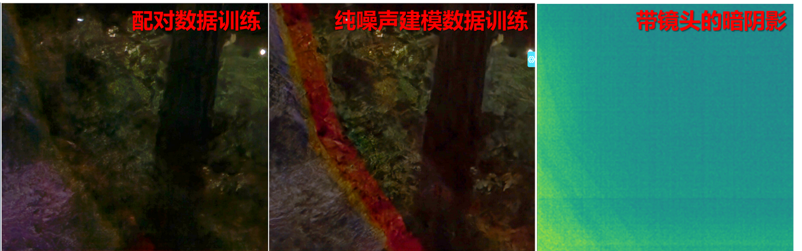

这个pattern是SonyA7S2直接补偿在raw图上的偏置，光圈越大越明显，无光的dark shading上也能看到。奇怪pattern的存在导致数据映射不纯粹是去噪映射，配对数据能学到，噪声建模学不到也不应该考虑这种数据集缺陷

- 不合理的采集设置造成的空间错位
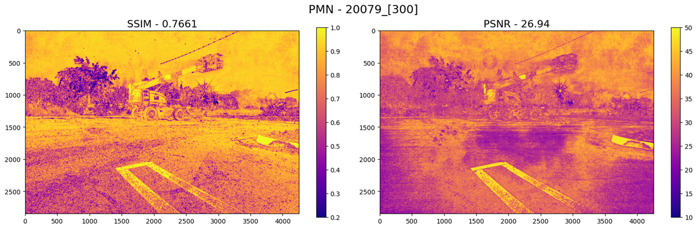

PMN去噪结果和GT在sRGB域上算pixel-wise的指标。室外长曝光GT中存在移动物体，天空中的长线在短曝光中是一个亮点，大概是飞机

- 高ISO场景的残留噪声
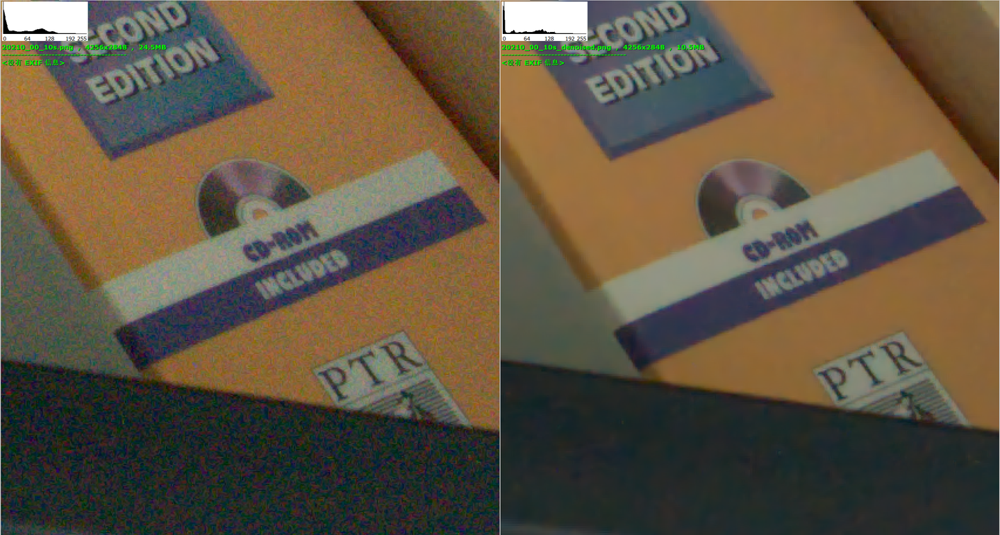

左图为SID中ISO-25600的GT，右图为对其简单去噪后的结果

- 一些不好证明的亮度错位
- ……
其实不止是SID数据集，现有的其他去噪数据集也或多或少存在一些数据缺陷，导致数据集在数据量、多样性、配对性（指是否存在错位）这几个关键的数据质量维度上有所不足。

正如我们前文所说：

> 低光下的数据采集难点很多，往往会顾此失彼，尤其是配对性经常被牺牲，导致训练数据和实际场景不是同分布的，nn学习的根本不是纯粹的去噪映射。

实际上，只要肯下功夫，大多数据集都能解决数据量和多样性的问题。制作数据集的真正的难点其实就在于配对性，以及在高配对性要求下如何保证数据量和多样性。

我们的目标就是做一套尽量不包含数据缺陷的低光去噪数据集，通过直接提高配对真实数据的质量来增强数据映射的可学习性**。**为此，有两个严谨的数据集制作流程很值得参考——ELD和SIDD[[5]](#ref_5)。ELD的制作方式相对简单，主要是通过调整ISO和长短曝以最高效的方式来制作数据集。SIDD主要是通过多帧融合来制作数据集的，包括一套系统的去坏点、筛图、校正、对齐、融合流程。这几乎可以视作一种简明扼要的多帧raw图去噪流程了。

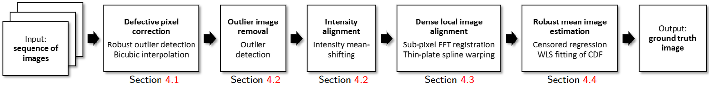

SIDD数据集的制作流程SIDD还有一个很关键的发现——即使把相机固定在防震的光学平台上，拍摄帧数多了仍然会存在错位，甚至在他们的实验中高达2~4 pixel！作者认为这种错位是由于手机的OIS（光学防抖）功能无法有效关闭导致的。我们在使用多台设备多种装置在多个位置复现这一现象后，发现这种错位本质上并不完全是OIS导致的。
经实验，关闭OIS在短时间内能观察到错位略有减小，而长时间下的错位则不受开关影响。范浩强做的另一个稳定性实验则隐隐戳到了这个现象的本质——这种空间错位是 不可测的环境扰动 与 手机夹的过阻尼摩擦力 共同导致的。

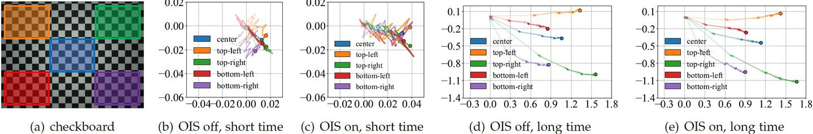

固定在三脚架上的手机相机空间错位。short time对应5秒内，long time则是约4*90秒这一发现对数据集制作而言是极其重要的。这相当于是说，制作低光去噪数据集时，无论是在室内还是室外都不得不考虑空间错位的问题。对齐算法的精度是有限的，尤其是对于大运动而言。因此，制作低光去噪数据集不能完全仰仗后处理来摆平空间错位，而是要在采集过程中就尽量避免长时间拍照，进而降低不可测的环境扰动所造成的空间错位**。

#### 智能手机低光原始去噪（LRID）数据集

去噪数据集本身的不足是限制数据映射可学习性的罪魁祸首。这种不足主要体现在四方面：多样性不足、带噪的GT、亮度错位、空间错位。多样性不足会导致数据映射过拟合。带噪的GT会导致数据映射难以收敛到最优。亮度错位会导致数据映射存在偏置。空间错位会导致数据映射存在错误。**不幸的是，现存的去噪数据集都在这些不足的一个或多个方面存在明显的不足，因而现存的数据集在可学习性上都难以满足真实场景下的低光去噪需求。我们的目的是收集一套高质量数据集，用以验证可学习性增强策略的上限。

- 数据采集阶段**
我们使用携带IMX686传感器的红米K30收集了一套高质量数据集。智能手机低光原始去噪（LRID）数据集包含138组场景。对于每个场景，我们首先在ISO-100下采集25张长曝光的图像，再立马在ISO-6400下采集5组（10张/组）短曝光图像。我们使用程序远程控制手机以避免振动，半自动连续采集的时间间隔很短（约0.01s/帧），因此短曝光图像可以视为没有空间错位。**室内场景数据是在多种色温和光照强度的各种封闭空间内收集的。每个场景有5组短曝光图像，长短曝光图像曝光时间比分别为64、128、256、512和1024。长曝光的总曝光时间约25秒。
室外场景数据大多拍摄于午夜，风平浪静（风速一般小于0.5m/s）。每个场景有3组短曝光图像，长短曝光图像曝光时间比分别为64、128和256。长曝光的总曝光时间约64秒。
有少量室内场景使用减光镜拍摄，沿用了室外场景的拍照设置。

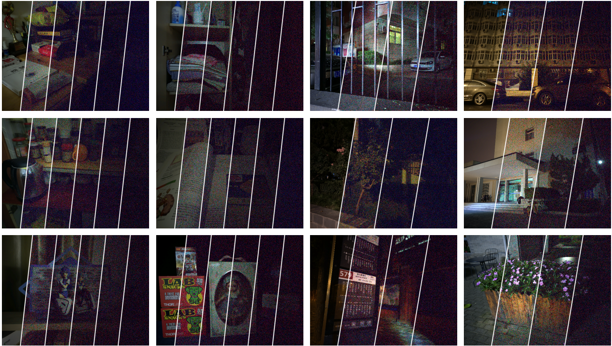

上述采集设置就是我们考虑数据缺陷后妥协出来的图像采集设置，主要有如下考虑：

- 总曝光时间有限（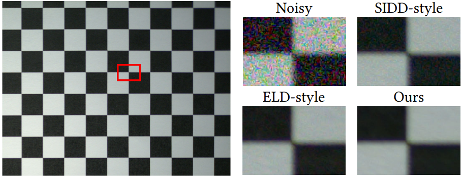

Noisy是ISO-6400下采集的单张图像，SIDD-style是在ISO-6400下采集的64张图像融合的结果，ELD-style是ISO-100下采集的单张图像。Ours是ISO-100下采集的25张图像融合的结果。（Best viewed with zoom-in）

- 短曝光每组10张是考虑到噪声采样也需要多样性，“GT：噪图”大于1:4比较好
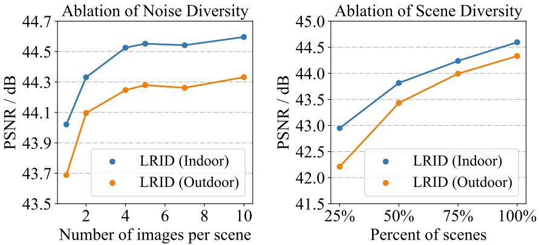

消融实验-用不同多样性的数据训练去噪网络，我们的设置下性能接近饱和

- 数据处理阶段**
改变噪图会破坏噪声模型，所以合理的思路是让相对干净的GT向噪图的位置。由于我们的采集设置下曝光时间间隔很短，所以噪图的空间位置可以近似为最后一帧ISO-100长曝光图像，即以最后一帧为参考帧做GT估计。

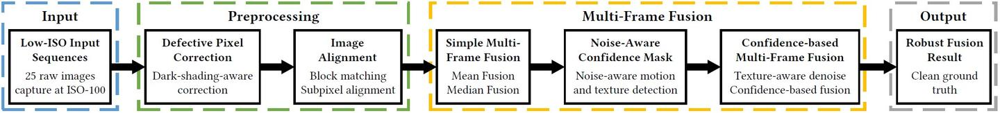

我们的GT估计流程，整个流程高度类似burst/video denoising这个流程集成了我对传统图像处理算法的很多认识，内容与细节都比较繁杂，此处不再赘述，详细的处理流程请参见原论文。这里仅以室外场景简单展示一下各模块的大致效果。

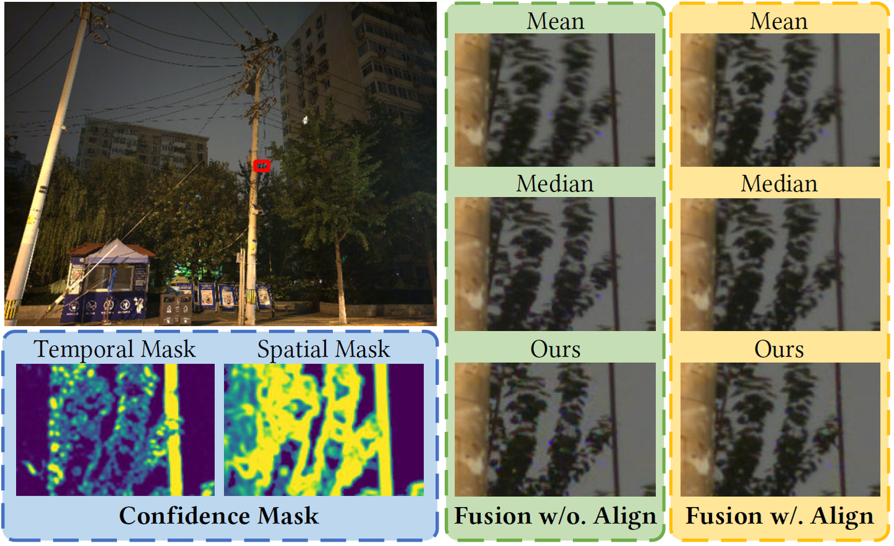

本流程可以鲁棒地应对室外微小物体运动，尽量避免空间错位、亮度错位、噪声对GT的影响
### 实验结果

**Raw域噪声建模系列的文章指标都是在raw域上计算的，大家看到的都是rawpy可视化后的结果。
做低照度图像增强的同学关注的sRGB域指标我往[会议版PMN解读文章](https://zhuanlan.zhihu.com/p/544592330)后面放了一部分，大家也可以根据网盘里公开的图片和权重自行计算。
#### 横向对比

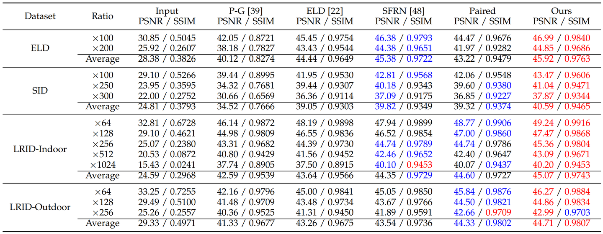

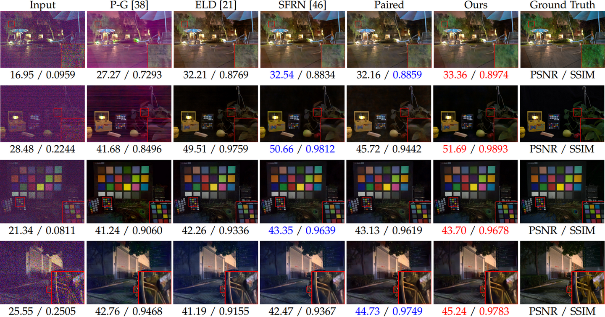

四行由上至下分别为：SID数据集、ELD数据集、LRID-Indoor、LRID-OutdoorELD数据集和SID数据集都是用SonyA7S2采集的，然而配对数据训练的结果在两个datasets上的表现差异很大。在SID数据集上，用配对真实数据训练出来的模型表现与SFRN接近。然而，在ELD数据集上，用配对真实数据训练出来的模型明显差于用ELD提出的合成数据训练出来的模型。

综合我们方法的实验结果来看，这个观察可以说明SID数据集由不合理的图像采集设置所造成的数据缺陷确实会导致脆弱的可学习性。脆弱的可学习性使得真实配对数据提供的数据映射并不精准，这同时拉低了性能和泛化性。我们的方法可以在两个数据集上同时达到state-of-the-art并明显超越之前的方法。这说明我们弥补数据可学习性的思路是本质的，这同时提高了性能和泛化性。

#### 消融实验

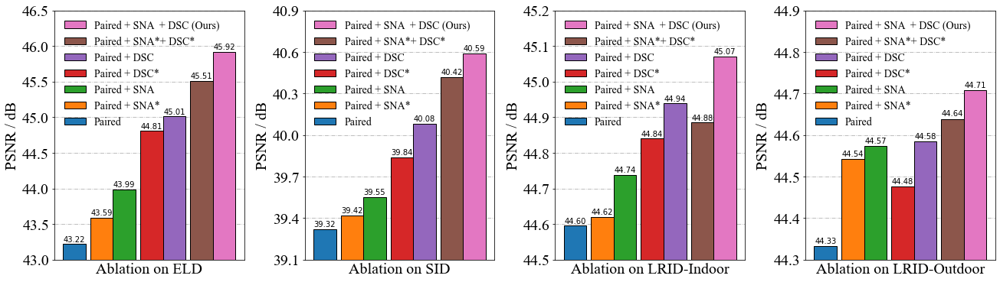

带*的模块表示使用之前的版本，即MM版的方法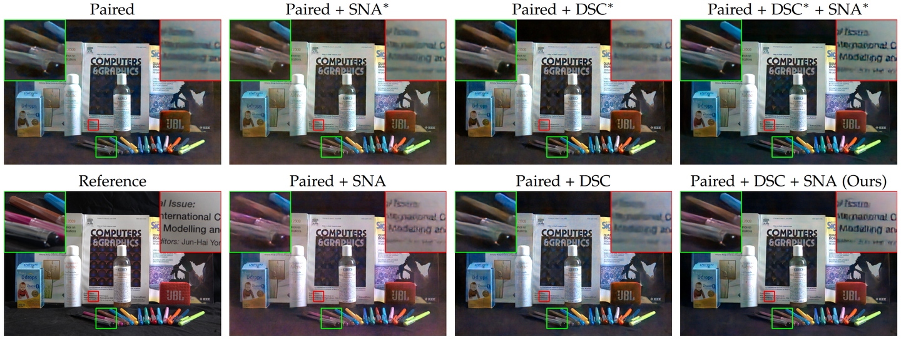

带*的模块表示使用之前的版本，即MM版的方法在没有任何可学习增强的情况下，使用配对的真实数据训练的去噪模型看起来模糊且带有噪声。对于神经网络来说，从可学习性不足的配对真实数据中学到精确又准确的数据映射十分困难。 

SNA通常在数值指标上的提升并不大，但可以显著提高去噪图像的解析力。这种视觉质量的提升主要得益于数据量增加所带来的精确拟合。与SNA的旧版本（SNA*）相比，新版的SNA拥有更全面的增强功能，可以实现更高的映射精度。但不矫正dark shading可能会让nn过拟合于有偏的数据映射，这有时会导致更显著的偏色。

DSC通常在数值指标上的提升很大，可以显著改善去噪图像由于dark shading导致的偏色。这种视觉质量的提升主要得益于降低噪声复杂性所带来的准确拟合。与DSC的旧版本（标为DSC*）相比，新版的DSC拥有更为精确的dark shading模型，可以实现更高的映射准度。但值得注意的是，DSC在提高去噪精度上并不显著，这方面更多地依赖于SNA。

总而言之，SNA和DSC相辅相成，采用完整的学习增强策略方可获得最佳的性能。

### 关于DSC的讨论

#### 同sensor不同camera下的dark shading

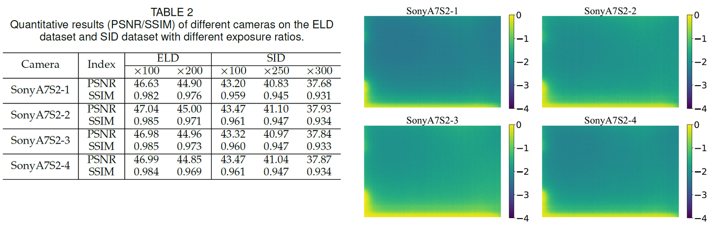

本文用的是SonyA7S2-4，补这个实验的时候我们才发现SonyA7S2-2才是去噪表现最好的用不同相机标定的dark shading确实会导致去噪性能不同，但它们的数值指标很接近，仍然明显高于之前的工作。实验结果表明，同一传感器的不同相机标定的dark shading高度相似，这表明我们提出的DSC在论文的设置下是可行的，具有一定的泛化能力。

#### 不同sensor的dark shading

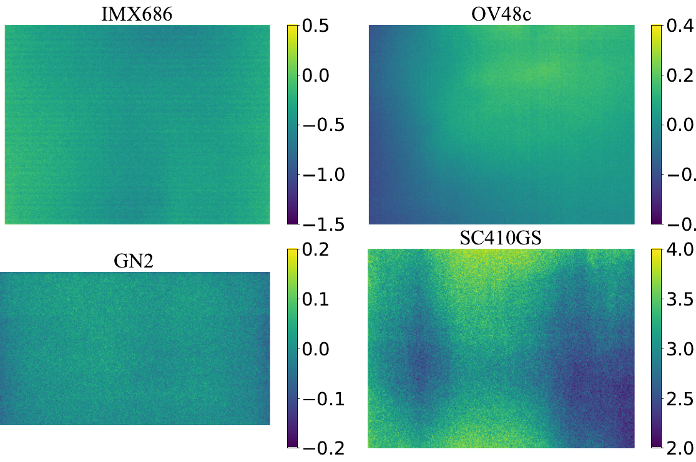

IMX686是LRID用到的sensor，OV48c和GN2也是手机sensor，SC410GS是个监控相机sensor根据我们的观察，具有明显dark shading的sensor并不少，它们往往在高ISO高增益下才会被发现。Dark shading在学术向的低光去噪数据集中还挺常见的（比如CVPR22的starlights[[6]](#ref_6)）。以上观察表明我们提出的DSC是必要的，有广泛的应用场景。

#### DSC用于拓展噪声建模

SNA本质上来说是shot noise建模的特化版本，对纯噪声建模真正有发展的是DSC。线性dark shading模型可以直接被用于改造现有的噪声建模方案。

- 对于时域稳定噪声从来没有考虑过的的噪声建模方法（例如泊松高斯模型），无需改变训练策略，直接在推理阶段应用DSC即可。
- 对于BLE已经被考虑过的噪声建模方法（例如RethinkNM[[7]](#ref_7)、ELD），有两种处理方式。如果传感器的BLE稳定，那么没必要改变训练策略。推理时用没有BLE的dark shading就可以了。如果传感器的BLE并不稳定，那么在训练时只能使用噪声建模中的时域噪声，推理时再应用DSC。
- 对于噪声建模中隐式地包含了dark shading的方法（例如SFRN、学习类噪声建模），我们需要改变训练策略。在训练过程中应仅使用噪声模型中的时域噪声，而在推断阶段应用DSC。
SFRN的情况略微复杂，还需要解决一些工程上的麻烦，详情请参见原文。另外我们惊喜的发现，左老师组CVPR23的LLD[[8]](#ref_8)已经用上这个方法了，其中LLD*中就有运用到了DSC，显著地改善了学习类噪声建模的性能。

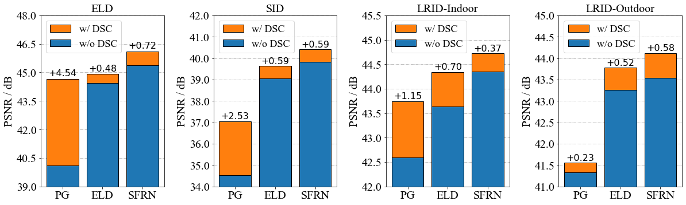

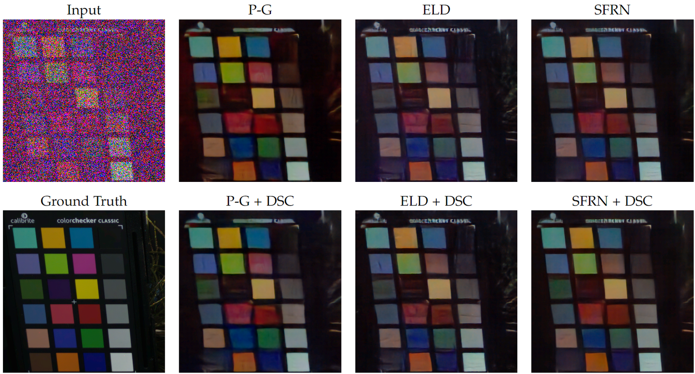

#### Limitation（保命声明）

- Dark shading标定与实际应用存在巨大温差时可能会导致DSC效率降低。
nn对正常工作温度**下的dark shading差异还是具有鲁棒性的。“同sensor不同camera下的dark shading”一节中的dark shading就没严格控温，2号3号相机的温度其实略高于正常工作温度，标定结束时是有些烫手的，但DSC在PMN下也cover住了。温度过高的话dark shading模式可能会发生不规律的变化。
- Sensor电路切换可能导致dark shading参数不适配，涉及电路明显变化的情况建议重新标定dark shading。**SonyA7S2是个双原生ISO相机，所以我们是以ISO-1600为界分别标定的dark shading。LRID用的IMX686有触发原理未知的温控/长曝光控制机制，有时会突然切换电路，所以我们标定了两套dark shading模型。

### 后记

#### PMN真正最适合的场景——被拆分的三部曲计划

其实我这两篇文章（PMN的MM版和TPAMI版）是一个半成品项目一拆三的结果——拍屏三部曲的前两部。

> [算法研究中的进度与时间管理 - 知乎 (2022.01.01)](https://zhuanlan.zhihu.com/p/452204071) 
…… 
本人目前正准备写论文投稿的项目就完整的经历了上述流程，这里可以分享给大家作为参考。 我的这个项目在立项时预期以某种电子设备为核心，绕过数据采集的难点解决数据采集的问题，进而通过解决数据问题提升任务的性能【PS：拍屏】**。这个方案引入了新的模块来解决旧的问题，属于对图像处理系统的优化而不是对模块本身的优化。这个方案最大的不确定性机在于引入的电子设备本身并不完全可控，它们或多或少存在某些误差与缺陷，在**绕过固有认知的缺陷的过程中引入了新的缺陷【PS：拍屏退化】**。在这一过程中，我为了弥补这些缺陷而开发了一种**新的灵活的数据增强算法【PS：SNA】**，同时在对比中**发现了一个被前人忽视了的问题并解决了它【PS：DSC】**。在发现预期方案的缺陷在常规情况下总是大于优势后，我选择**在特定条件下解决特定问题【PS：低光/极暗】**，终于得到了可堪一用的实验结论。 然而，特化后的方案无法与公开的数据集进行比较，说服力有限容易被拒，所以我需要**先做一个符合我需求的数据集工作【PS：LRID】**，被证明可行后再尝试发表这个工作。这时，我的实验规划的作用就体现了出来。在预期方案的一开始我就设计了当时看似用处有限的数据集采集实验，而研究过程中开发出来的数据增强算法和针对前人忽视问题的补偿方案都可以作为数据集工作的内容被复用，我无需再为数据集工作中数据集外的创新点而绞尽脑汁，这极快地加速了我的实验进度，让我终于有了充分的时间去润色我尚未面世的第一篇文章。** ……

实际上，拍屏数据集是21年1月复现RViDeNet[[9]](#ref_9)看到定格动画数据集后就想做的一个方案，后来因为种种原因21年8月才开始着手调研。实验了大概半年左右，在解决拍屏方案缺陷的过程中我搞出了SNA（数据增强）、DSC（噪声模型修正）和LRID（数据集）的基本方案。他们原本就是一个项目的产物，所以连贯性比较强。我导对论文质量的把控比较严格，“大杂烩”是不行的，而我又舍不得丢掉每一个重要组成成分，所以只好赌一把，把拍屏项目的内容拆解后分开投。这里真心感谢我导的逻辑支撑与穿针引线，要不也没法把拆开的点重新补完成一个整体。

至于原计划的第三部曲《拍屏》大概是不会面世了，毕竟核心创新点已经被PMN拆走了，而且作为形式载体的拍屏数据集在这一年内也已经被其他同行发掘过了（ReCRVD[[10]](#ref_10)、RMD[[11]](#ref_11)）。尽管我认为我们在数据采集以及处理拍屏退化上的独到经验仍然存在优势，但这种工程技巧确实并不好单独发表论文了。

#### 再聊聊学习类噪声建模——我们的下一个工作

前文在讨论“纯噪声建模的困境”时，我们提出过这样的一组问题：

> 假如我们有大量clean-to-noise(noisy)的配对真实数据了，那真的还有那么迫切得需要噪声建模么？
如果数据量不足的话，复杂的噪声模型我们真的学得到么？
就算数据量充足，现有的方法能保证准确学到噪声模型而不是过拟合于数据集么？

提出这些问题，是因为我们发现，已有的学习类噪声建模普遍受数据拖累，存在多种可学习性缺陷**

- **欠拟合于噪声模型****表现为合成数据通常和真实数据的噪声模型有别**（强度不一致**1**和模式不一致**2**），这导致去噪结果不精确
- **过拟合于训练场景****表现为神经网络通常会学习到不完善的数据采集过程所导致的数据偏置**（空间错位**3**和亮度错位**4**），这导致去噪结果不准确
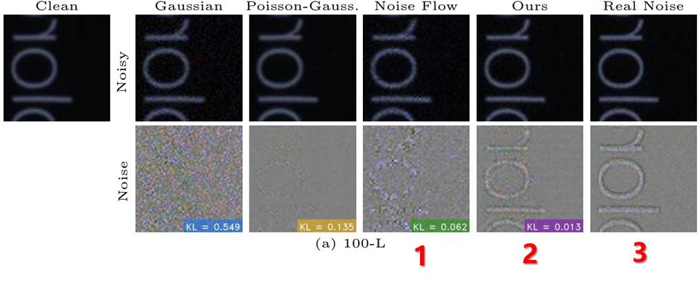

CAGAN (ECCV 2020). Noise中显著的边缘残差应当是SIDD非参考帧噪图和GT之间的空间错位，而不是噪声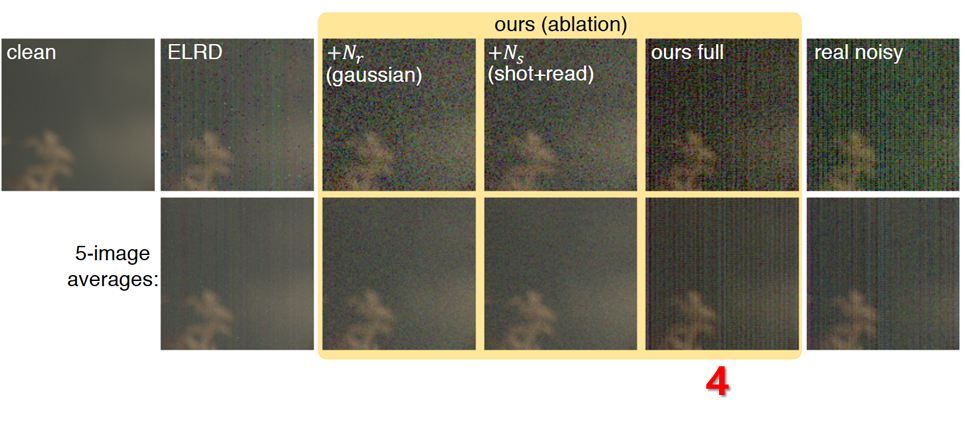

Starlights (CVPR 2022). 网络疑似是学到了训练数据集中的某种亮度错位诶嘿？有没有闻到“可学习性增强”的味道？没错，这也是我们下一个工作的方法论。

新的工作和期刊版PMN的增量部分拥有相同的故事背景，但是这回我们换了一种技术路线——直接改造学习类噪声建模。我们将在新的工作中直面数据质量与分布度量的问题，一一破除前文所提到的“纯噪声建模的困境”！这个纯噪声建模的工作已经投稿出去了，效果上比PMN更具特色，敬请期待~~

### 参考

- [^](#ref_1_0)[1] https://fenghansen.github.io/publication/PMN/
- [^](#ref_2_0)[2] https://ieeexplore.ieee.org/abstract/document/9511233/
- [^](#ref_3_0)[3] https://openaccess.thecvf.com/content/ICCV2021/papers/Zhang_Rethinking_Noise_Synthesis_and_Modeling_in_Raw_Denoising_ICCV_2021_paper.pdf
- [^](#ref_4_0)[4] https://openaccess.thecvf.com/content_cvpr_2018/html/Chen_Learning_to_See_CVPR_2018_paper.html
- [^](#ref_5_0)[5] https://openaccess.thecvf.com/content_cvpr_2018/html/Abdelhamed_A_High-Quality_Denoising_CVPR_2018_paper.html
- [^](#ref_6_0)[6] https://openaccess.thecvf.com/content/CVPR2022/html/Monakhova_Dancing_Under_the_Stars_Video_Denoising_in_Starlight_CVPR_2022_paper.html?ref=https://githubhelp.com
- [^](#ref_7_0)[6] https://ieeexplore.ieee.org/document/9428259
- [^](#ref_8_0)[7] http://openaccess.thecvf.com/content/CVPR2023/html/Cao_Physics-Guided_ISO-Dependent_Sensor_Noise_Modeling_for_Extreme_Low-Light_Photography_CVPR_2023_paper.html
- [^](#ref_9_0)[8] https://openaccess.thecvf.com/content_CVPR_2020/html/Yue_Supervised_Raw_Video_Denoising_With_a_Benchmark_Dataset_on_Dynamic_CVPR_2020_paper.html
- [^](#ref_10_0)[9] [https://arxiv.org/abs/2305.00767](https://arxiv.org/abs/2305.00767)
- [^](#ref_11_0)[10] https://ieeexplore.ieee.org/abstract/document/10003653/
