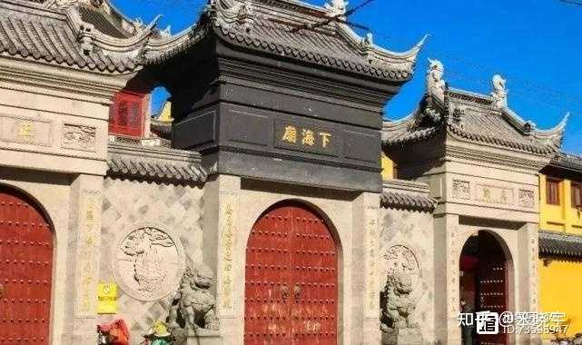
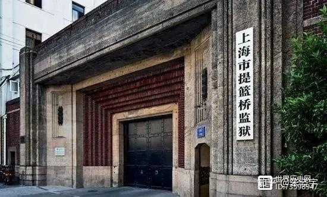
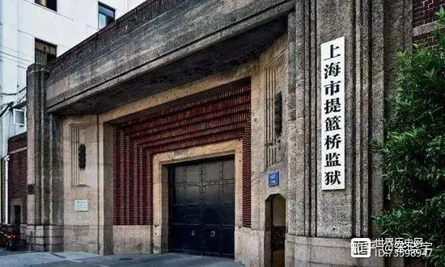
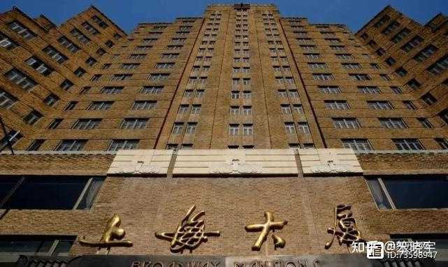
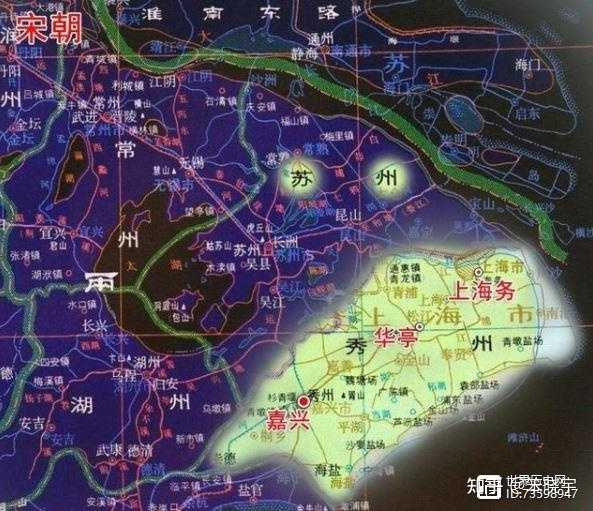
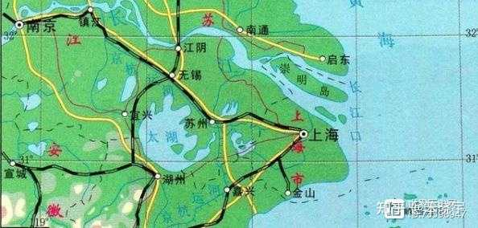
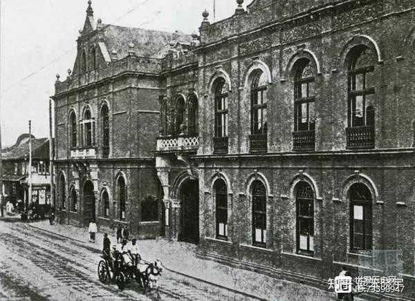
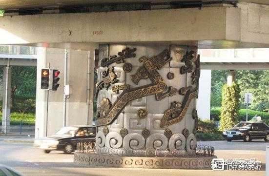

1955年，毛主席到上海视察，在黄浦江上游览时，突然问了陪同人员一个问题：“你们知道上海还有个'下海’吗？”举座哑然，没人能答得上毛主席的问题。

最后，还是他老人家自己提供了答案，他斩钉截铁地说：“有！”

是啊，既然有上海，那么下海在哪里？

上海之所以叫上海，是因为有下海才有上海，有下才有上，天经地义。名字之中，没有一个字是凭空出现没有来历的。

现在上海市虹口区昆明路73号有一座下海庙，当时夏海义王庙地处下海浦，长江船只入海处。那时候，从东大名路至商丘路一带全是渔村。渔民出海打渔，需要祈求神的保佑，便有这座小庙应运而生。所以当时这里供奉的是海神妈祖和天妃娘娘，而现在则变成了观音。

现正对庙门的马路就叫海门路，海门路，顾名思义，大海之门，就叫海门路。当时居民船民进庙烧香，常常提着篮子过桥，所以叫提篮桥，就是这么简单粗暴。

吴淞江南岸有两条支流，一条叫下海浦，一条叫上海浦，黄浦江的“浦”，在吴方言区原意是人工小河。从这个字的意思你就可以看出，黄浦江这个名字，其实是个悖论，江是大河的意思，而浦是小河，何以两者会混为一谈？

黄浦江的原名是黄歇浦，黄浦江是黄歇浦与春申江名字混杂的叫法，而黄歇指的是战国时的春申君黄歇。

宋代为解决吴淞江的泄水能力，在吴淞江两岸，大约每隔五里就会开凿一条进入吴淞江的大支流，这种支流水道称为浦。吴淞江两岸共有18个浦。

北宋郏亶著《水利书》：“松江之南，大浦十八，有上海、下海二浦”。

吴淞江在虹口区海门路段，南岸有一个浦，称作上海浦。南宋时设上海镇，元代建上海县，即取上海浦之名取名为上海镇。而与上海浦隔岸相望的北岸也有个浦，叫下海浦，却与“上海”这个名字失之交臂，而逐渐淹没在历史的尘埃中。

上海浦与下海浦，这是江南河流命名的习惯，接近源头的支流称为里或上，靠近下游的称为外或下。下海浦于清同治年间被填没，成为了现在的海门路，即今北外滩的滨江绿地一带，依旧在焕发着新的活力，只是世人多只知北外滩，却不太了解曾经的下海了，只有提篮桥附近的那座下海庙还在见证下海的历史。

下海庙俗称“义王庙”。始创于清代乾隆年间，一开始只有房屋九间，是当地渔民、居民为祈佑平安、奉祀海神的民间神庙。

嘉庆年间下海庙荒塌，由心意师太重修，此后作为一所临济宗的比丘尼道场，通俗点说这是一间尼姑庵。

相传心意师太至98岁高龄时，交法成师太继任主持，之后又陆续增建前殿等二十余间房屋殿舍。

抗日战争初期，下海庙房屋被日军炮火全部焚毁。1941年起，由觉莲募资重新修建，至解放以后，基本保持原有规模。

2012年，经过重修的下海庙重新对外开放，让这段上海的历史为更多的人所知晓。

与下海一起被人们遗忘的是吴淞江。吴淞江，就是松江，这就是松江区的名字由来。

苏州河（吴淞江上海市段）明明在上海为什么叫苏州河，跟苏州有什么关系？苏州河之名，始于19世纪中叶上海开埠后，部分爱冒险的外国移民由上海乘船而上，溯吴淞江直达苏州，就顺口称其为“苏州河”。

上海大厦（原百老汇大厦）

叫这个名字，却并不演百老汇戏剧。那为什么叫百老汇大厦呢？是因为大名路。这条马路在虹口区南部。西南起外白渡桥北堍，东至九龙路。清同治三年至光绪十四年分段筑，初名虹口路。光绪三年改名百老汇路(Broadway Road)，所以这座大厦就叫百老汇大厦。1943年，百老汇路以河北大名改今名。没错，就是《水浒传》中梁中书所在的大名府。东大名路的大名同样指的河北大名，这条路是大名路的东延伸段，故名。

1951年，陈毅市长将大厦命名为“上海大厦”。这是外滩建筑群重要的建筑物之一，全国重点文物保护单位。周恩来、陈毅等党和国家领导人曾先后陪同各国元首或政府首脑、政府代表团做客大楼，俯瞰上海市容。

现在的下海地区，最著名的就得说是提篮桥。除了大名鼎鼎的提篮桥监狱，提篮桥区域在二战中曾积聚过许多犹太人，是他们口中的“诺亚方舟”。上海方舟是犹太人世界，在那段“反人性”日子里的最温暖的“避难所”，是他们最温情的回忆，也让中国上海成为最散发人性光芒的地方。

这就是为什么，犹太难民在上海纪念馆会建在这里。

### 再说说为啥叫上海？

在较为遥远的春秋战国，现在的上海地区有一大半（含崇明岛）是泡在海里的，主要是上海的主城区。到了汉朝，陆地上的上海区域隶属于治所在吴县（今苏州）的会稽郡。东汉没什么变化，三国时有变化了，在今上海市的最西边，出现了一个叫华亭的地方。一把火烧掉刘备统一大业梦的吴将陆逊，就被孙权封为华亭侯。南朝萧梁时，设昆山县，但县治不在现在的江苏昆山。华亭一直隶于昆山县。唐玄宗天宝十载，公元751年，华亭才升格为县，从昆山、海盐、嘉兴三县各割一部分成立。

吴越时，华亭改隶属于治所在嘉兴的秀州。重大变化出现在北宋。

北宋时，华亭县依然隶属于秀州，但上海的陆地面积开始增长，逐渐向东部海域前进，崇明岛也慢慢有了形状。当时的华亭县，以松江（今吴淞江）为界，北属苏州，南属秀州。在松江南岸快要与大海汇合的地方，出现了一个叫上海务的地名。

务是宋朝的经济管理机构，主要负责征服酒税，全称是酒务。为什么要叫上海务呢？干嘛不叫下海务？

宋朝的时候，这里就出现了两个地名：南岸的上海浦、北岸的下海浦。当地命名有习惯，河流近海的称为下，近源头的称为上。所以上海是上海，下海是下海。

上海酒务设立的具体时间，是宋真宗大中祥符二年， 公元1008年。由于税收的增长，上海务逐渐繁荣起来。宋神宗熙宁时，上海务已是个繁荣的城镇了。

宋朝海运经济发达，与海外各国都有贸易往来。为了服务海运贸易，宋朝就在上海设立了市舶提兴司，以及榷货场，相当于物流中心。南宋在这里设置了上海镇，辖区主要是今已消失的南市区（2000年并入黄浦区与浦东新区）。元世祖忽必烈至元二十八年，公元1291年，上海镇升格为上海县。上海县治就在现在的吴淞江与黄浦江的汇合处南岸。

不过，由于各种原因，元朝并没在上海县设置城池。这种情况一直延续到明世宗嘉靖三十二年，公元1553年。江南饱受倭患，为了防御不知道什么时候蹿上岸的倭贼，松江知府方廉开始修建上海县城。城墙周长九里，有8座城门。上海城外有大濠，潮汐来时就能灌满濠沟，防备倭人进犯，非常的险固。

明清两朝的上海县没太大变化。道光二十三年，公元1843年，上海首开商埠。随着口岸的开通，上海成了冒险家的乐园，成为英美法租界。然后就是“许文强”来到上海滩，遇到了”冯程程”……

上海地名有了，可上海为什么简称沪，不简称“上”或“海”呢？

沪是啥？其实是渔民用来抓鱼的竹篓子（称为扈），把“沪”插在海上，就会有鱼上钩。

当时的上海有一半泡在海里，所以就形成了一个喇叭状的出海口。当地百姓称这种喇叭状为渎，连在一起，就是扈渎。后来可能觉得扈字笔画太多，就改用笔画较少的沪。东晋时，这里就被称为沪渎垒。久而久之，沪就成了上海简称。

上海还有一个第二简称，就是申，这与战国四大公子之一的春申君黄歇有关。春申君是楚国贵族，当过楚国丞相。春申君看中了吴国故都姑苏，就向楚考烈王申请，得到吴地为都邑。有意思的是，楚国国都当时在安徽寿春，所以在寿春有一种幽默的说法，说上海是寿县的郊区。

春申君的地盘包括现在的上海西部，来的时候很荒凉。春申君就在这里修建水利工程，清理淤泥，通畅黄浦江。人们为了纪念号称上海建城第一人的春申君，就简称这里为申。只不过“申”作为城市简称，使用率远低于“沪”。你听说过宁沪杭，没听说过宁申杭。

另外，上海还有一个非正式简称——魔都。为什么叫魔都呢？

### 上海为什么叫魔都？

第一个把上海称为“魔都”的人，是20世纪初旅居上海的日本作家存松梢风，他在1923年来上海访问时写的畅销小说《魔都》中，发明了“魔都”一词来指代上海。

当时的上海之所以被称作“魔都”，是由于它具有世界其它城市所没有的“魔性”，而产生这种“魔性”的根源，则在于因租界的设立而形成的“两个不同性质的空间”共存于上海的局面。

这“两个不同性质的空间”(即租界和县城)相互渗透、相互冲突的结果，使上海成为一座举世无双的“兼容”的都市，由此产生了种种奇特的现象，这些现象可以用“魔都”一词来笼统地概括。

上海的魔都别称真正被叫开来，是因为一部叫做《中华小当家》的动画片（1997-1998年富士电视台播出）。

《中华小当家》第34集标题“魔都上海！黑暗料理界的宣战”的广泛影响，90年代的动漫爱好者们在成为新生代网络社会文化的主要传播力量的进程中，一定程度上地推广了“魔都·上海”这样一个十分具有代表性的词汇。

还有一种说法就是，

为了镇住这条双头恶龙......

看看昔日上海的轨道交通线路图！

虽然现如今的上海地铁线路

已经密密麻麻不再是这个样子

但魔都的名号却一直流传了下来

毕竟，除了这条龙

还有延安高架的龙柱

龙华寺的桃树、静安寺的泉眼等等

各位不妨自行百度……

其实很多我们现代人之所以把上海称之为“魔都”，是因为上海经过这么多年的发展，以绝对的优势领跑于各个城市之前，人们更愿意把上海理解为“魔力之都”，也就是一个让人着魔的城市之意。

[发布于 2022-05-21 15:03](//www.zhihu.com/question/265572442/answer/2495205933)・辽宁

​​2077 ​432 ​分享

​​

收起​
