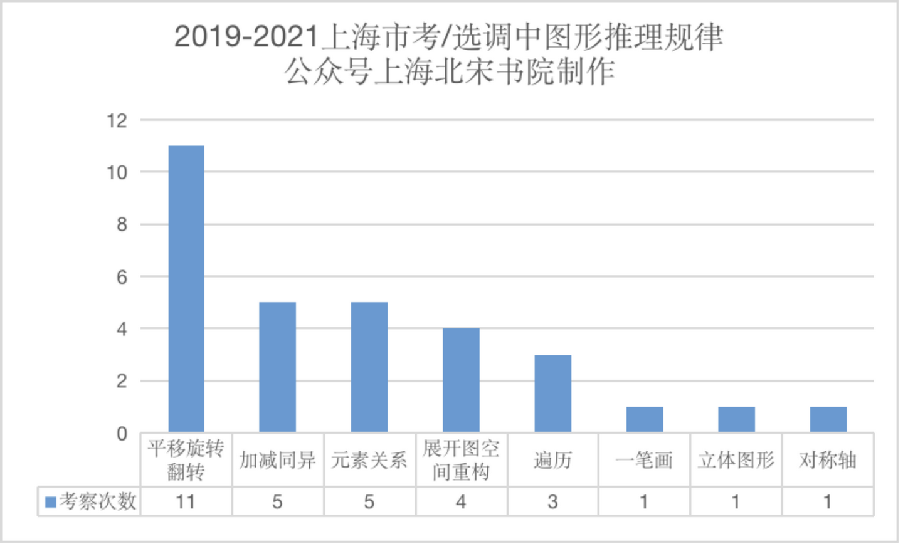

2019-2021三年上海市考/选调图形推理都有什么规律

对上海市考/定向选调三年真题进行总结，可以总结规律如下：

**一、图形推理的题量**

图形推理题量为12题，题量较大

**二、图形推理中，偏爱考察平移旋转翻转，以及加减同异**

一般每次考试，会考察2-3道平移旋转翻转题目，以及2道加减同异题目。

因此基本上可以为你带来一些稳定的分数。

**1、平移旋转翻转**

平移旋转翻转题目中，常考不同部分体现出不同的平移规律，例如：

上半部分体现出左右平移，平移一格规律；

下半部分体现出上下翻转规律。

**2、加减同异**

经常出现第一张图片平移后，再与第二张图片进行加减同异，变成第三张图片。

或者加减同异之后，再进行旋转，变成第三张图片。

**三、图形规律中，爱考元素关系规律**

例如考察：

1、不同元素之间的数量关系：圆形数量比方形数量多1。

2、不同元素之间的位置关系：圆形和方形之间的位置关系。

这类规律有一个特点，**就是难以被一笔画图形、图形面的数量、点的数量这些传统规律所涵盖。你要根据本道题目，寻找新的图形规律（位置、数量关系）**

**四、喜欢考遍历**

遍历规律，意味着有不同形状的图形，反复出现，并且不存在其他平行、对称等规律之后，你需要考虑的规律。在上海考试中，你经常看到各种各样的图形，在几张图中不断出现，但没有合适的规律总结的出来，也许就是遍历规律。

**五、国考中常考的几种规律，在上海出现较少**

国考中常常出现：

1、线的规律：一笔画图形、曲直图形

2、面的规律：面的数量与面的种类

3、属性规律：轴对称图形与中心对称图形，对称轴的数量、方向

上海较少出现这些规律。

**六、总结**

上海的规律，体现为较为明显，突出的体现为元素之间的规律。也就是说，你不太需要去思考图形内部属性的规律，而只要观察这张图中，有几个元素，他们之间的位置、数量关系怎么样。第一张图和第二张图，出现了什么样的样式变化。

2021年

11题图形推理考察规律：

1小三角形，拼起来构成一个完整正方形2遍历3翻转叠加：图1上半部分上下翻转，再与图1中斜线左右翻转之后的图形叠加4立体图形：水平截面都是圆5加减同异：外框内部的竖线求同，内框内部的横线求异6平移翻转7平移旋转8第一行：全曲、全直、全曲第二行：全曲、全直、全曲第三行：曲直、全直、曲直9加减同异，黑白运算第一组前两个图形，旋转180°后得到第三张图10平移规律，两个点运动的步数不同11四面体空间重构12第一组第一幅图顺时针旋转90°，再与第二幅图黑白运算，同色相加为白，异色相加为黑2020年

11题图形推理考察规律：

1元素种类+数量。每幅图中正方形数量比圆形多一个2平移，每次向右平移三步3加减同异4位置规律，每次向右平移三步5展开图，13面体6六面体展开图7平移8平移，翻转9遍历10三条平行线11面的数量2019年

12题图形推理考察规律：

1元素遍历：每一幅图形均由直线、黑圆和白圆组成，考虑三种元素之间关系。每一组图形中，每一条线均有2个黑圆、一个白圆，且两个黑圆中均有一个白圆2加减同异，黑白运算3小方块拼成立方体4黑白块占的格子数5旋转与翻转：第一个图形左右翻转，叠加成为第二个图形；第三个图形由第一个图形旋转180°后与第一个图形叠加得到6平移，外圈内圈不同规律7四面体空间重构8元素：每根线段两端都连接了小元素，一类是连接了相同的元素，一类是连接了不相同的元素9将所有元素拼在一起，得到一个完整的黑色正方形10一笔画规律11遍历：上面部分出现菱形、圆形和米字形；下面部分出现右箭头、朝左箭头和双箭头12第一横行，均为轴对称图形，且对称轴数量为123第二横行，前两个图形为轴对称图形，且对称轴数量为12，最后图形的对称轴数量应为3
