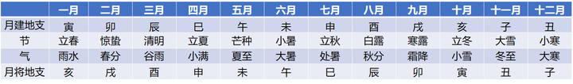
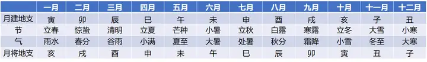
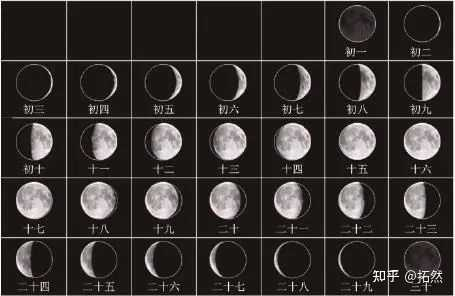
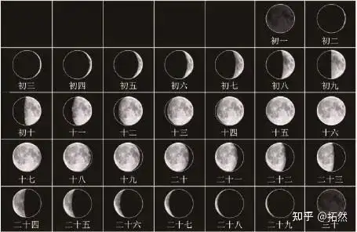
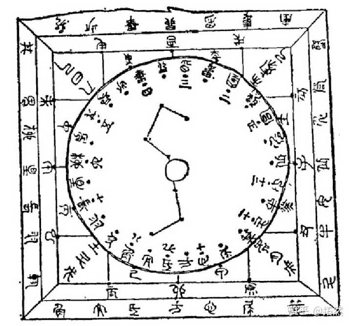
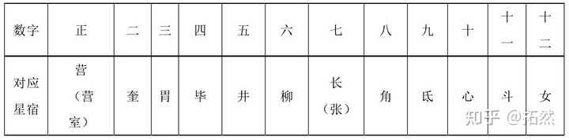
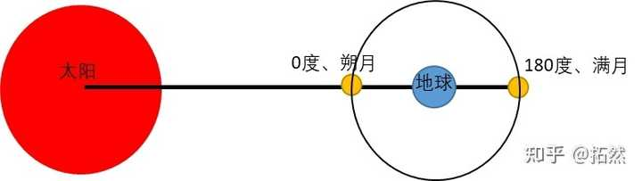
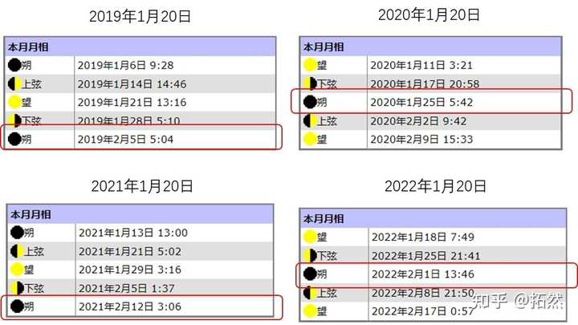

收录于 · 星庐Hosiro

这个提问很直白，应该需要一个直击本质的答案！农历之所以能闰一个月是因为我们的置闰方法和公历（西方）置闰凑整的方法有本质不同。

我先简述下公历置闰的原理，公历一年是365天，但一个太阳回归年是365.25天，所以每隔4年就会多出一天，也就需要一个闰年来消化这一天，所以闰年的2月是29天，平年是28天，其他11个月，其中7个月是31天，4个月是30天，合计闰年为366天，平年365天。

而我们的阴历是按朔望月来定一个月的，一个朔望月平均29.5天，一个阴历年是354天，与一个回归年差11.25天（也就是题主所说的误差）。

这么看一年12个月，取其中11个月每个月分担1天就可以了，但我们不能像公历（西方）那样将这差值天数平均分散到每个月中，**因为我们的阴历月的起始点是“固定的”，是有天文现象为依据的，不是公历那种纯按人类意志设定的历法。**

**这个天文现象就是日月相会（合朔）的那天**，**所以一旦每月多分摊1天，那次月的起点就乱了就不是合朔日了，而且会与日月合朔日的误差会越来越大。在此条件下我们只能采用置闰一个月的方式来解决与回归年误差的问题。**

下面附上相关的知识点

#### 1、我国的阴历是如何置闰的？

古时我们采取中气置闰，也就是说一个阴历月中没有24节气的气的话（见上表），那么这个月就要置闰，比如阴历3月没有中气谷雨，那么就要设立个闰3月。

当下我们的历法采用的是定气置闰，需要通过临近年中的冬至与冬至间的天数确定是否置闰，首先确定两个冬至之间岁实长度，然后排定历月，再看两个冬至之间除去两个冬至所在月外有多少个整月，如果是十一个整月，则无需置闰，即使出现无中气的月也无需置闰。如果有十二个整月则需置闰，此时置闰依照“无中气规则”，而且闰前不闰后。

#### 2、怎么确定阴历月的第一天？

**十二个农历月的每月第一天就是就是日月相会的那天**，即日月间的黄赤经度坐标差为0度的那天，古人称此日为日月合朔。

如晋代古书《五行大义》中记载了从正月到腊月的十二次日月在天空黄道中的相会位置。

《五行大义》有云：

**支合者。日月行次之所合也。**正月。日月会于诹訾之次。诹訾。亥也。一名豕韦。斗建在寅。故寅与亥合。二月。日月会于降娄之次。降娄。戌也。斗建在卯。故卯与戌合。三月。日月会于大梁之次。大梁。酉也。斗建在辰。故辰与酉合。四月。日月会于实沈之次。实沈。申也。斗建在巳。故巳与申合。五月。日月会于鹑首之次。鹑首。未也。斗建在午。故午与未合。六月。日月会于鹑火之次。鹑火。午也。斗建在未。故未与午合。七月。日月会于鹑尾之次。鹑尾。巳也。斗建在申。故申与巳合。八月。日月会于寿星之次。寿星。辰也。斗建在酉。故酉与辰合。九月。日月会于大火之次。大火。卯也。斗建在戌。故戌与卯合。十月。日月会于析木之次。析木。寅也。斗建在亥。故亥与寅合。十一月。日月会于星纪之次。星纪。丑也。斗建在子。故子与丑合。十二月。日月会于玄枵之次。玄枵。子也。一名天鼋。斗建在丑。故丑与子合。简单注解下：

正月，日月相会为在黄道亥宫，二月，日月相会在黄道戌宫，后面的内容依此类推。

**以上整段文字与汉代汝阴侯墓中出土的大六壬式盘上的内容完全对应。**

下图为汉汝阴候墓出土的六壬式盘，在最内圈可以看到正、二、三、四、五、六、七、八、九、十、十一、十二这些代表农历月的数字。

这些数字的外面一圈是二十八宿，而十二个月与其中十二个星宿一一相对应，见下表：

**上表中的每个星宿其本质代表的就是《五行大义》中所说的日月会于某某之次，也就是一年中十二月的日月合朔的黄道宫位。**

**日月合朔的天文现象就是地球、月亮、太阳在一条直线上，由于白天阳光很强看不到月亮，夜晚月亮又会随太阳一同落山，所以全天都看不到月亮。如下图所示。**

那么现代我们可以利用太阳与月亮的黄道经度的天文数据来测算出这天，比如我们知道春节正月初一的大致时间范围在1.20日——2.20日之间（“最早的春节”（如1966年的1月21日）和“最迟的春节”（如1985年的2月20日））

在天文网站上（注意先设置好观测地点），只要输入每年1月20日的日期就可以在下面看到最近的一次日月合朔日期

我从此网站截图了19年至22年，每年的1月20日——2月20日间（阴历正月）的日月合朔时间表，从图中可以很容易的找到正月合朔日那天就是春节。

送礼物

还没有人送礼物，鼓励一下作者吧

[所属专栏 · 13 小时前 更新](https://zhuanlan.zhihu.com/c_1317830490716839936)[星庐Hosiro

琴团长

44 篇内容 · 18163 赞同

](https://zhuanlan.zhihu.com/c_1317830490716839936)订阅[最热内容 ·

为什么三星堆发现的东西越来越让人震惊，4500年前他们会发生什么大事，才让他们消失？

](https://zhuanlan.zhihu.com/c_1317830490716839936)[编辑于 2022-02-08 11:57](//www.zhihu.com/question/514307216/answer/2338735633)

​​1134 ​263 ​分享

​​

收起​
