关注“**FightingCV**”公众号

回复“**AI**”即可获得超100G人工智能的**教程**

**点击进入→****FightingCV交流群**

### **前言**

随着大模型（GPT3，Instruction GPT，ChatGPT）的横空出世，如何更高效地提示大模型也成了学术界与工业界的关注，因此 In-context learning 的方法在 NLP 领域十分火热。

从时间线上看，它的演变历程大约是从 Prompt learning（2021年初） 到 Demonstration learning（2021年底）再到 In-cotnext learning（2022年初），但从方法原理上，他们却有很多相似之处。

本文对一篇有代表性的 in-context learning 论文：Rethinking the Role of Demonstrations: What Makes In-Context Learning Work？进行阅读，之后我也会做其他 ICL 论文的阅读笔记。

**Paper List for In-context Learning:**

[https://github.com/dongguanting/In-Context-Learning_PaperList](https://link.zhihu.com/?target=https%3A//github.com/dongguanting/In-Context-Learning_PaperList)

**论文链接：**

[https://arxiv.org/abs/2202.12837](https://link.zhihu.com/?target=https%3A//arxiv.org/abs/2202.12837)

**其他相关论文链接：**

[https://arxiv.org/pdf/2108.04106.pdf](https://link.zhihu.com/?target=https%3A//arxiv.org/pdf/2108.04106.pdf)

**In-Context Learning 综述：**

[https://arxiv.org/pdf/2301.00234.pdf](https://link.zhihu.com/?target=https%3A//arxiv.org/pdf/2301.00234.pdf)

**参考文章：**

[https://zhuanlan.zhihu.com/p/484999828](https://zhuanlan.zhihu.com/p/484999828)

### **什么是In-Context Learning**

在这篇综述论文给出了详细的定义：

*[https://arxiv.org/pdf/2301.00234.pdf](https://link.zhihu.com/?target=https%3A//arxiv.org/pdf/2301.00234.pdf)*

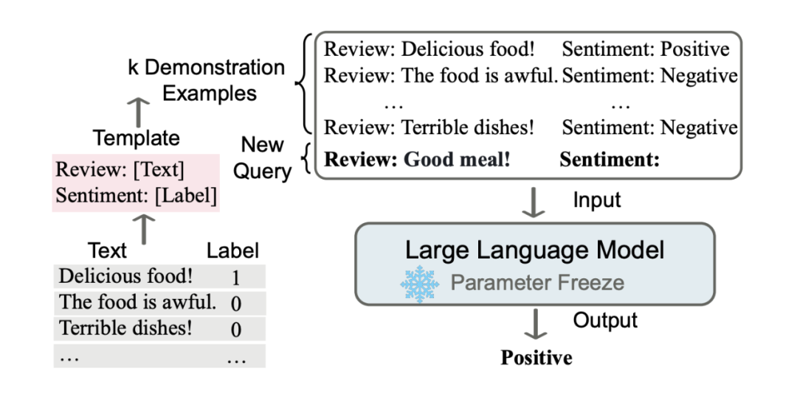

In Context Learning（ICL）的关键思想是从类比中学习。上图给出了一个描述语言模型如何使用 ICL 进行决策的例子。首先，ICL 需要一些示例来形成一个演示上下文。这些示例通常是用自然语言模板编写的。然后 ICL 将查询的问题（即你需要预测标签的 input）和一个上下文演示（一些相关的 cases）连接在一起，形成带有提示的输入，并将其输入到语言模型中进行预测。

值得注意的是，与需要使用反向梯度更新模型参数的训练阶段的监督学习不同，**ICL 不需要参数更新，并直接对预先训练好的语言模型进行预测（这是与 prompt，传统 demonstration learning 不同的地方，ICL 不需要在下游 P-tuning 或 Fine-tuning）**。我们希望该模型学习隐藏在演示中的模式，并据此做出正确的预测。

### **论文分析**

Rethinking the Role of Demonstrations: What Makes In-Context Learning Work？中我们已经发现 Demonstration，ICL 与大规模语言模型结合（LMs）在零样本条件下的许多任务上取得了很好的效果，但人们对它如何工作以及演示的哪些方面有助于最终任务的执行知之甚少。本文主要以实验为主，探究以上影响 ICL 的因素。

**实验设置**

作者采用 12 个模型进行了实验。我们包括 6 种语言模型（表 1），所有这些模型都是仅限解码器的 dense LM。LMs 的大小从 774M 到 175B 不等。

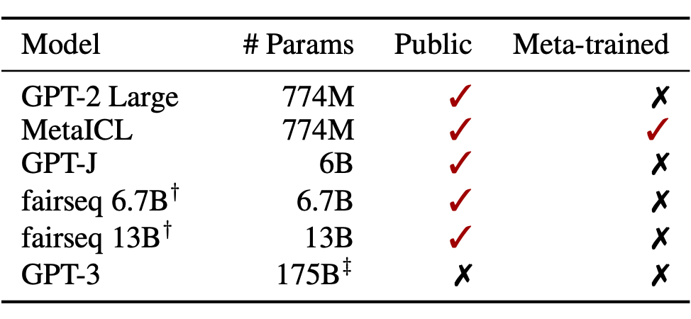

对于每个模型，作者采用了两种应用方式，即 direct 和 channel：

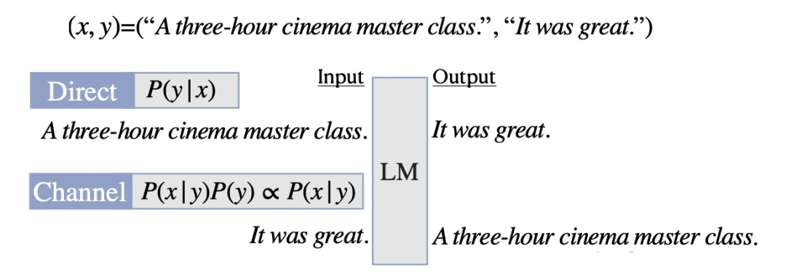

**Direct：**直接计算给定 input x 条件下，label y 的概率 P(y|x)。

**Channel：**与上面恰好相反，给定 y 的条件下计算 x 的概率 P(x,y)∝P(x|y）。

作者在如下数据集上进行实验，包括情感分析，段落检测，自然语言推理，仇恨言语检测，问答，句子补全等任务。

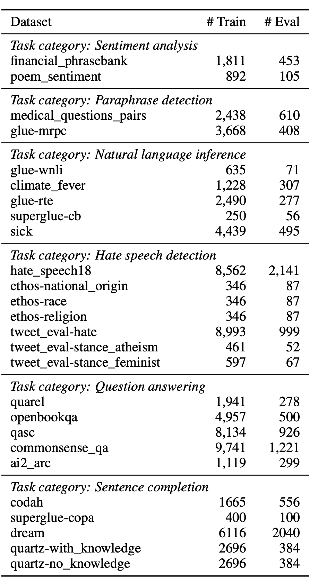

### **结论1：ICL中Ground Truth信息无关紧要**

**
**

**No Demos：**LMs 直接进行零样本预测，无提示

**Demos w gold：**依赖于 K 个标注的 examples 进行提示，进行预测

**Demos w random labels：**抽样 K 个 examples 提示，但样本 labels 在标签集中随机采样，而非 groundtruth。

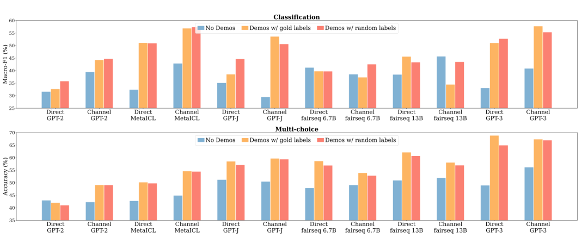

我们发现，用随机标签替换黄金标签只会轻微影响性能。这一趋势在几乎所有的模型上都是一致的：模型看到的性能下降在 0-5% 的绝对范围内。在多选择任务中（平均 1.7%）替换标签的影响小于在分类任务中（2.6% 的绝对标签）。

这一结果表明，地面真实值输入标签对并不是实现性能提高的必要条件。这是违反直觉的，因为正确的配对训练数据在典型的监督训练中是至关重要的——它通知模型执行下游任务所需的期望输入-标签对应。尽管如此，这些模型在下游任务上确实取得了非常重要的性能。

作者在以下 3 个维度上进一步做了消融实验：**正确演示占总的百分比**（下图1）与**演示样本数量 K**（下图2），**演示的模板样式**（下图3）。

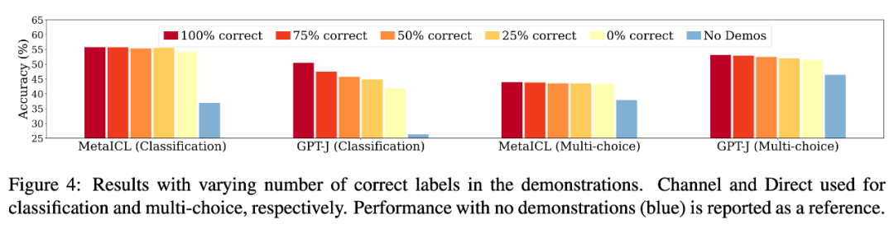

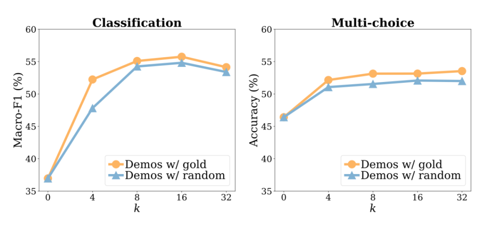

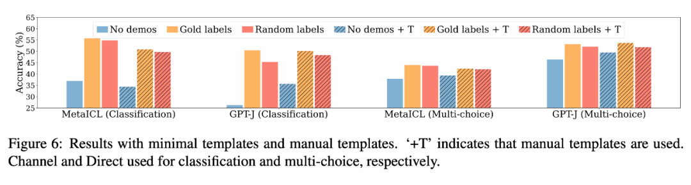

可以得到相似的结论，在演示正确与否影响并不大。

### **结论2：ICL的性能收益主要来自独立规范的输入空间和标签空间，以及正确一致的演示格式**

作者分别从以下四个维度探究 In-Context Learning 效果增益的影响。

**
**

**1. The input-label mapping：**即每个输入 xi 是否与正确的标签 yi 配对

**
**

**2. The distribution of the input text：**即 x1...xk 的分布是否一致

**
**

**3. The label space：**y1...yk 所覆盖的标签空间

**
**

**4. The format：**使用输入标签配对作为格式。

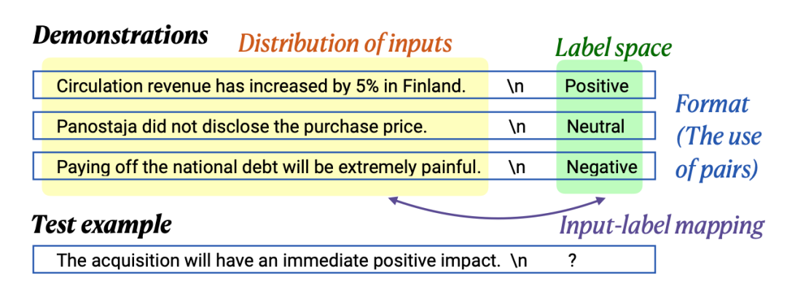

**输入文本分布实验：**

下图中，青绿色的柱子为用（从外部语料中）随机采样的句子替换输入句子的设置。可以看到，模型表现明显下降。因此，in-context learning 中，演示中的分布内输入极大地有助于提高性能。这可能是因为已 IND（in-distribution）文本的条件使任务更接近于语言建模，因为 LM 在此期间总是以 IND 文本为条件进行推理标签。

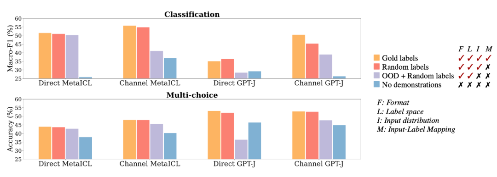

**标签空间实验：**

下图中，青绿色的柱子为用随机英语词汇替代展示样本中的标签。可以看到，模型表现明显下降。因此，in-context learning 中，标签空间的一致性显著有助于提高性能。

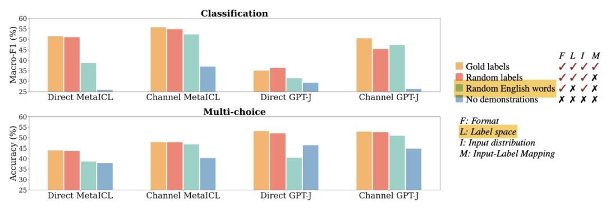

**演示格式实验：**

下图中，分别用 labels only（深紫）和 no labels（深绿）来探索演示模式的差异对模型表现的影响。可以看到，模型相对于上面两图的 OOD setting 而言，都有了进一步的下降。这可以表明 ICL 中保持输入-标签对的格式是关键的。

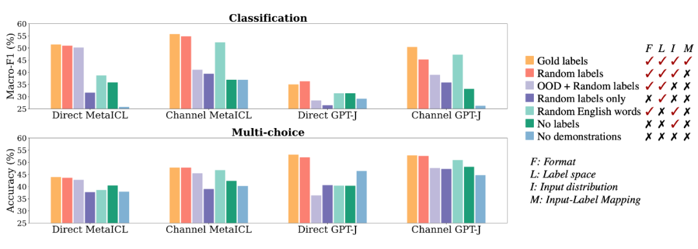

### **有意思的讨论**

作者还进行了个有意思的讨论，**即模型是否在 Test 阶段学习到了知识？**

作者认为如果我们对学习进行严格的定义，即学习在训练数据中给出的输入标签对，那么 lm 在测试时不学习新的任务。然而，学习一项新任务可以更广泛地解释：它可能包括适应特定的输入和标签分布以及演示的格式，并最终更准确地做出预测。有了这个学习的定义，该模型确实可以从演示中学习任务。我们的实验表明，该模型确实利用了演示的各个方面，并实现了性能的提高。

### 

### **总结**

本文从多个角度探究了演示是如何让 In-context learning 在不同的任务中产生性能增益的，而且随着 fine-tune 阶段的黑盒化，很多文章也提出 fine-tune 阶段可能让模型丧失了泛化性，那么 ICL 这种不 fine tune 的方法既节省时间与资源开销，且能提升效果，应该会在大模型林立的时代被人关注，并迅速火起来。

**往期回顾**

**
**

**基础知识**

【CV知识点汇总与解析】|损失函数篇

【CV知识点汇总与解析】|激活函数篇

【CV知识点汇总与解析】| optimizer和学习率篇

【CV知识点汇总与解析】| 正则化篇

【CV知识点汇总与解析】| 参数初始化篇

【CV知识点汇总与解析】| 卷积和池化篇 （超多图警告）

【CV知识点汇总与解析】| 技术发展篇 (超详细！！！)

**
**

**最新论文解析**

NeurIPS2022 Spotlight | TANGO：一种基于光照分解实现逼真稳健的文本驱动3D风格化**
**

ECCV2022 Oral | 微软提出UNICORN，统一文本生成与边框预测任务**
**

NeurIPS 2022 | VideoMAE：南大&腾讯联合提出第一个视频版MAE框架，遮盖率达到90%**
**

NeurIPS 2022 | 清华大学提出OrdinalCLIP，基于序数提示学习的语言引导有序回归

SlowFast Network：用于计算机视觉视频理解的双模CNN**
**

WACV2022 | 一张图片只值五句话吗？UAB提出图像-文本匹配语义的新视角！**
**

CVPR2022 | Attention机制是为了找最相关的item？中科大团队反其道而行之！**
**

ECCV2022 Oral | SeqTR：一个简单而通用的 Visual Grounding网络**
**

如何训练用于图像检索的Vision Transformer？Facebook研究员解决了这个问题！**
**

ICLR22 Workshop | 用两个模型解决一个任务，意大利学者提出维基百科上的高效检索模型

See Finer, See More！腾讯&上交提出IVT，越看越精细，进行精细全面的跨模态对比！**
**

MM2022｜兼具低级和高级表征，百度提出利用显式高级语义增强视频文本检索**
**

MM2022 | 用StyleGAN进行数据增强，真的太好用了

MM2022 | 在特征空间中的多模态数据增强方法

ECCV2022|港中文MM Lab证明Frozen的CLIP 模型是高效视频学习者

ECCV2022｜只能11%的参数就能优于Swin，微软提出快速预训练蒸馏方法TinyViT

CVPR2022|比VinVL快一万倍！人大提出交互协同的双流视觉语言预训练模型COTS，又快又好！

CVPR2022 Oral｜通过多尺度token聚合分流自注意力，代码已开源

CVPR Oral | 谷歌&斯坦福（李飞飞组）提出TIRG，用组合的文本和图像来进行图像检索
