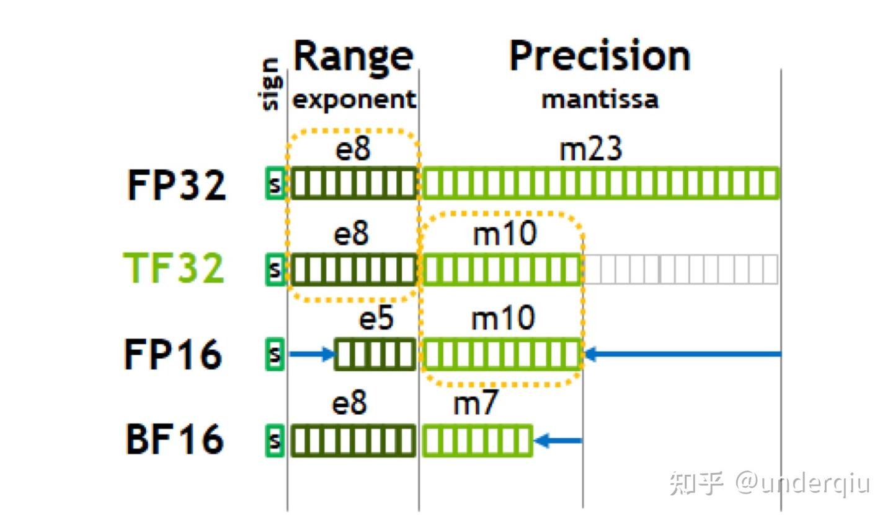
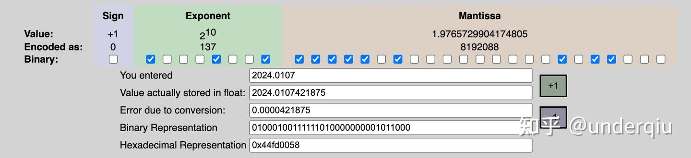
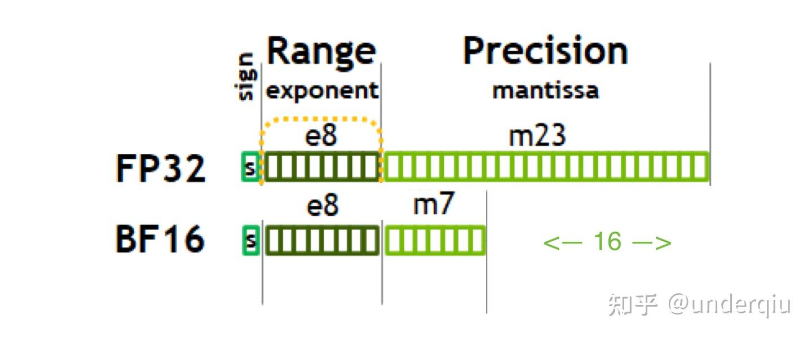
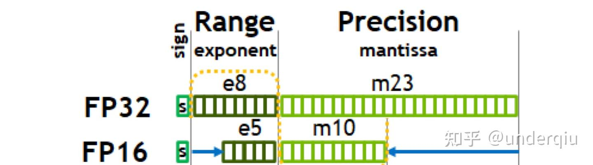
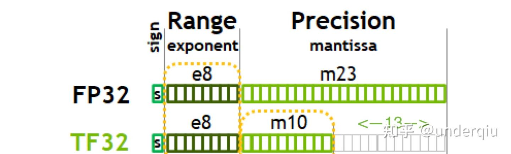
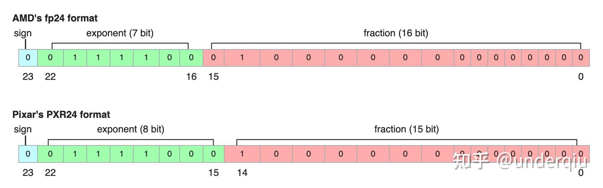

### **从一次面试搞懂 FP16、BF16、TF32、FP32**

https://images.nvidia.cn/aem-dam/en-zz/Solutions/data-center/nvidia-ampere-architecture-whitepaper.pdf#cid=_pa-srch-baid_zh-cn题图来自于 英伟达安培架构白皮书。

离上次记录面试情况 memcpy[1]([underqiu：面试社死现场之 memcpy 实现](https://zhuanlan.zhihu.com/p/518307924)) 已经有一段时间了，之后也陆陆续续聊了几家，很惭愧，时至今日，offer 拿到不多。一部分原因是自身定位不清晰，目标岗位差别大，另一部分原因可能是日益低迷的就业市场增强候选人的内卷，但我们知道这些是真是假都不重要，都可以是借口，自己还是要清晰得认识到主要矛盾还是在自身不够硬的事实上。

不过时至成文，自己也已入职新公司一段时间，总体情况从一开始的鸡血状态也转至一般，甚至厌倦，按乔布斯说的，你要 love what you do，if you never found it, don‘t settle，我觉得貌似又到了 don't settle, keep looking 的阶段了。

这里复盘之前面试腾讯败北的案例，和上次实现 memcpy 翻车一样，这次面试其实也被一个很基础很细节的问题难住，失了荆州。同样也是一道编程题，“请实现 FP32 到 BF16 的转换”。虽然工作中经常使用各种 reduced precision 来进行模型加速调优，但是真正到了实现，现场却想了好久没答出来，这里做个记录，进入错题集，加深印象。

### **Reduced Precision**

首先随便从 NV 的白皮书梳理一下新数据类型的历史。

FP16 最早是在图形学领域写 shader 相关的语言中引入的。其与8位或16位整数相比具有动态范围高的优点，可以使高对比度图片中更多细节得以保留。与单精度浮点数相比，它的优点是只需要一半的存储空间和带宽（但是会牺牲精度和数值范围）。

之后 FP16 随着 Volta 系列 Tensor Core 推出而广泛引用于深度学习，从而发扬光大。 类似的数据类型还有。 INT8 INT4 和 binary 1-bit 精度数据在图灵架构推出。 A100 Tensor Core 增加了 TF32 、BF16 和 FP64 的支持。

这些个 Reduced Precision 在算力紧缺的深度学习时代，在精度和性能做了取舍，推动着各种计算任务的发展，而它们背后正真的不同就在于其各自代表的位宽和位模式的不一样。

以单精度浮点数为例： 一个浮点数 (Value) 的表示其实可以这样表示(大多数情况) ：

Value = sign X exponent X fraction

也就是浮点数的实际值，等于符号位（sign bit）乘以指数偏移值(exponent bias)再乘以分数值(fraction)。

比如本文成文时间 2024.0107 实际上的表示就是

图来自网页工具 https://www.h-schmidt.net/FloatConverter/IEEE754.html

可以看到，不同于定点数，浮点数很多都其实都是近似，像我们这个数在计算机的表示实际上是2024.0107421875，就有转换误差 0.0000421875。 除此之外，这里面也会有一些特殊意义比如说 nan，inf ，0 之类的，不是本文重点，我们这里按下不表，详情参考 IEEE_754[2]。

而 NV 新推广的这些浮点类型也就是在这些位的分配上略有不同，通过，或者缩小指数位位宽来降低表数范围或者通过缩小数值位宽来缩小精度范围，从而降低整个深度学习计算负载的大小。而大多数情况下，舍弃这一点精度可以换来计算效率的大幅提升而不影响推理结果，而且很多流行的工程项目最后都可以优雅地使用低精度方案解决，所以开始得到广泛使用。

那么我们应该如何实现各个数据类型之间的转换呢？

### **请实现 FP32 到 BF16 的转换**

BF16 组成：

1个符号位， 8 个指数位， 举个例子 0 11110 1111111111 = 65504 （max half precision）

其实就是把 float32 后边多余的位给砍掉就好。 当时无从下手，后面看到 ncnn 里的实现通俗易懂，这里贴出来:src/mat.h[3]

`// convert float to brain half
NCNN_EXPORT NCNN_FORCEINLINE unsigned short float32_to_bfloat16(float value)
{
    // 16 : 16
    union
    {
        unsigned int u;
        float f;
    } tmp;
    tmp.f = value;
    return tmp.u >> 16;
}
// convert brain half to float
NCNN_EXPORT NCNN_FORCEINLINE float bfloat16_to_float32(unsigned short value)
{
    // 16 : 16
    union
    {
        unsigned int u;
        float f;
    } tmp;
    tmp.u = value 

当时面试考的就是这种情况，当时脑子里也知道最简单的方式就是砍掉后面的位数就行，但是却卡住不知如何下手，现在一看这 ncnn 的代码真的是很简洁优雅，一个 union 加移位就搞定了，如果当时想到了，现在会不会就在大厂搬砖了呢！

### **请实现 FP32 到 FP16 的转换**

**

FP16 和 BF16 有着一样的位宽，但要做起数据类型转换可比 BF16 复杂了不少。 FP16 是比 BF16 更早得到广泛应用的数据类型，他的组成为。 1个符号位5个符号位10个尾数位 这就和 float32 的位模式只有符号位是相同的了。

更详细的可看 wiki Half-precision_floating-point_format[4]

乍看之下确实没法下手，尤其是平时写惯 python，c++ 面向对象的同学们。 但是仔细想想，这其实就是三个映射而已：符号位的对应，指数位的对应，尾数位的对应。 有了这个思路，那就是两步走，分解三个部分，各个部分自己的映射，over。 于是我们可以这么写：

`// 拆分
unsigned int sign = x & 0x80000000;                   //sign flag
unsigned int mantissa_f32 = x & 0x007FFFFF;           // mantissa
unsigned int exponent_f32 = x & 0x7f800000;           // exp
// 映射 
// ...`

我们可以一个一个抠出来，然后再进行下一步（强烈推荐先一步一步试试自己能卡壳在哪）。

不考虑很全面的情况，你也可以参考 这个热火朝天的讨论[5]，简单粗暴地这么写：

其中 sign 最简单，无需转换就是对应位置提取就行，mantissa 可以采用直接偏移的方式，值得注意的是 exponent 需要有个偏置补偿。

这是因为 float 有 8 个 bit，全0和全1有特殊用途，可以表示 00000001-11111110 (1 到 254)，再减去 127 就是 (-126, 127)。

而 float16 有 5 个 bit，全0和全1有特殊用途，可以表示 00001-11110 (1 到 30)，再减去 15 就是 (-14, 15)。

这就导致了他们的表数范围本身就是不同的，转换时需要调整。

Half to float:

`// exponent mask
// 0000 0111 1100 0000 0000 (0x7c00)
// 对 exponent 完整的运算 (((((half >> 10) & 0x1f) - 15 + 127) & 0xff) 

Float to half:

`// exponent mask
// 0111 1111 1000 0000 0000 0000 0000 0000(0x7f800000)
// 对 exponent 完整的运算 ((((float >> 23) - 127 + 15) & 0x1f) >16)&0x8000)|((((x&0x7f800000)-0x38000000)>>13)&0x7c00)|((x>>13)&0x03ff);`

当然这些个简单的算法不能解决那些特殊的情况，就是所谓的 overflow, underflow, denormalized values, infinite values。

这里由于不想把行文篇幅拉的太长，就不摆上丑作了，像上面一样，直接上最高水准的代码。

下面是网上找的 高通** 的代码，可以看到比 fp32 和 bf16 复杂多了，篇幅很长，但是行文一气呵成，十分清晰，拆分，映射，组合，中间还穿插了一些特殊情况的处理，inf 怎么办，nan 怎么办等等，可以暂停细细琢磨，培养思路和编码习惯。

可以看到，高通最后也是用了一个 union 方便的输出结果。

`cl_half to_half(float f)
{
    static const struct
    {
        unsigned int bit_size       = 16;                                                 // total number of bits in the representation
        unsigned int num_frac_bits  = 10;                                                 // number of fractional (mantissa) bits
        unsigned int num_exp_bits   = 5;                                                  // number of (biased) exponent bits
        unsigned int sign_bit       = 15;                                                 // position of the sign bit
        unsigned int sign_mask      = 1 > (float16_params.num_frac_bits + float16_params.num_exp_bits + 1);
    cl_half            half       = 0;

    if (std::isnan(value.f))
    {
        half = float16_params.exp_mask | float16_params.frac_mask;
    }
    else if (std::isinf(value.f))
    {
        half = is_neg ? float16_params.sign_mask | float16_params.exp_mask : float16_params.exp_mask;
    }
    else if (f_abs_bits > float16_params.max_normal)
    {
        // Clamp to max float 16 value
        half = sign | (((1 > float32_params.num_mantissa_bits);
        const unsigned int shifted_bits = nshift > nshift : 0;
        half                            = sign | (shifted_bits >> float16_params.frac_bits_diff);
    }
    else
    {
        half = sign | ((f_abs_bits + float16_params.bias_diff) >> float16_params.frac_bits_diff);
    }
    return half;
}`

来都来了，顺便贴个反向的

`cl_float to_float(cl_half f)
{
    static const struct {
        uint16_t sign_mask                   = 0x8000;
        uint16_t exp_mask                    = 0x7C00;
        int      exp_bias                    = 15;
        int      exp_offset                  = 10;
        uint16_t biased_exp_max              = (1 > float16_params.exp_offset;
    const uint32_t frac            = (f & float16_params.frac_mask);
    const bool     is_inf          = biased_exponent == float16_params.biased_exp_max
                                     && (frac == 0);

    if (is_inf)
    {
        return is_pos ? std::numeric_limits::infinity() : -std::numeric_limits::infinity();
    }

    const bool is_nan = biased_exponent == float16_params.biased_exp_max
                        && (frac != 0);
    if (is_nan)
    {
        return std::numeric_limits::quiet_NaN();
    }

    const bool is_subnormal = biased_exponent == 0;
    if (is_subnormal)
    {
        return static_cast(frac) * float16_params.smallest_subnormal_as_float * (is_pos ? 1.f : -1.f);
    }

    const int      unbiased_exp        = static_cast*(biased_exponent) - float16_params.exp_bias;
    const uint32_t biased_f32_exponent = static_cast(unbiased_exp + float32_params.exp_bias);

    union
    {
        cl_float f;
        uint32_t ui;
    } res = {0};

    res.ui = (is_pos ? 0 : 1 

### **FP32 vs. TF32**

TF32 也是深度学习时代诞生的一种新类型。

这主要是针对 Nvidia Ampere 的 GPU 模式，它一般也是 TensorCore 的中间计算类型，默认情况下将启用。由于使用了 TF32，某些 float32 操作在基于 Ampere 架构的 GPU 上以较低的精度运行，包括乘法和卷积。具体来说，这类运算的输入从 23 位精度四舍五入到 10 位。这对于深度学习模型来说，在实践中不太会造成问题。

可以看到TF32 保持了 range 和 FP32 一致，减少了小数位，使用和 half 一样的 10bit 小数位，使得总体位数为 19 个 bit，降低了数据精度，但同时也在安培架构上带来了强劲的性能提升，参见官网博客[6]。

当然转换的原理都是一样的，对着规格书码就行，这里就不再赘述了，可以试着改改上一节的一些参数，也可以移步 Tensorflow 或者 Pytorch 的代码仓库找找看。

### **其他浮点数**

上述这些 reduce precision 浮点，基本上都是 NV 在主导使用的，除此之外，还有一些诸如 AMD 的fp24，Pixar pxr24 之类的浮点数在其他厂商或者机构中使用，可以看到其实也是在位数分配上有自己的设计。

### **总结**

至此，我们可以从一次面试大致搞懂从 FP16、BF16、TF32、FP32 这些个东西以及它们之间的转换的思路了。大厂的代码相对来讲精准而优雅，看得多了也能提高我们的代码审美。当然，前文代码也只是参考，比如说尾数的映射可能有其他更精确的方式等等，我们更需要习得的自然是相关转换思路，至少是分而治之的总体思想，围绕拆分和转换两个基本步骤，这样才能在面试中 happy hunting。

祝自己接下来好运，也祝大家都有满意的 offer，不卷的工作，有意思的事业，美满的人生！

#### **引用链接**

`[1]` memcpy: [https://zhuanlan.zhihu.com/p/518307924](https://zhuanlan.zhihu.com/p/518307924)*
`[2]` IEEE_754: *https://zh.wikipedia.org/wiki/IEEE_754*
`[3]` src/mat.h: *[https://github.com/Tencent/ncnn/blob/master/src/mat.h#L741](https://link.zhihu.com/?target=https%3A//github.com/Tencent/ncnn/blob/master/src/mat.h%23L741)*
`[4]` Half-precision_floating-point_format: *https://en.wikipedia.org/wiki/Half-precision_floating-point_format*
`[5]` *https://stackoverflow.com/questions/-bit-to-16-bit-floating-point-conversion*
`[6]` *https://blogs.nvidia.com/blog/tensorfloat-32-precision-format/*
