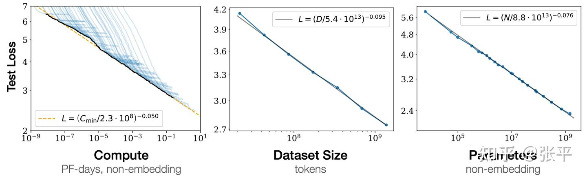
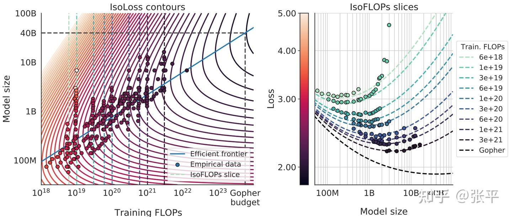

更多的数据，更大的参数规模，更多的算力通常能带来更好的模型性能，但如何量化该问题？LLMs的scaling law是关于该问题的一个**经验性**（empirical）研究，其描述的是模型性能与其规模（数据、参数、算力）之间的scale关系。Scaling law可以帮助我们在资源预算有限的情况下，最优地进行**算力分配**。例如，当可以额外获得的算力有限时，我们是应该继续增大训练数据的规模，还是增大模型的参数规模？哪个选择能带来更大的模型性能提升？即我们应该将新增的算力资源分配给数据还是参数？这里介绍两个基于transformer架构的代表性研究。

(1). Kaplan, J., McCandlish, S., Henighan, T., Brown, T. B., Chess, B., Child, R., ... & Amodei, D. (2020). Scaling laws for neural language models. *arXiv preprint arXiv:2001.08361*.

出自OpenAI团队，核心结论如下：

$$L(N)=(NcN)αN,αN∼0.076,Nc∼8.8×1013L(D)=(DcD)αD,αD∼0.095,Dc∼5.4×1013L(C)=(CcC)αC,αC∼0.050,Cc∼3.1×108\begin{equation} \begin{aligned} & L(N)=\left(\frac{N_c}{N}\right)^{\alpha_N}, \alpha_N \sim 0.076, N_c \sim 8.8 \times 10^{13} \\ & L(D)=\left(\frac{D_c}{D}\right)^{\alpha_D}, \alpha_D \sim 0.095, D_c \sim 5.4 \times 10^{13} \\ & L(C)=\left(\frac{C_c}{C}\right)^{\alpha_C}, \alpha_C \sim 0.050, C_c \sim 3.1 \times 10^8 \end{aligned} \end{equation} $$

其中，L表示模型训练的交叉熵（cross-entropy），是描述模型性能好坏的指标，越低表示性能越好，单位为nat (1 nat=1.4427 bits)。N, D, C 分别表示model size (number of parameters)，dataset size (number of tokens), 和 amount of training compute (PF-days[1])。上式是对L与N, D, C 之间**power-law关系**的一种建模。可以看到，当新增算力有限时，为最大限度提高模型的性能表现，应将算力更多地分配给模型参数而非训练数据，即**倾向于进一步增大参数规模**。

模型性能L随C，D，N增大而改善**(b). Hoffmann, J., Borgeaud, S., Mensch, A., Buchatskaya, E., Cai, T., Rutherford, E., ... & Sifre, L. (2022). Training compute-optimal large language models. *arXiv preprint arXiv:2203.15556*.

出自Google DeepMind团队，核心结论如下：

$$L(N,D)=E+AN&#x03B1;+BD&#x03B2;," role="presentation">L(N,D)=E+ANα+BDβ,\begin{equation} L(N, D)=E+\frac{A}{N^\alpha}+\frac{B}{D^\beta}, \end{equation} $$

$其中， E=1.69,A=406.4,B=410.7,&#x03B1;=0.34,&#x03B2;=0.28" role="presentation">E=1.69,A=406.4,B=410.7,α=0.34,β=0.28\begin{equation} E=1.69, \quad A=406.4, \quad B=410.7, \alpha=0.34, \beta=0.28 \end{equation}。那这个公式是如何得到的呢：作者采用传统的风险分解方法（risk decomposition），假设了上述带有参数E，A，B， &#x03B1;,&#x03B2;" role="presentation">α,β\begin{equation} \alpha, \beta \end{equation} 的参数化模型，然后在N位于70M~16B, D 位于5B ~ 500B的范围内跑了所有不同配置组合的训练实验，再根据实验数据拟合出上述参数化模型 \begin{equation} L(N, D) \end{equation} 。$

根据前文介绍的论文(a)中的经验公式 \begin{equation} C \approx 6 N D \end{equation} ，可求解使得 \begin{equation} L(N, D) \end{equation} 最优的N和D的表达式如下：

$$\begin{equation} N_{o p t}(C)=G\left(\frac{C}{6}\right)^a, D_{o p t}(C)=G^{-1}\left(\frac{C}{6}\right)^b \end{equation} $$

$$其中， \begin{equation} G=\left(\frac{\alpha A}{\beta B}\right)^{\frac{1}{\alpha+\beta}}, a=\frac{\beta}{\alpha+\beta}, b=\frac{\alpha}{\alpha+\beta} \end{equation} 。因此，在compute-optimal的意义下，参数规模和数据规模对于L是“同等重要的”，故算力应在二者之间均等分配**。$$

 L，N，C的参数化拟合结果[1] 1 PF-day = 1 petaflop×24 hours/day×3600 seconds/hour = 24×3600×1015 FLOPs = 8.64 × 1019 FLOPs
