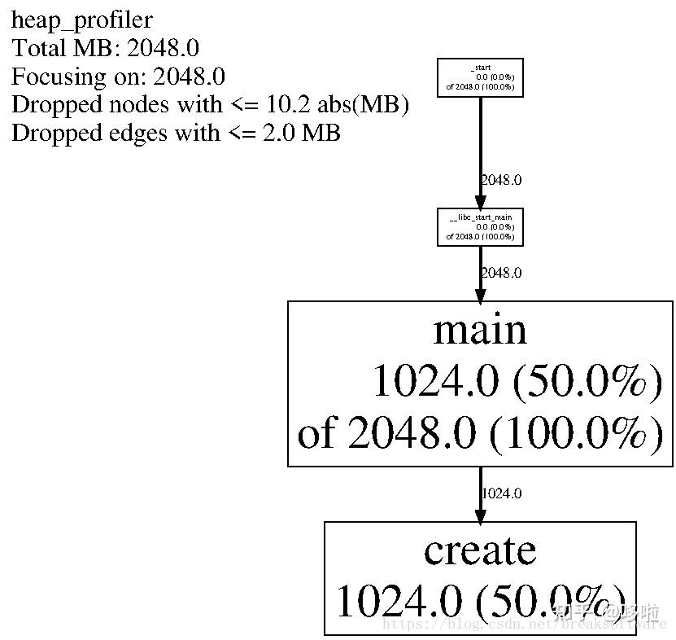
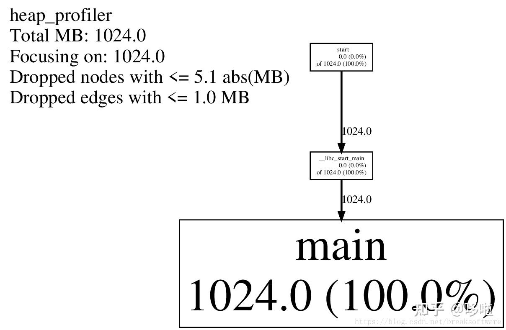
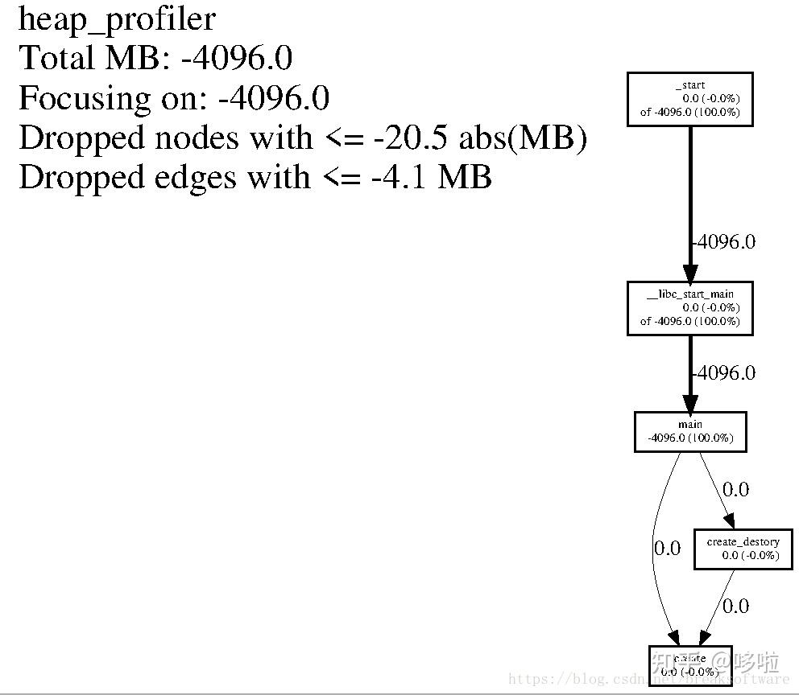
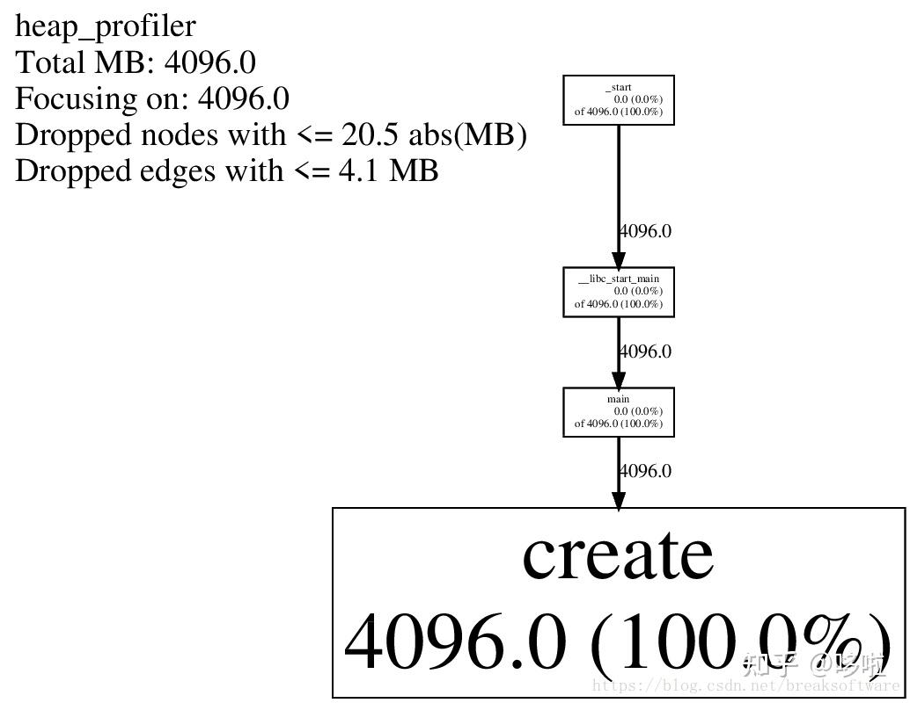

在《内存泄漏分析的利器——gperftools的Heap Checker》一文中，我们介绍了如何使用gperftools分析内存泄漏。本文将介绍其另一个强大的工具——Heap Profiler去分析堆的变化过程。 我们使用类似于《堆状态分析的利器——valgraind的DHAT》中的测试代码作为例子。为了让Heap Profiler产生多份快照文件，我将申请的内存放大了很多

`#include 

void* create(unsigned int size) {
    return malloc(size);
}

void create_destory(unsigned int size) {
    void *p = create(size);
    free(p);
}

int main(void) {
    const int loop = 4;
    char* a[loop];
    unsigned int mega = 1024 * 1024;

    for (int i = 0; i  loop; i++) {
        const unsigned int create_size = 1024 * mega;
        create(create_size);

        const unsigned int malloc_size = 1024 * mega;
        a[i] = (char*)malloc(malloc_size);

        const unsigned int create_destory_size = mega;
        create_destory(create_destory_size);
    }

    for (int i = 0; i  loop; i++) {
        free(a[i]);
    }

    return 0;
}
`

第19行每次申请1G的空间，且在整个程序周期中，都不会释放。 第22行每次申请1G的空间，每个空间都将在第29行释放掉。 第25行调用的create_destory方法，每次申请1M的空间，每次申请完就释放掉。 为了方便起见，我们还是要链接tcmalloc库，并开启调试信息

`g++ heap_profiler.cpp -ltcmalloc -g -o heap_profiler`

编译完后，使用如下指令开始分析。其中HEAPPROFILE表示的“生成快照文件的目录格式”。

`HEAPPROFILE=/tmp/profile /home/fangliang/gperftools_test/heap_profiler/heap_profiler`

会得到输出结果。

`Starting tracking the heap
Dumping heap profile to /tmp/profile.0001.heap (1024 MB allocated cumulatively, 1024 MB currently in use)
Dumping heap profile to /tmp/profile.0002.heap (2048 MB allocated cumulatively, 2048 MB currently in use)
Dumping heap profile to /tmp/profile.0003.heap (3073 MB allocated cumulatively, 3072 MB currently in use)
Dumping heap profile to /tmp/profile.0004.heap (4097 MB allocated cumulatively, 4096 MB currently in use)
Dumping heap profile to /tmp/profile.0005.heap (5122 MB allocated cumulatively, 5120 MB currently in use)
Dumping heap profile to /tmp/profile.0006.heap (6146 MB allocated cumulatively, 6144 MB currently in use)
Dumping heap profile to /tmp/profile.0007.heap (7171 MB allocated cumulatively, 7168 MB currently in use)
Dumping heap profile to /tmp/profile.0008.heap (8195 MB allocated cumulatively, 8192 MB currently in use)
Dumping heap profile to /tmp/profile.0009.heap (Exiting, 4096 MB in use)`

第2到9行显示，每个快照都会增长1G的内存申请。第10行显示，释放了4G的内存，最终还有4G的内存没有被释放。这个分析结果和代码的逻辑是一致的： 第19行和第22行每次都申请1G空间，一共执行了4次，故8G的在用内存使用量。 第25行每次申请并释放了1M，故不会造成内存增长。 第29行每次释放1G的空间，共执行4次，释放了4G空间。最终有4G的内存泄漏。 我们先看下第一个快照的状态

`pprof --text heap_profiler /tmp/profile.0001.heap`

此时我们使用的文本输出方式（--text）。

`Using local file heap_profiler.
Using local file /tmp/profile.0001.heap.
Total: 1024.0 MB
  1024.0 100.0% 100.0%   1024.0 100.0% create
     0.0   0.0% 100.0%   1024.0 100.0% __libc_start_main
     0.0   0.0% 100.0%   1024.0 100.0% _start
     0.0   0.0% 100.0%   1024.0 100.0% main`

第4到7行是调用堆栈，这段显示create方法申请了1G的空间，且该空间还是可用状态。 再查看快照2。

`pprof --text heap_profiler /tmp/profile.0002.heap`

其结果显示main函数和create函数各申请了1G的空间（第4\~5行第1列），各占总未释放内存（2G）的50%（第4\~5行第2列）。main函数中调用了create方法（第4~5行第3,4,5列显示出main中直接调用了create，因为main函数中直接和间接申请了2G的空间，其中1G是直接申请的）

`Using local file heap_profiler.
Using local file /tmp/profile.0002.heap.
Total: 2048.0 MB
  1024.0  50.0%  50.0%   1024.0  50.0% create
  1024.0  50.0% 100.0%   2048.0 100.0% main
     0.0   0.0% 100.0%   2048.0 100.0% __libc_start_main
     0.0   0.0% 100.0%   2048.0 100.0% _start`

为了更方便解读这组信息，我们使用图形显示命令

`pprof --gv heap_profiler /tmp/profile.0002.heap`

显示结果如下 

在这里插入图片描述 上图中，main下面“1024.0（50.0%）”意思是main函数直接申请了1024M尚未释放的空间，占总未释放空间的50%。再下面一行“of 2048.0 (100.0%)”意思是main函数直接或者间接申请了2048M尚未释放的空间（这意味着它申请并释放了的空间不在该统计内）。create中的信息解读是类似的。 如果只是单纯的看一个快照点，是比较难以发现问题。我们需要对比两个快照，比如我们对比1号和2号快照，看看1G内存的增长是什么导致的。

`pprof --gv heap_profiler --base=/tmp/profile.0001.heap  /tmp/profile.0002.heap`

在这里插入图片描述 可以发现，快照1和快照2的变化是：main函数自身申请了1G的空间。 我们再对比下8和9号快照。

`pprof --gv heap_profiler --base=/tmp/profile.0008.heap  /tmp/profile.0009.heap`

在这里插入图片描述 上面显示：main函数内部释放了4G的空间（出现了负值）。这个就是第29行代码的执行结果，分析和代码逻辑一致。 最后我们再看下最后一片快照。

`pprof --gv heap_profiler /tmp/profile.0009.heap`

在这里插入图片描述 create函数导致的4G内存泄漏就一目了然了。 最后提一句，如果项目不能链接tcmalloc，则可以使用如下的指令去获取快照

`LD_PRELOAD="/usr/local/lib/libtcmalloc.so" HEAPPROFILE=/tmp/profile /home/fangliang/gperftools_test/heap_profiler/heap_profiler`
