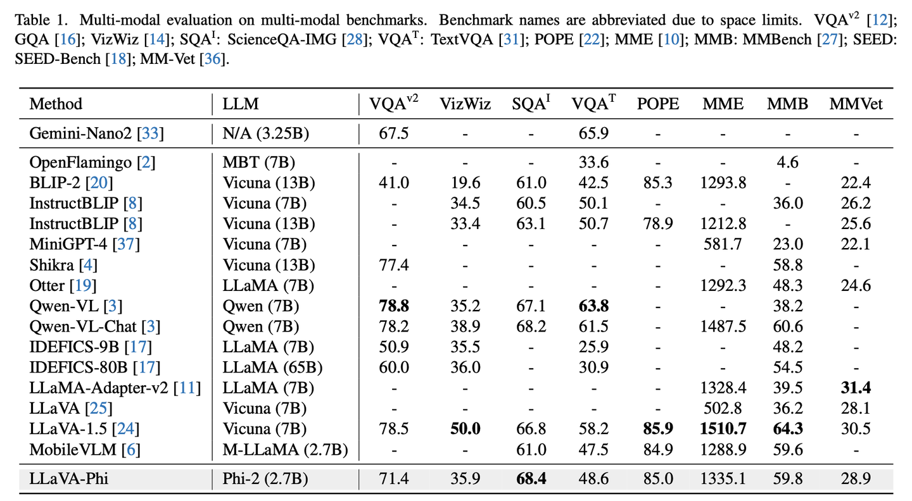
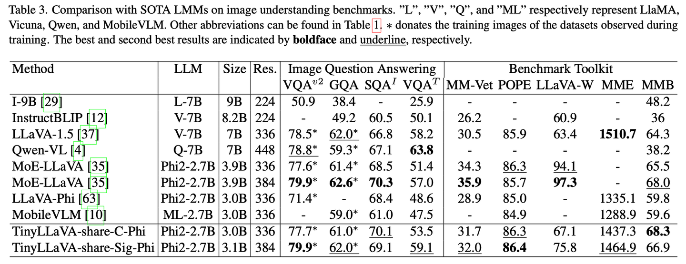
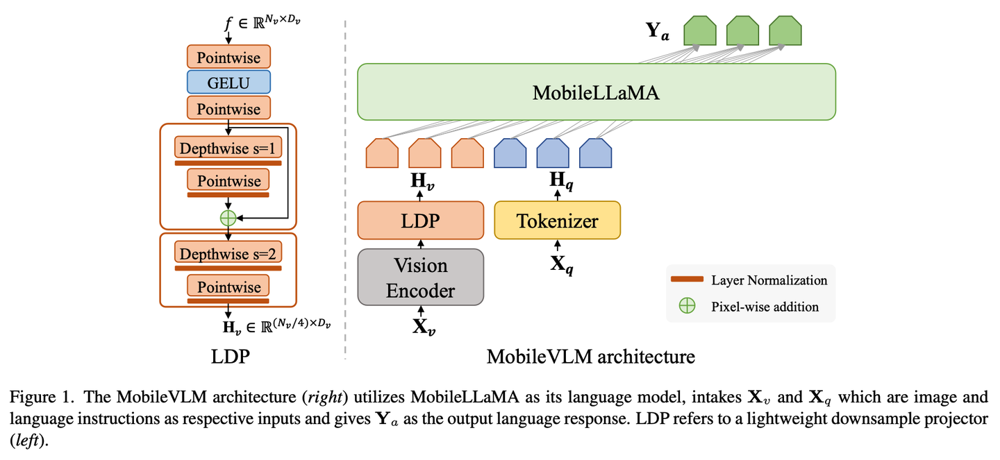
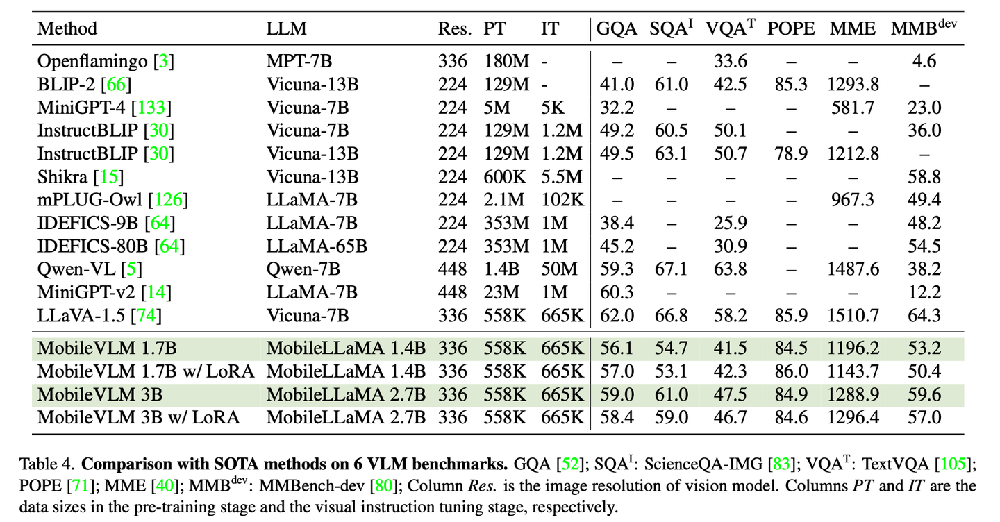
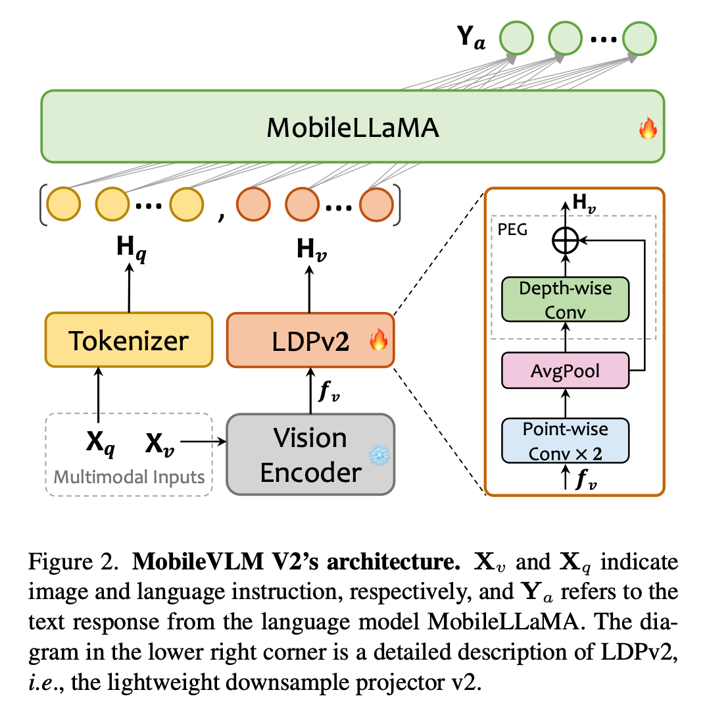
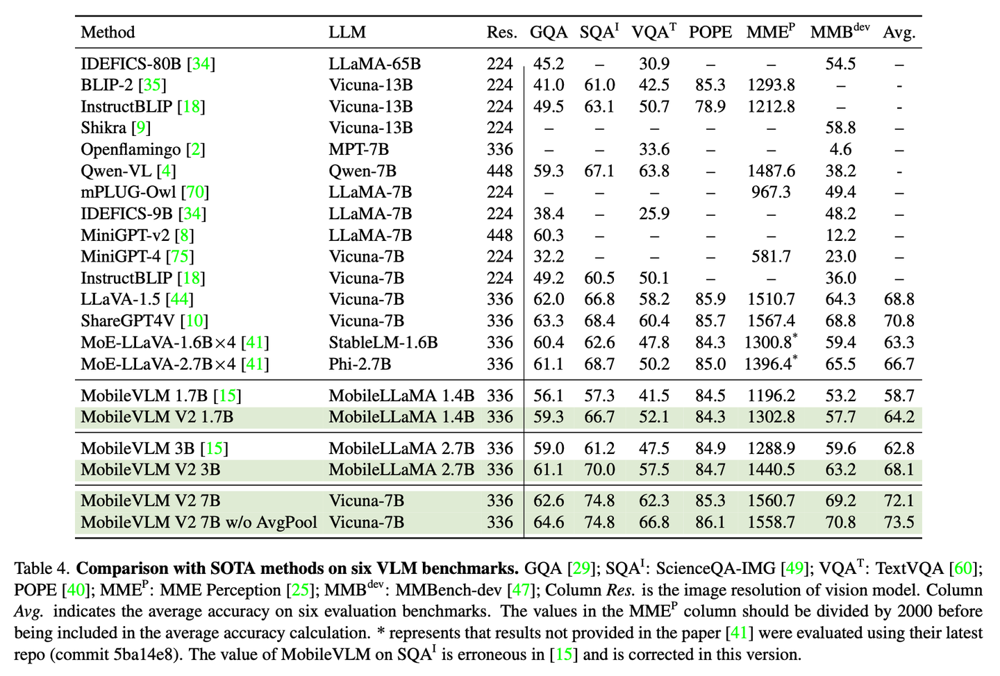

这里介绍几篇多模态小模型，探索一下目前主流的轻量级多模态大模型是如何设计的。通读下来，这几篇文章的轻量级多模态大模型的设计思路都是类似的，包括更换backbone、更换训练策略和使用更多训练数据。

### LLaVa-Phi

论文：LLaVA-Phi: Efficient Multi-Modal Assistant with Small Language Model

代码：[https://github.com/zhuyiche/llava-phi](https://link.zhihu.com/?target=https%3A//github.com/zhuyiche/llava-phi)

#### 总结概括

本文提出了LLaVa-Phi，一种轻量级的多模态大模型，部分性能指标上达到LLaVa-1.5-7B模型。其模型架构和LLaVa相似，一个visual encoder+projector+LLM，主要差别为其LLM采用了轻量级的Phi-2 (2.7B) [1]。训练数据与LLaVa无异，也是采用预训练+指令微调的方式，在8张a100下，分别需要消耗1.5小时和8小时。

[1] Textbooks are all you need ii: phi-1.5 technical report.

### TinyLLaVa

论文：TinyLLaVA: A Framework of Small-scale Large Multimodal Models

代码：[https://github.com/DLCV-BUAA/TinyLLaVABench](https://link.zhihu.com/?target=https%3A//github.com/DLCV-BUAA/TinyLLaVABench)

#### 总结概括

这篇论文算是比较翔实的实验论文，对LLM、visual backbone、projector、训练数据和训练方式进行了比较全面的效果实验。总结论文的几个观点：

- 在LLM上，基本满足越大的LLM可以取得更好的性能，即Phi-2 (2.7 B)>StableLM-2 (1.6B) > TinyLlama (1.1B)。
- 在visual backbone上，SLIP好于CLIP，但是SLIP采用的是384分辨率，而CLIP是334分辨率，所以SLIP更好的效果可能主要是来自于更大的分辨率。
- 在projector上，目前的MLP已经足以做模态对齐。
- 在训练数据上，使用更高质量的数据如ShareGPT4v，效果略好于LLaVA-1.5数据集。
- 在训练方式上，预训练时微调visual encoder会取得更好的效果。
总而言之，轻量级多模态大模型，用更强的backbone、更多的训练参数、更高质量的训练数据，就可以取得更好的效果，感觉这个结论是显而易见的，缺少insight。做这种消融所需要的计算资源也比较多。 表3展示了TinyLLaVa与其他MLLM的对比结果。

### MobileVLM系列

MobileVLM包括v1和v2版本，由美团提出。

#### MobileVLMv1

论文：MobileVLM: A Fast, Strong and Open Vision Language Assistant for Mobile Devices

代码：[https://github.com/Meituan-AutoML/MobileVLM](https://link.zhihu.com/?target=https%3A//github.com/Meituan-AutoML/MobileVLM)

本文提出了MobileVLMv1，可以运行于低计算力平台如智能手机。主要在模型结构上进行设计，包括LLM encoder和projector。如图1所示：

- 在LLM encoder上，论文对LLaMa进行了缩放，训练出了MobileLLaMa，包括1.4B和2.7B模型。
- 在projector上，提出了Lightweight Downsample Projector (LDP)。它相对于MLP，会通过下采样降低Token数量，提升模型效率，同时为了增强局部性，使用了深度卷积和逐点卷积。

在多模态预训练时，和llava类似，采用两阶段的训练。在8张a100下，1.7B的模型需要5小时，3B的模型需要8小时，所需要的训练资源不算多。表4展示了一些性能对比。

#### MobileVLMv2

该文是MobileVLM的改进，主要在三个方面进行了改进，包括projector、训练策略、训练数据：

- projector上，改变了下采样方式，采用平均池化，如图2所示。
- 训练策略上，在两阶段的训练上都放开了projector和LLM。
- 训练数据上，在第一阶段使用ShareGPT4v做预训练；第二阶段使用多个任务的数据集（如caption数据集、VQA数据集和指令微调数据集）进行联合训练。

所设计的MobileVLMv2，相较于v1版本在多个数据集上均有提升，其3B版本在部分指标上与LLaVa-1.5-7B相当。

