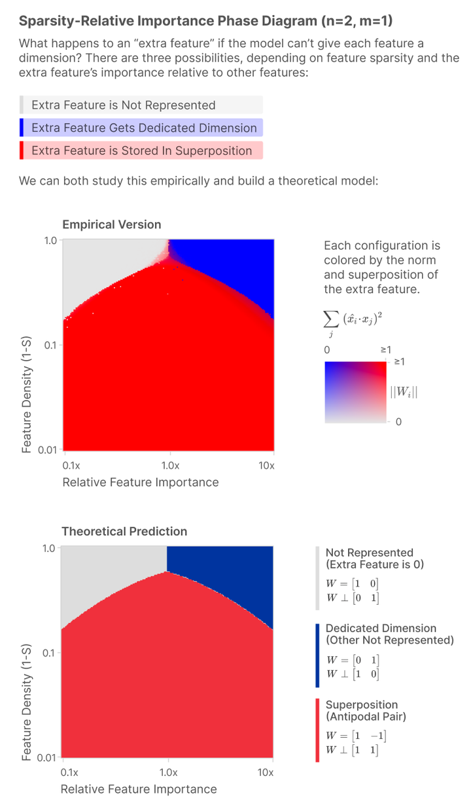
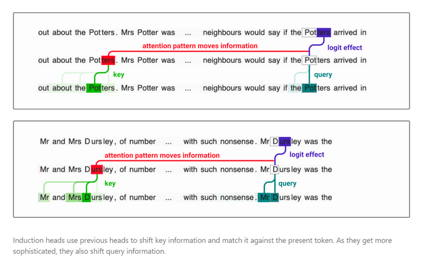
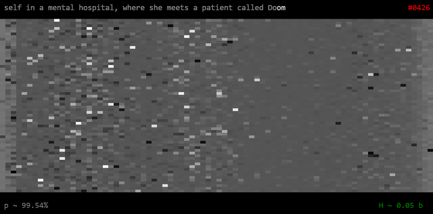
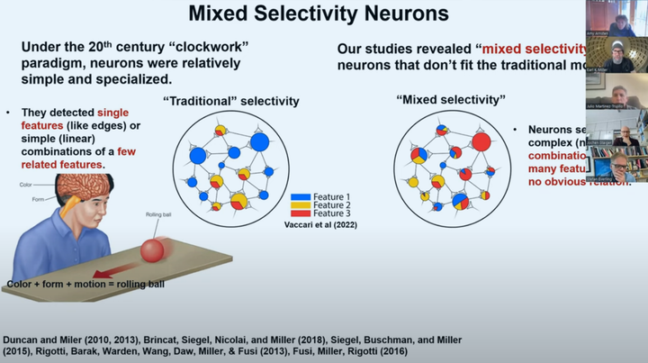
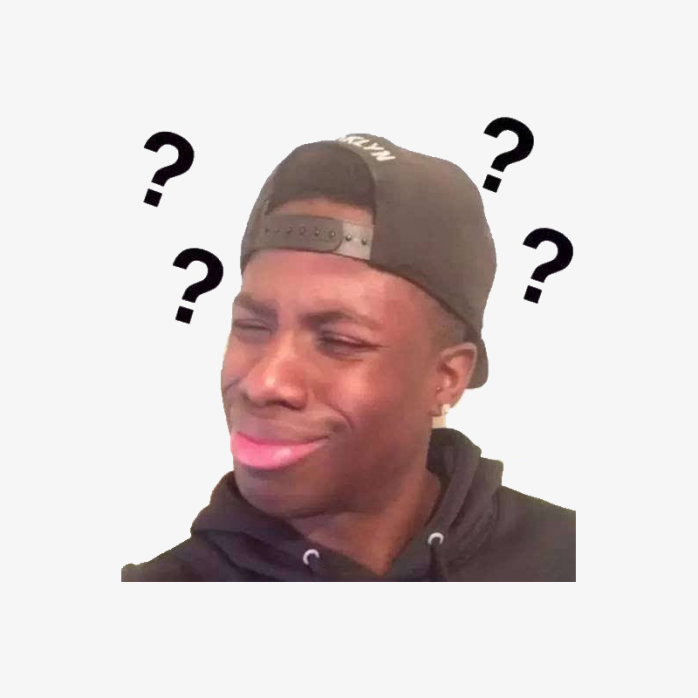
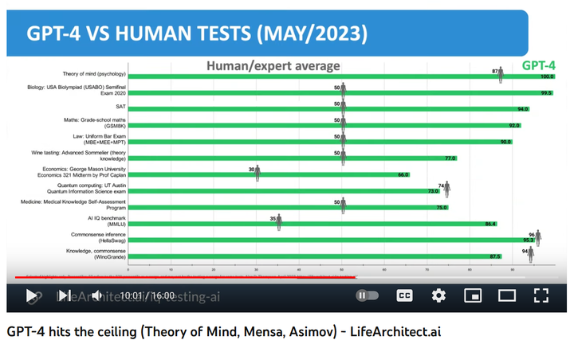
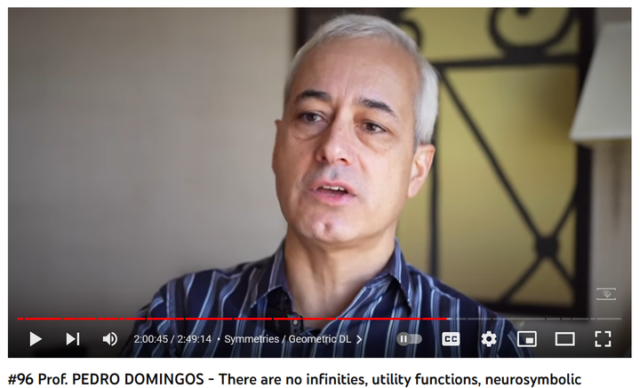
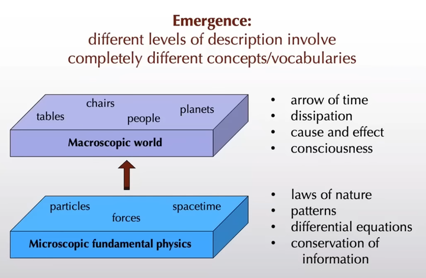

本回答是专栏文章的威力加强版[[1]](#ref_1)，不保证勘误或者更新。

[空门：Perturbation is the Way45 赞同 · 9 评论 文章](https://zhuanlan.zhihu.com/p/626525134)

#### TL;DR;

涌现这个说法不是很合适，因为大语言模型可以用条件概率分布表征，原始分布几乎没有零概率的 token，所以所有的合法序列都有非零概率[[2]](#ref_2)。如果借用 no-design laws 来描述，就比较科学了。不过，相关的论文都是纯粹的 observational study，即便达到 mechanistic interpretability 的高度也只是现象学，所以谈不上科学或者伪科学。

我觉得真正有意思的问题是，为什么简单的自回归训练能够让语言模型唬住各路大佬，能让 LeCun 气急败坏，也能让 Hinton 亲自下场发表观点。

我抛块砖出来 —— 这是微扰和准临界现象的功劳。

#### Ubiquitous Perturbation

微扰这个术语已经困扰了我多年，它似乎是物理学家最喜欢的一种计算工具。在量子力学的语境下，微扰论[[3]](#ref_3)似乎跟数学意义上的摄动法不太一样[[4]](#ref_4)，比如个别知乎大佬就认为这是中文翻译的问题[[5]](#ref_5)。抛开微扰这个翻译是否合理不谈，它显然是一种近似计算的工具，总是用一个简单的系统通过某种修正去近似更复杂的系统。大家最熟悉的泰勒展开就是微扰法的一个特例[[6]](#ref_6)。甚至有某个我关注过的知乎大佬说路径积分也是微扰论的一个方法[[7]](#ref_7)，只是以我对量子力学肤浅的了解无法判断其正确性。

由于数学中的摄动法通常是为了寻找一些非线性系统的近似解，我对它并没有太多的重视[[8]](#ref_8)。而且无论在哪个版本中，微扰都需要性质非常好的代数结构，比如泰勒展开的前提是函数是解析的，而量子力学需要 Hilbert Space[[9]](#ref_9)[[10]](#ref_10)。而且我发现大多数可计算问题其实都跟 fiber bundle 和 manifold 没啥关系[[11]](#ref_11)，深度学习领域所谓的流形在数学家看来属于 not even wrong。

然而，当我后知后觉的发现 Latent Diffusion 也是微扰法的某种变体之后，我发现自己错得有点离谱。意识到这一点之后，我还用类似的策略解决了一些实际的工程问题[[12]](#ref_12)。很显然，（广义的）微扰法的适用范围比我想象的要大很多。最近开始分析 LLaMA 系列模型的名义分布之后[[13]](#ref_13)，我才发现 LLaMA-30B 这样的模型在微扰下具备稳定性，而且它所谓的涌现能力只体现在局部测地线的邻域[[14]](#ref_14)。

*那么，是不是可以认为 LLaMA 这样的 LLMs 也是微扰法显灵的奇观呢？*

我很不情愿地认同这种观点[[15]](#ref_15)，并宣称 —— **微扰法自古以来**[[16]](#ref_16)**就是修正主义路线**[[17]](#ref_17)**不可分割的一部分**。

#### Edge of Stability[[18]](#ref_18)

几年前我就发现深度模型的训练过程大致是一个包含随机扰动的动力学过程。在一些小自由度的模型中，使用小 batch 训练反而能取得更好的泛化能力[[19]](#ref_19)。而且大多数监督学习都存在平衡态假设，所以我一直有个大致的概念模型，认为训练过程的轨迹大致是连续，不能在参数空间里面找到很多有趣的东西。

但是在 Latent Diffusion 开始，我之前的很多假设都不再成立。Latent Diffusion 通过引入高斯噪声破坏了平衡态假设，而且推理过程也是个动力学过程，它和简单的前馈神经网络存在实质性的区别。在刚开始接触 Stable Diffusion 的时候，我意识到 DDPM 是一个微扰求解非线性算符的算法，并热衷于利用它的性质制作插值视频[[20]](#ref_20)。仅仅用微扰和稳定性无法解释 Stable Diffusion 的成功，在各种采样视频中都能看到，图像似乎是从噪声模式中涌现出来的。后来我才逐渐发现，在 Stable Diffusion 中，CFG 破坏了可逆性[[21]](#ref_21)并且导致对称性破缺[[22]](#ref_22)。在动力学系统稳定性被破坏的时候，采样过程出现了实质性的飞跃。这种性质类似于物理学系统中的相变。

不难想象，专业的研究者很早就注意到类似的现象，并进行系统的研究——

连相图都画出来了就连 Sebastien Bubeck 都开始讨论 Physics of AI[[23]](#ref_23)，我当然也得抛出些关于准临界现象的暴论[[24]](#ref_24)。

我的猜想大致如下：

*当训练过程经历某些（准）相变之后，LLaMA-[30B, 65B] 在微扰下可以探索之前无法到达的参数空间，从而具备了更强的表征能力。这类参数空间对于更小的模型是不可到达的。LLaMA-13B 很可能存在类似的参数空间，只不过很难*[[25]](#ref_25)*通过同样的微扰到达这些参数空间。*

相变和准临界现象通常意味着系统中出现长程相关，无法用还原论的典型套路来处理。例如 Anthropic 的研究者就发现，Transformer 可能会使用所谓的 Induction Head 来做 in-context learning[[26]](#ref_26)——

个人觉得实际情况比 Toy Model 更复杂
#### No Design[[27]](#ref_27)

有些人似乎对 涌现/Emergence 这个说法并不满意[[28]](#ref_28)，我并不能苟同。最关键的问题是并没有 emergence 的严格定义，如果使用类似相变和临界现象的定义，那么所有的计算模型都不可能出现严格意义上的涌现[[29]](#ref_29)。如果自然语言需要像数学语言那么严谨，那正常人类都没办法沟通。

不过，我们的确应该找一个比涌现更好的术语来描述所谓的涌现能力。我建议借用 Constructor Theory of Life 中的 no-design laws[[30]](#ref_30)，因为 LLaMA-[30B, 65B] 这样的模型表现出的某些能力并不是人为设计的。这些模型仅仅是一个使用了特殊位置编码的 decoder-only Transformer，设计者并未考虑过前面提到的 in-context learning 或者 induction head。这些模型只是按照自回归的语言模型进行训练，唯一的目标是预测下一个 token 的条件概率分布。Meta 并没有在模型结构和训练中编码任何特别的先验信息，但是 LLaMA-65B 却能够模拟人类的乖张和存在主义风格的吐槽[[31]](#ref_31)。

虽然还没有证据表明各种 Transformer 的变种[[32]](#ref_32)都能涌现出 LLaMA-[30B, 65B] 相当的能力，但是很多不同结构、不同数据集训练的 Transformer 都能够超越 LLaMA-13B[[33]](#ref_33)。这也间接地印证了 no-design thesis 的有效性。无需任何祖传秘方，只要有足够的算力和数据，任何人都有可能复现甚至超越 LLaMA-[30B, 65B]。

只有 no-design thesis 才能合理化[[34]](#ref_34) LLaMA-65B 注意力机制中独特的层次结构 ——

LLaMA-65B 中的注意力结构如果 no-design thesis 成立，那么基于 Transformer 的 LLMs 可以被当作一种发现[[35]](#ref_35)，应该存在更多的计算模型可以超越现有的 LLMs。在新的计算范式下，通过精心设计在模型中引入先验信息，可能还不如用个简单但是并行度好的模型大力出奇迹。相当一部分人（包括一年前的我），都无法接受这一点。所以颇有一些人不理解 Hinton 离开 Google 的理由和言论，觉得他老了或者反应过度[[36]](#ref_36)[[37]](#ref_37)。

像 Max Tegmark 这样的人认为基于 Transformer 的 LLMs 非常低效，因此优化空间非常大。我大致认同他的观点，但是他有一种对人工设计的偏好，对此我无法苟同。我们当然可以通过逆向工程对涌现出来的模型进行优化，就像生物学家可以通过 CRISP 进行基因工程一样。但是这种思路过于狭隘，是一种基于还原论的修正主义。为什么一定要拘泥于 Transformer 等已有的模型结构呢？搞不好 LLMs 的未来属于 SNN[[38]](#ref_38)。

#### Devalue of Intelligence?

以反动学阀 Yann LeCun 为代表的一撮专家对 LLMs 口诛笔伐，妄图将 LLMs 贬低为 Stochastic Parrot[[39]](#ref_39)。半年前我的屁股大概也坐在这边[[40]](#ref_40)。我勉强能跟他们共情，正如我以前同情 Noam Chomsky 的立场一样。

Noam Chomsky 倾向于把语言能力神圣化，所以才会有所谓的 Minimalist Program[[41]](#ref_41)。Noam Chomsky 钦定 LLMs 是一些无趣的 artifact，对语言研究和人类认知毫无价值，最多是工程应用上“useful”[[42]](#ref_42)。 Noam Chomsky 认为人脑中存在一种神圣的 Language Acquisition Device[[43]](#ref_43) —— 人脑可能仅仅是大脑皮层面积更大更多连接甚至不配被称为异端邪说。至于 more is different 这样的箴言，在 Noam Chomsky 看来大概是自欺欺人的废话。作为一个修正主义者，我显然不可能接受这样极端的原教旨主义意识形态。

在很长一段时间里，我的确认为自然语言处理是个非常困难的问题，可能需要非常复杂的模型结构和先验知识才能达到 chatGPT-3.5 的水平。作为 Church-Turing Thesis 和 PCE 的信徒[[44]](#ref_44)，我认为自然语言处理是个可计算问题，只是计算所需的模型结构和计算量超出了现有的计算能力。GPT-4 毫无悬念地把我的脸都打肿了，我亲自把玩了 LLaMA-[30B, 65B] 之后才搞清楚自己错在哪里，强化了关于 more is different 的思想钢印。

抛开事实不谈，从理论上说，LLaMA-[30B, 65B] 这种连递归计算能力都没有的模型甚至不能处理任意的递归文法[[45]](#ref_45)，更不用说高贵的自然语言了。然而，人脑也不能处理任意的递归文法，大多数人对语法的应用和中短篇文本的驾驭能力还不如 GPT-3.5。如果没有纸笔，我的心算能力和逻辑推理能力未必比 GPT-4 强。但是这并不是什么大不了的事情，毕竟运行在笔记本上的围棋程序就能吊打九段棋手[[46]](#ref_46)。即便忽略深度学习和狭义的人工智能，工业文明的很多日常计算任务压根就离不开高性能计算机和千奇百怪的算法[[47]](#ref_47)。我认为既没必要贬低 LLMs，也没有必要捧杀 LLMs[[48]](#ref_48)。

人类的神经元也存在所谓的 Superposition对于没有宗教信仰且相信进化论的人而言，应该可以坦然接受人类的智慧和语言能力是涌现出来的能力[[49]](#ref_49)。在这个前提下，我觉得类似微扰法的机制可能在其中扮演了重要的角色。人类的意识和智慧都是进化塑造的奇观，不会因为人类对它的理解或者模仿而贬值。

#### Verdict

No-design thesis 不仅适用于刻画生命的起源，还能解释[[50]](#ref_50)大脑皮层中涌现出来的智能，自然也能描述大语言模型中所谓的涌现现象。

如果说人话就比较简单 —— 让专家们大跌眼镜。

大佬都想不通，就别问我了还在怀疑 GPT-4 能力，并称之为鹦鹉的人，请看看最新的结果[[51]](#ref_51) ——

没有搞过深度学习的非业内人士，不建议自认为比 Hinton 老爷子更懂 AIPedro Domingos 的访谈[[52]](#ref_52)提到了我关心的大部分问题[[53]](#ref_53)，当然也更加深刻 ——

请大佬收下我的膝盖物理意义上的涌现（仅仅是猜想）——

物理意义上的涌现, Sean Caroll

如果你接受这个定义的涌现，那么大语言模型可以被称为涌现（只是个文字游戏）。

### 参考

- [^](#ref_1_0)guang gao
- [^](#ref_2_0)如果是用浮点数表征很快就下溢了，得用对数算才行。 [https://zhuanlan.zhihu.com/p/624916619](https://zhuanlan.zhihu.com/p/624916619)
- [^](#ref_3_0)https://en.wikipedia.org/wiki/Perturbation_theory_(quantum_mechanics))
- [^](#ref_4_0)https://en.wikipedia.org/wiki/Perturbation_theory
- [^](#ref_5_0)[https://www.zhihu.com/question/319317614/answer/2655720419](https://www.zhihu.com/question/319317614/answer/2655720419)
- [^](#ref_6_0)或者说是微扰法中的一个步骤。
- [^](#ref_7_0)因为实名要求已流失多年。 [https://www.zhihu.com/question/24290545/answer/27342706](https://www.zhihu.com/question/24290545/answer/27342706)
- [^](#ref_8_0)在了解 Koopman Operator Theory 之前，我都对这种用线性系统近似非线性系统的奇技淫巧表示怀疑。
- [^](#ref_9_0)更严格的说，是 Rigged Hilbert Space。 [https://arxiv.org/abs/quant-ph/0502053](https://arxiv.org/abs/quant-ph/0502053)
- [^](#ref_10_0)[https://www.zhihu.com/question/26707049/answer/33748758](https://www.zhihu.com/question/26707049/answer/33748758)
- [^](#ref_11_0)当然更残酷的真相是微分几何什么的实在是太难了。
- [^](#ref_12_0)[https://zhuanlan.zhihu.com/p/574632476](https://zhuanlan.zhihu.com/p/574632476)
- [^](#ref_13_0)[https://zhuanlan.zhihu.com/p/624916619](https://zhuanlan.zhihu.com/p/624916619)
- [^](#ref_14_0)如果使用原始分布采样，模型将会很快开始一本道。
- [^](#ref_15_0)我习惯于用非线性性系统、非微扰结构、远离平衡态这些空洞的口号自我麻痹，低估了准平衡态微扰的潜力。
- [^](#ref_16_0)Who controls the past controls the future! [https://zhuanlan.zhihu.com/p/25180070](https://zhuanlan.zhihu.com/p/25180070)
- [^](#ref_17_0)回想一下，把线性系统修正成非线性系统，显然体现了非线性特色修正路线的优越性。
- [^](#ref_18_0)[https://arxiv.org/abs/2212.07469](https://arxiv.org/abs/2212.07469)
- [^](#ref_19_0)[https://arxiv.org/abs/1609.04836](https://arxiv.org/abs/1609.04836)
- [^](#ref_20_0)[https://zhuanlan.zhihu.com/p/570007292](https://zhuanlan.zhihu.com/p/570007292)
- [^](#ref_21_0)[https://zhuanlan.zhihu.com/p/588808879](https://zhuanlan.zhihu.com/p/588808879)
- [^](#ref_22_0)[https://zhuanlan.zhihu.com/p/593259899](https://zhuanlan.zhihu.com/p/593259899)
- [^](#ref_23_0)https://www.youtube.com/watch?v=XLNmgviQHPA
- [^](#ref_24_0)[https://zhuanlan.zhihu.com/p/625469130](https://zhuanlan.zhihu.com/p/625469130)
- [^](#ref_25_0)很可能是个极低的概率，比如远低于 -100dB 。
- [^](#ref_26_0)建议阅读原文，这个系列的文章得看网页版，arxiv 上 PDF 逊色很多。 https://transformer-circuits.pub/2022/in-context-learning-and-induction-heads/index.html
- [^](#ref_27_0)[https://arxiv.org/abs/1407.0681](https://arxiv.org/abs/1407.0681)
- [^](#ref_28_0)[https://arxiv.org/abs/2304.15004](https://arxiv.org/abs/2304.15004)
- [^](#ref_29_0)有限自由度的可计算系统不可能出现无穷。 [https://zhuanlan.zhihu.com/p/137900403](https://zhuanlan.zhihu.com/p/137900403)
- [^](#ref_30_0)https://royalsocietypublishing.org/doi/10.1098/rsif.2014.1226
- [^](#ref_31_0)[https://zhuanlan.zhihu.com/p/619346041](https://zhuanlan.zhihu.com/p/619346041)
- [^](#ref_32_0)比如 SSM。 https://hazyresearch.stanford.edu/blog/2023-03-27-long-learning
- [^](#ref_33_0)不开放的 gpt-3.5、gpt-4、claude、LaMDA 比这些开源的 LLMs 更强大，但是对社区而言只是一些黑盒。
- [^](#ref_34_0)它类似于弱人择原理，并不能解释我们观察到的现象。
- [^](#ref_35_0)[https://zhuanlan.zhihu.com/p/30155839](https://zhuanlan.zhihu.com/p/30155839)
- [^](#ref_36_0)知乎上部分人甚至对他冷嘲热讽，请强势围观。 [https://www.zhihu.com/question/598709243](https://www.zhihu.com/question/598709243)
- [^](#ref_37_0)Machine Learning Street 放了一个视频很有代表性，但是不知为何被撤回了。
- [^](#ref_38_0)https://en.wikipedia.org/wiki/Spiking_neural_network
- [^](#ref_39_0)https://magazine.scienceforthepeople.org/vol24-2-dont-be-evil/stochastic-parrots/
- [^](#ref_40_0)作为一个有自知之明的民科，我不会把自己当作专家大放厥词 —— 我以前甚至不喜欢 NLP。
- [^](#ref_41_0)https://en.wikipedia.org/wiki/Minimalist_program
- [^](#ref_42_0)ChatGPT is High-Tech Plagiarism: Noam Chomsky https://www.youtube.com/watch?v=SJi4VE-0MoA
- [^](#ref_43_0)https://en.wikipedia.org/wiki/Language_acquisition_device
- [^](#ref_44_0)修正主义者的信仰不太可能是坚定的，只能用统计显著来描述。
- [^](#ref_45_0)https://en.wikipedia.org/wiki/Chomsky_hierarchy
- [^](#ref_46_0)有人告诉我高端智能手机就够了。
- [^](#ref_47_0)如果所有的微处理器同时失效，工业文明会立刻崩溃，而且数十年内都无法恢复。
- [^](#ref_48_0)LLMs 仅仅是非常强大的自然语言采样算法，它连 agent 都不是。 [https://zhuanlan.zhihu.com/p/624173387](https://zhuanlan.zhihu.com/p/624173387)
- [^](#ref_49_0)[https://zhuanlan.zhihu.com/p/624173387](https://zhuanlan.zhihu.com/p/624173387)
- [^](#ref_50_0)好吧，仅仅是 合理化/rationalize。
- [^](#ref_51_0)https://www.youtube.com/watch?v=StDZeRlDzaM
- [^](#ref_52_0)There are no infinities, utility functions, neurosymbolic，有条件的建议听一两遍。 https://www.youtube.com/watch?v=C9BH3F2c0vQ
- [^](#ref_53_0)包括但不限于 it from bits, emergence, symmetry breaking, no infinities (real number is not real), chomsky hierachy...
[编辑于 2023-05-15 23:46](//www.zhihu.com/question/587177332/answer/3012764207)・北京

​​475 ​53 ​分享

​​

收起​
