**h2o项目简介**

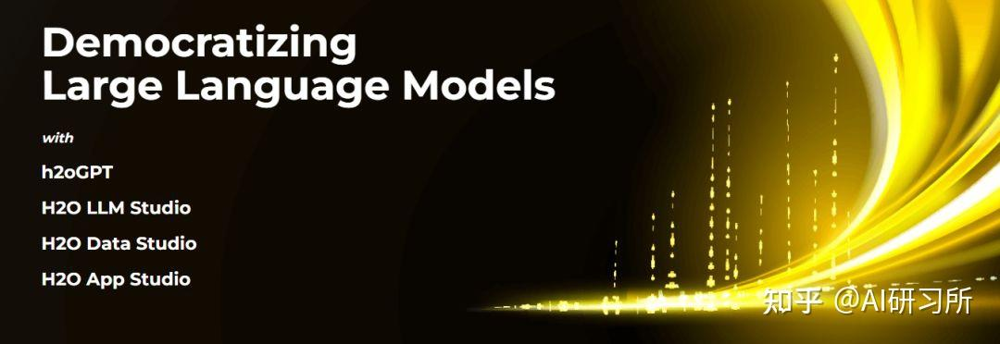

查询和总结您的文档，或者只是使用 h2oGPT（一个 Apache V2 开源项目）与本地私有 GPT LLM 聊天。**
项目地址****
[https://github.com/h2oai/h2ogpt](https://link.zhihu.com/?target=https%3A//github.com/h2oai/h2ogpt)

测试体验地址

https://gpt.h2o.ai/

主要功能****

- 任何文档的私人离线数据库（PDF、Excel、Word、图像、代码、文本、MarkDown 等）
- 使用精确嵌入（大型、全 MiniLM-L6-v2 等）的持久数据库（Chroma、Weaviate 或内存中 FAISS）
- 使用指令调整的 LLM有效利用上下文（不需要 LangChain 的少样本方法）
- 并行汇总达到 80 个令牌/秒输出 13B LLaMa2
- 通过 UI上传和查看文档（控制多个协作或临时集合）

- UI或 CLI 以及所有模型的流式传输

- 同时针对多个模型进行UI 模式

- 支持多种模型（LLaMa2、Falcon、Vicuna、WizardLM，包括 AutoGPTQ、4 位/8 位、LORA）
- HF 和 LLaMa.cpp GGML 模型的GPU支持，以及使用 HF、LLaMa.cpp 和 GPT4ALL 模型的CPU支持
- Linux、Docker、MAC 和 Windows支持
- 推理服务器支持（HF TGI 服务器、vLLM、Gradio、ExLLaMa、OpenAI）
- 符合 OpenAI 标准的 Python 客户端 API，用于客户端-服务器控制
- 使用奖励模型评估绩效

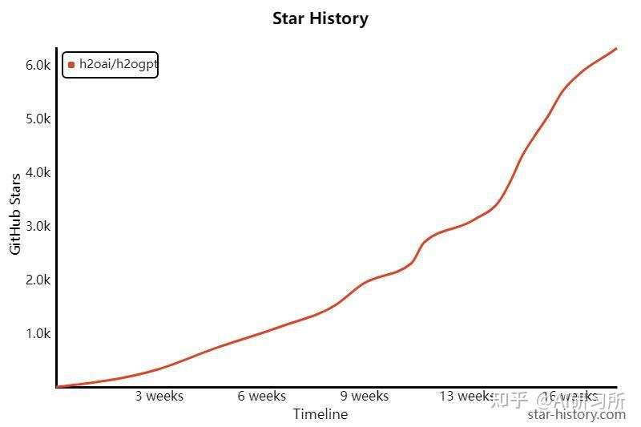

各类模型和数据集下载地址

[https://huggingface.co/h2oai](https://link.zhihu.com/?target=https%3A//huggingface.co/h2oai)
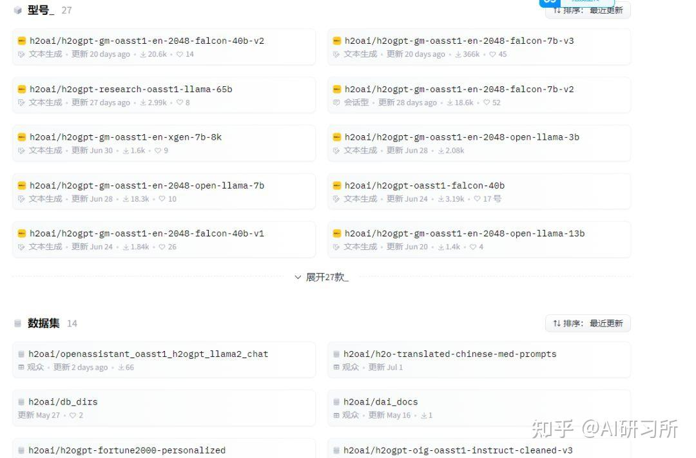

测评

上传文件这里注意可以上传本地的常见的各种类型的文件。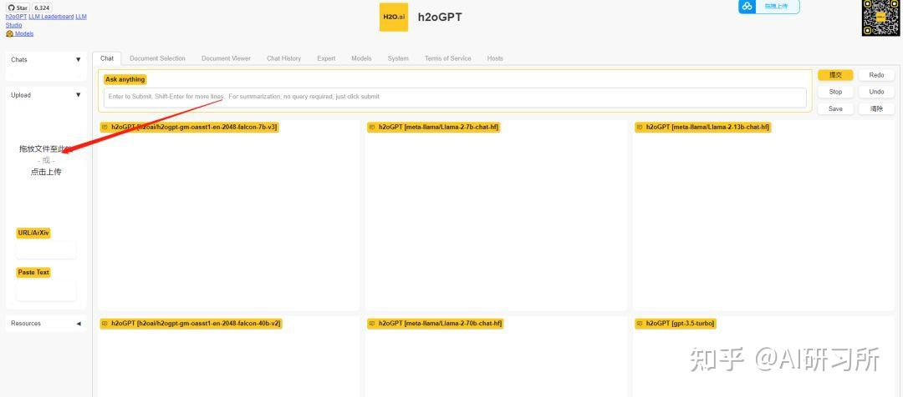

支持的本机数据类型****
.pdf：便携式文档格式（PDF），

.txt：文本文件（UTF-8），

.csv：CSV，

.toml：托姆尔，

.py： Python，

.rst：重构文本，

.rtf：富文本格式，

.md：降价，

.html：HTML 文件，

.docx：Word文档（可选），

.doc：Word文档（可选），

.xlsx：Excel 文档（可选），

.xls：Excel 文档（可选），

.enex： 印象笔记，

.eml： 电子邮件，

.epub：电子书，

.odt：打开文档文本，

.pptx： PowerPoint 文档，

.ppt： PowerPoint 文档，

.png：PNG图像（可选），

.jpg：JPEG 图像（可选），

.jpeg：JPEG 图像（可选）。

生成回答，可以看到提问问题后，多个模型同时回答，用户可以选择一个自己感觉比较合理的回答。
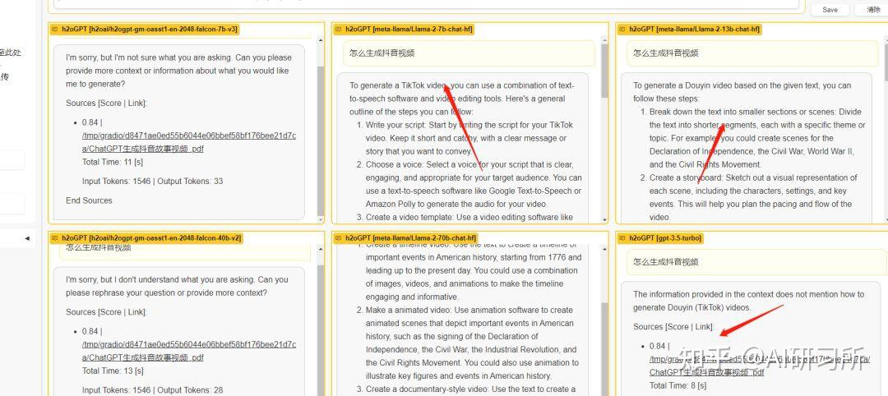

文档管理****可以查看和管理自己上传的文档。
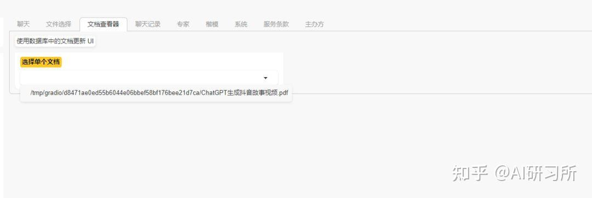

聊天记录管理：**
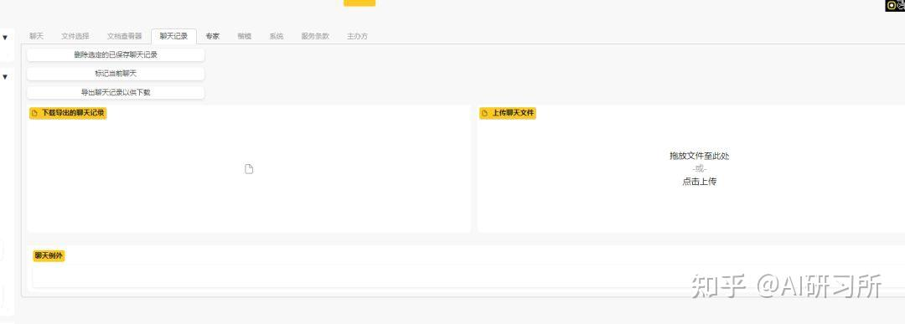

自定义输出配置
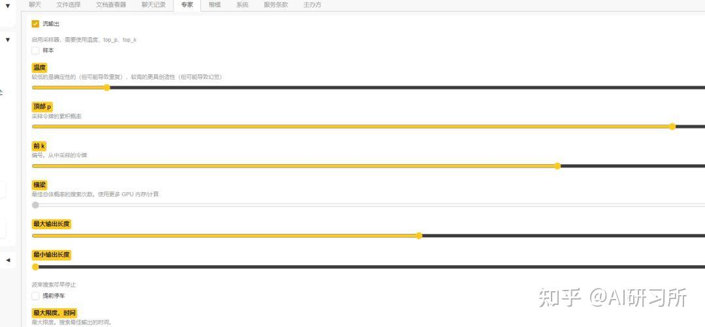

部署

1：下载 Visual Studio 2022
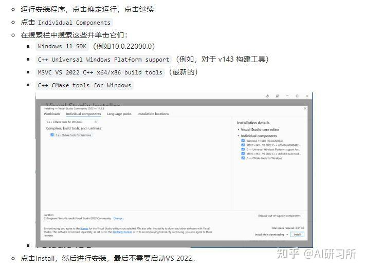

2：下载 MinGW 安装程序
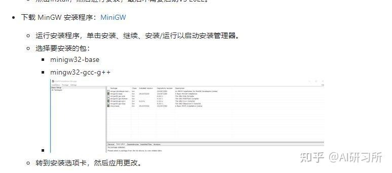

3：下载并安装Miniconda
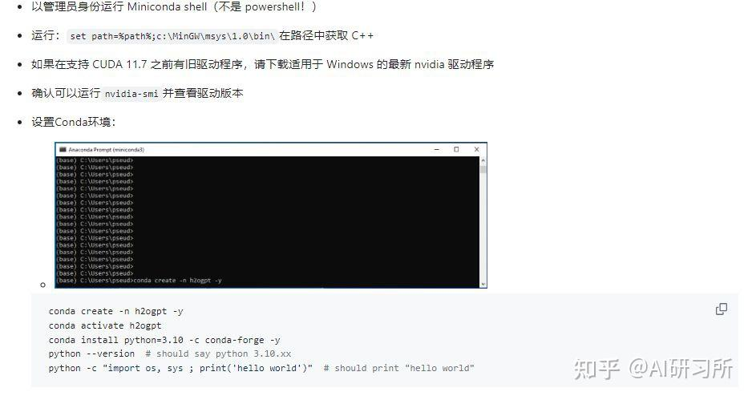

4：安装依赖
 # Required for Doc Q/A: LangChain:
 pip install -r reqs_optional/requirements_optional_langchain.txt
 # Required for CPU: LLaMa/GPT4All:
 pip install -r reqs_optional/requirements_optional_gpt4all.txt
 # Optional: PyMuPDF/ArXiv:
 pip install -r reqs_optional/requirements_optional_langchain.gpllike.txt
 # Optional: Selenium/PlayWright:
 pip install -r reqs_optional/requirements_optional_langchain.urls.txt
 # Optional: for supporting unstructured package
 python -m nltk.downloader all

5：可选配置
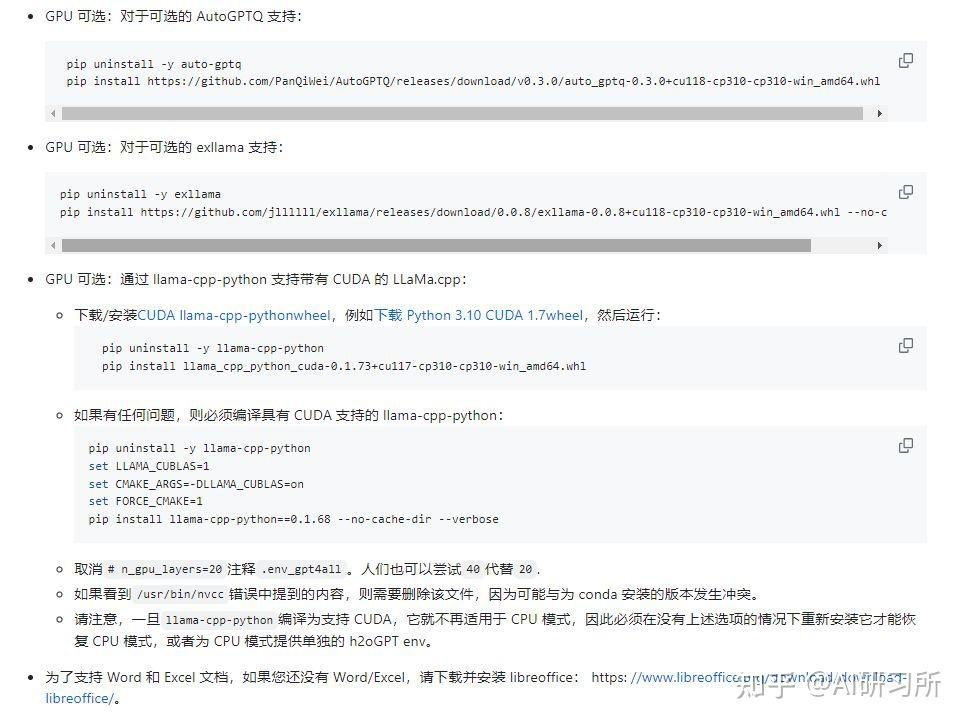

6：运行

For document Q/A with UI using LLaMa.cpp-based model on CPU or GPU:

Click Download Wizard Model and place file in h2oGPT directory.

python generate.py --base_model='llama' --prompt_type=wizard2 --score_model=None --langchain_mode='UserData' --user_path=user_path
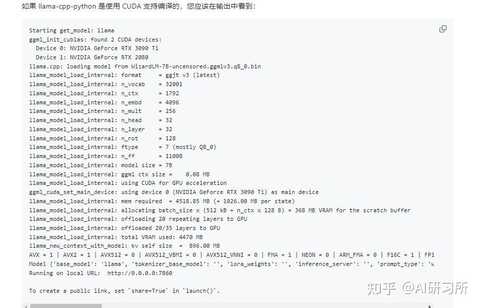

7：使用和分享

Starting get_model: llama
ggml_init_cublas: found 2 CUDA devices:
  Device 0: NVIDIA GeForce RTX 3090 Ti
  Device 1: NVIDIA GeForce RTX 2080
llama.cpp: loading model from WizardLM-7B-uncensored.ggmlv3.q8_0.bin
llama_model_load_internal: format     = ggjt v3 (latest)
llama_model_load_internal: n_vocab    = 32001
llama_model_load_internal: n_ctx      = 1792
llama_model_load_internal: n_embd     = 4096
llama_model_load_internal: n_mult     = 256
llama_model_load_internal: n_head     = 32
llama_model_load_internal: n_layer    = 32
llama_model_load_internal: n_rot      = 128
llama_model_load_internal: ftype      = 7 (mostly Q8_0)
llama_model_load_internal: n_ff       = 11008
llama_model_load_internal: model size = 7B
llama_model_load_internal: ggml ctx size =    0.08 MB
llama_model_load_internal: using CUDA for GPU acceleration
ggml_cuda_set_main_device: using device 0 (NVIDIA GeForce RTX 3090 Ti) as main device
llama_model_load_internal: mem required  = 4518.85 MB (+ 1026.00 MB per state)
llama_model_load_internal: allocating batch_size x (512 kB + n_ctx x 128 B) = 368 MB VRAM for the scratch buffer
llama_model_load_internal: offloading 20 repeating layers to GPU
llama_model_load_internal: offloaded  layers to GPU
llama_model_load_internal: total VRAM used: 4470 MB
llama_new_context_with_model: kv self size  =  896.00 MB
AVX = 1 | AVX2 = 1 | AVX512 = 0 | AVX512_VBMI = 0 | AVX512_VNNI = 0 | FMA = 1 | NEON = 0 | ARM_FMA = 0 | F16C = 1 | FP16_VA = 0 | WASM_SIMD = 0 | BLAS = 1 | SSE3 = 1 | VSX = 0 |
Model {'base_model': 'llama', 'tokenizer_base_model': '', 'lora_weights': '', 'inference_server': '', 'prompt_type': 'wizard2', 'prompt_dict': {'promptA': 'Below is an instruction that describes a task. Write a response that appropriately completes the request.', 'promptB': 'Below is an instruction that describes a task. Write a response that appropriately completes the request.', 'PreInstruct': '\n### Instruction:\n', 'PreInput': None, 'PreResponse': '\n### Response:\n', 'terminate_response': ['\n### Response:\n'], 'chat_sep': '\n', 'chat_turn_sep': '\n', 'humanstr': '\n### Instruction:\n', 'botstr': '\n### Response:\n', 'generates_leading_space': False}}
Running on local URL:  http://0.0.0.0:7860

To create a public link, set `share=True` in `launch()`.

转到http://127.0.0.1:7860（忽略上面的消息）。添加--share=True以获得可共享的安全链接。

要仅与 LLM 聊天，请在“集合”中单击Resources并单击LLM，或者在不使用--langchain_mode=UserData.

在nvidia-smi或其他一些 GPU 监视器程序中，您应该看到python.exe在（计算）模式下使用 GPUC并使用 GPU 资源。

3090Ti 的 i9 上，每秒大约获得 5 个令牌。
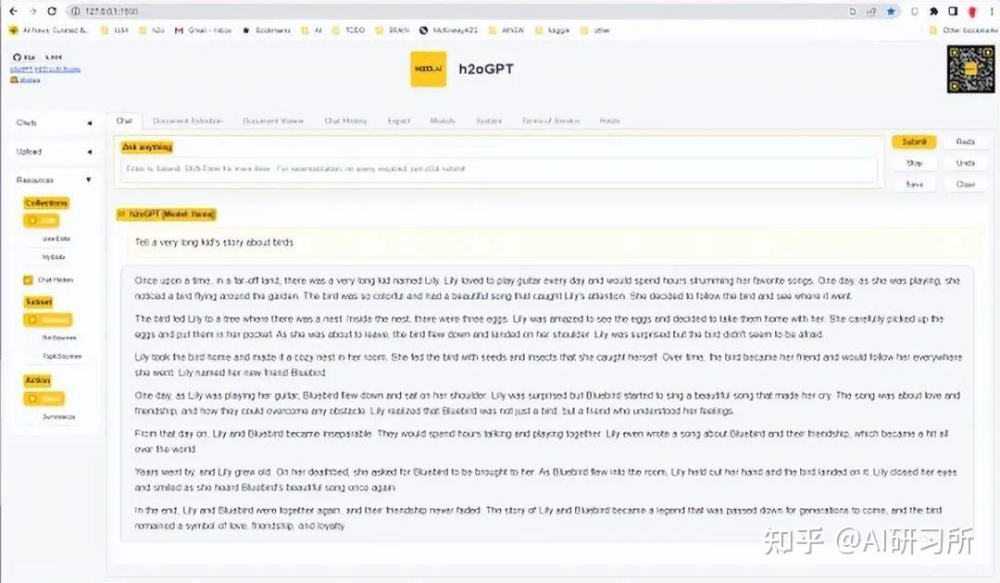

如果您有多个 GPU，最好通过执行以下操作来指定使用快速 GPU（例如，如果设备 0 是最快且内存最大的 GPU）。

感兴趣的小伙伴们快去动手试试吧！
