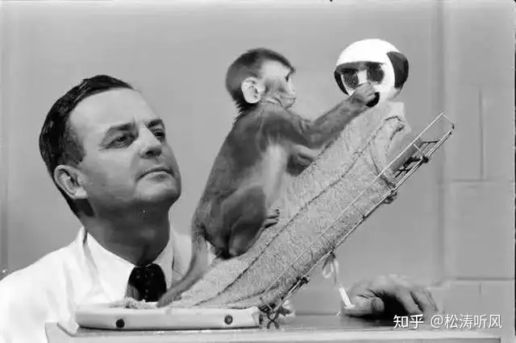
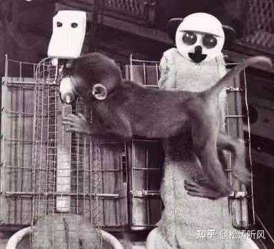
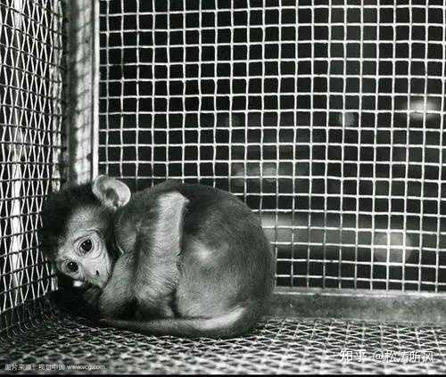
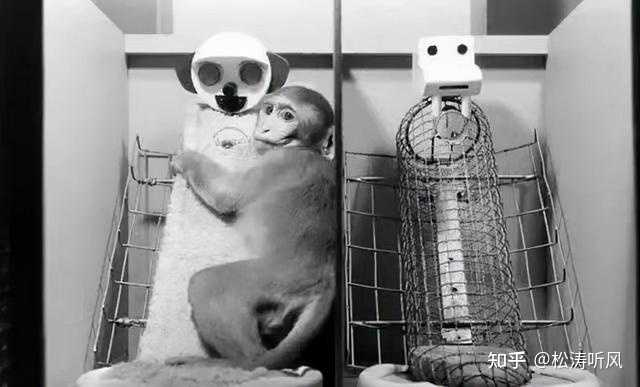
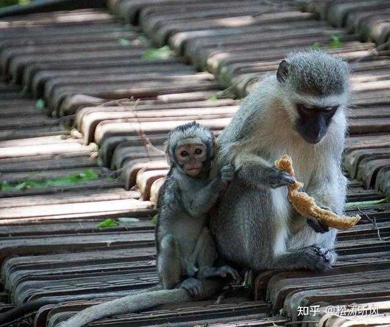
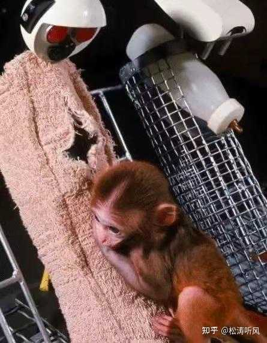

先说结论：你做错了，孩子三岁以前需要无条件的爱、无条件的爱、无条件的爱，你眼中婆婆的溺爱，恰恰是孩子三岁以前最需要的无条件的爱。

老人和父母对待孩子最大的区别，就是老人很少把负面情绪发泄到孩子身上，毕竟隔代是真的亲，相反那些不称职的父母经常把自己的负面情绪倾倒到孩子身上，这才是最可怕的。

你可能被大骗局：“**约翰华生 育儿理论**”给误导了。约翰华生自己生育有3个孩子，第一个孩子自杀死了，第二个孩子自杀未遂，第三个孩子长期流浪，靠父亲接济。想想华生育儿理论多么可怕。

**孩子在三岁以前需要无条件的爱，无条件的爱才能给孩子带来安全感，孩子有了安全感，才能逐渐形成坚强、自信等良好的个性品质，成为一个对人友善、积极向上、乐于探索、具有处事能力的人。**

培养孩子的自立和好的行为习惯，并不能影响影响你对孩子的爱，同时要让孩子感受到你对孩子的爱。

**最重要的一点：纠正孩子的不良行为，不是为了发泄情绪，这点尤为重要。那些父母皆祸害的，基本上都违背了这一点，他们的父母打着爱的名义，发泄自己的不良情绪，父母无法控制的不良情绪对孩子成长过程中的伤害是巨大的。**

**

### 这是一个轰动世界的残忍实验——恒河猴实验，它颠覆了人类的育儿方法，拯救了无数的孩子。

当时被欧美封神的教育界大师华生认为，越早把婴儿与妈妈分离，就越容易培养孩子的独立性，孩子哭就任他哭，哭一夜也不要理会，这就是广为流传的哭声免疫法。因此，在当时美国产后立即断奶，让孩子自己睡小屋，尽量避免跟孩子亲密接触，以此来培养孩子独立性的父母不计其数。

1959年美国心理学家哈洛认为这种育儿方式是在伤害孩子，对孩子的心理以及情感造成负面影响，为了打破这一育儿观念，他做了一项轰动世界的恒河猴实验，也是被称为世界最残忍的实验之一。他将一部分新生的婴猴进行了产妇分离，小猴子出生之后就独自生活在笼子里，并在笼子里给刚出生的婴猴提供了两个假的“猴妈妈”，一个是由铁丝网做成的，胸前挂着一个可以提供奶水的橡皮奶头奶瓶，“铁丝妈妈”只能提供食物，但无法拥抱；另一个是绒物做成的“绒布妈妈”抱起来很柔软，但是却无法提供食物，如果按照华生的育儿理论，应该是挂着奶瓶的铁丝妈妈会更受欢迎。

然而，实验的结果却令人难以置信，那个摸起来很舒服的“绒布妈妈”居然打败了挂着奶瓶的“铁丝妈妈”。**

在实验最初的几天里，小猴子大部分是围着挂着奶瓶的“铁丝妈妈”，因为它24小时可以提供食物。然而没过几天，令人惊讶的事情发生了，哈洛发现，笼子里所有的小猴子只有在饥饿时才会去找挂着奶瓶的铁丝妈妈，其它大部分时间都会黏着这个绒布妈妈，小猴子一吃完立马会离开回到绒布妈妈身边，有些小猴子甚至一刻都不愿意离开绒布妈妈即便吃奶也要挂在绒布妈妈身上。

几个月后，实验的结果出来了，如果按照当时华生育儿的观念，这部分从小被分离的小猴子应该是比在猴妈妈呵护下的小猴子更加聪明、更加独立、更加强壮才对，但是结果却是相反的。这些从小就被分离出来的猴子和正常成长的猴子产生了巨大的差异，它们明显比正常成长的猴子们胆小、目光呆滞、手足无措、也不懂得和同类相处。

哈洛为了进一步做实验，他又在笼子里放入一些猴子们会害怕的东西，比如一只木制的大蜘蛛，当小猴宝宝一看到这些东西，会跑到绒布妈妈怀里钻紧紧的抱住它，似乎这样可以给它更多的安全感，而铁丝妈妈被晾在一边，甚至连看一眼都不看。最后洛河干脆把绒布妈妈拿走，只留下挂着这个奶瓶的铁丝妈妈，然后再拿玩具吓小猴子，可即便是被吓得瑟瑟发抖，小猴子也不靠近挂着奶瓶的铁丝妈妈，没有绒布妈妈的怀抱它就蹲在角落里缩成一团，一边颤抖一边尖叫。

而后哈洛又继续下一个实验，将小猴子分别放在3种不同的笼子里，3个笼子里面都放了很多小猴子喜欢的小玩具。第一个笼子里有绒布妈妈和玩具，第二个笼子里有铁丝妈妈和玩具，第三个笼子里，只有玩具。

实验的结果是，当笼子里只有铁丝妈妈或只有玩具时，小猴子是非常紧张和害怕的，它不敢靠近铁丝妈妈也不碰玩具，只抱自己的头蜷缩在墙角；而当在有绒布妈妈的笼子里时，小猴子会紧紧的抱着绒布妈妈，在绒布妈妈的怀里，张望着周围的玩具，然后会小心翼翼的试着触碰那些玩具，然后大着胆子将玩具拿走，再回到绒布妈妈的怀里。

更为残忍的还在后头，哈洛将绒布妈妈变成一个变成了坏蛋，这个坏妈妈会时不时向小猴子们放铁钉、射水柱来攻击小猴子，吓得它们到处窜。可让人意外的是，不管坏妈妈对它们做了什么，无论怎么攻击或虐待它们，小猴子都会在绒布妈妈停止攻击后义无反顾回到妈妈的怀抱，紧紧的抱着绒布妈妈不放开。

这多么像人类的孩子们，即使被妈妈打骂也依然哭着要妈妈抱，小猴子的这一行为更加佐证了，婴孩在成长过程中需要温暖和抚慰，那些从小就缺乏母爱的人，成年之后极易出现巨大的心理障碍，并且这种影响会伴随他们一生。

    哈洛通过实验得出了两个结论：爱源自于接触而非食物，温暖的接触才是母亲的本性，独立并不是“孤立”和“狠心”训练出来的。按照当时风靡的华生育儿理论，婴儿只会对食物产生依恋，只要有充足的食物，母亲是可有可无的，并且认为这种亲情只会让孩子成年之后丧失独立自强的精神，而洛河的实验则打破了华生的育儿理论。

实验证明那些从小得到细心呵护、温柔拥抱、及时回应在妈妈的怀抱里得到安全感的孩子，反而更容易离开妈妈的怀抱去独立探索，成为更加独立、更能适应社会的人。 越是得到关爱和疼爱的孩子，就越会敞开内心，变得开朗乐观而充满自信。而越是得不到关爱的孩子，就越容易封闭自己的内心，漠视周围环境，孤僻不合群。

实验到此并没有结束，因为数年之后，当这一批从小和自己猴妈妈分离的猴子长大之后，却发生了令人意想不到的事情，洛河发现，当初在绒布妈妈身边长大的猴子，在它们成年之后也出现了严重的自闭、自残、抑郁等心理问题，甚至在它们生下孩子之后，还会对自己的孩子暴力殴打，甚至残忍杀害，这个发现令洛河很是吃惊，为什么会这样呢？

为了进一步研究这个现象，哈洛再次做了一个实验，他给这些绒布妈妈增加了一个晃动的功能并能发出各种好玩的声音，能够让绒布妈妈和小猴子产生互动。然后奇迹出现了，小猴子有一个可以跟它一起互动玩耍的妈妈，在长大后一切正常，可以交朋友，可以正常融入社会。于是哈洛得出了一个震惊世界的结论，爱存在在三个变量，是触摸、运动和玩耍，只要你能够提供这三个变量，就能够满足一个灵长类动物的全部需要。

紧接着，哈洛又在一批小猴子出生之后做了新的实验，不给它们任何的假妈妈，让它们孤独地在笼子里生存，在八个月之后，再给它们绒布妈妈和奶瓶妈妈，然后拿玩具吓唬它们时，结果却令人泪奔了，小猴子受到惊吓后并没有奔向任何一个妈妈，而是缩成一团躲在角落里瑟瑟发抖，并发出绝望的叫声。这些猴子在长大后，自然无法融入到正常的猴群，并伴随着自残，攻击等行为。

很多人认为哈洛的实验对于那些猴子来说太过残忍，并且很不人道，因为被实验的恒河猴有很多在实验中丧失了生命！我们要知道，恒河猴和人类有93%的DNA吻合，它们具有超强的记忆力、学习能力和自我决断力，并且向人类一样拥有相似和易懂的表情表达，是社会化的复杂动物。它们有着有人类类似的发声系统和沟通方式，它们可以通过身体姿势和手势、面部表情、发声进行沟通。而在这个实验中，无疑对恒河猴是非常残忍的，因为它们是一群拥有情感的社会化动物！

但这残忍的实验却证明了父母对孩子的养育不能仅仅停留在喂饱层次，要使孩子健康成长，一定要为他提供触觉、视觉、听觉等多种感觉通道，及时回应让孩子能够感到父母的存在，并能从他们那里得到安全感。

哈洛的实验结果发表之后，一夜之间华生育儿法彻底被推翻，可令人没想到的是在华生的理论被摒弃数十年之后，这套洋垃圾却漂洋过海，被中国的一群别有用心的人发现，如获至宝般疯狂的刷屏朋友圈，疯狂的推崇华生育儿理论。哭声免疫法、婴儿完整独立睡眠法被一些人当成了育儿宝典，万千中国儿童成为这套邪恶理论的牺牲品。

写在最后

哈洛的恒河猴实验研究发现给了我们很多有意义的启示，让更多的人认识到孩子在婴幼儿时期的情感需求，不是喂饱就行了，还需要更多的关爱与关注，让孩子能够感到父母的存在，并能从他们那里得到安全感。

孩子有了安全感，才能逐渐形成坚强、自信等良好的个性品质，成为一个对人友善、积极向上、乐于探索、具有处事能力的人。

[编辑于 2023-07-05 16:27](//www.zhihu.com/question/606034442/answer/3074024904)・辽宁

​​1455 ​421 ​分享

​​

收起​
