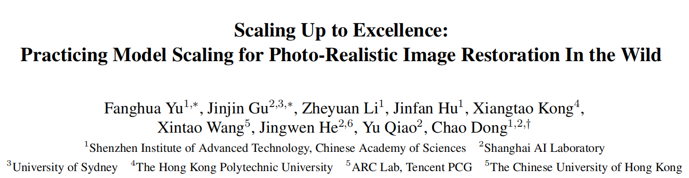

Project Page：https://supir.xpixel.group

arxiv：[https://arxiv.org/pdf/2401.13627.pdf](https://link.zhihu.com/?target=https%3A//arxiv.org/pdf/2401.13627.pdf)

### **Scaling Up to Excellence: Practicing Model Scaling for Photo-Realistic Image Restoration In the Wild**

2024.1.25，董超XPixelGroup发布的一个新作。这篇文章用20M+张图像数据，结合SDXL模型进行了图像复原，使用64张A6000训练10天，可以看做是底层视觉领域迈向大模型的一个里程碑。本文对其进行详细的解读。

这是部分可视化结果，整体视觉效果还是很好的：

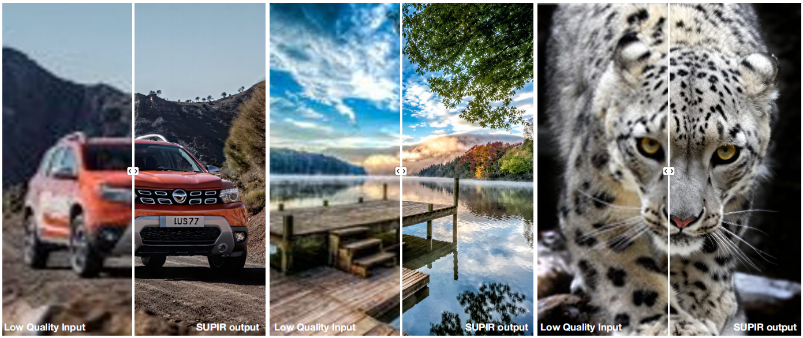

另外Project Page上有一些可交互的可视化结果。

**

#### Introduction

      在其他CV领域有很多大模型工作出现，比如SAM。而由于计算资源、模型架构、训练数据以及生成模型等工程约束条件的限制，扩大图像复原模型是很具有挑战性的。文章的motivation也就是要在一定程度上突破这样的诸多限制，构建一个较大的模型用于图像复原。

      该工作使用了StableDiffusion-XL (SDXL)作为生成模型，设计并训练了一个参数量为600M的adapter，收集了20M+高质量高清数据用于训练，并且每张图片都有相应的描述性文本作为prompt；同时，使用了一个参数量13B的多模态LLM用于提供图像内容prompt。

#### Related Work

相关工作可以参考StableSR, PASD, DiffBIR等等。另外可以参考我对PromptSR, SeeSR的解读：

#### Method

整体架构见下图

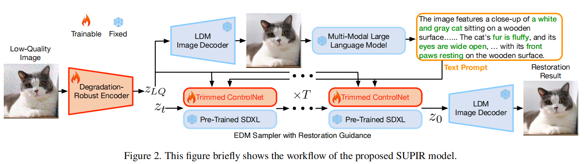

#### Model Scaling Up

Generative Prior**

可选的生成式大模型有Imagen, IF, SDXL。作者首先给出了选择SDXL的原因：Imagen和IF都是层次化方法，即先生成一个低分辨率的图像然后逐步上采样，SDXL一步到位生成高分辨率图像能够更加有效地利用其参数来提升图像质量，而不是进行文本解释，更加符合本工作的目标；

另外，SDXL采用了一种Base-Refine策略。在Base model中，生成的图像多样但质量较低，Refine model则提升了这些图像的感知质量。与Base model相比，Refine model使用的训练图像质量更高，但多样性较少。由于训练数据已经是大量高质量的图像，SDXL的两阶段设计就没有必要，因此选择了参数更多的基础模型。

**

Degradation-Robust Encoder**

在SDXL中，diffusion过程是在latent space进行的，HQ图像要经过一个预训练的encoder从而映射为latent HQ，前面的一些工作为了更好地利用LQ先验，将LQ也用同一个encoder映射到latent space。而作者认为这个encoder没用LQ图像训练过(这样会导致其对退化敏感，受到退化的影响)，会影响模型对LQ图像内容的判断，可能会产生伪影。因此作者用LQ和HQ对预训练encoder进行了finetune，从而得到一个退化鲁棒的encoder，不会不受到退化影响。

$\mathcal{L}_{\mathcal{E}}=\left\|\mathcal{D}\left(\mathcal{E}_{\mathrm{dr}}\left(x_{L Q}\right)\right)-\mathcal{D}\left(\mathcal{E}_{\mathrm{dr}}\left(x_{G T}\right)\right)\right\|_2^2 $

$\mathcal{E}_{\mathrm{dr}} 是Degradation-Robust Encoder， \mathcal{D} 是固定的decoder$

**

Large-Scale Adaptor Design**

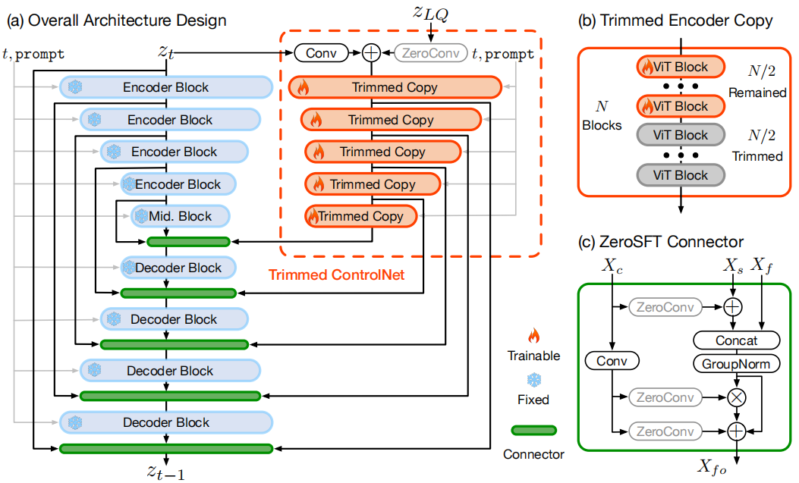

当前的几种adapter， LoRA, T2I adaptor, ControlNet，都有局限性，最常用的ControlNet的问题在于如果在SDXL这种大模型上用的话，encoder复制一份代价太大，那么作者主要对其有两个改动：

- 模型剪枝。具体而言，对SDXL每个encoder block中的ViT blocks剪掉一半；
- 重新设计adapter和SDXL的connector。connector的设计是非常重要的，最初的SD用的是zero convolution；PASD是用了带cross-attention的PACA模块；StableSR是用了IKC中的SFT模块；PromptSR和SeeSR也是带cross-attention的模块。IKC中SFT模块如下，可以看成是退化估计向量作为原图仿射变换的参数。这里的SFT也是类似， X_c 是adapter的输出， X_s,X_f 分别是encoder的shortcut和decoder的feature map。一方面，adapter的输出与shortcut相加后与encoder拼接，并接上一个GroupNorm；另一方面，adapter输出作为仿射变换的系数与上面的feature结合。
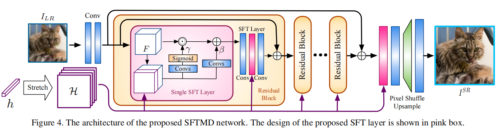

**

#### Scaling Up Training Data**

**Image Collection**

图像复原领域数量多且质量高的数据集目前尚未出现，因此作者收集了一个数据集，包含20M张1024*1024的高质量图像。并加入了70K张未对齐的FFHQ-raw数据集图像从而提升face restoration的能力。可以看到和其他数据集对比如下：

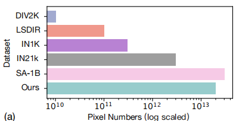

**Multi-Modality Language Guidance**

$textual prompts在image restoration中非常重要，这里作者使用了多模态大模型LLaVa(NeurIPS 2023)对退化鲁棒的LQ图像 x_{L Q}^{\prime}=\mathcal{D}\left(\mathcal{E}_{\mathrm{dr}}\left(x_{L Q}\right)\right) 提取内容语义描述；并且用PixART的方法收集了textual annotations。$

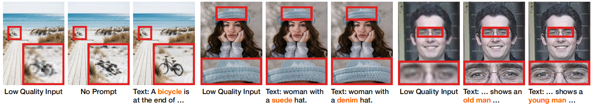

**

Negative-Quality Samples and Prompt**

概括而言，就是加入negative prompts，也就是对图像质量负面评价的词，比如oil painting, cartoon, blur, dirty, messy, low quality, deformation, low resolution, over-smooth等，然后将positive和negative prompts得到的输出融合，公式如下：

$\begin{aligned} & z_{t-1}^{\text {pos }}=\mathcal{H}\left(z_t, z_{L Q}, \sigma_t, \operatorname{pos}\right), z_{t-1}^{\text {neg }}=\mathcal{H}\left(z_t, z_{L Q}, \sigma_t, \text { neg }\right), \\ & z_{t-1}=z_{t-1}^{\text {pos }}+\lambda_{\text {cfg }} \times\left(z_{t-1}^{\text {pos }}-z_{t-1}^{\text {neg }}\right), \end{aligned} $

$\mathcal{H}(\cdot) 是DM， \sigma_t 是t步的噪声方差， \lambda_{\mathrm{cfg}} 是一个超参$

但是只有negative prompts没有negative samples，模型无法理解negative prompts，因此作者在训练数据中加入了negative samples，具体而言，用SDXL生成100K张低质量图像。效果如图：

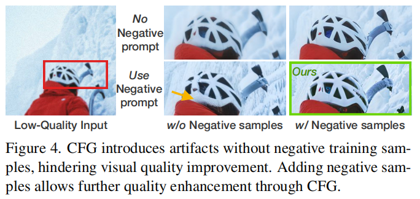

**Restoration-Guided Sampling**

Diffusion model做restoration会面临一个fidelity-Realness的trade-off，强大的生成能力可能会造成保真度的下降。因此作者提出了一种采样策略，基于EDM。简单概括，在DM生成图像的早期阶段，主要生成低频信息，那么需要约束其与LQ图像的一致性，提高保真度，在后期，主要生成高频细节纹理，那么这个时候就不需要过多约束，保证生成的真实性效果，方法如图所示，详细说明见论文。

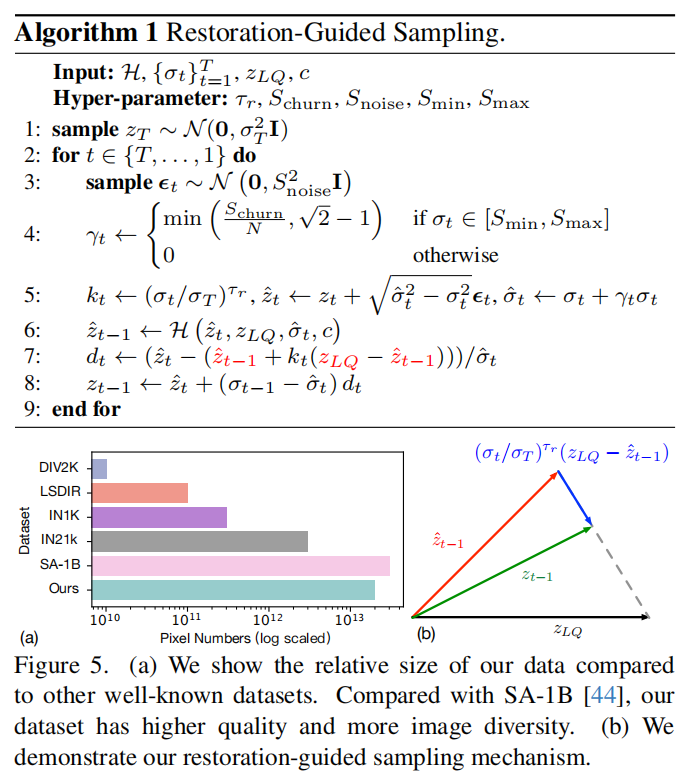

#### Experiments

**Datasets**

20K带文字描述的高质量图像+70K FFHQ人脸图像+100K negative-quality samples

**Results**

分别在合成数据和真实数据上进行了实验，具体见论文。

注意虽然有参考的指标不是SOTA，但无参考指标对于图像感知质量更加重要。

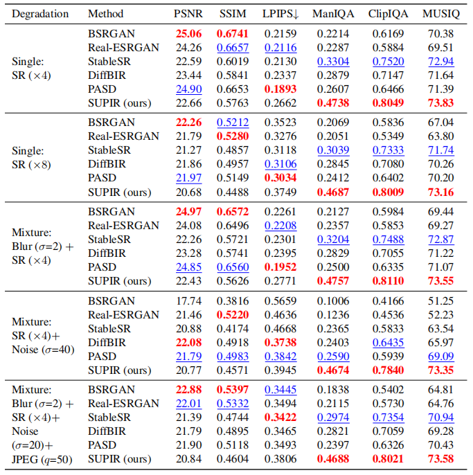

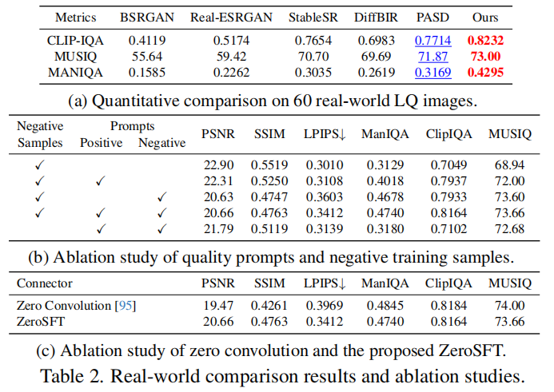

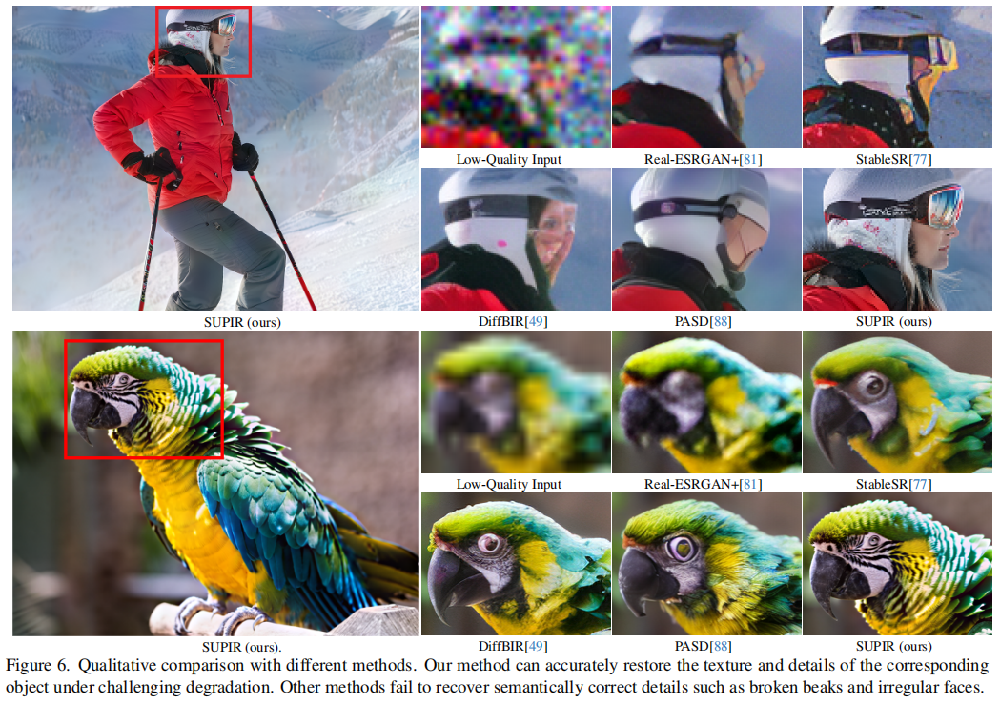

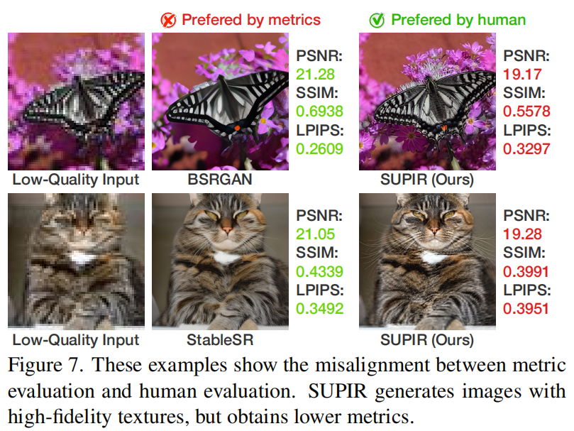

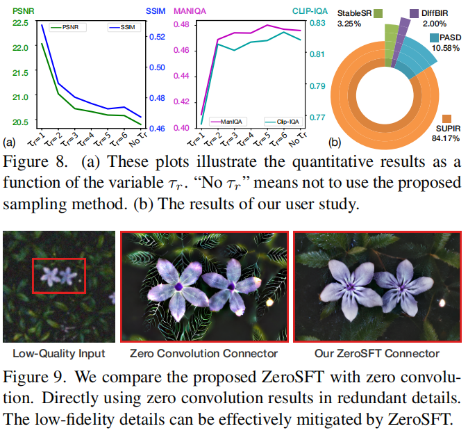

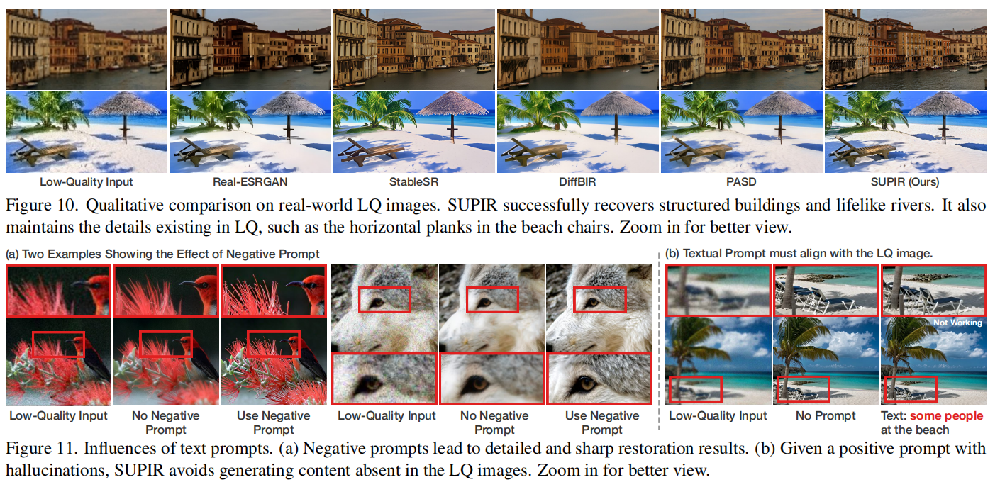

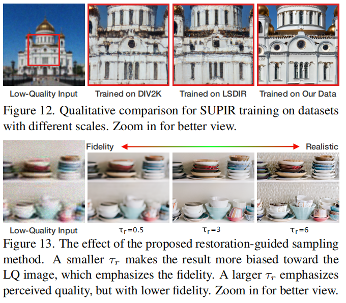
