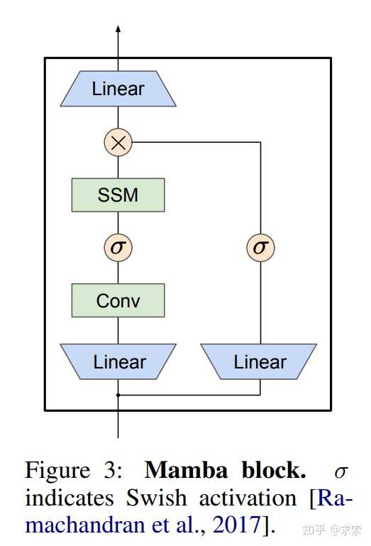
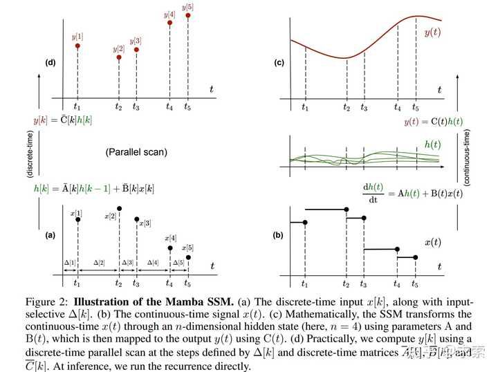
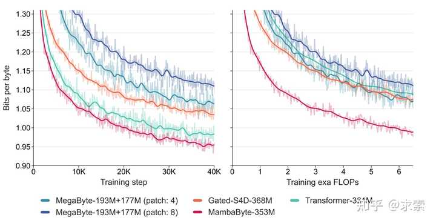
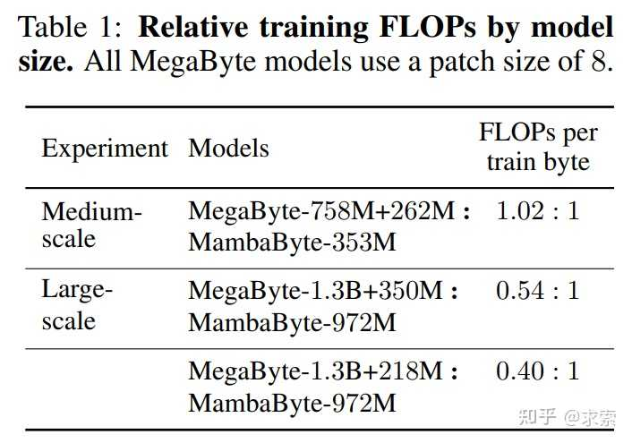
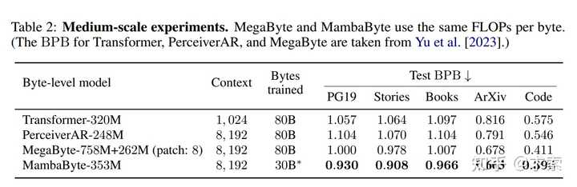
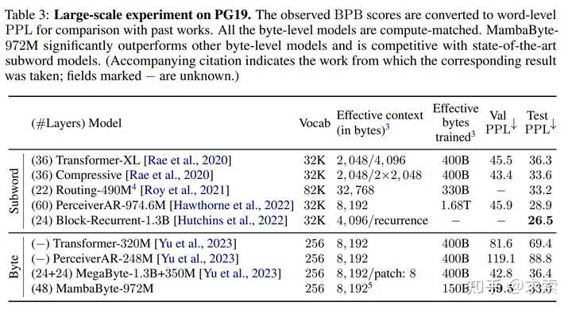
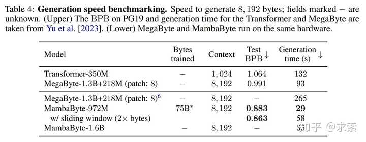

之前有关Mamba的架构在人工智能领域引起不少轰动。最近又有一篇基于Mamba的论文——《MambaByte: Token-free Selective State Space Model》（《MambaByte：无Token选择状态空间模型》），论文号称可以和Transformer有得一比，我们接下来稍微介绍一下该论文。

**

#### 论文概要

这篇论文提出了一个无标记（Token）语言模型，直接从原始字节中学习**，并消除了子词（Subword)令牌化（Tokenization)的偏见。然而，对字节进行操作，会导致明显更长的序列，并且标准的自回归Transformer在这种设置下扩展不佳。论文用 MambaByte 进行了实验，这是Mamba 状态空间模型（SSM）的无标记（Token）改编，在字节序列上进行自回归训练。论文的实验表明，与其他字节级模型相比，MambaByte 的计算效率更高。同时还发现** MambaByte 与最先进的子词 Transformer 具有竞争力，甚至优于它**。此外，由于长度的线性缩放，与 Transformer 相比，MambaByte 将使快速推理受益。该论文的研究结果确立了 MambaByte 在实现无令牌语言建模方面的可行性。

#### 论文介绍

在论文中研究人员采用了一种**使用字节序列的替代方法**，即**从原始数据到预测的端到端映射，无需任何中间标记化**。与子词模型相比，字节级语言模型可以更容易对跨正交变体和形态学变体进行泛化。当然，将文本建模为字节意味着生成的序列比其子词对应序列长得多。这将效率问题推向了架构本身的上游。

 虽然自回归Transformer在语言建模中占主导地位，但其效率问题尤为明显。由于注意力的二次成本，Transformers 在长（字节）序列上的扩展性很差 。研究人员已经压缩了内部 Transformer 表示以处理长序列，例如，开发了长度感知建模方法 ，其中标记组合并在中间层内。最近，有论文提出了 MegaByte Transformer，它使用固定大小的字节补丁形式的压缩作为子词模拟。因此，MegaByte 可以降低计算成本. 

在这项工作中，论文引入了 MambaByte，一种高效且简单的字节级语言模型。该模型是对最近引入的 Mamba 架构的直接改编，这是一种用于序列建模的线性时间方法。Mamba 基于状态空间模型 （SSM） 开创的方法引入了一种对离散数据（如文本）更有效的选择机制，并提供高效的 GPU 实现。

通过简单的观察，使用 Mamba（无需修改）可以缓解语言建模中的主要计算瓶颈，从而消除补丁并有效利用可用的计算预算。

**

实验将 MambaByte 与 Transformers、SSM 和 MegaByte（修补）架构在固定参数和固定计算设置中对多个长格式文本数据集进行比较。下图总结了论文的主要发现，与字节级 Transformer 相比，MambaByte 可以更快地实现更好的性能，并且计算效率明显更高。

同时与现有最先进的子词模型相比，无标记语言模型具有较高可行性。在这方面，我们发现 MambaByte 尽管处理的序列要长得多，但在各种子词基线方面具有竞争力。论文的研究结果将 MambaByte 确立为现有依赖Token模型的有力替代品，并提倡使用它来促进端到端学习**。

####  实验

我们的实验将 MambaByte 与其他字节级 Transformer 和 SSM 进行了比较。论文所有的模型都采用相同的训练方法。我们利用了一组不同的长格式文本数据集。论文考虑两种设置：计算匹配和参数匹配。此设置是必要的，因为默认的 MegaByte Transformer 使用一个全局模块，该模块使用 8× 补丁的输入表示，因此每字节的前馈 FLOP 比原始 Transformer 少 8×，同时具有更多参数。下表显示了我们实验中使用的 MegaByte 和 MambaByte 模型大小。

所有 MambaByte 模型都是使用开源 Mamba 代码库进行训练的。 在训练时，对文档进行随机洗牌并使用8K字节（每个文档一个）的连续序列，从随机位置开始。我们使用 BF16 实现混合精度训练，以提高大规模训练效率。在推理过程中使用滑动窗口来权衡速度和性能。在此之后采用滑动窗口（长度为 Lctx 的字节序列的步幅为 Lctx/2）。

#### 结果

通过实验，观察到 MambaByte 在所有数据集上的表现始终优于 MegaByte。此外，MambaByte-353M 的性能也优于字节级 Transformer 和 PerceiverAR。MambaByte 如何在如此少的训练步骤中比更大的模型表现得更好？对于相同参数大小的 MegaByte 模型，输入修补较少的模型性能更好，但在计算规范化时，它们的性能相似。事实上，全长 Transformer 虽然在绝对意义上很慢，但在计算规范化时，其性能也与 MegaByte 相似。相比之下，切换到 Mamba 架构可显著提高计算使用率和模型性能。

论文下载网址

 

[编辑于 2024-01-26 00:03](//www.zhihu.com/question/641253249/answer/3376193344)・日本

​添加评论​38 ​4 ​分享

​​

收起​
