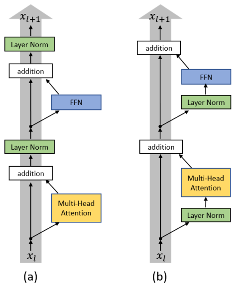
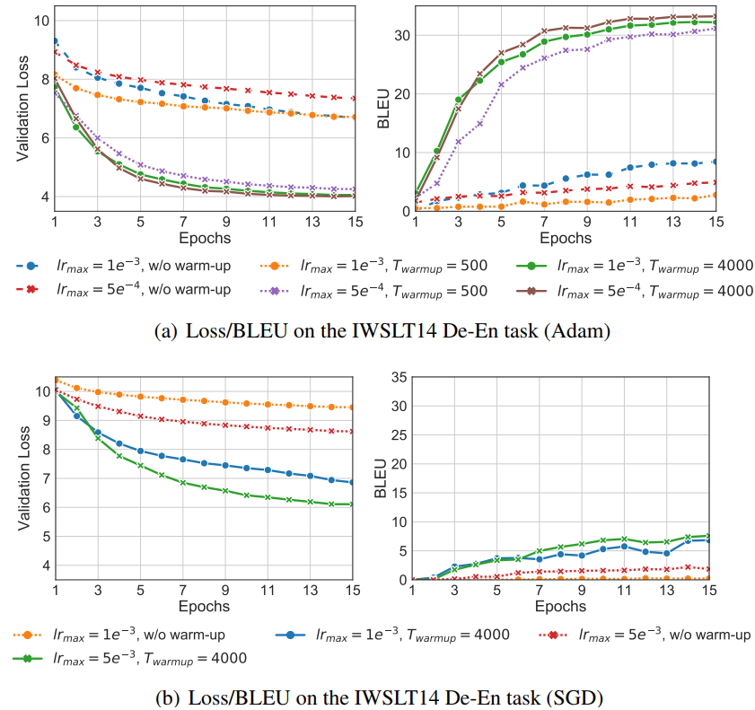
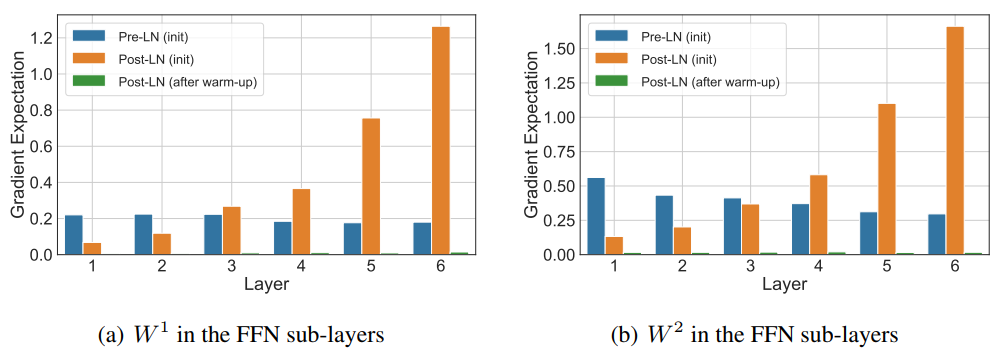
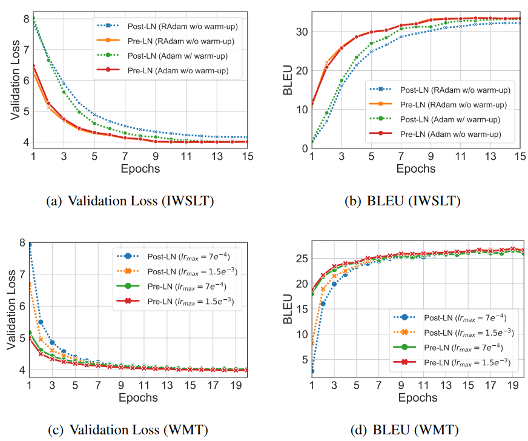
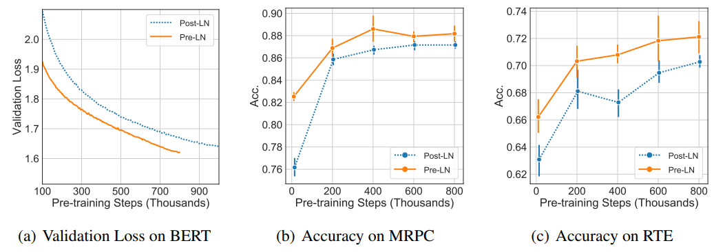

**论文标题**：On Layer Normalization in the Transformer Architecture

**论文链接**：https://openreview.net/forum?id=B1x8anVFPr

**论文作者**：Anonymous

**收录情况**：Under Blind Submission for ICLR 2020

祝同学们国庆节快乐！这是国庆节前的最后一次“香侬读”，这次我选取了ICLR2020投稿论文中的一篇，探究Transformer中warm-up和Layer normalization的重要性，比较偏实验和理论，希望可以给大家带来启发！（微信明天发，明天发）

### Transformer中的warm-up与LayerNorm

之前知乎上有一个问题：[神经网络中 warmup 策略为什么有效；有什么理论解释么？](https://www.zhihu.com/question/338066667/answer/771252708)在这个问题下，由于理论解释的缺乏，通过现有的一些文章，我将（可能的）原因归结为两点：（1）减缓模型在初始阶段对mini-batch的提前过拟合现象，保持分布的平稳；（2）保持模型深层的稳定性。本文从一个新的观点解释warm-up：和Layer Norm有关。而且在另一个问题：[为什么Transformer 需要进行 Multi-head Attention？](https://www.zhihu.com/question/341222779/answer/814111138)我也提到，Transformer中的初始化其实相当有探索空间。本文正是将这两个问题联系了起来。

我们知道，在原始的Transformer中，Layer Norm在跟在Residual之后的，我们把这个称为`Post-LN Transformer`；而且用Transformer调过参的同学也知道，`Post-LN Transformer`对参数非常敏感，需要很仔细地调参才能取得好的结果，比如必备的warm-up学习率策略，这会非常耗时间。

所以现在问题来了，为什么warm-up是必须的？能不能把它去掉？本文的出发点是：既然warm-up是训练的初始阶段使用的，那肯定是训练的初始阶段优化有问题，包括模型的初始化。从而，作者发现，`Post-LN Transformer`在训练的初始阶段，输出层附近的期望梯度非常大，所以，如果没有warm-up，模型优化过程就会炸裂，非常不稳定。这一发现之前总结的2点原因完全符合，使用warm-up既可以保持分布的平稳，也可以保持深层的稳定。既然如此，本文作者尝试把Layer Norm换个位置，比如放在Residual的过程之中（称为`Pre-LN Transformer`），再观察训练初始阶段的梯度变化，发现比`Post-LN Transformer`不知道好到哪里去了，甚至不需要warm-up，从而进一步减少训练时间，这一结果的确令人震惊。

下图是两种结构的示意图，相当直观：

### Post-LN Transformer与Pre-LN Transformer

$$为了之后叙述方便，我们还是先约定一些记号。我们还是用Q,K,V,W^{Q/K/V/O}_k,h_i,W^{},b^{}表示参数，用\text{head}_k,\text{FFN},\text{Concat},\text{Attention},\text{Multi-head}表示大家熟知的操作。用\text{LN}(v)=\gamma\frac{v-\mu}{\sigma}+\beta表示LayerNorm操作。`Post-LN Transformer`和`Pre-LN Transformer`还是参考上图，可以用这些记号表示，就不多赘述了。$$

### Post-LN Transformer中warm-up的重要性

Transformer中的warm-up可以看作学习率\text{lr}随迭代数t的函数： 

$$\text{lr}(t)=\frac{t}{T_{\text{warmup}}}\text{lr}_{\text{max}},t\le T_{\text{warmup}}$$

之后，学习率会以某种方式（线性或其他）递减，这里我们只关心warm-up阶段。可以看到，学习率从0开始增长，经过T_{\text{warmup}}次迭代达到最大。

下面，我们在`IWSLT14 De-En`数据集上研究两个问题：（1）是否warm-up必要，（2）是否T_{\text{warmup}}的设置很重要。对第一个问题，我们分别用Adam和SGD训练模型，并且分别看保留和移除warm-up的效果。对Adam，设置\text{lr}_\text{max}=5e^{-4},1e^{-3}，对SGD，设置\text{lr}_\text{max}=5e^{-3},1e^{-3}。当使用warm-up时，T_{\text{warmup}}=4000。对第二个问题，分别设置T_{\text{warmup}}=/4000，并且只使用Adam及其设置。

下图是相关结果。可以看到，无论对Adam还是SGD，warm-up都相当必要，没有warm-up，结果瞬间爆炸。而且，T_{\text{warmup}}实际上还是有影响（至少对Adam）。

从上面的实验可以得出：（1）warm-up的使用增加了训练时间；（2）在训练的开始阶段，loss很大，一开始使用大学习率对模型是毁灭性的打击。（Liu et al. 2019a）认为warm-up对Adam而言非常重要，因此提出了RAdam，但是这里的结果表明，warm-up对SGD同样非常重要，并不是Adam的“宠妃”。

### 一窥Transformer训练的初始阶段

上面的发现启发我们去探究模型训练的初始阶段发生了什么。这一部分大多是理论证明，我们略去表述和证明，只讲与之相关的结论，有兴趣的同学可以参考原文学习一个（其实是公式太多人有点懒）。注意到这里使用的是Xavier Gaussian分布，而在Transformer原文里使用的是Xavier Uniform。

$$**定理1（Transformer最后一个FFN层的梯度）** 告诉我们，`Post-LN Transformer`最后一个FFN层的梯度是O(d\sqrt{\ln d})的，和L无关，而对`Pre-LN Transformer`，是O(d\sqrt{\frac{\ln d}{L}})的，小得多。$$

然后**引理1，引理2，引理3** 又告诉我们，LayerNorm的确会normalize梯度。在`Post-LN Transformer`中，输入到最后一层LN的scale是与L无关的，因此最后一层的梯度也是与L无关的；而在`Pre-LN Transformer`中，输入到最后一层的LN的scale是随L线性增长的，因此梯度将会以\sqrt{L}的比例normalized。

现在我们要扩展到每一层。这里的主要结论是：`Post-LN Transformer`的梯度范数在输出层附近很大，因此很可能随着BP的进行梯度越来越小。相反，`Pre-LN Transformer`在每层的梯度范数都近似不变（证明在Appendix F）。

下面我们又以`IWSLT14 De-En`数据集为例实验，实验设置同上。我们计算不同阶段、不同参数的梯度期望值，结果如下。

可以看到，实验结果验证了上述的推论。而且，注意图中的绿色部分（真的有，不是忘了画！），非常小，这时候可以用大学习率训练。这说明了，warm-up的确有助于训练的稳定性。那么，用`Pre-LN Transformer`能不能去掉warm-up呢，在接下来一节将用实验证明。

### 在Pre-LN Transformer中去掉warm-up

我们在两个数据集上实验：`IWSLT14 De-En`和`WMT14 En-De`，使用Transformer base结构。对`Pre-LN Transformer`，我们去掉warm-up，在`IWSLT14 De-En`中保持5e^{-4}然后从第8个epoch开始下降；在`WMT14 En-De`上，分别实验7e^{-4}/1.5e^{-3}，都在第6个epoch下降。用带warm-up的`Post-LN Transformer`作为基线。对所有实验，使用Adam，并且也在`IWSLT14 De-En`上实验了RAdam，参数设置与原论文保持一致。

对于非翻译任务，我们使用预训练的BERT base模型，只不过是把其中的Transformer相应地替换为Post-LN与Pre-LN而已。

下图是机器翻译的结果。对`Pre-LN Transformer`，warm-up不再必要，而且收敛更快。此外，相比用RAdam替换Adam，似乎改变LN的结构更显著。

下图是无监督预训练的结果，指标有Validation Loss，MRPC和RTE上的Accuracy。可以看到，`Pre-LN Transformer`收敛更快，效果更好。总而言之一句话，`Pre-LN Transformer`似乎不再需要warm-up了。

### 小结

本文别出心裁，用实验和理论验证了`Pre-LN Transformer`结构不需要使用warm-up的可能性，其根源是LN层的位置导致层次梯度范数的增长，进而导致了`Post-LN Transformer`训练的不稳定性。本文很好进一步follow，比如Residual和LN的其他位置关系，如何进一步设计初始化方法，使得可以完全抛弃warm-up等。比如[Improving Deep Transformer with Depth-Scaled Initialization and Merged Attention](https://link.zhihu.com/?target=https%3A//arxiv.org/pdf/1908.11365.pdf)这篇文章（第二次说到了），其实也提到了Transformer底层多头的方差过大的问题，然后提出使用depth-scaled初始化参数缓解。我们不得不去猜测：Residual、LN、Initialization、Gradient这四者之间，肯定有千丝万缕的联系。

另外其实在Kaiming大神2016年的这篇文章中已经指出了BN、activation和Residual的关系了，并且提供了简单的数学证明，有兴趣的同学可以看看。（再次膜拜Kaiming大神）

