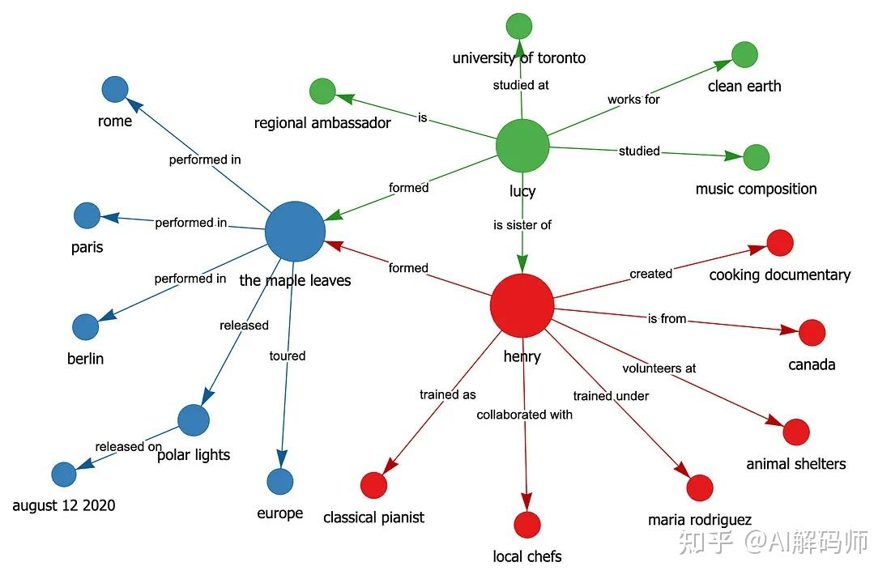
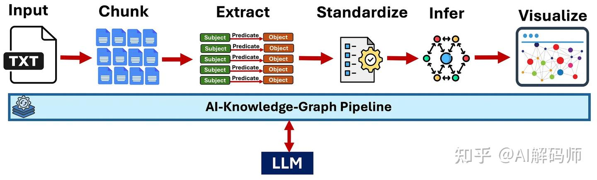
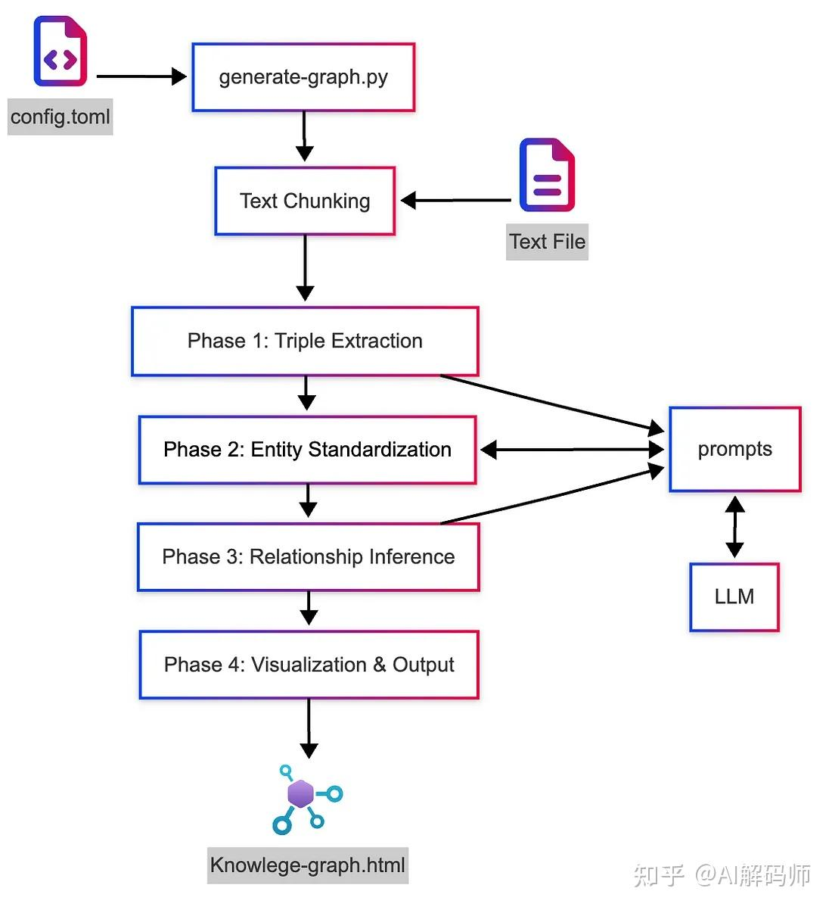
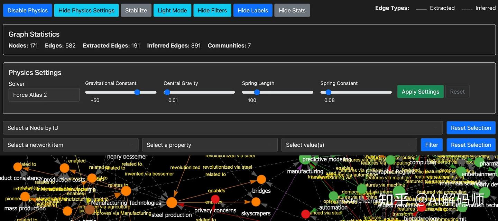

**导语：** 知识图谱作为一种强大的信息表示方式，通过实体（节点）和关系（边）展现了信息间的内在联系，其清晰的结构化优势远超非结构化文本。然而，从海量非结构化文本中构建知识图谱，传统方法往往面临挑战。本文将深入探讨如何利用大语言模型（LLM）的强大能力，构建一套自动化流程，将原始文本转化为交互式知识图谱网页。

#### 传统构建知识图谱的痛点

在过去，从原始文本中构建知识图谱并非易事。它通常需要人工识别实体及其关系，或依赖大量手写的提取规则，甚至需要训练专门的机器学习模型。这些方法不仅耗时耗力，而且灵活性欠佳，难以适应多样化的文本内容。

#### LLM：知识图谱构建的变革者

大语言模型（LLM）以其卓越的文本理解和生成能力，为知识图谱的自动化构建带来了全新的可能性。LLM能够理解自由形式的文本，并输出结构化的信息，这使得它们成为自动化知识图谱构建流程中的理想选择。本文将详细介绍一个实践项目，旨在利用LLM的能力，将非结构化文本转化为可交互的知识图谱网页。该项目的全部代码已开源，并位于**AI-Knowledge-Graph**项目仓库中。

#### 项目示例：将复杂文本结构化呈现

为了直观展示该项目的能力，我们来看一个简单的例子。当输入以下非结构化文本时：

**“Henry, a talented musician from Canada, originally trained as a classical pianist under renowned conductor Maria Rodriguez. Henry later formed a rock band called The Maple Leaves with his sister Lucy, who studied music composition at the University of Toronto. The Maple Leaves released their debut album, Polar Lights, on August 12, 2020, earning critical acclaim for blending classical and rock influences. Lucy also pursued environmental activism and joined Clean Earth as a regional ambassador, where she campaigned for stricter wildlife protection laws. Henry was inspired by Lucy’s passion for charity work, so he started volunteering at local animal shelters in his hometown. Although Henry and Lucy initially struggled with creative differences, they eventually found harmony in combining Lucy’s classical compositions with Henry’s rock guitar riffs. The Maple Leaves toured across Europe in 2021, performing sold-out shows in major cities like Paris, Berlin, and Rome. During the tour, Henry developed a keen interest in international cuisine and collaborated with local chefs to film a short documentary on regional cooking techniques.”AI-Knowledge-Graph**工具将利用您配置的LLM，从上述文本中提取知识，并生成一个类似下图所示的交互式知识图谱HTML文件：

#### 高度抽象的工作原理

该项目的高层工作流程可以概括为以下几个关键步骤：

- **文本分块（Text Chunking）：** 自动将大型文档分割成易于处理的文本块。
- **知识提取（Knowledge Extraction）：** LLM从每个文本块中识别并提取主语-谓语-宾语（SPO）三元组（即事实）。
- **实体标准化（Entity Standardization）：** 将指代同一实体的不同表述（如“AI”和“人工智能”）统一为单一名称。
- **关系推理（Relationship Inference）：** 通过简单的逻辑规则（如传递性）和LLM的推理能力，推断出额外的关系，以连接不相连的子图。
- **交互式可视化（Interactive Visualization）：** 将生成的知识图谱以交互式网络的形式在浏览器中展示。

#### 详细解析：每一步的精妙之处

**文本分块**

由于LLM存在上下文窗口限制，以及本地系统的内存限制，为了处理大型文档，该工具会自动将文本分割成块（例如，每块500个词，并带有一定重叠）。重叠有助于保持边界句子的上下文连贯性。每个文本块随后会被发送给LLM，并附带一个指令，要求其提取SPO三元组。

**LLM驱动的知识提取**

对于每个文本块，该工具会要求LLM输出一个JSON数组，其中包含三元组以及信息提取自哪个文本块。示例如下：

`[
  {
    "subject": "eli whitney",
    "predicate": "invented",
    "object": "cotton gin",
    "chunk": 1
  },
  {
    "subject": "Industrial Revolution",
    "predicate": "reshapes",
    "object": "economic systems",
    "chunk": 1
  },
  {
    "subject": "amazon",
    "predicate": "transformed",
    "object": "retail",
    "chunk": 3
  }
]`

提示词鼓励LLM在实体命名上保持一致性，使用简短的关系短语（1-3个词），并避免使用代词指代。从所有文本块中提取的三元组随后会被组合成一个初始的原始知识图谱。

#### 跨文本块的实体标准化

提取完成后，您经常会发现同一实体的多种变体（例如，“AI”、“A.I.”、“artificial intelligence”）。为了避免节点碎片化或重复，该工具提供了实体标准化步骤。

- **基本规范化：** 小写化、去除空格等操作会合并明显的重复项。
- **标准化（可选）：** 启用此功能后，LLM会聚类不同的提及，这些提及可能指代同一实体。例如，“New York”、“NYC”和“New York City”会成为一个规范节点；“United States”、“U.S.”和“USA”会成为另一个。
这能显著提高图谱的连贯性，通常建议启用。如果您需要严格的原始提取结果，可以在配置文件中禁用此功能。

#### 推理隐藏连接以丰富图谱

即使对文本进行了彻底阅读，也可能无法捕捉到所有隐含的关系。该工具通过两种方式解决这个问题：

- **基于规则的推理：** 

- **传递性关系：** 如果A促成了B，且B推动了C，系统可以推断A影响了C。
- **词汇相似性：** 名称相似的实体可能会通过一个通用的“相关于”关系连接起来。

- **LLM辅助推理：** 

- 该工具可以提示LLM提出连接原本不相连的子图的链接。例如，如果一个集群是关于工业革命的，另一个是关于AI的，LLM可能会推断出历史或概念上的联系（“AI是始于工业革命的技术创新的产物”）。

这些推断出的边会用不同方式标记（例如虚线），以便与文本中明确陈述的事实区分开来。这个推理步骤通常会增加大量新关系，大大减少了孤立的子网络。如果您希望获得纯粹基于文本的图谱，可以在配置文件中禁用此功能。与文本块编号不同，推断出的关系包含一个属性，表明该关系是推断而来。此属性非常重要，因为它将在可视化过程中用于以虚线边表示推断关系。示例结构：

`[
  {
    "subject": "electrification",
    "predicate": "enables",
    "object": "Manufacturing Automation",
    "inferred": true
  },
  {
    "subject": "tim berners-lee",
    "predicate": "expanded via internet",
    "object": "information sharing",
    "inferred": true
  }
]`

#### LLM提示词的艺术

如果所有选项都启用，共有四个提示词会发送给LLM。初始的主语-谓语-宾语（SPO）知识提取是其中之一。

**提取系统提示词：**

`您是一个专注于知识提取和知识图谱生成的高级AI系统。
您的专长包括识别文本中一致的实体引用和有意义的关系。
关键指令：所有关系（谓语）必须最多3个词。理想情况下是1-2个词。这是硬性限制。`

**提取用户提示词：**

`您的任务：阅读以下文本（由三反引号分隔），并识别每个句子中的所有主语-谓语-宾语（S-P-O）关系。然后生成一个包含对象的JSON数组，每个对象代表一个三元组。

请仔细遵循以下规则：

- 实体一致性：在整个文档中对实体使用一致的名称。例如，如果“John Smith”在不同地方被提及为“John”、“Mr. Smith”和“John Smith”，请在所有三元组中使用单一一致的形式（最好是最完整的形式）。
- 原子术语：识别不同的关键术语（例如，对象、地点、组织、缩写、人物、条件、概念、感受）。避免将多个想法合并为一个术语（它们应该尽可能“原子化”）。
- 统一引用：如果可识别，将所有代词（例如，“he”、“she”、“it”、“they”等）替换为实际引用的实体。
- 成对关系：如果多个术语在同一句子（或使其在上下文相关联的短段落）中共同出现，则为每对具有有意义关系的对象创建一个三元组。
- 关键指令：谓语必须最多1-3个词。绝不能超过3个词。保持它们极其简洁。
- 确保识别文本中所有可能的关系，并将其捕获为S-P-O关系。
- 术语标准化：如果相同的概念出现略有不同（例如，“artificial intelligence”和“AI”），请始终使用最常见或规范的形式。
- 将S-P-O文本中的所有文本都小写，甚至包括人名和地名。
- 如果有人名被提及，请创建与他们的位置、职业以及他们所做的事情（发明、写作、开始、头衔等）相关的关系，如果已知且符合信息上下文。

重要注意事项：
- 旨在实体命名中实现精确性——使用特定形式来区分相似但不同的实体。
- 通过在整个文档中对相同概念使用相同的实体名称来最大化连接性。
- 在识别实体引用时考虑整个上下文。
- 所有谓语必须少于或等于3个词——这是硬性要求。

输出要求：

- 除了JSON之外，不要包含任何文本或评论。
- 只返回JSON数组，每个三元组作为一个对象，包含“subject”、“predicate”和“object”。
- 确保JSON有效且格式正确。`

还有另外三个提示词未在此列出，它们指导LLM进行标准化和关系推理。您可以在源文件中查看（和调整）所有提示词。

#### 交互式图谱可视化

有了全面的SPO三元组列表（原始加推断），该工具使用**PyVis**（Vis.js的Python接口）生成交互式HTML可视化。在浏览器中打开生成的文件，您将看到：

- **颜色编码的社区：** 同一集群中的节点共享相同的颜色。集群通常对应文本中的子主题或主题。
- **按重要性调整节点大小：** 连接多（或中心性高）的节点会显得更大。
- **边样式：** 实线表示来自文本的关系，虚线表示推断关系。
- **交互式控件：** 平移、缩放、拖动节点、切换物理效果、切换亮/暗模式，以及过滤视图。
这使得以视觉吸引人的格式探索关系变得非常容易。

#### 程序流程概览

以下是该程序的基本流程（代码仓库的`README.md`中有更详细的程序流程图）：

#### 如何安装AI-Knowledge-Graph

要在您的计算机上运行此工具，您需要满足以下要求：

**要求：**

- 可运行的计算机（Windows、Linux或macOS）。
- 已安装Python（3.12或更高版本），推荐使用`uv`。
- 访问兼容OpenAI API的端点（Ollama、LiteLLM、LM Studio、OpenAI订阅等）。
- Git，用于克隆代码仓库。
**下载和安装依赖项：**

将仓库克隆到您要运行的系统上，并切换到该目录：

`git clone https://github.com/robert-mcdermott/ai-knowledge-graph.git
cd ai-knowledge-graph`

使用`uv`安装依赖项：

`uv sync`

或者使用`pip`安装：

`pip install -r requirements.txt`

**配置AI-Knowledge-Graph**

编辑`config.toml`文件以适应您的情况。您可以在此处配置LLM模型、端点（URL）、最大上下文窗口长度和LLM的温度。在下面的示例中，我使用Google的开源**Gemma 3**模型，该模型通过Ollama托管在我的本地计算机上。您还可以在此处调整文档分块大小和重叠量，以及是否启用实体标准化和关系推理：

`[llm]
model = "gemma3"
api_key = "sk-1234"
base_url = "http://localhost:11434/v1/chat/completions"
max_tokens = 8192
temperature = 0.2

[chunking]
chunk_size = 200    # 每块的单词数
overlap = 20        # 块之间的重叠单词数

[standardization]
enabled = true          # 是否启用实体标准化
use_llm_for_entities = true # 是否使用LLM进行额外的实体解析

[inference]
enabled = true          # 是否启用关系推理
use_llm_for_inference = true    # 是否使用LLM进行关系推理
apply_transitive = true     # 是否应用传递性推理规则

[visualization]
edge_smooth = false # 边缘线是否平滑（true或false）`

**注意：** 对于本地LLM的使用，您可以使用Ollama或LM Studio API端点；对于访问任何商业LLM提供商（AWS Bedrock、Azure、Anthropic、OpenAI等），可以使用LiteLLM。如果您需要有关运行Ollama本地或LiteLLM访问其他LLM服务的帮助，请参阅我之前的文章：《LLM零到英雄：Ollama实践指南》或《使用LiteLLM Proxy集中管理多个AI服务》。

#### 构建您的第一个知识图谱

现在您已经安装并配置好**AI-Knowledge-Graph**，并指向您的LLM，您就可以开始创建您的第一个知识图谱了。获取一个您想构建知识图谱的纯文本文件（目前仅支持文本文件）。

接下来，您需要运行`generate-graph.py`脚本。以下是该脚本的帮助信息：

`usage: generate-graph.py [-h] [--test] [--config CONFIG] [--output OUTPUT] [--input INPUT] [--debug] [--no-standardize] [--no-inference]

Knowledge Graph Generator and Visualizer

options:
  -h, --help        显示此帮助消息并退出
  --test            使用示例数据生成测试可视化
  --config CONFIG   配置文件路径
  --output OUTPUT   输出HTML文件路径
  --input INPUT     输入文本文件路径（必需，除非使用--test）
  --debug           启用调试输出（原始LLM响应和提取的JSON）
  --no-standardize  禁用实体标准化
  --no-inference    禁用关系推理`

以下是使用当前目录中文本文件`mydocument.txt`创建知识图谱的示例（如果您使用`uv`，请将“python”替换为“uv run”）：

`python generate-graph.py --input mydocument.txt --output mydocument.html`

以下是上述命令在控制台中运行完整流程的输出：

`python generate-graph.py --input mydocument.txt --output mydocument.html
Using input text from file: mydocument.txt
==================================================
PHASE 1: INITIAL TRIPLE EXTRACTION
==================================================
Processing text in 3 chunks (size: 500 words, overlap: 50 words)
Processing chunk 1/3 (500 words)
Processing chunk 2/3 (500 words)
Processing chunk 3/3 (66 words)

Extracted a total of 73 triples from all chunks

==================================================
PHASE 2: ENTITY STANDARDIZATION
==================================================
Starting with 73 triples and 106 unique entities
Standardizing entity names across all triples...
Applied LLM-based entity standardization for 15 entity groups
Removed 8 self-referencing triples
Standardized 106 entities into 101 standard forms
After standardization: 65 triples and 72 unique entities

==================================================
PHASE 3: RELATIONSHIP INFERENCE
==================================================
Starting with 65 triples
Top 5 relationship types before inference:
  - pioneered: 9 occurrences
  - invented: 7 occurrences
  - developed: 6 occurrences
  - develops: 6 occurrences
  - was: 4 occurrences

Inferring additional relationships between entities...
Identified 18 disconnected communities in the graph
Inferred 27 new relationships between communities
Inferred 30 new relationships between communities
Inferred 6 new relationships within communities
Inferred 8 relationships based on lexical similarity
Added 51 inferred relationships

Top 5 relationship types after inference:
  - invented: 7 occurrences
  - pioneered: 6 occurrences
  - developed: 6 occurrences
  - develops: 6 occurrences
  - related to: 6 occurrences

Added 57 inferred relationships
Final knowledge graph: 116 triples
Saved raw knowledge graph data to mydocument.json
Processing 116 triples for visualization
Found 72 unique nodes
Found 55 inferred relationships
Detected 12 communities using Louvain method

Knowledge graph visualization saved to mydocument.html

Knowledge Graph Statistics:
Nodes: 72
Edges: 116 (55 inferred)
Communities: 12

To view the visualization, open the following file in your browser:
file:///Users/robertm/mycode/ai-knowledge-graph/mydocument.html`

现在，在您的网络浏览器中打开生成的HTML文件，即可探索知识图谱。如果您只是阅读本文，想直接查看并与该系统创建的知识图谱进行交互，无需自行创建，请点击以下链接查看一个关于工业革命的文档生成的示例可视化：[Industrial-Revolutions.html](https://link.zhihu.com/?target=https%3A//robert-mcdermott.github.io/ai-knowledge-graph/) (请注意，此链接是示例，实际链接需要替换为真实的托管地址)。

您可以使用页面顶部的菜单展开控制面板，调整布局物理效果、隐藏或显示节点/边标签、查看图谱统计信息或选择/过滤节点和边。还有暗黑模式可供选择，如下图所示：

#### 实验与优化：探索最佳实践

**重要提示：** 尝试不同的分块大小/重叠量和LLM模型至关重要，这将显著影响结果。我通常将重叠量设置为分块大小的10%。较小的文档分块大小（100-200个词）似乎能够提取更多的关系，但这可能会导致在跨越小块的概念/社区之间关系较少。您需要通过实验找到合适的分块大小和模型。我也相信，通过调整提示词，还有大量的优化空间。