人工智能正以前所未有的速度进化，深刻影响着各行各业。进入2025年，AI大模型不仅在智能水平、运行效率和应用成本上取得了显著突破，其应用范式也在经历深刻变革。本文深度解读Artificial Analysis公司发布的《Artificial Analysis State of AI – Q1 2025》及《State of AI: China – Q2 2025》报告，旨在为您提炼AI大模型（文本类）发展的核心趋势、关键洞察以及中美两国的最新竞争格局。

文章将围绕以下四个部分展开，前三部分聚焦全球AI大模型的整体进展，第四部分则深入剖析中美AI的竞逐态势：**一、AI大模型进展：智能、效率与生态的全面演进
二、推理模型（Reasoning Models）：AI认知能力的新纪元
三、效率与混合专家模型（MoEs）：应对算力挑战的智慧进化
四、中美大模型竞争态势：差距缩小，中国力量加速崛起

【备注：前三部分内容是基于2025 Q1（一季度）报告，因此DeepSeek仍是2025年1月份版本；但第四部分内容更新引入了DeepSeek 2025年0528版本**】

#### **【报告来源说明】**

**1、Artificial Analysis公司**

本次分析所基于的报告是来源于Artificial Analysis，这是一家公开声明专注于AI基准测试与分析的公司。按照其官方说法，Artificial Analysis旨在为市场提供不受特定AI技术供应商影响的模型性能评估，以协助用户在日益复杂的技术选项中做出更明智的决策，并帮助业界追踪AI领域的快速进展。

**2、关于“智能指数”（Intelligence Index）**

Artificial Analysis评估大模型综合能力的核心工具，是其构建的“智能指数”（Intelligence Index）。根据该公司披露的信息，该指数主要**针对基于英语的、纯文本处理能力的大模型**进行评估。它通过整合多个来源的评估数据集（包括一些行业熟知的公开基准，如MMLU、HumanEval等），对模型在推理、知识掌握、数学能力和编程技能等多个维度进行测试。其评分过程据称运用了标准化的提示工程、特定的答案提取与验证机制，并通过一套加权算法最终形成综合得分。

在后续分析中，我们将主要依据此“智能指数”框架下的数据展开，在应用这些数据进行决策时，应结合自身具体需求和多方信息进行综合考量。

#### **一、AI大模型进展：智能、效率与生态的全面演进**

现阶段各大AI公司在大模型智能水平、成本效益和模型速度上均取得了实质性进展，预示着AI技术正加速渗透并重塑产业格局。

**1）AI价值链整合各显神通：谷歌“全栈”布局引人注目****

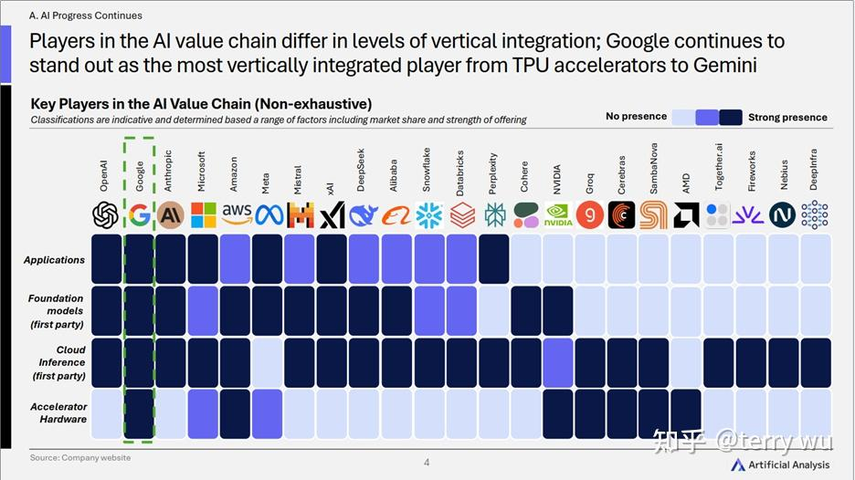

- 核心趋势： **AI价值链上的参与者们展现出不同程度的垂直整合策略，从底层硬件到顶层应用，其布局深度和广度各不相同。其中，谷歌凭借其从TPU加速器到Gemini模型的全面覆盖，成为当前垂直整合程度最高的公司。这种差异化的整合路径，正成为各方构建竞争壁垒和影响行业走向的关键。
- **关键洞察：**

- **谷歌的“全栈”影响力： **谷歌通过其端到端的整合能力，清晰展示了深度垂直整合的强大影响力。这种“全栈式”布局使其在优化性能、控制生态、引领创新方向上具备一定优势。
- **生态位分化与战略选择： **与此同时，价值链上的其他主要玩家，如英伟达在硬件端的“基石”地位，OpenAI、Anthropic等在模型与应用层的创新引领，以及微软、亚马逊云的强大平台能力，共同构成了复杂且动态的AI生态。这种生态位的差异化反映了各家不同的战略侧重。未来行业是会趋向于少数巨头的“全能型封闭花园”，还是形成更加开放和模块化的协作体系，将是决定AI产业发展方向的关键看点。

**

2）模态全面开花与赛道聚焦：巨头与挑战者的不同选择****

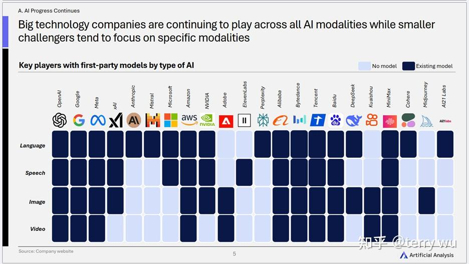

- 核心趋势：** 大型科技公司凭借雄厚资源，在文本、语音、图像、视频等所有主流AI模态上全面布局，力图构建“全能型”AI平台。而规模较小的挑战者则更倾向于在特定模态或细分领域深耕，寻求差异化突破。
- **关键洞察：**

- **“大而全” vs “小而美”：** 市场呈现出两种发展路径。巨头们追求的是一站式解决多模态AI需求，而新兴力量则通过在特定模态（如ElevenLabs在语音，Midjourney在图像）上的技术领先或独特体验来获取用户。
- **应用场景驱动模态融合：** 虽然图表展示的是各公司的模型布局，但其背后是应用场景对多模态能力的渴求。未来，能够无缝融合不同模态信息、提供更自然交互体验的AI应用将更具竞争力。

**

3）智能高地争夺白热化：“会思考”的模型引领新飞跃****

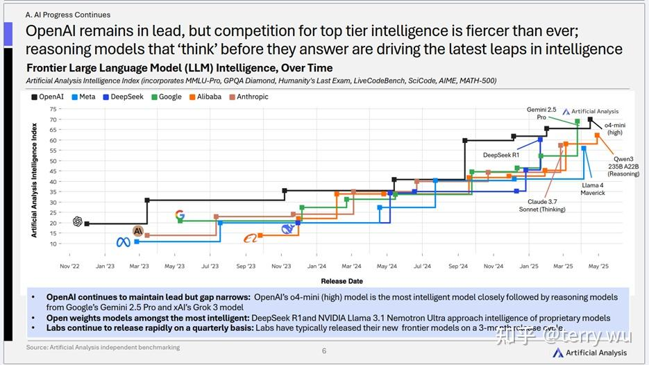

- 核心趋势：** OpenAI虽在AI智能指数上仍保持领先，但与追赶者的差距正在缩小，顶级智能大模型的竞争空前激烈。尤其值得注意的是，那些具备“思考”能力的推理模型（Reasoning Models）正成为推动AI智能实现最新突破的关键驱动力。
- **关键洞察：**

- **智能上限的突破口：** AI的进步不再仅仅是参数量的堆砌或数据量的增加，模型能否进行有效的“推理”和“思考”，成为衡量其智能水平的新标杆。
- **快速迭代成为常态：** 各大公司以平均3个月的周期发布新一代前沿模型，这种“AI军备竞赛”的背后，是研发投入的持续加码和对市场领导地位的渴望。
- **开放与闭源的竞逐：** DeepSeek R1等开放权重模型的智能水平已逼近顶级闭源模型，这为AI技术的普及和创新提供了更多可能性，也给闭源模型厂商带来了更大的竞争压力。

**

二、推理模型（Reasoning Models）：AI认知能力的新纪元****推理模型被反复提及，其重要性不言而喻。它们不仅在基准测试中表现优异，更代表了AI理解和解决复杂问题能力的一次质的飞跃。

1）推理模型：智能指数的“新王者”****

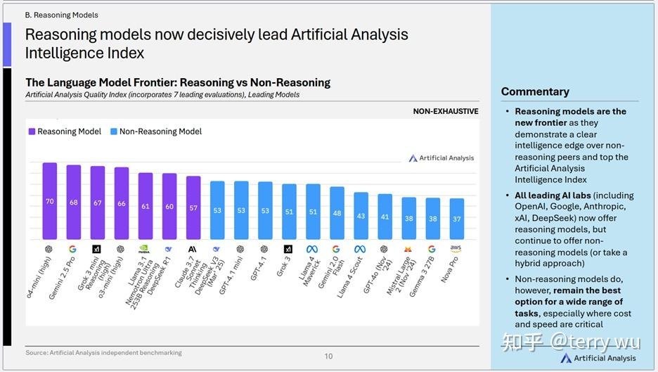

- 核心趋势：** **推理模型（Reasoning models）已明确成为当前大模型智能水平的领跑者。** 在智能指数排名前列的模型中，具备推理能力的模型占据了主导地位。
- **关键洞察：**

- **“思考”即优势，推理引领前沿：**模型是否具备在输出答案前进行“思考”和复杂逻辑处理的能力，已成为衡量其智能上限的关键分水岭。
- **头部公司的策略选择：** 所有领先的AI公司都提供推理模型，同时也继续提供非推理模型（或采取混合策略），体现出不同类型模型在应用场景上的互补性。
- **非推理模型仍具价值：** 尽管推理模型在智能指数上领先，但非推理模型在许多任务中，尤其是在成本和速度至关重要的场景下，仍然是最佳选择。

**

2）“思考”的代价：时间与Token换取更高准确率****

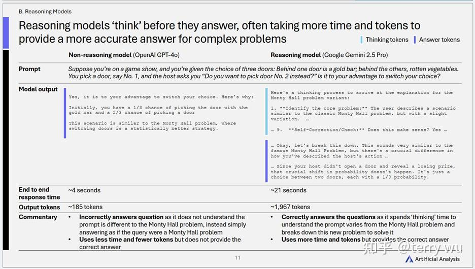

- 核心趋势：** 推理模型在回答复杂问题前，会进行一个内部的“思考”过程（通常表现为生成额外的“思考token”），这使得它们能够提供更准确、更细致的答案，但同时也带来了更长的响应时间和更高的token消耗。
- **关键洞察：**

- **智能与效率的权衡：**追求极致准确性需要付出时间与计算资源的代价。企业在应用推理模型时，必须根据具体场景的需求（如实时性要求、成本预算）来平衡准确性与效率。

**

三、效率与混合专家模型（MoEs）：应对算力挑战的智慧进化****随着模型能力的增强，对计算资源的需求也水涨船高。提升效率、降低成本成为AI可持续发展的关键。

1）推理成本的“雪崩式”下降：高智能AI正加速走向普惠****

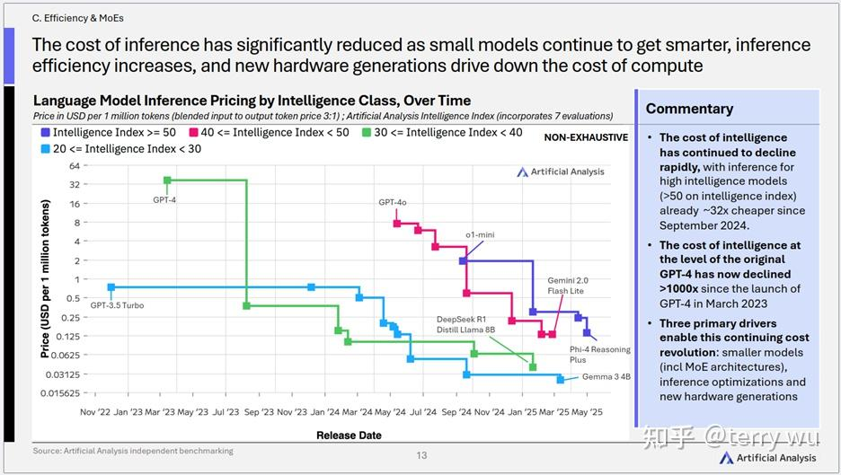

- 核心趋势：** **AI大模型的推理成本在过去一年多经历了显著且持续的下降，尤其对于高智能模型而言，其成本效益的提升速度惊人。** 例如，对于Artificial Analysis智能指数高于50的高智能模型，其推理成本相较于2024年9月已降低了约32倍。
- **关键洞察：**

- **顶级智能成本的千倍级优化：** 自2023年3月以来，达到原始GPT-4同等智能水平的推理成本已下降超过1000倍。这一巨大的成本降幅，直观地揭示了AI技术在成本优化上的巨大进展，使得曾经高不可攀的顶级智能正变得越来越触手可及。
- **三大核心驱动力协同发力：** 这场“成本革命”主要得益于三个方面的协同进化：**更小的模型（包括MoE架构）、推理优化技术、以及新一代硬件。** 这表明AI成本的降低是算法创新、软件工程和硬件迭代共同作用的结果。
- **加速AI普惠化进程：** 推理成本的持续、大幅度下降，正在以前所未有的力度降低AI技术的应用门槛。这意味着，无论是大型企业还是中小型开发者，都有更多机会以可负担的成本利用先进的AI能力进行创新和应用开发，从而极大地加速AI技术在各行各业的普及和渗透。一个AI应用大爆发的时代可能正在到来。

**

2）速度与等待的博弈：为何AI快了，我们却可能等更久？****

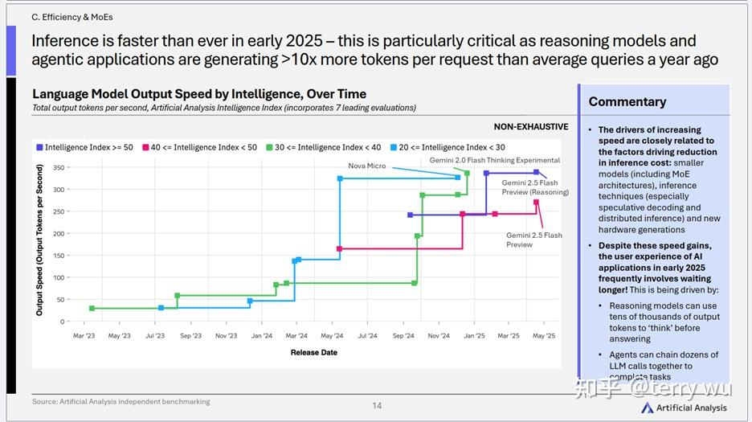

- 核心趋势：** **2025年初，AI模型的推理速度达到了前所未有的水平，不同智能等级模型的输出速度（token/秒）均有显著提升。然而，一个值得关注的现象是，由于新兴的推理模型和智能体（Agentic）应用在单次请求中生成的token数量远超以往（可能超过10倍），用户在实际体验中仍可能面临较长的等待时间**。
- **关键洞察：**

- **速度提升的驱动力与成本降低因素相近：** 推理速度的提升，与推理成本降低的驱动因素密切相关，主要包括：更小的模型（含MoE架构）、先进的推理技术、以及新一代硬件的进步。这些因素共同作用，使得单位token的生成更为迅速。
- **“等待延时”的来源：Token总量的激增是关键：** 尽管底层推理速度在加快，但用户体验中的“等待延时”并未同等比例缩短，甚至在某些复杂应用中可能不降反升。其核心原因在于：**

- 推理模型的“深度思考”：** 为了提供更精准的答案，推理模型在内部“思考”时会生成大量token。
- **智能体应用的“链式调用”：** AI智能体为了完成复杂任务，往往需要链接数十个对大模型的调用，这同样导致了token总量的急剧增加。

**

- 用户体验的新平衡点：** 这揭示了AI应用发展中的一个新矛盾：底层技术的进步带来了速度的提升，但应用模式的复杂化又可能抵消这种速度优势。未来，优化用户体验不仅要关注模型的峰值速度，更要关注如何设计更高效的交互流程，以及如何管理和优化因“深度思考”和“链式调用”而产生的token总量，这将是提升AI应用实用性的关键挑战。

**

3）MoE架构：平衡智能与效率的前沿探索****

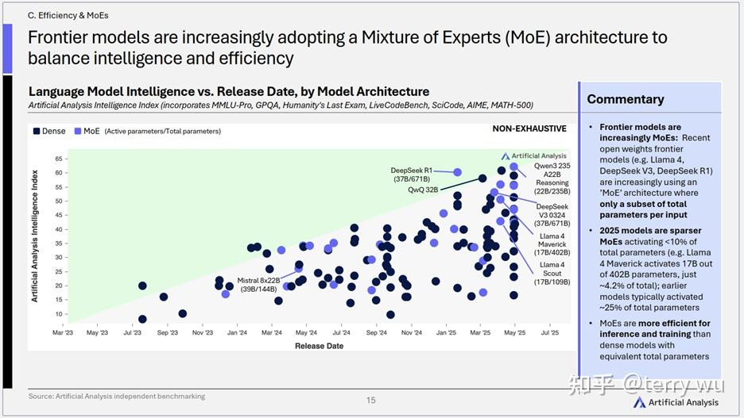

- 核心趋势：** 混合专家（MoE）架构正被越来越多的前沿模型采用，以在庞大的总参数量下，通过仅激活部分参数（稀疏激活）来实现智能与效率的平衡。2025年的MoE模型呈现出更高的稀疏性（激活参数4）效率提升与需求增长的“AI跷跷板”****

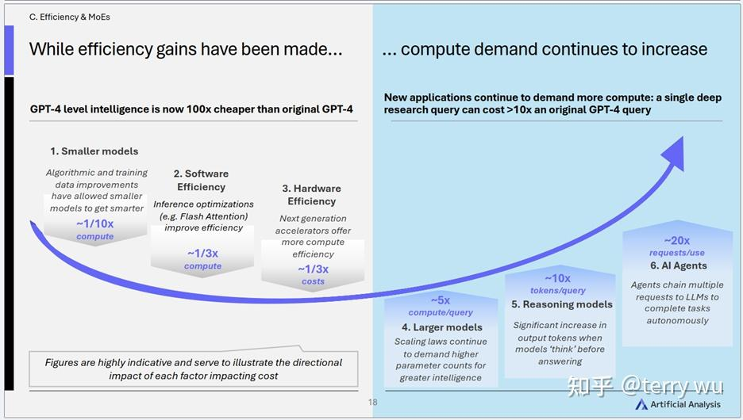

- 核心趋势：** 尽管技术进步使得同等级别的AI智能成本大幅下降（如GPT-4级别大模型成本降低100倍），但新的应用范式（更大的模型参数、更深度的推理、更复杂的AI智能体）又反过来驱动计算需求的持续增长。
- **关键洞察：**

- **永恒的追逐：** AI领域呈现出一种“效率提升被需求增长所抵消”的动态平衡。技术进步在不断降低成本，而应用创新则在不断拓展能力的边界，推高需求。这是一个螺旋式上升的过程。
- **算力依然是核心瓶颈：** 尽管优化手段层出不穷，但对更强大AI能力的无尽追求，意味着算力在可预见的未来仍将是制约AI发展的核心要素。

**

四、中美大模型竞争态势：差距缩小，中国力量加速崛起****在全球AI大模型的竞赛中，中美两国无疑是舞台中央最耀眼的两位选手。2025年Q2的报告（State of AI: China, Q2 2025）揭示了这一竞争格局的最新动态：中国AI公司正以前所未有的速度追赶美国领先者，尤其在开放权重模型领域，中国已展现出领先势头。

1）中国AI公司与美国领先者差距显著缩小****

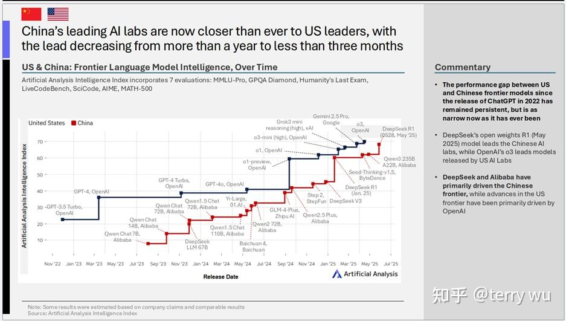

- 核心趋势：** 中国顶尖AI公司与美国领导者在大模型智能上的差距，已从之前落后一年多，缩短至不到三个月。Artificial Analysis智能指数显示，中美在前沿大模型智能上的差距达到了历史最小。
- **关键洞察：**

- **追赶速度惊人：** 这一趋势表明中国AI研发能力的快速提升。自ChatGPT发布以来，尽管美国一直保持领先，但中国公司通过持续投入和快速迭代，正在有力地挑战现有格局。
- **关键推动者：** DeepSeek和阿里巴巴成为推动中国前沿AI发展的主要力量，而OpenAI则一直是美国前沿AI进步的核心驱动。DeepSeek的开放权重模型R1（2025年5月）在智能上已非常接近OpenAI的o3模型。

**

2）中国在开放权重模型领域实现反超****

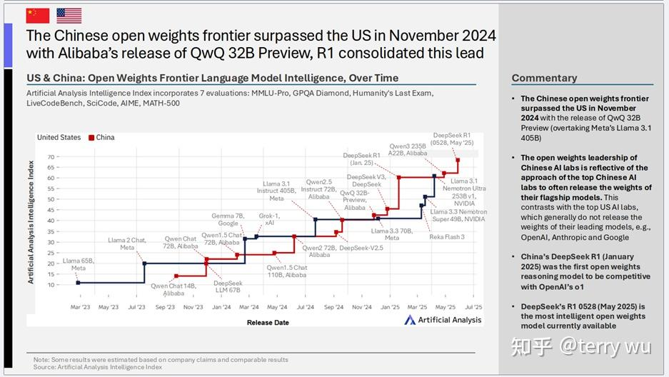

- 核心趋势：** 2024年11月，随着阿里巴巴发布QwQ 32B Preview，中国在开放权重前沿大模型智能方面超越了美国（当时超越了Meta的Llama 3.1 405B）。随后，DeepSeek的R1模型进一步巩固了这一领先地位。
- **关键洞察：**

- **开放策略的胜利：** 中国顶尖AI公司（如DeepSeek、阿里巴巴）倾向于将其旗舰模型的权重开放，这与美国顶尖公司（如OpenAI、Anthropic、Google）通常不开放其领先模型权重的做法形成对比。这种开放策略加速了模型的传播、应用和迭代，客观上推动了中国在开放权重领域的整体进步。
- **里程碑事件：** DeepSeek R1（2025年1月版）成为首个在智能上能与OpenAI的o1模型相媲美的开放权重推理模型。而其2025年5月更新的R1 0528版本，更是成为当前最智能的开放权重模型。

**

3）DeepSeek与阿里巴巴引领中国AI模型发展****

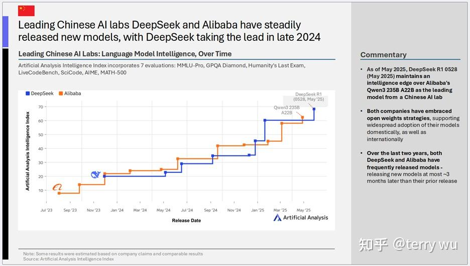

- 核心趋势：** 中国领先的AI公司DeepSeek和阿里巴巴持续稳定地发布新模型，其中DeepSeek在2024年底取得了领先地位。
- **关键洞察：**

- **双雄并进：** DeepSeek的R1 0528版本目前在智能上领先于阿里巴巴的Qwen3 235B A22B，成为中国AI公司的领头羊。
- **拥抱开放，着眼全球：** 两家公司都积极采纳开放权重策略，这不仅支持了其模型在国内的广泛应用，也着眼于国际市场的拓展。
- **快速迭代的中国速度：** 在过去两年中，DeepSeek和阿里巴巴都保持了高频的模型发布节奏，通常在前一个模型发布后最多约3个月就会推出新模型。

**

4）DeepSeek模型智能水平的飞速提升****

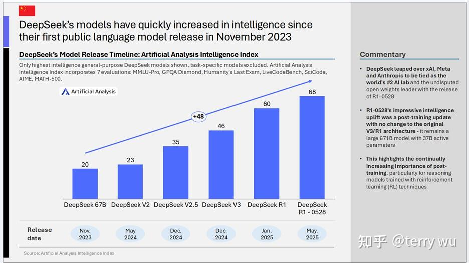

- 核心趋势：** 自2023年11月首次公开发布大模型以来，DeepSeek的模型智能水平实现了迅猛增长。其最新的R1-0528模型智能指数已达到68，相较于最初的67B模型（指数20），提升了48个点。
- **关键洞察：**

- **后起之秀的惊人潜力：** DeepSeek凭借R1-0528的发布，一举超越xAI、Meta和Anthropic，成为全球排名第二的AI公司（与某些指标下的领先者并列），并成为无可争议的开放权重领导者。
- **后训练（Post-training）的重要性凸显：** R1-0528的显著智能提升是在未改变原有V3/R1架构（仍为671B总参数，37B激活参数的大模型）的情况下，通过后训练更新实现的。这突显了后训练，特别是针对使用强化学习（RL）技术训练的推理模型，在提升模型能力方面日益增长的重要性。

**

5）美国AI领导权竞争加剧，OpenAI优势不再绝对****

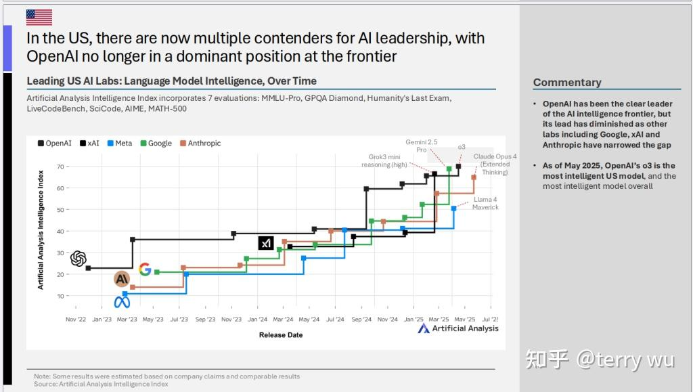

- 核心趋势：** 在美国本土，AI领导权的争夺也日趋激烈，多个竞争者涌现，OpenAI在前沿领域的统治地位已不再像过去那样稳固。
- **关键洞察：**

- **群雄并起：** OpenAI一直是AI智能前沿的明显领导者，但其领先优势有所减弱，因为包括Google、xAI和Anthropic在内的其他公司已经缩小了差距。
- **OpenAI o3仍具竞争力：** 截至2025年5月，OpenAI的o3模型仍然是美国最智能的模型，也是整体上最智能的模型。但这更多反映了头部竞争的胶着状态，而非一家独大。

**

6）中国AI玩家的三大阵营****

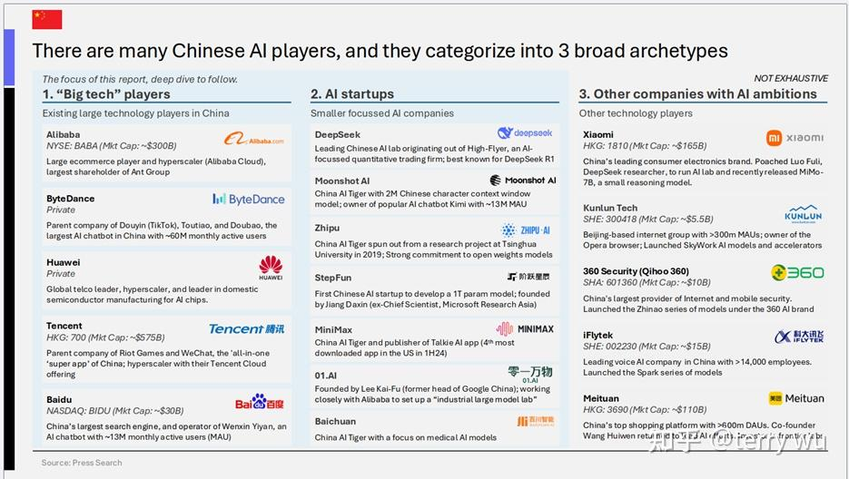

- 核心趋势：**中国AI领域存在众多参与者，报告将其大致归为三大阵营：大型科技公司、AI初创企业、以及其他比较重视AI的公司。
- **关键洞察：**

- **生态多样性：****

- 大型科技公司：** 如阿里巴巴、字节跳动、华为、腾讯、百度，它们拥有庞大的用户基础、强大的研发能力和云计算资源，是中国AI发展的中坚力量。
- **AI初创企业：** 如DeepSeek、月之暗面（Moonshot AI）、智谱AI（Zhipu AI）、阶跃星辰（StepFun）、MiniMax、零一万物（01.AI）、百川智能（Baichuan AI），这些公司中很多也获得了大型科技公司的投资。

【**备注**：**虽然DeepSeek的技术实力已达到行业领先水平，但从其公司发展阶段和报告分类来看，仍属于‘AI初创企业’范畴**。】

**

7）中国AI公司紧随美国，差距已不遥远****

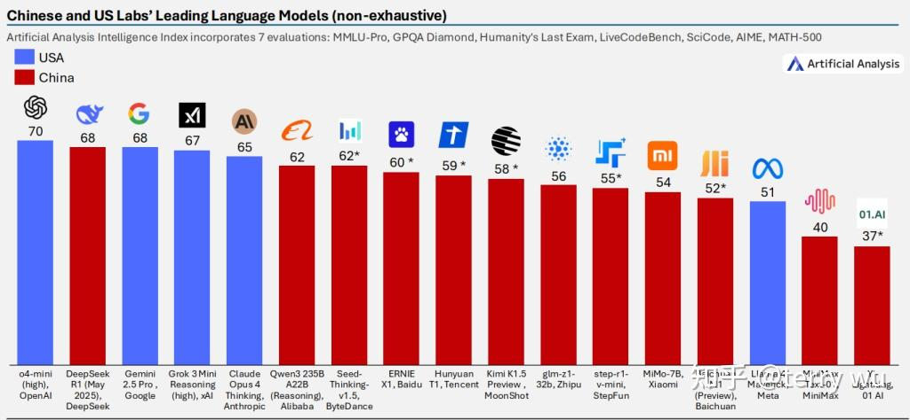

- 核心趋势：** 美国AI公司虽然在前沿大模型的整体智能水平上保持着领先优势，但中国AI公司的迅速崛起正深刻改变着竞争格局，双方的差距已显著缩小。如今，在顶尖大模型的智能指数排行榜上，中国模型的身影日益增多，并已在多个关键位次上与美国顶尖模型展开直接较量。
- **关键洞察：**

- **第一梯队的中国面孔：** DeepSeek R1 (2025年0528版本) 的智能指数（68）已与Google的Gemini 2.5 Pro持平，并非常接近OpenAI的o4-mini (high)（70）。阿里巴巴的Qwen3 235B A22B (Reasoning)（62）也表现强劲。
- **整体实力的提升：** 除了头部模型，中国还有一批来自字节跳动（Seed-Thinking-v1.5, 62*）、百度（ERNIE X1, 60*）、腾讯（Hunyuan T1, 59*）、月之暗面（Kimi K1.5 Preview, 58*）、智谱AI（glm-z1-32b, 56）、阶跃星辰（step-r1-v-mini, 55）等公司的模型也展现出不俗的智能水平，形成了有力的第二梯队。

**

8）DeepSeek引领开放权重模型前沿****

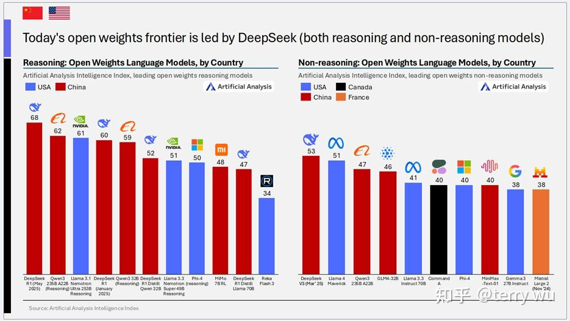

- 核心趋势：** 无论是推理型还是非推理型的开放权重大模型，其前沿目前均由DeepSeek引领。
- **关键洞察：**

- **推理型开放权重：** DeepSeek R1 (2025年0528版本) 以68的智能指数领先，紧随其后的是阿里巴巴的Qwen3 235B A22B (Reasoning)（62）。
- **非推理型开放权重：** DeepSeek V3 (2025年0324版本) 以53的智能指数位居榜首，美国的Llama 4 Maverick（51）和阿里巴巴的Qwen3 235B A22B（47）分列二三。
- **中国在开放权重领域的全面优势：** 这一数据显示，中国不仅在开放权重模型的整体智能水平上领先，在细分的推理和非推理赛道上也都占据了领导地位，这与中国AI公司更倾向于开放其模型权重的策略密切相关。

**

五、结语****2025年上半年的AI领域充满了机遇与挑战。推理模型的崛起、效率与成本的持续优化，以及中美两国在AI赛道上的激烈竞逐和中国力量的加速崛起，共同描绘了一幅AI技术加速进化并深度赋能各行各业的蓝图。中国AI公司在开放权重模型领域的领先，以及整体智能水平与美国差距的显著缩小，预示着全球AI格局正在发生深刻变化。对于企业而言，理解这些核心趋势和竞争态势，并结合自身业务特点，积极探索和应用AI技术，将是在这轮智能化浪潮中保持竞争力的关键。
面对日新月异的AI技术浪潮，众多企业在拥抱AI时既充满期待也面临挑战。杭州萌嘉深耕于企业AI知识管理与人工智能应用等领域，致力于将前沿的AI洞察转化为切实可行的解决方案，赋能您的企业轻松驾驭这些变革趋势。
我们深知，在企业级应用中的数据安全至关重要。因此，我们的大部分客户均选择了私有化部署方案，确保核心数据不出企业，满足严格的合规要求**。目前在我们的项目中，诸如**DeepSeek和通义千问等领先的国产开源大模型**因其出色的性能和灵活性，得到了广泛应用和客户的高度认可。**凭借在人工智能不同应用场景中积累的丰富经验，我们深刻理解各行各业的独特需求，可以协助构建AI企业知识库，提升内部运营效率，能够提供面向特定业务场景的AI应用方案。我们清楚，AI的价值最终体现在落地应用上。
如果您对此感兴趣，欢迎随时与我们联系。让我们携手，共同探索AI技术赋能企业创新发展的最佳路径。

https://u.wechat.com/EGxJ70-xsYB9mm4XCHr3nJA?s=4 (二维码自动识别)

【参考资料】****1.《Artificial Analysis State of AI – Q1 2025》****[https://artificialanalysis.ai/downloads/state-of-ai/2025/Artificial-Analysis-State-of-AI-Q1-2025-Highlights-Report.pdf](https://link.zhihu.com/?target=https%3A//artificialanalysis.ai/downloads/state-of-ai/2025/Artificial-Analysis-State-of-AI-Q1-2025-Highlights-Report.pdf)

2.《State of AI: China – Q2 2025》****[https://artificialanalysis.ai/downloads/china-report/2025/Artificial-Analysis-State-of-AI-China-Q2-2025-Highlights.pdf](https://link.zhihu.com/?target=https%3A//artificialanalysis.ai/downloads/china-report/2025/Artificial-Analysis-State-of-AI-China-Q2-2025-Highlights.pdf)

3. Artificial Analysis Intelligence Benchmarking Methodology**
[https://artificialanalysis.ai/methodology/intelligence-benchmarking](https://link.zhihu.com/?target=https%3A//artificialanalysis.ai/methodology/intelligence-benchmarking)