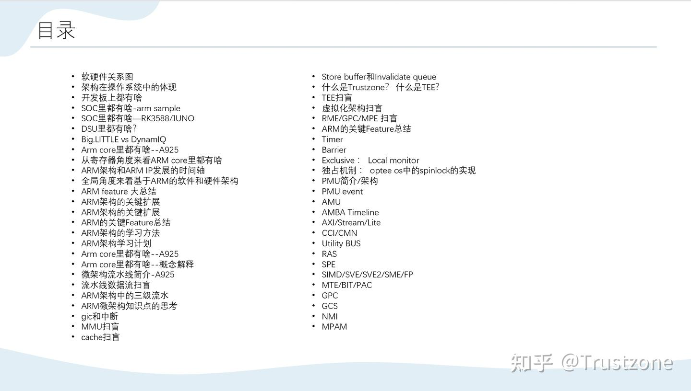
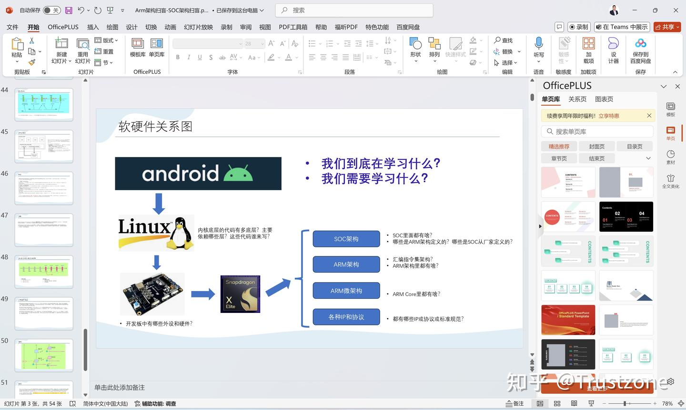
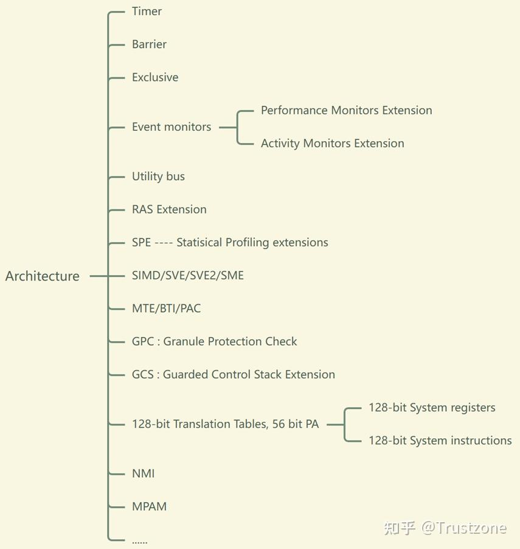

- 软硬件关系图
- 架构在操作系统中的体现
- 开发板上都有啥
- SOC里都有啥-arm sample
- SOC里都有啥—RK3588/JUNO
- DSU里都有啥？
- Big.LITTLE vs DynamIQ
- Arm core里都有啥–A925
- 从寄存器角度来看ARM core里都有啥
- ARM架构和ARM IP发展的时间轴
- 全局角度来看基于ARM的软件和硬件架构
- ARM feature 大总结
- ARM架构的关键扩展
- ARM架构的关键扩展
- ARM的关键Feature总结
- ARM架构的学习方法
- ARM架构学习计划
- Arm core里都有啥–A925
- Arm core里都有啥–概念解释
- 微架构流水线简介-A925
- 流水线数据流扫盲
- ARM架构中的三级流水
- ARM微架构知识点的思考
- gic和中断
- MMU扫盲
- cache扫盲
- Store buffer和Invalidate queue
- 什么是Trustzone？ 什么是TEE？
- TEE扫盲
- 虚拟化架构扫盲
- RME/GPC/MPE 扫盲
- ARM的关键Feature总结
- Timer
- Barrier
- Exclusive ： Local monitor
- 独占机制 ： optee os中的spinlock的实现
- PMU简介/架构
- PMU event
- AMU
- AMBA Timeline
- AXI/Stream/Lite
- CCI/CMN
- Utility BUS
- RAS
- SPE
- SIMD/SVE/SVE2/SME/FP
- MTE/BIT/PAC
- GPC
- GCS
- NMI
- MPAM
共计2节课，2小时+， 2024年10月最新制作和录制。