来知乎介绍下AReaL团队七月份最新的Agentic RL方面的开源项目：ASearcher —— Unlocking Long-Horizon Agentic Search via Asynchronous RL

- **项目地址（数据/模型/论文）**：[GitHub - inclusionAI/ASearcher](https://link.zhihu.com/?target=https%3A//github.com/inclusionAI/ASearcher)
- **论文**：[https://arxiv.org/abs/2508.07976](https://link.zhihu.com/?target=https%3A//arxiv.org/abs/2508.07976)
- **X Post**: [https://x.com/jxwuyi/status/1955487396344238486?s=46&t=BCnM3-LHt73HrvN1m7RFKw](https://link.zhihu.com/?target=https%3A//x.com/jxwuyi/status/1955487396344238486%3Fs%3D46%26t%3DBCnM3-LHt73HrvN1m7RFKw)
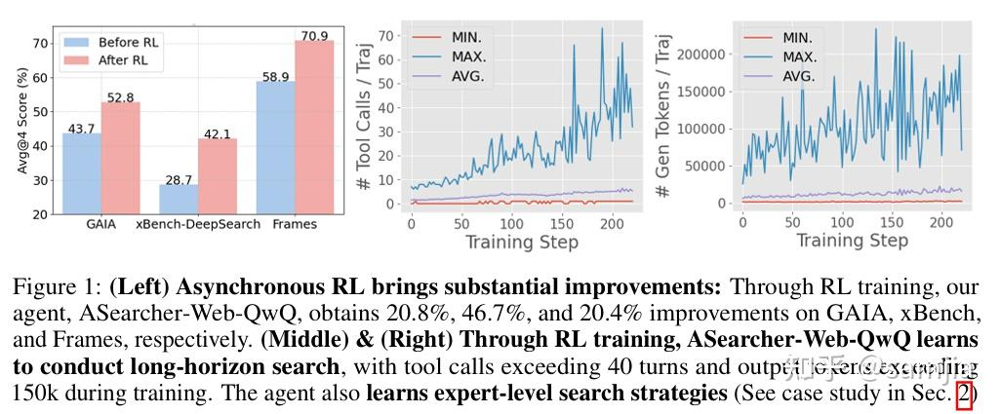

在大模型智能体（LLM Agent）的发展中，工具使用正成为解决复杂问题的关键能力。其中，搜索引擎作为连接外部世界的核心工具，其使用效果直接影响agent的问题解决深度。要真正驾驭搜索工具，agent需要学会精准查询，深度探索，动态验证，以及长程策略规划。然而，当前的开源强化学习方案却面临两个根本性挑战：

- ** 轮次限制**：现有online RL训练限制交互轮次（≤10轮），阻碍agent进行深度探索。
- ** 数据不足**：现有开源RL数据规模小、复杂度低，难以激发agent的复杂搜索行为。
ASearcher主要有两项核心贡献：

- 使用**完全异步RL训练（Fully Async RL）**在训练高效的同时让agent学会**长程工具使用（Long-Horizon Tool Use）**。训练过程中，基于QwQ-32B的**agent能够自然地学会更多的工具使用轮次和更多输出token**，在200步之后学会高达40轮次的tool use，并且生成token达到了150k+。
- 我们开源了一个用于**构造高质量&高难度数据的agent**。agent通过注入外部事实（Fact Injection）以及对题目模糊化（Fuzz）来合成问题。同时我们在每一步合成都进行了非常严格的检验来保证quality & difficulty检验。
**完全异步RL训练+高质量数据的训练效果显著**，ASearcher-Web-QwQ在GAIA，xBench-DeepSearch和Frames三个高难度benchmark上分别得到了**+20.8%，+46.7%，+20.4%的提升**。同时，我们进行了细致的case study，发现agent学会了人类专家级别的搜索策略（如跨文档对比推理，主动检验结论等等）。

在使用了单agent并且不借助任何外部LLM的情况下，ASearcher-Web-QwQ实现了非常不错的效果，**超越了一系列纯开源模型方案**。

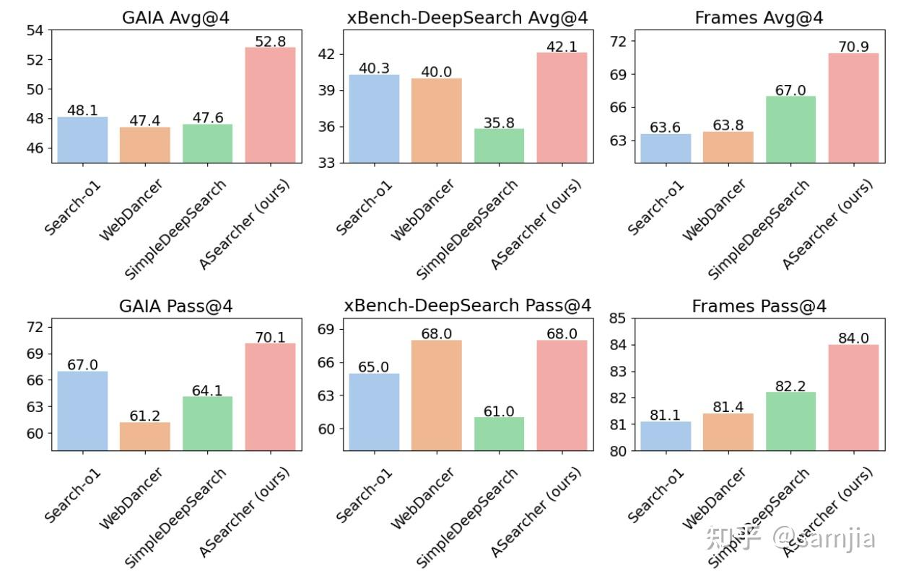

### ASearcher

在ASearcher中，我们关注的核心问题是：**如何使用Online RL有效的激发LLM agent使用工具解决复杂问题的能力**？

ASearcher采用single agent design，其中agent可以使用基本的search & browsing两种工具，并且不借助任何外部LLM。值得注意的是，我们不仅仅是让agent进行分析，也让agent对网页内容进行总结。在RL训练中，reasoning和summarization两种能力都是使用端到端训练进行优化的。

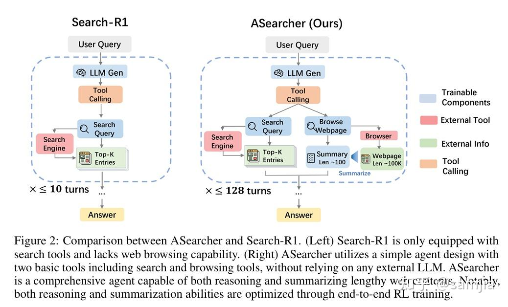

### 长程工具使用（Long-Horizon Tool Use）

在介绍ASearcher具体是怎么做的之前，有两个概念需要理清：

- **“复杂问题”指什么**？这里指的是涉及多个网页，具有高度不确定性，且agent需要进行多轮工具调用才能做对的问题。
- **我们期望看到什么样的能力**？举个简单的例子，比如一个问题要问“中国在某年奥运会的最后奖牌数量”，而由于药检奖牌递补一类的原因，网络上实际上有几种不同的答案。一个expert-level agent应该能够辨别不同的信息，仔细分析导致有冲突答案的原因，最终到定位正确的答案。
**为什么长程工具使用很重要？** 这是因为，面对复杂问题，agent需要更多的工具调用轮次来动态地进行深度探索，获取大量信息，以及进行反复确认。

下面我们举了一个更复杂的例子，其中包括4个不同的未知信息，只有找全这些未知信息才能确定最后的答案。

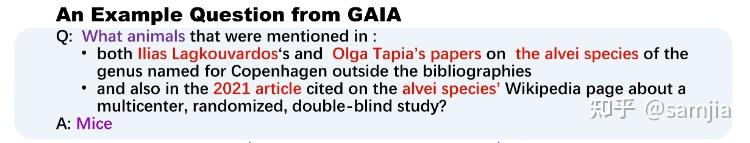

首先，我们分析了轮数限制比较小的online RL+开源数据训练出的agent（Search-R1-32B）：

- 无法有效拆解问题，直接把含有3个未知信息的查询输入给搜索引擎。
- 幻觉（Hallucination）严重，模型会生成出搜索结果里没看到的信息。
- 实际执行轮次很少，没法对错误结论进行有效验证。
另外，我们也分析了一个基于QwQ-32B的pompt-based agent （Search-o1 (QwQ)）：

- Search-o1每次搜索后会使用外部LLM分析搜索结果中每个网页的内容，通过大量网页浏览可以成功确定题目中的中间信息
- 然而，Search-o1在提取网页信息时有丢失关键信息的风险，导致错误的结果
- 最后，在给出最后结论前没有进行更进一步的搜索来确定结论正确性，导致最终只能给出错误的结论。
最后，通过完全异步RL+构造数据，ASearcher-Web-QwQ学会了：

- **Uncertainty-Aware Analysis**: agent在浏览网页时会记录下所有可能的答案并且进行详细的分析
- **Cross-Document Inference**：在没有找到直接指向答案的信息时，会对比不同文档中的相关信息进行合理推断
- **Grounded Verification**: 在找到正确答案后，agent没有立刻返回结果，而是进行了多轮的工具调用来确认题目中的所有信息，保证答案正确性。
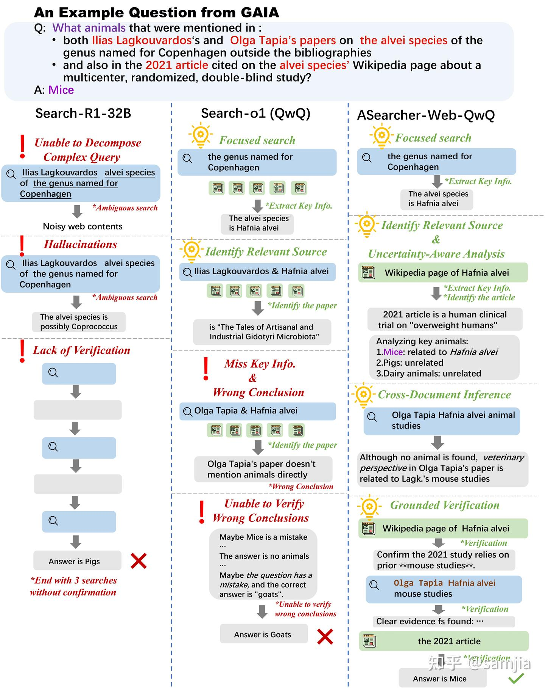

### 数据构造Agent （Data Synthesis Agent）

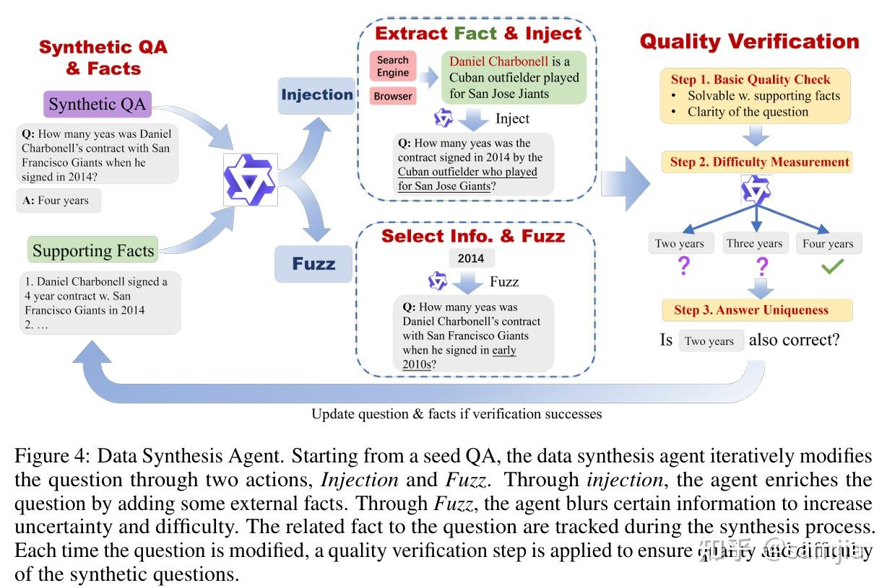

为了能够自动化的构造大规模的有难度的数据，我们开发了一个数据构造agent。从一个基本的QA pair出发，agent每次会从两个action中选择一个来进行问题增强：

- *事实注入（Injection）*：agent使用工具获取到外部相关信息，并且把信息注入到题面中，使题目信息更加复杂。
- *题面模糊化（Fuzz）*：选取题目中的一些关键信息并且把信息进行模糊化处理，从而增加题目不确定程度。
在合成问题的过程中，所有Injection操作注入的事实都会保存在一个列表内保证所用到的信息都可以溯源。在每次修改题目后，我们使用一个**严格的质量检测过程**来保证合成问题的质量，其中包括检验问题的基本层面（如问题是否可以通过保存的事实解出来），使用模型直接生成答案来衡量问题难度，以及判断答案唯一性。

我们在Wikipedia 2018 corpus上面进行了数据合成，并且挑选了模型在不使用工具的情况下无法做对的题目用来训练。最后，我们得到了25.6k高质量的构造数据作为RL训练数据。

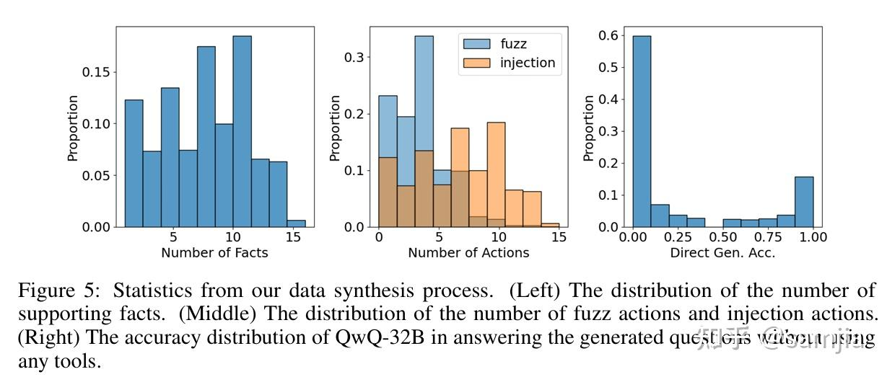

### 完全异步RL（Fully Async RL）

在设定更大的轮数限制时，我们采用了**完全异步RL训练（Fully Async RL），大大提升了训练效率**。

**

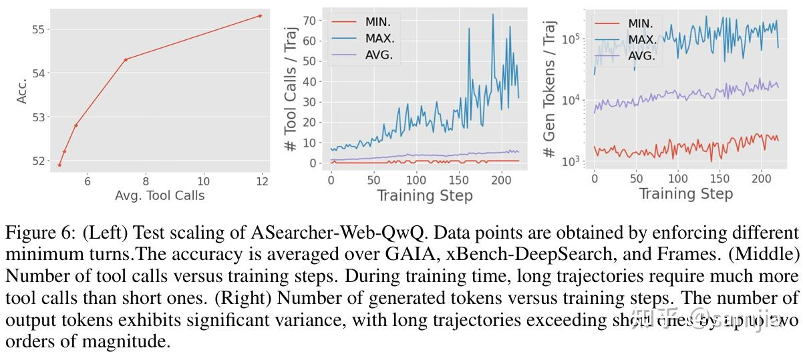

上图中我们可以看到，在实际训练过程中，随着训练过程进行，agent学会进行更多轮次的工具使用，每个trajectory的总输出token数也会上升，但同时，工具调用次数和输出token数量的方差也在逐渐增大，这意味着，实际生成的轨迹耗时方差巨大，**有的很快有的很慢。

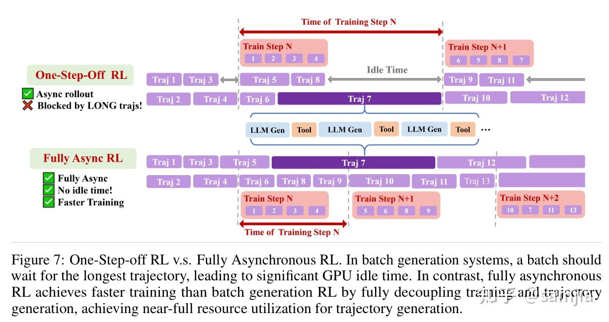

此前工作如Search-R1采用的是batch generation RL系统，在这类系统中，一个批次的轨迹会同时被采集，等该批次数据采集完之后才会进行RL训练。下图中One-Step-Off RL也是一种目前最先进的batch generation RL系统之一，采用了相邻训练推理步重叠的方式，提高GPU利用率。然而，即使在One-Step-Off RL系统中，**过长的轨迹仍会使整个批次陷入长时间的等待，造成大量的idle time以及GPU低利用率。**

于是我们使用了基于AReaL的完全异步RL训练系统。如图所示，完全异步RL 训练中，所有轨迹的采集是并行进行的，在采集数据时不需要等待一个batch的轨迹收集完再进行训练，于是避免了由于长轨迹带来的等待时间。这使得**完全异步RL可以在生成部分达到近乎满GPU利用率**。

### 实验结果

我们在三类Benchmark上验证了我们的训练pipeline:

- **Single-Hop QA 任务**: Natural Question, TriviaQA, and PopQA
- **Multi-Hop QA任务:**  HotpotQA, 2WikiMultiHopQA, MuSiQue, and Bamboogle.
- **深度搜索任务**：包括GAIA, xBench-DeepSearch，和Frames
我们使用了两种训练设定：

- **从Qwen2.5-7B/14B base直接开始训练**：我们分别进行了两类工具的实验，包括使用本地知识库的RAG作为搜索工具，以及使用在线搜索工具
- **对一个基于QwQ-32B的prompt-based LLM agent进行微调**：在该训练设定下，我们只使用在线搜索工具
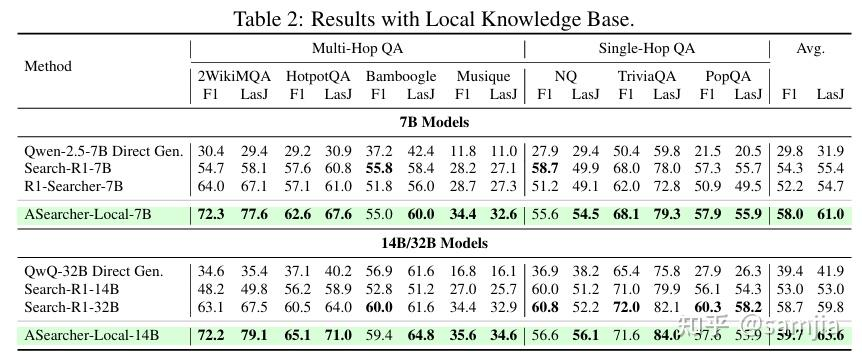

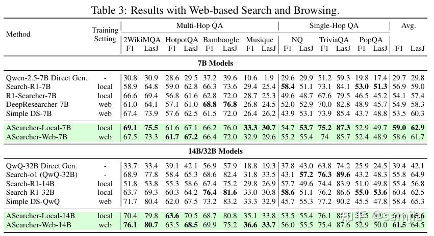

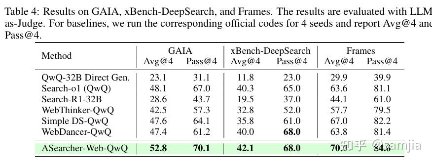

实验结果显示：

- ASearcher-Local/Web-7B/14B在Single-Hop和Multi-Hop QA任务中取得非常好的效果，其中**ASearcher在14B尺度上可以达到甚至超越32B模型**。
- 基于QwQ-32B训练的**ASearcher-Web-QwQ也比此前的开源方案训练得到的agent在深度搜索任务上展现出更强的性能**。
- 在Pass@4指标上，ASearcher-Web-QwQ可以在GAIA/xBench-DeepSearch/Frames上达到70.1/68.0/84.0

### Why ASearcher?

写在最后，我想讲讲我们为什么要做ASearcher以及为什么我们觉得ASearcher非常重要。

在今年6月份，我们团队发布了AReaL-boba^2，第一个采用完全异步的RL训练系统，当时我们在非常具有挑战性的LiveCodeBench/Codeforces等coding benchmark上基于Qwen3-8B/14B做了实验验证，同期也发布了AReaL异步系统的论文，表明**异步系统可以在成倍提速的情况下无损地进行RL训练**。

其实**AReaL的异步RL系统在设计之初就是为了agent设计的**。在LLM agent大规模地火起来之前，我们团队就一直在各种game上做大规模并行的RL agent训练（这里指基于mlp/rnn policy的agent，当时还没做LLM训练），当时发现最大的问题是在于环境会有各种奇怪的问题，比如游戏引擎帧率太低效果很差或者连接超时会断掉导致轨迹无法使用。当时我们深刻地理解到，要让agent应用在真实的场景里，大规模的异步RL会起到关键性作用。

那么，在AReaL-boba^2发布之后，异步RL系统基本ready，我们开始找更适合验证异步RL训练的场景。当时我们注意到search task上开始有一系列工作出现，如WebSailor, Search-R1, R1-Searcher, WebThinker，我们觉得还是有一些做的不太够的地方：

- 之前的online RL方法通常会设置非常小的轮数限制（e.g. <=10 per traj），然而，**过小的轮数限制会大幅限制agent学习工具使用**（Tool Use），特别是在困难任务上，agent几乎不太可能去探索出一个正确的解题路径。但unfortunately，现有RL框架训练中使用更大的轮数限制容易因为等待最慢的trajectory而训得很慢。
- 在fine-tune比较复杂的LLM-based Agent时，通常都是采用offline RL的方法，比如WebThinker，SimpleDeepSearcher，其实大家还**缺少一个真正能够对复杂的prompt-based LLM Agent进行有效online RL训练的开源框架**。
- **缺少大量的能够有效激发agent tool use能力的训练数据**。之前的一些工作通常采用一些比较旧的开源数据（e.g. HotpotQA），或者是只开源了相当小一部分训练数据（100~1k左右）。
那么， 基于这些观察，我们开始了一个多月的在search agent上的尝试，最后也是成功的对一个基于QwQ-32B的promt-based agent进行了有效的online RL训练，并且观察到复杂搜索行为的出现。

**ASearcher意味着什么**？

- **一个支持long-horizon tool use的online RL开源训练框架**。要让tool-use agent真正的能够处理复杂任务，RL框架需要做到在训练时就支持足够大的轮数限制，让agent可以进行更多的自由探索。
- 我们的结果表明**，高质量的训练数据可以由tool-use agent构造**。当然，这需要搭配严格的质量检测，保证数据真实性和可靠性。我们也期望看到未来更多这方面的尝试，在problem-solving agent越来越强的同时，也希望能够看到能自动提供高质量训练数据的problem-synthesis agent，实现真正的AI agent自动进化。

### 总结与展望

ASearcher项目通过完全异步RL训练以及高质量的构造数据，让agent通过RL训练学会复杂的搜索行为，这伴随着工具使用次数以及输出长度的提升。目前ASearcher聚焦于agentic RL训练，未来仍有多个方向值得继续探究：

- **多工具接入**：ASearcher目前只使用了两个基本的搜索和网页浏览工具，未来可以接入更多的工具进行RL训练，提升agent在复杂任务下的性能。
- **更先进的agent设计**：ASearcher采用了single agent设计，即可通过RL训练在深度搜索任务上达到了相当不错的性能。未来随着需要解决的任务更加复杂，可以探索更适用于RL训练的agent设计，在保持训练效率的情况下最大化agent rl训练效果。
- **数据构造Agent**：ASearcher中采用了prompt-based LLM agent来构造数据，未来可以探索更加通用的数据构造agent，可以高效地构造出更通用以及更具有挑战性的问题来进行agentic RL训练。
这几个月也有非常多很棒的search agent方面的工作出现，包括通义的WebAgent系列（WebSailor/WebShaper），以及最近ARPO，MiroMindAI的工作，都从算法、数据、工具等不同维度进行了有效的探索。我们也希望ASearcher可以为未来agentic RL工作提供一些有价值的insight，也欢迎大家来基于AReaL fully async RL高效率地训练自己的LLM/VLM agent！