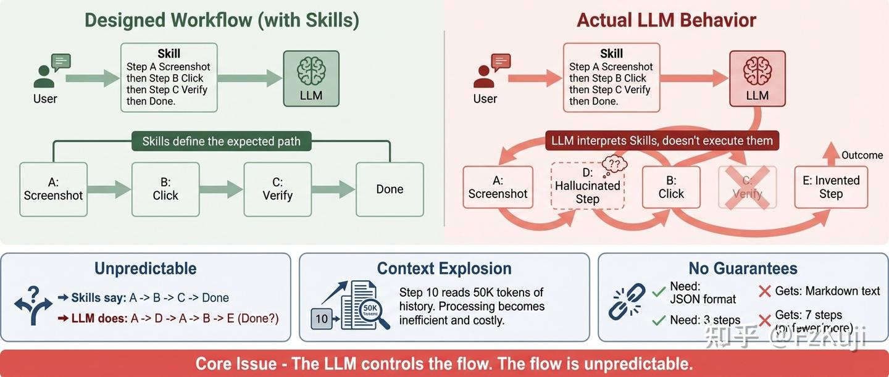
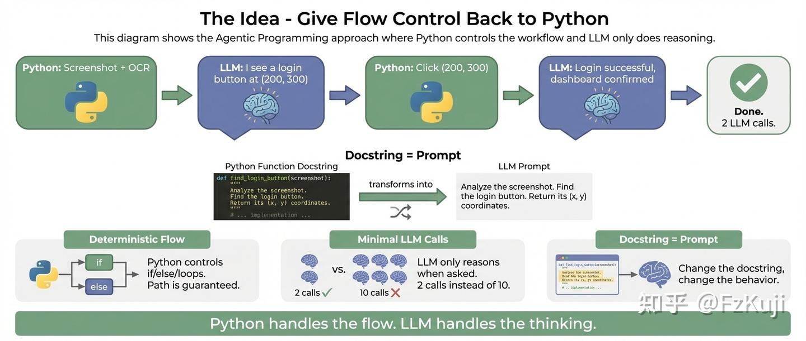

** 从设计Skills项目的挫败，到重新思考“谁应该控制流程”。
#### 起因：Skill写得再好，大模型也不一定听

在做GUI Agent项目时——让大模型操作电脑界面，完成截图、识别元素、点击按钮——遇到了一个反复出现的问题。

一个简单的登录流程，Skill 写得很清楚：

`截图 → 分析、标注屏幕组件 → 找到按钮 → 根据按钮位置分析坐标 → 点击 → 验证。`

大模型实际走的：

`🧠 "我先截个图看看"         → 截图
🧠 "好像看到一个按钮，点一下"    → 点击 (x:121,y:580)
🧠 "好像没反应？再看看"      → 又截图
🧠 "换个坐标试试"           → 又点击 (x:720,y:360)
🧠 "要不要先滚动页面？"      → 调了一个没预期的工具
...（重复 10 轮）`

设计的流程是 A → B → C → Done。实际走出来的是 A → D → A → B → E → …

反复调了Skills措辞、加强调、换system prompt。有时好用，有时又不行。后来意识到：这不是prompt的问题，是架构的问题。**我承认大模型能力太强了，大部分情况下可以通过自己设计的流程实现我们的目标，但是这并不是我们想要的，且结果也很难控制。这在GUI操作场景下是难以接受的。

#### 根本原因：大模型是调度器

现在主流 LLM Agent 框架（OpenClaw、Claude Code、Codex等）的核心设计都一样：**大模型自己决定下一步做什么。**我们给的Skills、Prompts、System Messages本质上都是可选的“**建议**”，不是必需的“**指令**”。

简单任务可能感觉不到问题。任务一复杂——多步骤、有分支、需要错误处理——三个问题就暴露了：

**🎰 路径不可控** — 无法强制大模型按特定顺序执行。它可能跳步、重复、自己发明新步骤。

**📈 上下文爆炸** — 每轮工具调用都在对话历史里堆积。第10步时大模型在读几十万token的历史，就为了决定下一步点哪。

**🎯 输出不稳定** — 要 JSON 给 markdown，要3步做7步。大模型*理解*指令，但不*执行*指令。

#### 反过来想：为什么大模型要当调度器？

截图是确定性操作，写代码就行。点击是确定性操作，给坐标就行。OCR 调库就行。

**真正需要大模型的，只有推理**——“看这张图，告诉我按钮在哪。”

那为什么不让Python管流程，大模型只在需要推理时介入？

`🐍 Python：截图 + OCR                  ← 确定性代码
🧠 LLM："按钮在 (200, 300)"            ← 推理

🐍 Python：点击 (200, 300)              ← 确定性代码
🧠 LLM："登录成功"                      ← 推理

完成。`

#### Agentic Programming：把这个思路系统化

“把 LLM 嵌入函数”这件事，工程实践中很多人在做。DSPy、Marvin、Microsoft Guidance 都有类似思路。

但把它作为一种**编程范式**系统化之后，引出了几个有意思的设计：

#### 1. Docstring = Prompt

`@agentic_function
def observe(task):
    """观察屏幕，找到目标元素。"""  # ← 这就是发给 LLM 的 prompt
    
    img = take_screenshot()       # Python：确定性
    ocr = run_ocr(img)            # Python：确定性
    
    return runtime.exec(content=[ # LLM：只做推理
        {"type": "text", "text": f"任务: {task}\nOCR: {ocr}"},
        {"type": "image", "path": img},
    ])`

改注释就改行为。函数签名定义接口。Python 代码处理确定性逻辑。

#### 2. Context 树 — 自动上下文管理

每个函数调用自动记录，形成树。下游函数调用 LLM 时，框架自动注入上游的执行结果：

`login_flow ✓ 8.8s
├── observe ✓ 3.1s → "在 (200,300) 找到登录按钮"
├── click ✓ 2.5s → "点击了登录按钮"
└── verify ✓ 3.2s → "确认进入仪表盘"`

不需要手动拼 prompt。而且每次只在末尾追加，前缀不变——天然利于 prompt caching。

#### 3. Meta Function — 函数生成函数

运行时创建新函数，出了 bug 还能自动修复：

`from agentic.meta_function import create, fix

summarize = create("把文本总结成3个要点", runtime=runtime)
# 如果有 bug
fixed = fix(fn=summarize, runtime=runtime, instruction="输出用 markdown 列表")`

#### 独特贡献在哪

坦率地说，“Python 控制流程 + LLM 做推理”不是新想法。但是目前大家都在努力设计Skills，寄希望于大模型本身可以遵循指令，倒不如直接让大模型对流程进行编程。

这样的设计实现后显得反而异常优雅。且非常容易适配现有的功能，包括：MCP、Skills和Hooks：

- 这个设计符合Skills的**progressive disclosure**的想法。只有在方法被调用的时候，大模型才会知道这个能力
- 设计的Agentic Functions可以很自然的被别的Agent调用，直接通过命令行或者加入MCP
- 在Agentic Functions运行过程中，可以很轻松的设置其他监听程序，设置Hooks，进行重试等常规框架难以实现的运行逻辑

#### 代码

参考实现开源在 GitHub：

🔗 **[github.com/Fzkuji/Agentic-Programming](https://link.zhihu.com/?target=https%3A//github.com/Fzkuji/Agentic-Programming)**

161 个测试。内置 Anthropic、OpenAI、Gemini、Claude Code CLI 四个 provider。MIT 许可证。

欢迎基于这个思路做自己的实现，也欢迎讨论这个范式本身的问题。