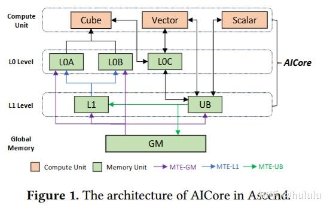
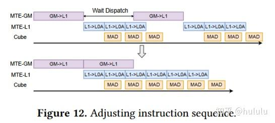
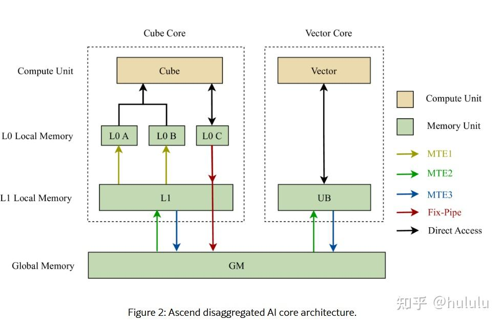
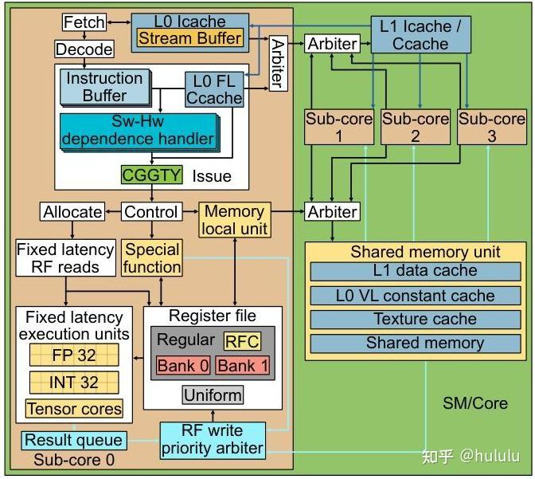
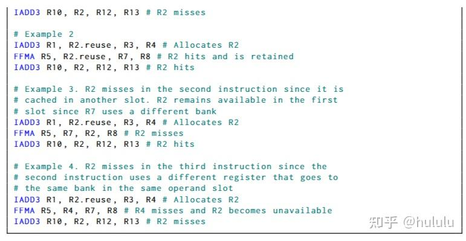
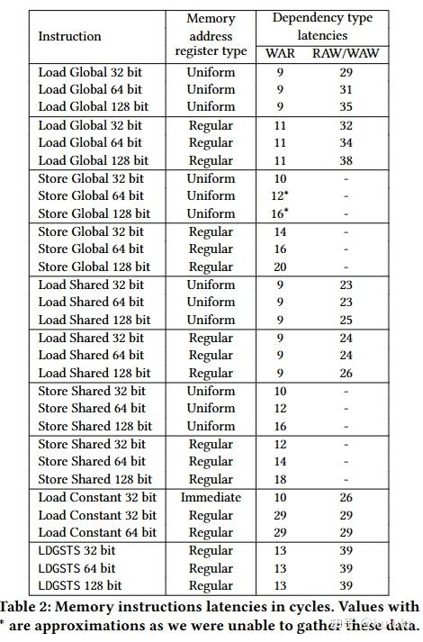
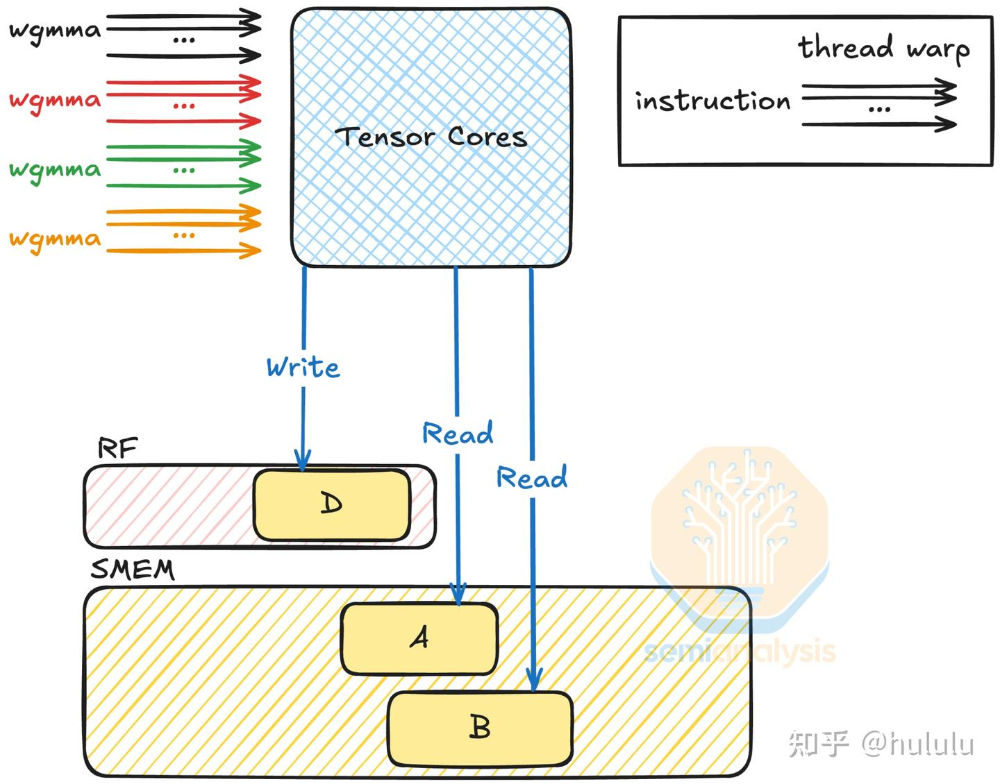
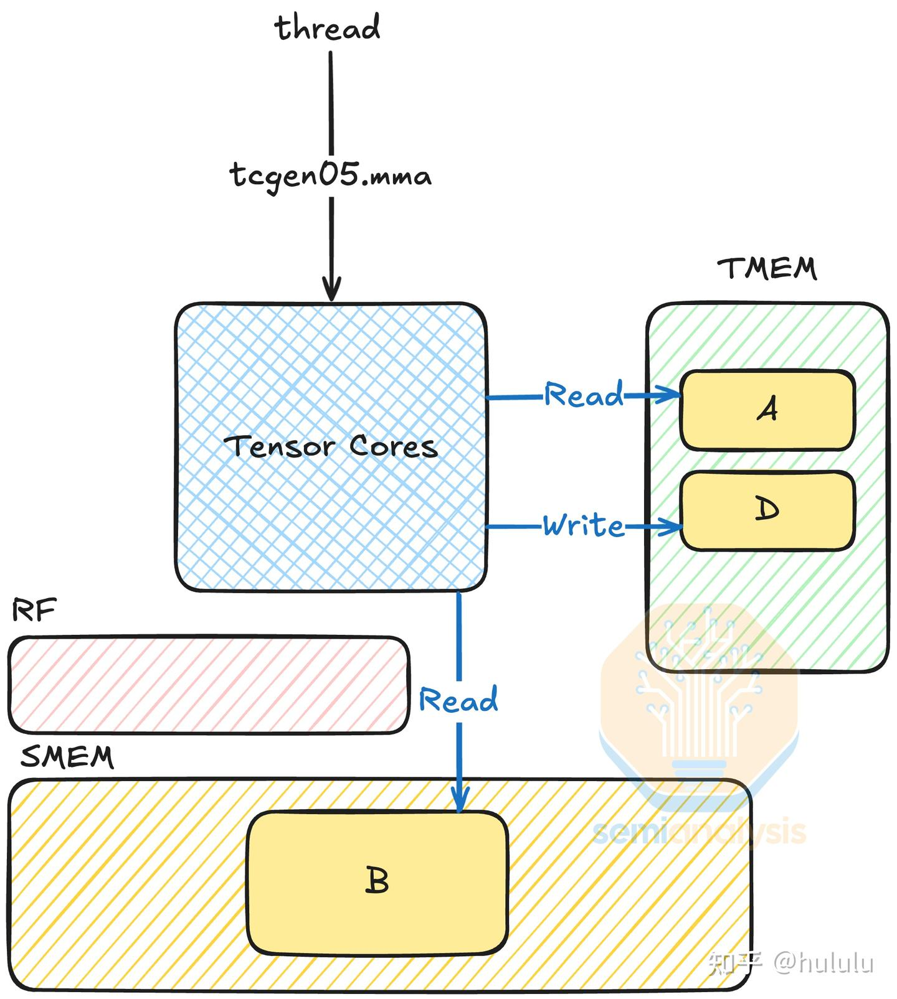
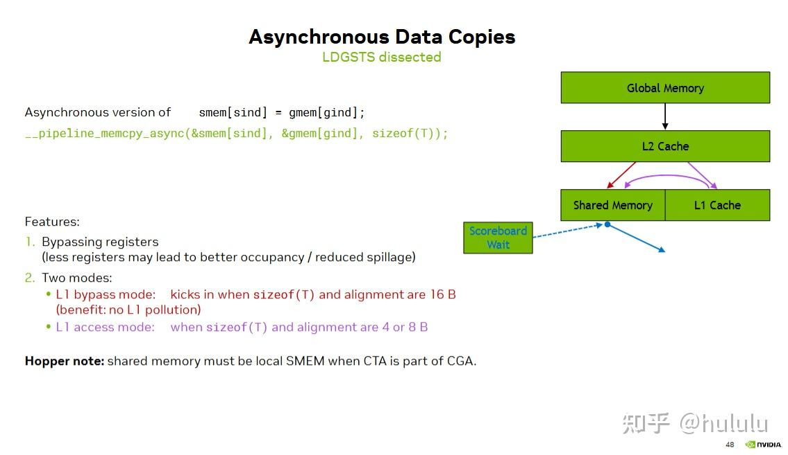
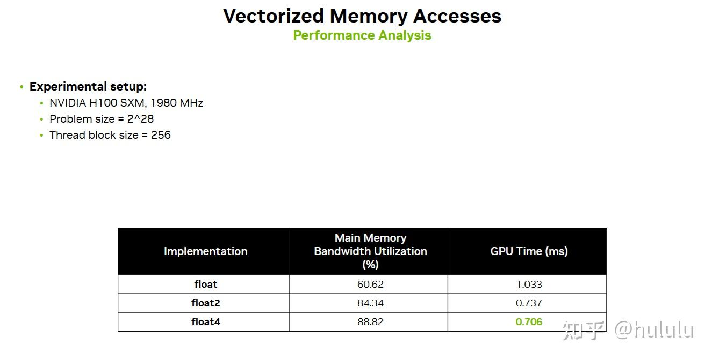

对最近看的关于异构编程的论文与资料做个分析总结, 好记性不如烂笔头

#### Ascend NPU

- ****
- ****
**这两篇文章内容大致都差不多, 从昇腾NPU的硬件架构和指令集，到实际的kernel优化, 尽管具体涉及到优化的硬件细节还是有点少，但是算是对昇腾有一个全面的介绍. 从硬件架构来看和业界NPU都比较像, 用于tensor core固定输入的L0A L0B, L0C buffer，独立于vector core的访存流量, 避免带宽竞争; 同时L0C也提供cube core和vector core的互访, 可以基于此做算子融合; 设计了多个Memory Transfer Engines(类似于TMA), 加速大数据量的访存, 甚至集成了img2col, 不同MTE data path也有所区分, 一定程度避免了内存访问的竞争, 本质上就是用scratch memory access 代替normal cache, 对于AI这种特定负载是友好的.

至于优化手段就是老生常谈的, 并发计算单元和不同的访存单元, 切分tile size, 常量循环外提等.

ascend npu interconnection

ai core pipeline

ascend ai core and cube core

- **
- ****
- **ascend-tribe/ascend-cluster-infra** [GitCode - 全球开发者的开源社区,开源代码托管平台](https://link.zhihu.com/?target=https%3A//gitcode.com/ascend-tribe/ascend-cluster-infra)
- **ascend-tribe/ascend-inference-cluster** [GitCode - 全球开发者的开源社区,开源代码托管平台](https://link.zhihu.com/?target=https%3A//gitcode.com/ascend-tribe/ascend-inference-cluster)
- ****

#### GPGPU

- ****
**这篇文章主要分析了NV Ampere GPU微架构(RTX A6000), 主要内容是通过sass 编程逆向分析SIMT单元的指令发射执行流程/访存单元行为/寄存器缓存/WAR/warp scheduler行为等, 没有tensor core 部分的内容; 但还是很值得一看,  其中对于上层GPU编程来说比较关键的是, register cache的设计目的(容量小但比寄存器更大的带宽用于缓解寄存器bank conflict), 不同寄存器(uniform/regular) 的延迟以及哪一种组合对性能更友好, memory pipeline中具有数据依赖的不同指令的带宽和延迟.

这个图不要太棒, 把cuda core的细节很好地展示出来了

register cache 逆向

memory inst latencise with dependcy

-  (Semianalysis)**
**非常好的一篇介绍NV GPU Tensor Core发展历程的文章, 通过对不同代GPU的tensor core设计以及编程接口, 探讨高性能的tensor core设计所面临的挑战以及编程上的抽象. 从这么多代的Tensor core演进可以看出, 随着tensor core吞吐的提高, 更多的限制在于操作数的带宽和容量上, 所以从share memory到tensor memory, 从wmma_sync 到tcgen.async, 分别从操作数带宽 (*原先的寄存器带宽和share memory带宽太容易陷入竞争的情况, 所以设计独立的tensor memory作为输入buffer, 同时更靠近tensor core有利于latenc*y**) 以及指令发射的效率上做了优化(单thread 全异步的指令发射机制), 尽管原来越偏离cuda 本身简洁的设计(笑)

Hopper Tensor Core

BlackWell Tensor Core

- ****
- ****
- ****
- ****
- ****
- ****
- ****
- ** (GTC2024)**
- ** (GTC2025)**
- ** (GTC2025**)
**这三篇文章都是NV 官方出的CUDA Perf Tuning Guide, 跨度从GTC 2024到GTC2025, 并包含了hopper和blackwell的新特性. 比较有意义的是关于cuda memory model的介绍, 以及在不同场景下如何打满带宽的tips/ 还有关于多卡场景下小开销的同步机制/warp scheduler的机制. 还是非常值得一读的

-  (GTC2025)**
- ****
**NCCL 实现细节综述

- **
未完待续........