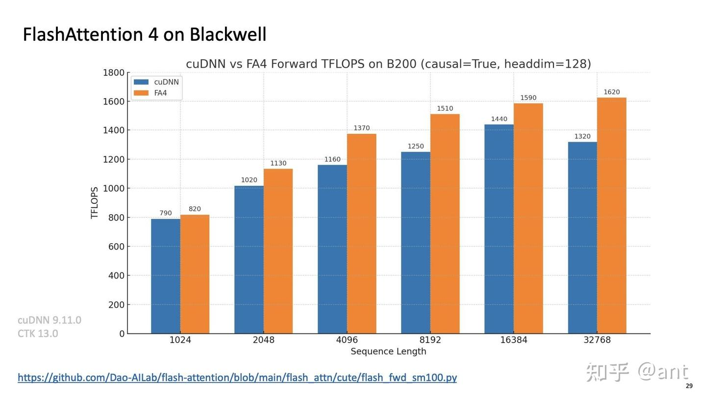
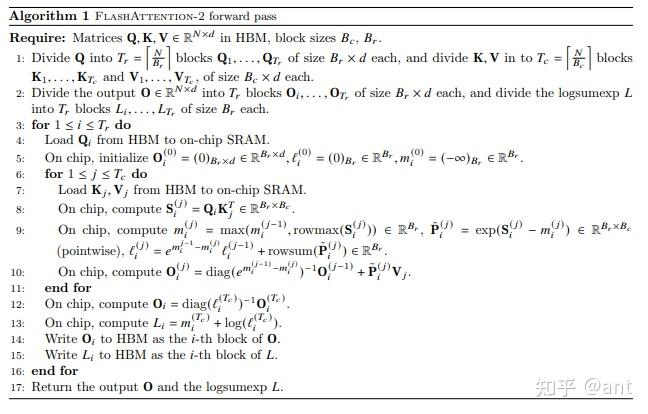
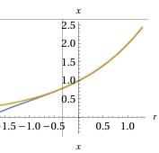
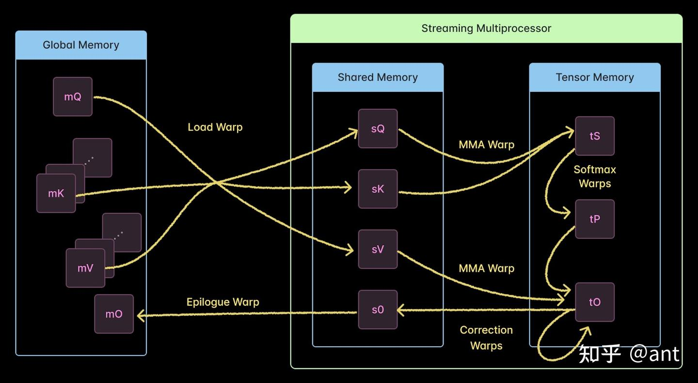

FA4 虽然论文还没出来，但是代码已经开源。目前网上的分析较少，笔者最近看到有个英文博客对 FA4 代码进行了分析，虽然不是很全面，但是也基本上能对 FA4 有个大概的认识。

**总的来说，FA4 针对 B 系列进行了优化，关键算法改进包括：****1. 高效的在线 softmax**：采用了一种新型在线 softmax 算法，可跳过 90% 的输出重缩放操作。**2. exp 近似加速**：为更有效地使 softmax 计算与张量核计算重叠，运用指数的软件模拟以提升吞吐量。**此外，FA4 在工程实现上也做了优化，利用 warp specialization **的特性设计了 5 阶段的流水线，充分发挥了 GPU 的并行性。

前向推理的计算效率对比，可见FA4相对于Nvidia cuDNN Attention内核性能提升约 20%。(B200 FP16算力为2.2PFLOPS，图中可见算力利用率最高为72%)**

本文档主要参考的外部资源如下：

- 博客网址：[http://modal.com/blog/reverse-engineer-flash-attention-4](https://link.zhihu.com/?target=http%3A//modal.com/blog/reverse-engineer-flash-attention-4)
- 代码仓库：[http://GitHub.com/Dao-AILab/flash-attention/blob/main/flash_attn/cute/flash_fwd_sm100.py](https://link.zhihu.com/?target=http%3A//GitHub.com/Dao-AILab/flash-attention/blob/main/flash_attn/cute/flash_fwd_sm100.py)
- GPU 术语表：[http://modal.com/gpu-glossary/device-hardware/tensor-memory](https://link.zhihu.com/?target=http%3A//modal.com/gpu-glossary/device-hardware/tensor-memory)
值得一提的是，截止到今天（2025 年 11 月 6 日），FA4 仅支持 FP16/BF16 精度**的计算。

### 算法改进

#### 高效在线 softmax

- 核心思想：当发现新的最大值时，之前累加的结果需要按比例校正。与旧版每次遇新最大值就更新相比，FA4 **只有在最大值变化足够大以威胁数值稳定时才更新缩放因子**
$$- 背景补充：softmax 在计算 exp 时，为了数值稳定，需要减去最大值，即 P_{ij}=\frac{exp(s_{ij}-max_j(s_{ij}))}{\sum_iexp(s_{ij}-max_j(s_{ij}))} **在 FA 中，采用 online softmax，计算流程如下：$$

   由伪代码可知， m_i^{(j)} 以在线的方式记录了最大值，每次最大值有变化,  l_i^{(j)} , O_i^{(j)} 都需要更新。

- 减去最大值需要在 cuda core 操作，由于最大值的变化，频繁的更新数据会带来较大的计算开销。而该操作其实是为了数值稳定，直观上如果最大值的变化没有大到会影响数值稳定，那么就可以不用更新，这样可以减少计算。FA4 正是利用了这个思想，通过这种方式，可以将更新的计算减少 10 倍。
- FA4 中具体的实现：
`@cute.jit
def update_row_max(self, acc_S_row: cute.TensorSSA, is_first: int) -> Tuple[Float32, Float32]:
    if cutlass.const_expr(is_first):
        row_max_new = self._compute_row_max(acc_S_row)
        row_max_safe = row_max_new if row_max_new != -cutlass.Float32.inf else 0.0
        acc_scale = 0.0
    else:
        row_max_old = self.row_max[0]
        row_max_new = self._compute_row_max(acc_S_row, init_val=row_max_old)
        row_max_safe = row_max_new if row_max_new != -cutlass.Float32.inf else 0.0
        acc_scale_ = (row_max_old - row_max_safe) * self.scale_log2
        acc_scale = utils.exp2f(acc_scale_)
        if cutlass.const_expr(self.rescale_threshold > 0.0):
            if acc_scale_ >= -self.rescale_threshold:
                row_max_new = row_max_old
                row_max_safe = row_max_old
                acc_scale = 1.0
    self.row_max[0] = row_max_new
    return row_max_safe, acc_scale`

#### exp 近似加速

- 核心思想：利用 cuda core 对 exp 进行近似计算，缓解 SFU 的计算瓶颈
- 背景补充：GPU 中 SFU 进行 exp 计算的原理
  GPU 使用近似算法**来计算 y=exp(x)。具体地，我们可以用数学恒等式将 exp(x)进行拆解：

$y=e^x = 2^{x / \ln(2)} = 2^{i + r} = 2^i \cdot 2^r $

  其中：

- i = \text{floor}(x / \ln(2)) 为整数
- r = x / \ln(2) - i 为介于[0, 1)之间的小数

  于是可以：

- 用整数移位或指数域加法高效实现 2^i ；
- 对小数部分，用 **查表 + 多项式近似** 实现。

  这正是 SFU 中 **exp 指令** 的核心机制。

- FA4 中，使用 Horner 多项式近似方法来近似计算 f(r)=2^r ：**
g(r)=0.07711909*r^3+0.22756439*r^2+0.69514614*r+1.0 

将 f(r)和 g(r)画图如下，可见在[0, 1)之间，两者几乎重合

f(r)和g(r)在[0,1]之内几乎重合

- FA4 中的实现：

- 并非所有 exp 都采用了近似实现，有一部分仍然使用 SFU 去计算，对应如下代码 28-32 行。
- 可以将 g(r)变为 3 个乘加操作（FMA，即(((c3 * r) + c2) * r + c1) * r + c0 ），对应如下代码的 65-67 行。

`@cute.jit
def apply_exp2_convert(
    self,
    acc_S_row: cute.Tensor,
    acc_S_row_converted: cute.Tensor,
    e2e: cutlass.Constexpr[bool] = False,
    e2e_freq: cutlass.Constexpr[int] = 16,
    e2e_res: cutlass.Constexpr[int] = 4,
    e2e_frg_limit: cutlass.Constexpr[int] = 1,
):
    assert cute.size(acc_S_row.shape) % 2 == 0, 「acc_S_row must have an even number of elements」
    frg_tile = 32
    assert frg_tile % 2 == 0
    frg_cnt = cute.size(acc_S_row) // frg_tile
    assert cute.size(acc_S_row) % frg_tile == 0
    acc_S_row_frg = cute.logical_divide(acc_S_row, cute.make_layout(frg_tile))
    acc_S_row_converted_frg = cute.logical_divide(
        acc_S_row_converted, cute.make_layout(frg_tile)
    )
    for j in cutlass.range_constexpr(frg_cnt):
        for k in cutlass.range_constexpr(0, cute.size(acc_S_row_frg, mode=[0]), 2):
            # acc_S_row_frg[k, j] = utils.exp2f(acc_S_row_frg[k, j])
            # acc_S_row_frg[k + 1, j] = utils.exp2f(acc_S_row_frg[k + 1, j])
            if cutlass.const_expr(not e2e):
                acc_S_row_frg[k, j] = cute.arch.exp2(acc_S_row_frg[k, j])
                acc_S_row_frg[k + 1, j] = cute.arch.exp2(acc_S_row_frg[k + 1, j])
            else:
                if cutlass.const_expr(k % e2e_freq  e2e_freq - e2e_res or j >= frg_cnt - e2e_frg_limit):
                    acc_S_row_frg[k, j] = cute.arch.exp2(acc_S_row_frg[k, j])
                    acc_S_row_frg[k + 1, j] = cute.arch.exp2(acc_S_row_frg[k + 1, j])
                else:
                    acc_S_row_frg[k, j], acc_S_row_frg[k + 1, j] = utils.e2e_asm2(acc_S_row_frg[k, j], acc_S_row_frg[k + 1, j])
        acc_S_row_converted_frg[None, j].store(
            acc_S_row_frg[None, j].load().to(acc_S_row_converted.element_type)
        )

#code in flash_attn/cute/utils.py
@dsl_user_op
def e2e_asm2(x: Float32, y: Float32, *, loc=None, ip=None) -> Tuple[Float32, Float32]:
    out_f32x2 = llvm.inline_asm(
        llvm.StructType.get_literal([T.f32(), T.f32()]),
        [Float32(x).ir_value(loc=loc, ip=ip), Float32(y, loc=loc, ip=ip).ir_value()],
        {\n\t」
        .reg .f32 f1, f2, f3, f4, f5, f6, f7;\n\t
        .reg .b64 l1, l2, l3, l4, l5, l6, l7, l8, l9, l10;\n\t
        .reg .s32 r1, r2, r3, r4, r5, r6, r7, r8;\n\t
        max.ftz.f32 f1, $2, 0fC2FE0000;\n\t
        max.ftz.f32 f2, $3, 0fC2FE0000;\n\t
        mov.b64 l1, {f1, f2};\n\t
        mov.f32 f3, 0f4B400000;\n\t
        mov.b64 l2, {f3, f3};\n\t
        add.rm.ftz.f32x2 l7, l1, l2;\n\t
        sub.rn.ftz.f32x2 l8, l7, l2;\n\t
        sub.rn.ftz.f32x2 l9, l1, l8;\n\t
        mov.f32 f7, 0f3D9DF09D;\n\t  # 0f3D9DF09D=0.07711908966302872
        mov.b64 l6, {f7, f7};\n\t
        mov.f32 f6, 0f3E6906A4;\n\t  # 0f3E6906A4=0.22756439447402954
        mov.b64 l5, {f6, f6};\n\t
        mov.f32 f5, 0f3F31F519;\n\t  # 0f3F31F519=0.6951461434364319
        mov.b64 l4, {f5, f5};\n\t
        mov.f32 f4, 0f3F800000;\n\t  # 0f3F800000=1
        mov.b64 l3, {f4, f4};\n\t
        fma.rn.ftz.f32x2 l10, l9, l6, l5;\n\t
        fma.rn.ftz.f32x2 l10, l10, l9, l4;\n\t
        fma.rn.ftz.f32x2 l10, l10, l9, l3;\n\t
        mov.b64 {r1, r2}, l7;\n\t
        mov.b64 {r3, r4}, l10;\n\t
        shl.b32 r5, r1, 23;\n\t
        add.s32 r7, r5, r3;\n\t
        shl.b32 r6, r2, 23;\n\t
        add.s32 r8, r6, r4;\n\t
        mov.b32 $0, r7;\n\t
        mov.b32 $1, r8;\n\t
        }\n,
        =r,=r,f,f,
        has_side_effects=False,
        is_align_stack=False,
        asm_dialect=llvm.AsmDialect.AD_ATT,
    )
    out0 = Float32(llvm.extractvalue(T.f32(), out_f32x2, [0], loc=loc, ip=ip))
    out1 = Float32(llvm.extractvalue(T.f32(), out_f32x2, [1], loc=loc, ip=ip))
    return out0, out1
`

### 工程优化

- FA4 将一个 CTA 的工作细分到多个 warp 上，利用 Warp 专门执行不同功能：在一个时钟周期内，硬件的 Warp 调度器可以同时处理 Load、MMA、Softmax 等不同任务的 warp，当一个 warp 因数据加载而阻塞时，其他 warp 已可执行。FA4 的多阶段异步管线相对于 FA3 的“乒乓”两阶段管线是一个巨大跃迁。这种设计使得绝大多数时钟周期均有有效指令在执行，显著提高吞吐率。具体来说，一个 CTA 启动后，会按照以下流水线展开任务：

- Load Warp**：从全局内存预取数据。Load warp 利用张量内存加速器 (TMA) 异步地将查询块 Q 加载到共享内存，并循环“流式”加载所有对应的 K、V 块。TMA 硬件自动计算地址并发起数据传输，减小了寄存器压力和加载延迟。不同 warp 之间通过 barrier 进行同步。
- **MMA Warp**：在共享内存中执行矩阵乘加（Tensor Core）。MMA warp 针对每个查询块和键块运行张量核矩阵乘累加，先计算未归一化的注意力分数块 S，再利用这些分数对值块 V 做加权累加生成部分输出。这里使用内嵌 PTX 指令（如 `tcgen05.mma.cta_group::1`，对应 Blackwell 5 代 Tensor Core）来调度 Tensor Core 硬件，所有乘加运算都在单个线程块(CTA)内完成。中间结果 S 和 O 累积在张量内存（Tensor Memory，作为 L1 Cache）中，以充分利用快速存储降低对全局内存的访问。
- **Softmax Warps**：对 S 块进行归一化处理。一组 Softmax warp 从张量内存中**取出 S 值到寄存器**，执行指数运算并累加求和。由于 Tensor Core 仅支持矩阵乘，这里需要将数据移至标量计算资源；FA4 通过 CUDA 核心执行指数近似。具体而言，对于较小的头维度，FA4** 混合使用硬件 SFU 和软件近似**：它将指数运算分解为两部分（整数部分和小数部分），对小数部分使用 3 次多项式近似计算。该多项式采用 Horner 方法（3 次 fused-multiply-add）在寄存器中计算，有效缓解了 SFU 的瓶颈。Softmax 过程还采用在线算法维护当前行的最大值和指数和。当发现新的最大值时，之前累加的结果需要按比例校正。与旧版每次遇新最大值就更新相比，FA4 只有在最大值变化足够大以威胁数值稳定时才更新缩放因子，据报道将修正操作次数减少了约 10 倍。
- **Correction Warps**：对先前计算的输出执行数值校正。四个 Correction warp 监视归一化过程中的最大值变化，当 Softmax 阶段更新了新的缩放因子时，它们会加载对应的输出 O 块（从张量内存到寄存器）进行按比例缩放。随后将最终结果写回共享内存（称为 correction_epilogue），并通知 Epilogue warp 可以复用该缓冲区。
- **Epilogue Warp**：将输出从共享内存写回全局内存。根据硬件配置，通常有 1–2 个 Epilogue warp 完成这个工作。如果允许使用 TMA，则单个 Epilogue warp 等待 Correction 完成后直接通过 TMA 将结果块传输回全局内存。

### 关键差异对比（FA 1/2/3 vs FA4）

FlashAttention-4 相对于前作在架构设计、算法策略和硬件适配上都有显著变化：

- **Pipeline Stage 与 Warp Specialization**：FA1/FA2 的注意力核通常只是对大矩阵分块进行标准计算；FA3 在 Hopper GPU 引入了双阶段（ping-pong）流水线，使用较少的生产者/消费者 warp 交替执行矩阵乘和 softmax。而 FA4 在 Blackwell 上设计了更复杂的五阶段管线（Load/MMA/Softmax/Correction/Epilogue），每个阶段专门分配 warp 组并行执行。这种精细划分使各阶段能在硬件上高度并行化，进一步减少了空闲时间。
- **精度与新特性支持**：FA3 在 Hopper 引入了低精度（FP8）支持，大幅提升吞吐率；FA4 最初仅支持 BF16/FP16（尚未在第一版支持 FP4 运算），因此当前在更低精度模式下仍有提升空间。
- **Softmax 算法改进**：前几代 FlashAttention 均使用 GPU SFU（特殊功能单元）执行指数运算，当发现新的最大值时立即对之前输出做校正。FA4 则创新性地使用可配置的多项式近似并行计算 `exp2`，同时引入只在必要时更新缩放因子的在线策略。前者减少了对稀缺 SFU 的依赖，后者则减少了约 10 倍的校正次数，提高了软硬件协同效率。