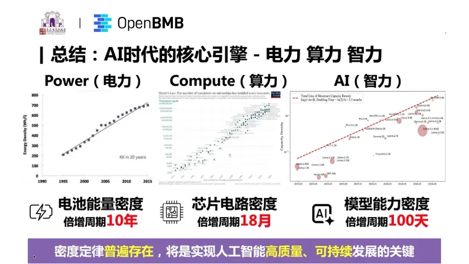
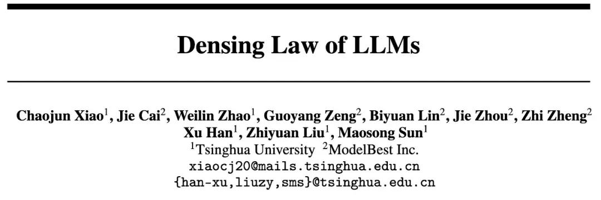
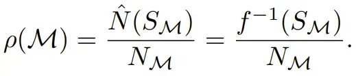
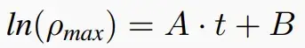
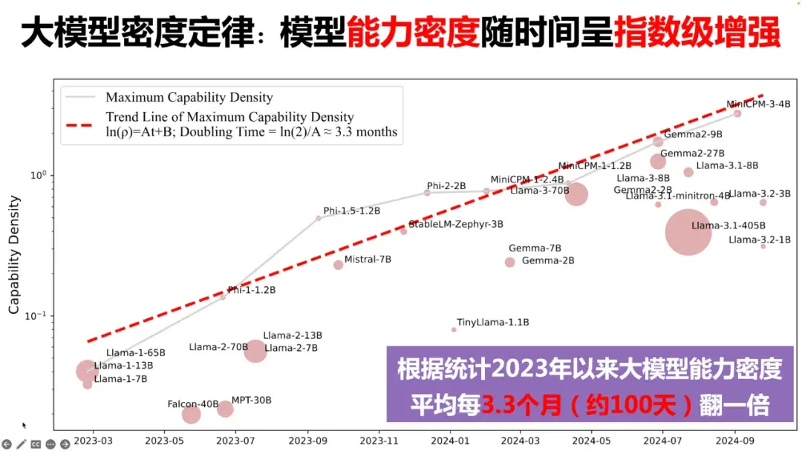
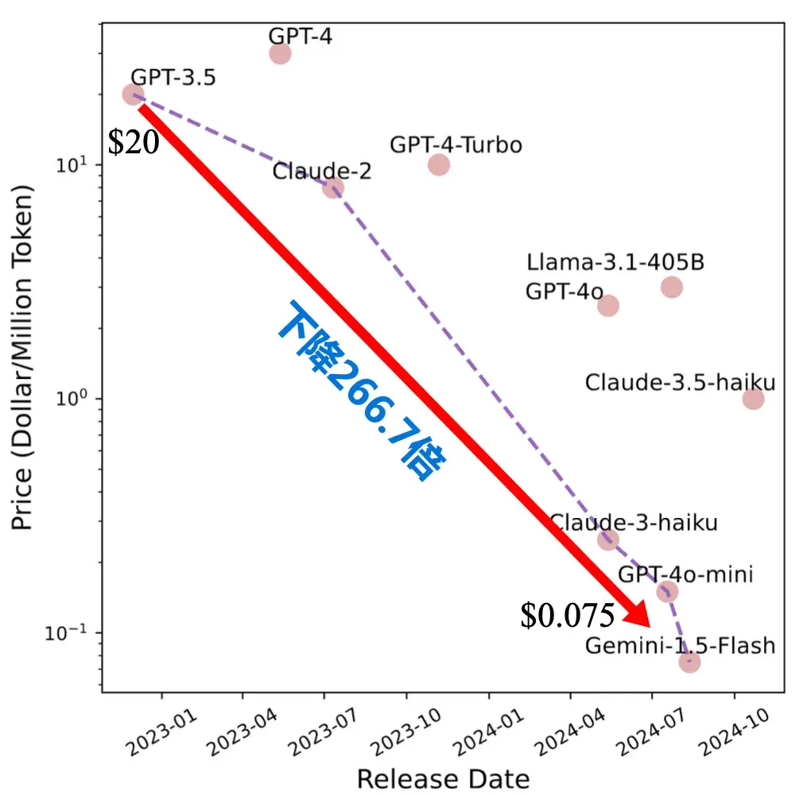
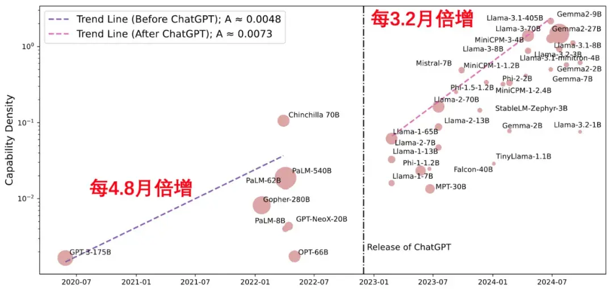
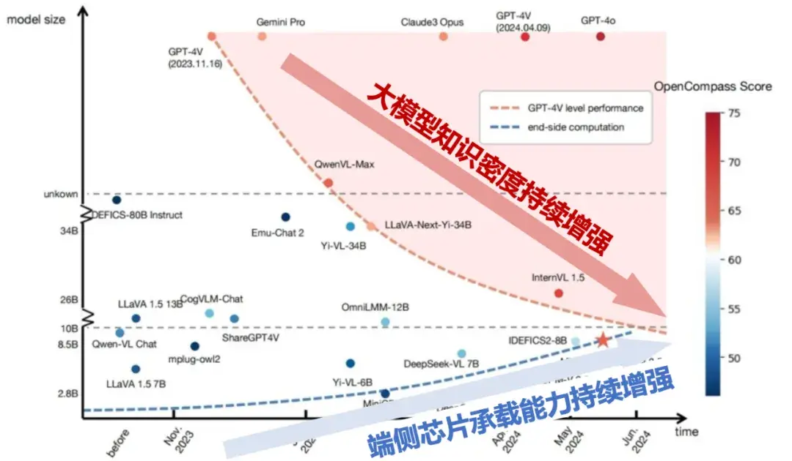
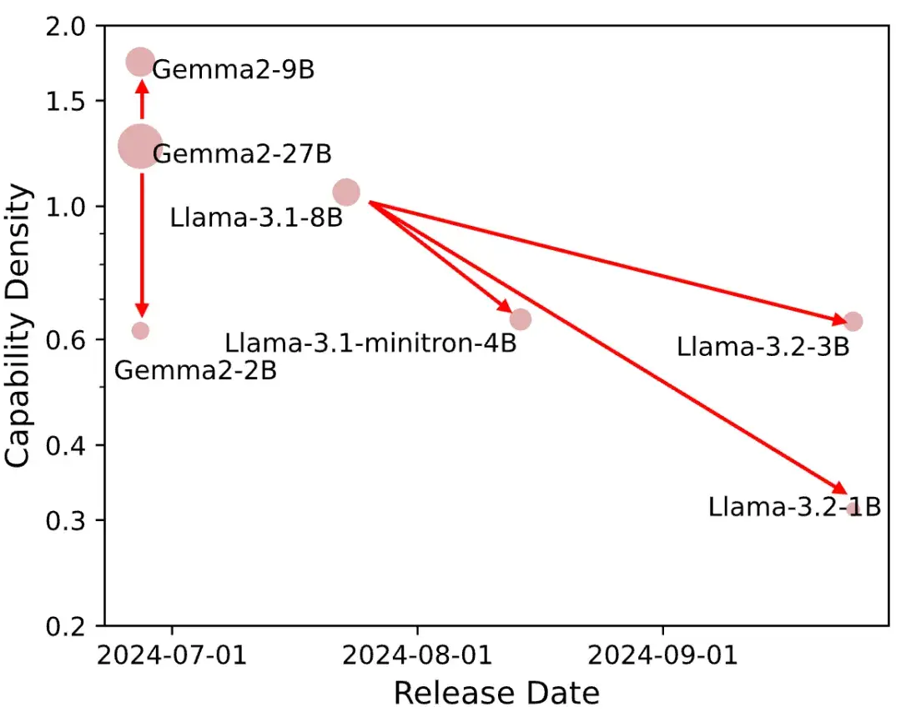

机器之心报道。

**

支持大模型一路狂飙的 Scaling Law 到头了？

近期，[AI 圈针对 Scaling Law 是否到头产生了分歧](https://link.zhihu.com/?target=https%3A//mp.weixin.qq.com/s%3F__biz%3DMzA3MzI4MjgzMw%3D%3D%26mid%3D2650942531%26idx%3D1%26sn%3D2fabcd16a94b0966864aaf18c6338faf%26scene%3D21%23wechat_redirect)。一派观点认为 Scaling Law 已经「撞墙」了，另一派观点（如 OpenAI CEO Sam Altman）仍然坚定 Scaling Law 的潜力尚未穷尽。

其实以上争论的核心点在于，大模型的性能提升是否还能继续靠无限堆叠数据和参数规模从而大力出奇迹。

然而 Scaling Law 并非唯一的视角，近期，来自清华大学刘知远教授团队发现并提出大模型的密度定律（Densing Law）—— 模型能力密度随时间呈指数级增长，2023 年以来能力密度约每 3.3 个月（约 100 天) 翻一倍。**这意味着每 100 天，我们可以用一半参数量实现当前最优模型相当的性能。

**

根据密度定律，研究团队还得出以下重要推论，并且发现 AI 时代的三大核心引擎——电力、算力与智力，都同样遵循密度快速增长趋势。

- 推论 1 ：模型推理开销随时间指数级下降。**
- **推论 2 ：大模型能力密度正在加速增强 。**
- **推论 3：模型小型化揭示端侧智能巨大潜力 。**
- **推论 4：无法依靠模型压缩算法增强模型能力密度 。**
- **推论 5：模型高性价比有效期不断缩短。**
**

该定律还揭示了端侧智能的巨大潜力，并指出未来应持续探索大模型科学化建设路径，不断改进模型制造工艺，实现大模型的高质量、可持续发展。

相关研究成果可参考论文《Densing Law of LLMs》。

- 论文标题：Densing Law of LLMs
- 论文链接：[https://arxiv.org/pdf/2412.04315v2](https://link.zhihu.com/?target=https%3A//arxiv.org/pdf/2412.04315v2)
Scaling Law 和 Densing Law**

**

大模型尺度定律（Scaling Law）和密度定律（Densing Law），都是大模型指导性的规律发现。它们分别在不同的维度，对大模型进行科学化的推演。

大模型尺度定律是一种描述大模型随着规模的变化而发生的规律性变化的数学表达，表现为大模型的 Loss 与模型参数规模、训练数据规模之间的幂律关系。

尺度定律之外，清华研究团队发现，大模型还有另一种度量与优化的空间，能力密度（Capability Density），它为评估不同规模 LLM 的训练质量提供了新的统一度量框架。

清华研究团队提出的「能力密度」（Capability Density），定义为给定 LLM 的有效参数大小与实际参数大小的比率。有效参数大小指的是达到与目标模型同等性能所需的参考模型的参数数量。清华研究团队特别引入了参考模型（Reference Model）的概念，通过拟合参考模型在不同参数规模下的性能表现，建立起参数量与性能之间的映射关系。

具体来说，若一个目标模型 M 的参数量为 N_M ，其在下游任务上的性能分数为 S_M，研究人员会计算出参考模型要达到相同性能所需的参数量 N (S_M)，即「有效参数量」。目标模型 M 的密度就定义为这个「有效参数量」与其实际参数量的比值：

比如一个 3B 的模型能达到 6B 参考模型的性能，那么这个 3B 模型的能力密度就是 2（6B/3B）。

为了准确估计模型性能，研究团队采用了两步估计法。第一步是损失（Loss）估计，通过一系列不同规模的参考模型来拟合参数量与语言模型 Loss 之间的关系；第二步是性能估计，考虑到涌现能力的存在，研究人员结合开源模型来计算它们的损失和性能，最终建立起完整的映射关系。

通过研究分析近年来 29 个被广泛使用的开源大模型，清华研究团队发现，LLM 的最大能力密度随时间呈指数增长趋势，可以以下公式来描述，其中 ρ_max 是时间 t 时 LLM 的最大能力密度。

密度定律表明，大约每过 3.3 个月 (100 天），我们就能用参数量减半的模型达到当前最先进模型的性能水平。**

**

基于密度定律，清华研究团队提出了多个重要推论。

首先，模型推理开销随时间指数级下降。2022 年 12 月的 GPT-3.5 模型每百万 Token 的推理成本为 20 美元，而 2024 年 8 月的 Gemini-1.5-Flash 模型仅为 0.075 美元，成本降低了 266 倍，约 2.5 个月下降一倍。与此同时，大模型推理算法不断取得新的技术突破：模型量化、投机采样、显存优化 。

其次，研究还发现，自 ChatGPT 发布以来，大模型能力密度正在加速增强 。

以 MMLU 为评测基准测量的能力密度变化情况，ChatGPT 发布前按照每 4.8 月倍增，发布后按照每 3.2 月倍增，密度增强速度增加 50% 。这一现象背后，更高效模型引起了学术界和产业的广泛关注，诞生了更多高质量开源模型。

再次，芯片电路密度 (摩尔定律) 和模型能力密度 (密度定律) 持续增强，两条曲线交汇揭示端侧智能巨大潜力。研究显示，在摩尔定律的作用下，相同价格芯片的计算能力每 2.1 年翻倍，而密度法则表明模型的有效参数规模每 3.3 个月翻倍。两条曲线的交汇，意味着主流终端如 PC、手机将能运行更高能力密度的模型，推动端侧智能在消费市场普及。

此外，团队指出，无法仅依靠模型压缩算法增强模型能力密度 。现有的模型压缩技术（如剪枝和蒸馏）未必能提高模型密度。实验表明，大多数压缩模型的密度低于原始模型，模型压缩算法虽可以节省小参数模型构建开销，但是如果后训练不充分，小参数模型能力密度将会有显著下降。

最后，研究团队指出，模型高性价比有效期不断缩短。根据尺度定律，更多数据 + 更多参数实现能力增强，训练成本会急剧上升；而能力密度定律，随着能力密度加速增强，每隔数月会出现更加高效的模型。这意味着模型高性价比的有效使用期缩短，盈利窗口短暂。例如，2024 年 6 月发布的 Google Gemma-2-9B 模型，其训练成本约 185 万人民币，但仅两个月后，它的性能就被参数量减半的 MiniCPM-3-4B 超越。以 API 盈利方式估算，2 个月内需要 17 亿次用户访问，才能够收回训练成本！

Densing Law（密度定律）揭示 LLM 进入「密度至上」新发展阶段**

尺度定律下，LLM 规模至上。而在密度定律下，LLM 正进入一个全新的发展阶段。在清华刘知远老师最新报告中，AI 时代的三大核心引擎 —— 电力、算力与智力，密度都在快速增长：电池能量密度在过去 20 年中增长了 4 倍，其倍增周期约为 10 年；摩尔定律则揭示，芯片的晶体管密度每 18 个月翻倍；而 AI 模型能力密度每 100 天翻倍的速度更是惊人。

尤其是模型能力密度的提升也意味着用更少的资源实现更强的能力，这不仅降低了 AI 发展对能源和算力的需求，也为 AI 技术的可持续发展提供了无限可能。同时也揭示了端侧智能的巨大潜力 。

在这一趋势下，AI 计算从中心端到边缘端的分布式特性协同高效发展，将实现「AI 无处不在」的愿景。随着全球 AI 计算云端数据中心、边缘计算节点的扩张，加上模型能力密度增长带来的效率提升，我们将看到更多本地化的 AI 模型涌现，云端和边缘端各司其职，可运行 LLM 的终端数量和种类大幅增长，「AI 无处不在」的未来正在到来。