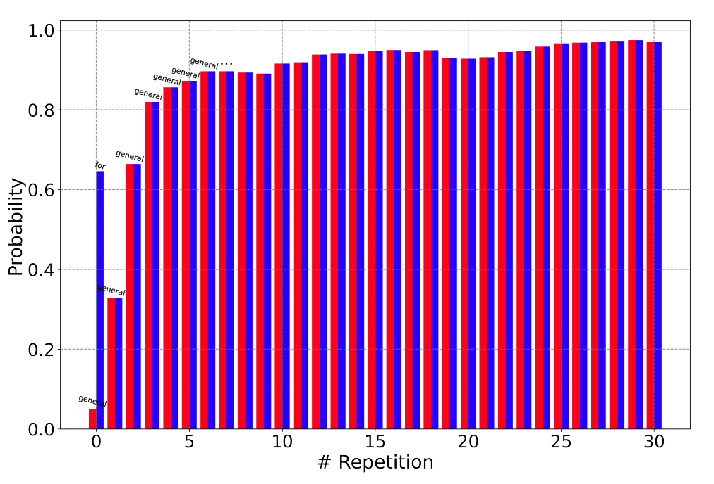
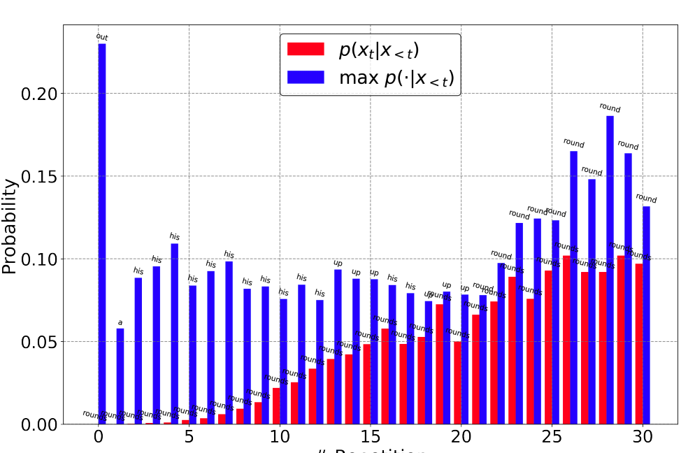
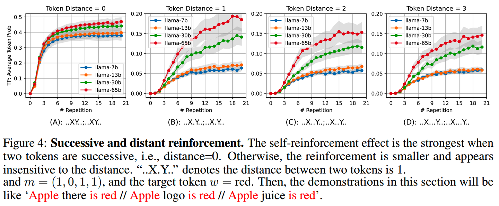
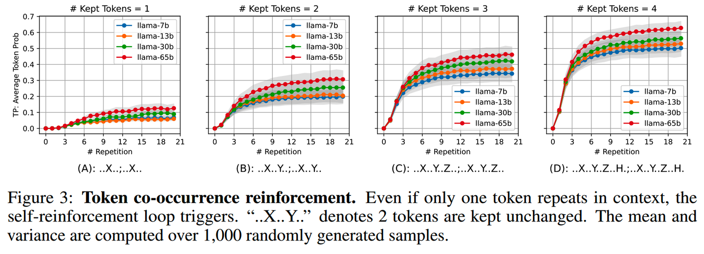
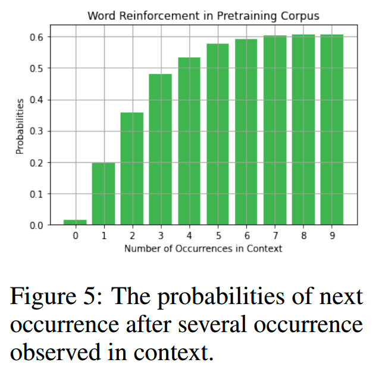
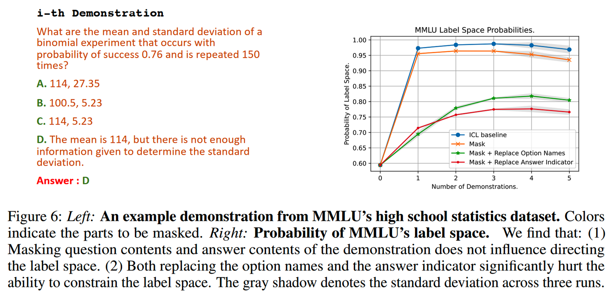

【往期文章】

[MoE模型的前世今生](https://zhuanlan.zhihu.com/p/694653556)
[昆仑万维-SkyworkMoE](https://zhuanlan.zhihu.com/p/701854564)
[从loss视角理解大模型涌现能力](https://zhuanlan.zhihu.com/p/703690848)
[LLM长上下文的问题](https://zhuanlan.zhihu.com/p/684924585)
[解锁大模型长上下文能力](https://zhuanlan.zhihu.com/p/696226537)
[大模型推理窗口-从有限到无限大](https://zhuanlan.zhihu.com/p/696862604)
[理解Attention:从起源到MHA,MQA和GQA](https://zhuanlan.zhihu.com/p/686149289)
[大模型推理加速-投机解码](https://zhuanlan.zhihu.com/p/699670010)
[大模型推理加速-MEDUSA](https://zhuanlan.zhihu.com/p/703461293)
[大模型偏好对齐-DPO](https://zhuanlan.zhihu.com/p/700580300?)
[大模型偏好对齐-ODPO](https://zhuanlan.zhihu.com/p/700997723)
[大模型偏好对齐-simPO](https://zhuanlan.zhihu.com/p/701151333)
[大模型偏好对齐-IPO](https://zhuanlan.zhihu.com/p/702222242)
[Yi技术报告-划重点看细节](https://zhuanlan.zhihu.com/p/689626296?)
[transformer中normalization的二三事](https://zhuanlan.zhihu.com/p/688711911)
[从代码实现看normalization-到底做了什么](https://zhuanlan.zhihu.com/p/691357048)
[稀疏注意力计算:sliding window attention](https://zhuanlan.zhihu.com/p/687349083)
[理解LLM位置编码:RoPE](https://zhuanlan.zhihu.com/p/684072868)
[大模型算法题(1)](https://zhuanlan.zhihu.com/p/687530140)
[大模型算法题(2)](https://zhuanlan.zhihu.com/p/688994354)
[大模型算法题(3)](https://zhuanlan.zhihu.com/p/690821700)
[大模型算法题(4)](https://zhuanlan.zhihu.com/p/693597239)
[大模型算法题(5)](https://zhuanlan.zhihu.com/p/695901851)
[大模型算法题(6)](https://zhuanlan.zhihu.com/p/697749801)
[大模型算法题(7)](https://zhuanlan.zhihu.com/p/703034037)

【本文已在同名 微信公众号 / 知乎 / [个人博客linsight.cn](https://link.zhihu.com/?target=http%3A//www.linsight.cn/) 上线】

LLM的重复生成问题，俗称复读机问题。

对于这个问题的研究很多都和in-context learning相关。

### 1.背景

在目前这个时间点，其实已经很少会遇到字符级别的重复生成问题。

自ChatGPT发布以来，模型规模的增大，训练数据数量和质量的提升，都让LLM的能力不断提升，复读机问题这种基础问题看起来确实不多见了。

不过在某些场景，比如手机的端侧智能助手，所用的模型相对较小，有时还是能遇到一些句子级别、段落级别的重复生成问题。

此外，在多轮对话下，随着对话轮次的增多，出现“重复生成/近似重复生成”的概率也会增加。在特定的对话中，用户新增了一些细致的要求或者进行关于细节的追问，这时模型有可能倾向于给出和前面回答几乎相同的答案。

当然这些情况都可以归因于模型训得不够好。但重复生成的问题显然和知识储备、回复质量这些问题有所不同，也有一些工作进行相关分析。

模型这种重复生成的特性部分可以为我们所用，但有时也会带来问题。

### 2.induction heads

Anthropic在22年的文章《In-context Learning and Induction Heads》中对基于transformer的语言模型进行了ICL相关的分析。他们发现在这些生成模型里，存在着induction heads的机制。

induction heads是模型中的一条circuit。简单来说，其功能是回顾当前token前面的内容，找到前面出现当前token的地方，并按照前面出现过的模式来补全当前token后面的内容。

举个例子，比如现在的序列是

   ... [token A] [token B] [token C] ... [toekn A]   

在生成下一个token的时候，induction heads就会从最后一个 [toekn A] 往前找，发现前面出现过相同的 [toekn A]，那么模型后面就会倾向于按照前面的出现过的 [token A] [token B] [token C] 这样的pattern来补全后面的内容，生成

   ... [token A] [token B] [token C] ... [toekn A] [toekn B] [toekn C]   

induction heads这样的复制能力也会扩展到“相似”token上。如果当前token在前面没有出现过，那么induction heads就会去前面找和当前token相似的token所在的pattern，以此pattern作为后面生成的参考。比如现在的序列是

   ... [token A] [token B] [token C] ... [toekn A‘]   

其中 [toekn A‘] 和 [toekn A] 具有相近的特征，那么induction heads就会倾向于把序列补全为

   ... [token A] [token B] [token C] ... [toekn A‘] [toekn B‘] [toekn C‘]   

其中 [toekn B‘]、[toekn C‘]分别和[token B]、[token C]有相近的特征。

induction heads由2个attention head组成。Anthropic在2层的transformer模型上精确地探测到了这样的行为，而且更多层更复杂的transformer模型上，也通过一些手段观察到类似功能的存在。

induction heads这样的“复制”行为被认为是ICL能力的主要来源。前面的例子中，从[token A] [token B] [toekn A‘] 生成 [toekn B‘]，这就已经是一个ICL的行为。

同时induction heads这样的“复制”行为某种程度上其实也是一种重复生成行为。这样的“复制”行为很可能和LLM的训练方式有关：预训练next token prediction鼓励模型预测概率最大的token，而在上文出现过相似token/pattern会提升模型复制token的信心，从而加强了重复生成的行为。

### 3.重复生成与ICL

论文：《Learning to Break the Loop: Analyzing and Mitigating Repetitions for Neural Text Generation》，2022年

这篇文论对生成模型的（句子级）重复生成问题做了一些实验和分析，找到一些和重复生成现象相关的发现，并提出DITTO（pseuDo-repetITion penalizaTiOn）缓解重复生成的问题。（这缩写的方式让人想起 NEural contextualiZed representation for cHinese lAnguage understanding）

这样的研究基于一个前提：使用maximization-based decoding算法（如greedy decoding）。一些带有随机性的算法本身是具有缓解重复生成问题的能力的。

发现一：模型倾向于提升前面出现过的句子的生成概率

并且只要重复一次，这个概率就会飙升很多（下图）。这个发现和induction heads中的类似。

发现二：重复生成具有self-reinforcement的特点

重复的次数越多，越容易重复，越难以打破这个循环，如下图，横轴表示重复次数，纵轴红色表示某个token的概率，蓝色表示最大的概率。

发现三：Sentences with higher initial probabilities usually have a stronger self-reinforcement effect

句子本身概率越大（模型认为越通顺），重复的自我加强效应越强。把重复的句子换成随机token，在不同重复次数下解码token的概率变化如下图，增强的趋势比上图（通顺句子）要弱很多

而DITTO的做法简单来说是构造了一些重复句子的训练样本，并在训练时显示加入对重复token的惩罚。

另一个工作《UNDERSTANDING IN-CONTEXT LEARNING FROM REPETITIONS》，对self-reinforcement进行了进一步的测试，发现：

- self-reinforcement是LLM的共同属性，多个模型都具有这样的特点
- self-reinforcement强度随着重复token的距离减小而增强，如下图所示

- 即使重复的token个数只有1个，这种self-reinforcement也会出现；而随着重复片段的增长，self-reinforcement强度也在提升，如下图所示

而通过计算token重复的次数和token的概率，发现正是预训练next token prediction的任务赋予了模型self-reinforcement的特点。

模型这种自我加强的作用对我们来说，既有好处又有坏处，可以说令人又爱又恨。

好处一：constraining output space

在ICL中，给定多个demonstration，通过利用self-reinforcement的特点，可以让模型的输出不要跑偏。比如多项选择题的ICL，可以让模型输出ABCD，而不是其他无法解析的内容。

为了验证这个假设，对用ICL数据做了实验，如下图。橙色线是对demonstration的问题内容和答案内容进行mask处理，蓝色线是在橙色的基础上进一步把ABCD替换成别的符号，红色线是在橙色线的基础上把“Answer：”替换成相同意思的内容。

可以看到，如果仅仅对问题和答案内容进行mask，并不影响模型输出ABCD的概率，但是如果把ABCD/“Answer：”这种在demonstration中多次重复的内容替换成意思相近的符号，就会使得模型在答案空间的分布概率降低。

好处二：learning to follow patterns

和好处一类似，CoT的成功正是这个好处的一个例子。

坏处一：spurious connections

对于ICL来说，self-reinforcement的坏处也很明显。不合理的prompt，比如不平均的答案分布，都会影响模型的能力，甚至可能成为用户注入攻击的入口。

### 4.缓解复读机问题

模型重复生成的self-reinforcement可以在ICL中发挥作用，但是也会让模型在生成回复的时候不断重复相同内容，停不下来。

一个可能的原因是训练数据中存在较多重复内容，这在从网页爬取的预训练数据中还是有一定比例的，因此对数据的清洗需要加入筛选这种重复内容的逻辑。

但是即使把训练数据中的重复数据比例降到很低，依然不能完全杜绝复读机问题，因此有很多方法是在解码的时候进行处理（decoding-base），缓解复读机问题：

- stochastic sampling：通过引入随机性，让模型不要总是选择概率最大的token输出，比如top-k、top-p采样。
- 重复惩罚：对已经出现过的token进行惩罚，减少生成结果的重复token。
- contrastive decoding：对比采样，降低生成表征相近的token。（实操对效果有比较大的影响）
- beam search（比较慢）
- locally typical sampling
- no repeat ngram：和重复惩罚类似，保证没有重复的ngram出现
此外也有training-based的方法：

- 在训练的时候对已经出现过的token进行惩罚
- 通过强化学习对模型的重复生成进行惩罚（但强化学习成本和难度都比较高）

### 5.小结

自回归模型的重复生成不仅和数据有关，跟训练方法、模型结构、解码策略都有关。

这种特性既好处也有坏处，在ICL可以成为我们控制模型效果的抓手，但也有可能带来生成内容的崩溃问题。

读到这了，来一发点赞收藏关注吧~

博客：[http://www.linsight.cn/](https://link.zhihu.com/?target=http%3A//www.linsight.cn/)
知乎：Linsight
微信公众号：Linsight

http://weixin.qq.com/r/khGpsfDEOq1FrbTS90SA (二维码自动识别)

【往期文章】

[MoE模型的前世今生](https://zhuanlan.zhihu.com/p/694653556)
[昆仑万维-SkyworkMoE](https://zhuanlan.zhihu.com/p/701854564)
[从loss视角理解大模型涌现能力](https://zhuanlan.zhihu.com/p/703690848)
[LLM长上下文的问题](https://zhuanlan.zhihu.com/p/684924585)
[解锁大模型长上下文能力](https://zhuanlan.zhihu.com/p/696226537)
[大模型推理窗口-从有限到无限大](https://zhuanlan.zhihu.com/p/696862604)
[理解Attention:从起源到MHA,MQA和GQA](https://zhuanlan.zhihu.com/p/686149289)
[大模型推理加速-投机解码](https://zhuanlan.zhihu.com/p/699670010)
[大模型推理加速-MEDUSA](https://zhuanlan.zhihu.com/p/703461293)
[大模型偏好对齐-DPO](https://zhuanlan.zhihu.com/p/700580300?)
[大模型偏好对齐-ODPO](https://zhuanlan.zhihu.com/p/700997723)
[大模型偏好对齐-simPO](https://zhuanlan.zhihu.com/p/701151333)
[大模型偏好对齐-IPO](https://zhuanlan.zhihu.com/p/702222242)
[Yi技术报告-划重点看细节](https://zhuanlan.zhihu.com/p/689626296?)
[transformer中normalization的二三事](https://zhuanlan.zhihu.com/p/688711911)
[从代码实现看normalization-到底做了什么](https://zhuanlan.zhihu.com/p/691357048)
[稀疏注意力计算:sliding window attention](https://zhuanlan.zhihu.com/p/687349083)
[理解LLM位置编码:RoPE](https://zhuanlan.zhihu.com/p/684072868)
[大模型算法题(1)](https://zhuanlan.zhihu.com/p/687530140)
[大模型算法题(2)](https://zhuanlan.zhihu.com/p/688994354)
[大模型算法题(3)](https://zhuanlan.zhihu.com/p/690821700)
[大模型算法题(4)](https://zhuanlan.zhihu.com/p/693597239)
[大模型算法题(5)](https://zhuanlan.zhihu.com/p/695901851)
[大模型算法题(6)](https://zhuanlan.zhihu.com/p/697749801)
[大模型算法题(7)](https://zhuanlan.zhihu.com/p/703034037)

### Reference

【1】如何解释大模型的重复生成现象？ [https://www.zhihu.com/question/616130636](https://www.zhihu.com/question/616130636)
【2】Learning to Break the Loop: Analyzing and Mitigating Repetitions for Neural Text Generation [https://arxiv.org/abs/2206.02369](https://link.zhihu.com/?target=https%3A//arxiv.org/abs/2206.02369)
【3】Understanding In-Context Learning from Repetitions [https://arxiv.org/abs/2310.00297](https://link.zhihu.com/?target=https%3A//arxiv.org/abs/2310.00297)
【4】In-context Learning and Induction Heads [https://arxiv.org/abs/2209.11895](https://link.zhihu.com/?target=https%3A//arxiv.org/abs/2209.11895)
【5】[https://zhuanlan.zhihu.com/p/671697479](https://zhuanlan.zhihu.com/p/671697479)