（S，IO）MMU是一个与cache紧密关联的，不但体现在配合使用实现提升读取数据的性能，还体现在MMU内部实现中TLB（TBU）和TWU（TCU）也会分别使用cache来缓存va-pa的映射等信息，以及不同级页表的信息。

**

MMU即内存管理单元（Memory Manage Unit），无论是MMU、还是SMMU、IOMMU，其最基本的功能都是负责将虚拟地址转换成物理地址。

其中MMU还实现了内存保护，进程无法直接访问物理内存，防止内存数据被随意篡改。MMU的主要内部模块包括：

- TLB模块：用于缓存从虚拟地址到物理地址的转换结果
- TWU模块：负责完成页表的查过程
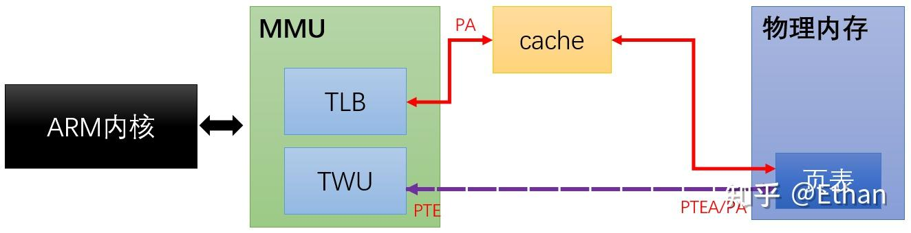

术语定义：**

**页表：**

- 将虚拟地址转换为物理地址
- 管理CPU对物理页的访问（即检查是否具备读、写、可执行等权限）
- 隔离地址空间（隔离各个进程的地址空间，使其互不影响）
**PTE: **是一种数据结构，用于描述虚拟内存和物理内存之间的映射关系。**它是页表（Page Table）中的一个条目，每个虚拟内存页面都对应一个PTE。**通过使用PTE，CPU可以根据虚拟地址获取到物理内存地址，同时检查该地址的访问权限。

- 物理页地址：虚拟内存所映射的物理内存页的地址
- 访问权限：指示当前页面是否可读、可写、可执行等权限信息
- 脏位：标记页面是否被修改过，以支持页面置换
- 共享位：指示页面是否可以被共享
- 缓存位：用于控制页面的缓存策略，例如是否可以缓存到Cache
**页/页帧/页表/页表项(PTE)**

MMU是负责把虚拟地址映射为物理地址，但凡"映射"都要解决两个问题：映射的最小单位（粒度）和映射的规则。

- MMU中VA到PA映射的最小单位称为页(Page)，映射的最低粒度是单个虚拟页到物理页，页大小通常是4K，即一次最少要把4K大小的VA页块整体映射到4K的PA页块（从0开始4K对齐划分页块），页内偏移不变，如VA的一页0x30004000~0x30004fff被映射到PA的一页 0x00008000~0x00008fff，当CPU执行单元访问虚拟地址0x30004008，实际访问的物理地址是0x00008008（0x30004008和0x00008008分别位于虚实两套地址空间，互不相干，不存在重叠和冲突）。以页为最小单位，就是不能把VA中某一页划分成几小块分别映射到不同PA，也不能把VA中属于不同页的碎块映射到PA某一页的不同部分，必须页对页整体映射。
- 页帧（Page Frame）是指物理内存中的一页内存，MMU虚实地址映射就是寻找物理页帧的过程，对这个概念了解就可以了。
- MMU软件配置的核心是页表（Page Table），它描述MMU的映射规则，即虚拟内存哪(几)个页映射到物理内存哪(几)个页帧。
- 页表由一条条代表映射规则的记录组成，每一条称为一个页表条目（Page Table Entry,即PTE），整个页表保存在片外内存，MMU通过查找页表确定一个VA应该映射到什么PA，以及是否有权限映射。
- 但如果MMU每次地址转换都到位于外部内存的页表上查找PTE，转换速度就会大大降低，于是出现了TLB，TLB (Translation Lookaside Buffers)即转换快表，又简称快表，可以理解为MMU内部专用的存放页表的cache，保存着最近使用的PTE乃至全部页表。MMU接收到虚拟地址后，首先在TLB中查找，如果找到该VA对应的PTE就直接转换，找不到再去外存页表查找，并置换进TLB。TLB属于片上SRAM，访问速度快，通过TLB缓存PTE可以节省MMU访问外存页表的时间，从而加速虚实地址转换。TLB和CPU cache的工作原理一样，只是TLB专用于为MMU缓存页表。
**MMU的内存保护功能**

．． 既然所有发往内存的地址信号都要经过MMU处理，那让它只单单做地址转换，岂不是浪费了这个特意安插的转换层?显然它有能力对虚地址访问做更多的限定(就像路由器转发网络包的同时还能过滤各种非法访问)，比如内存保护。可以在PTE条目中预留出几个比特，用于设置访问权限的属性，如禁止访问、可读、可写和可执行等。设好后，CPU访问一个VA时，MMU找到页表中对应PTE，把指令的权限需求与该PTE中的限定条件做比对，若符合要求就把VA转换成PA，否则不允许访问，并产生异常。

#### 多级页表

直接看下面这张图吧，以64位的虚拟地址为例，其中CR3是CPU的一个寄存器，从图中也可以看出来用来存放顶级页目录项。所以MMU开启之后，首先就是读取CR3寄存器的内容

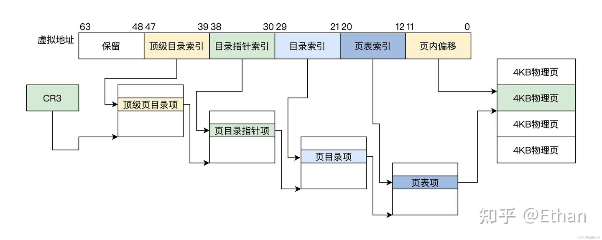

**操作系统和MMU**

实际上MMU是为满足操作系统越来越复杂的内存管理而产生的。OS和MMU的关系简单说：

- 系统初始化代码会在内存中生成页表，然后把页表地址设置给MMU对应寄存器，使MMU知道页表在物理内存中的什么位置，以便在需要时进行查找。之后通过专用指令启动MMU，以此为分界，之后程序中所有内存地址都变成虚地址，MMU硬件开始自动完成查表和虚实地址转换。
- os初始化后期，创建第一个用户进程，这个过程中也需要创建页表，把其地址赋给进程结构体中某指针成员变量。即每个进程都要有独立的页表。
**

MMU映射失败的几种情况**

．．1.访问了受内核保护的页面，或者访问了只读的页面（比如c语言中存储字符串字面量和const变量的段），此时内核会抛出段错误

　　2.页面和页框没有产生映射关系，但是数据页已经被其他进程加载到内存中了，此时只需要建立页面和页框的映射关系，称为次级缺页中断

　　3.页面和页框没有产生映射关系，数据页也没有被加载到内存中（在磁盘上），此时需要发生磁盘io从磁盘中加载页到内存中，还需要建立页面和页框的映射关系，称为严重缺页中断。

除了第一点，第二第三都会以内核降低自身运行速度来修复，也就是老师说的，通过中断形成页表映射，然后再重新执行引起中断的命令（此时数据页已经在内存中并且建立映射关系了）。

**

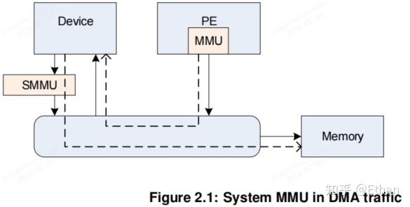

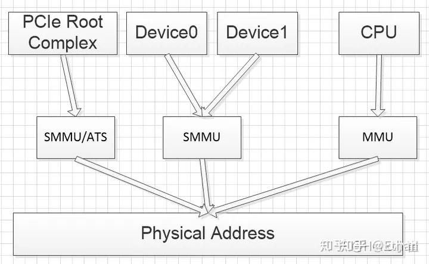

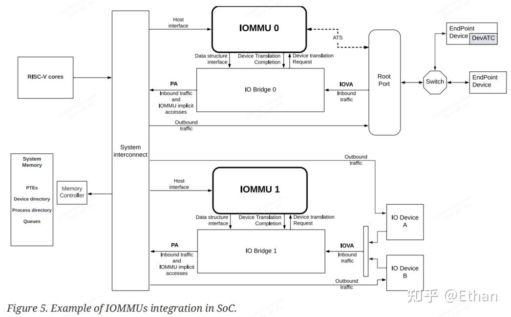

MMU**是在处理器中使用的，一个MMU仅支持一个CPU，用于将支持多进程的虚拟地址共享同一个物理内存，以及对物理地址的访问进行权限检查的一个硬件单元。

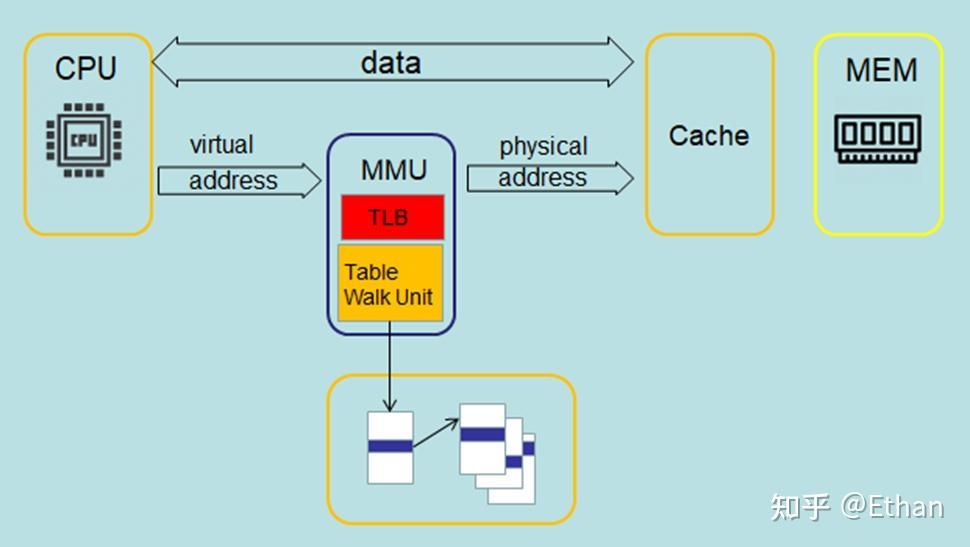

**

根据MMU和cache的顺序关系——物理和虚拟cache**

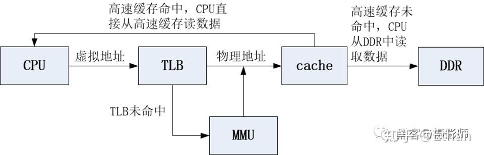

 Cache和MMU基本上都是一起使用的，会同时开启或同时关闭。因为MMU页表中的entry属性，控制着内存的权限和cache缓存的策略。

CPU在访问DDR的时候用的地址是虚拟地址（Virtual Address，VA），经过MMU将VA映射成物理地址（Physucal Address，PA），然后使用物理地址查询高速缓存，这种高速缓存称为物理高速缓存。

物理高速缓存在的缺点主要是，CPU查询TLB或MMU后才能访问cache，增加了流水线的延时。

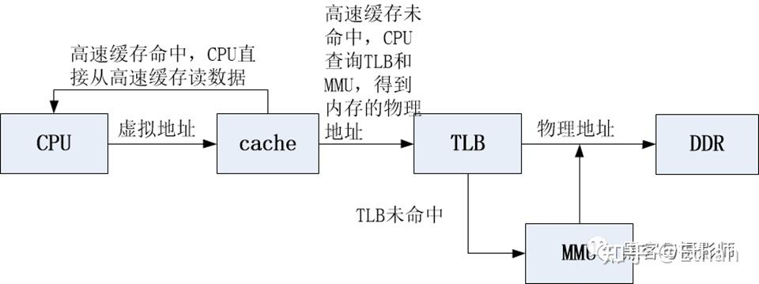

CPU使用虚拟地址寻址高速缓存，这种高速缓存称为虚拟高速缓存。

CPU在寻址时，先把虚拟地址发送到高速缓存，若在高速缓存里找到所需数据，就不再访问TLB和DDR。

**

cache缓存寻址方式与设计 – VIVT, VIPT, PIPT**

•即用虚拟地址或者物理地址 (VA/PA) 作为Index和tag对缓存行进行寻址的方式引申出的不同缓存设计

•VIVT速度最快因为寻址时可以不经过MMU/TLB，但同时对操作系统的要求高，需要避免tag/index的歧义问题

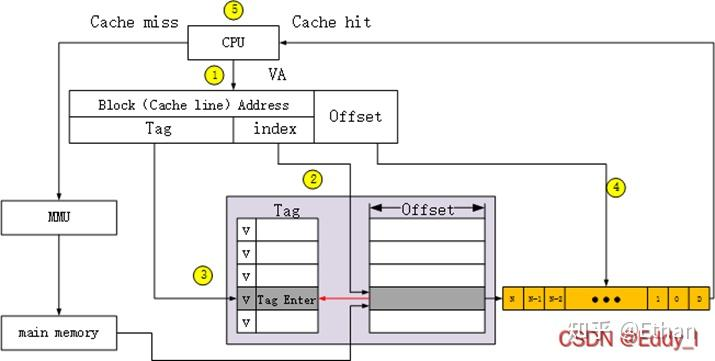

VIVT-虚拟高速缓存 VIVT（Virtually-Indexed Virtually Tagged）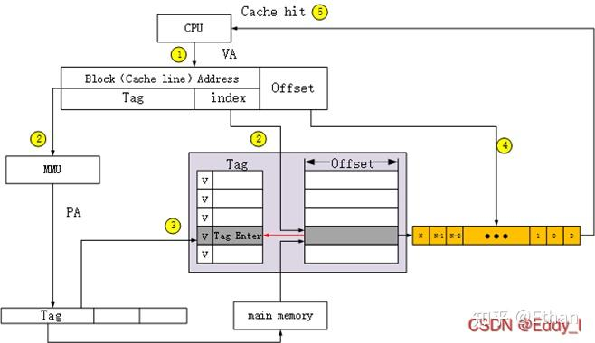

VIPT-物理标记的虚拟高速缓存 VIPT（Virtually-Indexed Physically-Tagged）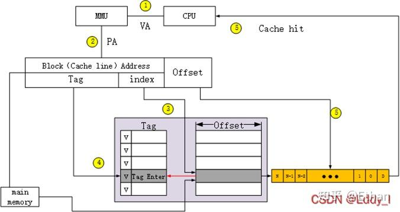

PIPT-物理高速缓存 PIPT（Physically-Indexed，Physically-Tagged）**

SMMU**是在子系统之间使用，SMMU可以支持多个外设，为了区分这些外设，使用StreamID来标识，同个SMMU的StreamID必须唯一，不同SMMU的StreamID互不影响。将离散的物理地址映射到连续的虚拟地址空间，避免内存分配过程中的碎片化问题，用于解决越界和地址踩他问题

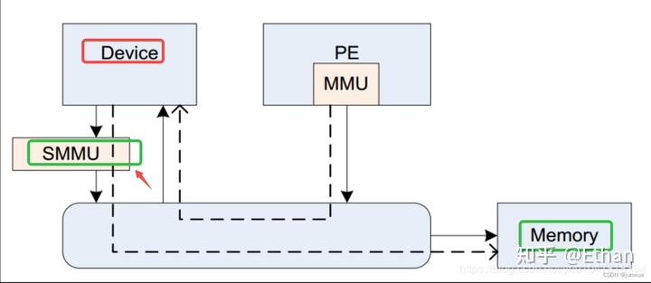

SMMUv3.0 特性 

SMMUv3 提供了功能以补充 PCI Express 根复合体和其他潜在的大型 I/O 系统，通过支持大量的并发转换上下文。 

- 基于内存的配置结构以支持大量的流。 
- 实现可能仅支持阶段 1，仅支持阶段 2 或同时支持两个阶段的转换。这种能力以及其他特定于实现的选项，可以从寄存器接口中发现。 
- 高达 16 位的 ASIDs。 
- 高达 16 位的 VMIDs 。 
- 根据 Armv8.1 虚拟内存系统架构进行地址转换和保护。SMMU 转换表可与 PEs 共享，允许软件选择共享现有表或创建 SMMU 私有表。 
- 49 位的 VA，与 Armv8-A 的 2×48 位转换表输入大小相匹配。 
在实现中，以下支持是可选的： 

- 阶段 1 或阶段 2 中的任何一个。 
- 对 AArch32（LPAE）和 AArch64 转换表格式的阶段 1 和 2 支持。 
- 安全流支持。 
- 广播 TLB 无效。 
- 页面的访问标志和脏状态的硬件转换表更新（HTTU）。实现可能仅支持访问标志的更新，支持页面的访问标志和脏状态的更新，或者不支持 HTTU。 
- 与兼容的根复合体一起使用时的 PCIe ATS 和 PRI。 
- 16KB 和 64KB 页面粒度。然而，建议在阶段 1 和阶段 2 都存在 64KB 页面粒度，以与服务器基础系统架构中的 PE 要求保持一致。 由于使用内存中的配置来支持大量流导致 SMMUv3 编程接口与 SMMUv2 有显著不同，SMMUv3 并非设计为与 SMMUv2 向后兼容。 
**

为什么需要SMMU？[https://blog.csdn.net/junwua/article/details/138972951](https://link.zhihu.com/?target=https%3A//blog.csdn.net/junwua/article/details/138972951)

了解SMMU出现的背景，需要知道系统中的两个概念：DMA和虚拟化。

1-DMA

DMA：（(Direct Memory Access），直接内存存取, 是一种外部设备不通过CPU而直接与系统内存交换数据的接口技术 。外设可以通过DMA，将数据批量传输到内存，然后再发送一个中断通知CPU取，其传输过程并不经过CPU， 减轻了CPU的负担。但由于DMA不能像CPU一样通过MMU操作虚拟地址，所以DMA需要连续的物理地址。

2-虚拟化

虚拟化：在虚拟化场景， 所有的VM都运行在中间层hypervisor上，每一个VM独立运行自己的OS（guest OS）, Hypervisor完成硬件资源的共享, 隔离和切换。

VA ： virtual addresses (VAs) 虚拟地址

IPA : intermediate physical address (IPA) memory map 中间层 物理地址

PA ： physical addresses (PAs) 物理地址

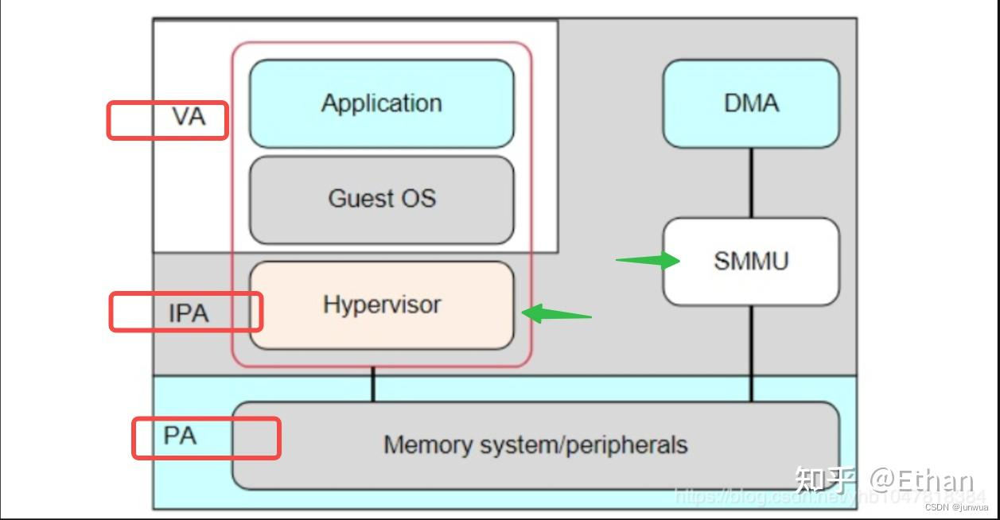

地址转换**：SMMU跟MMU一样，支持两级转换Stage 1 Translation和Stage2 Translation，例如VAIPAPA，但是在现实使用中，也可以直接bypass，stage 1 only，stage2 only，或者Stage 1+Stage 2

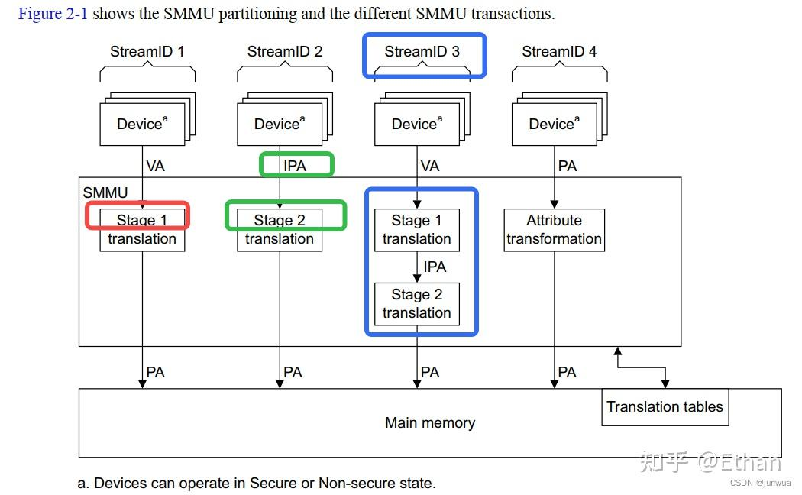

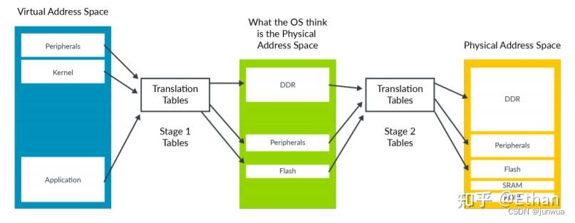

**内存保护**：（S）MMU除了支持地址转换外，内存属性也是重要的部分，例如可以在页表内配置读写权限，执行权限，访问权限等

内存区域权限 由 AP、APX 和 Domain(域) 共同控制，如下：

AP/APX：字段 AP 和 APX 的不同组合将形成不同的 访问权限，如图所示。

Privileged 指的是 CPU 处于 svc 等状态，而 Unprivileged 则为 CPU 处于 user 状态。

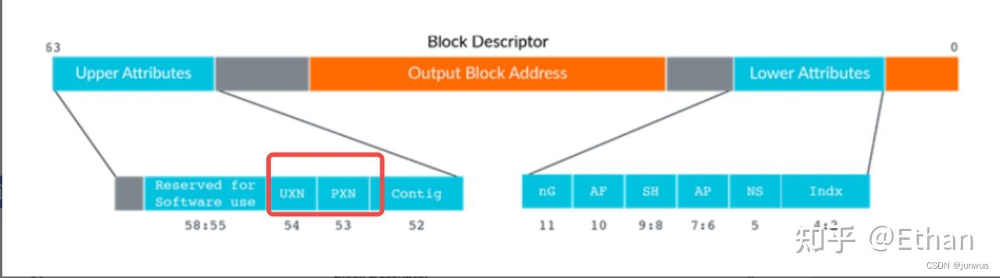

隔离：SMMU同时可以给多个Master使用，例如SMMUv2支持128个contexts，SMMUv3支持更多的Contexts，因为在SMMUv2中contexts的信息是保存在寄存器，在SMMUv3中context的信息是存储在内存里面，通过StreamID来查询，Stream ID是32位的。CPU可以和其他Master使用同一套页表，或者CPU可以SMMU单独建立页表，或者可以为每个Master建立一套或者多套页表，来控制不同的访问区域。

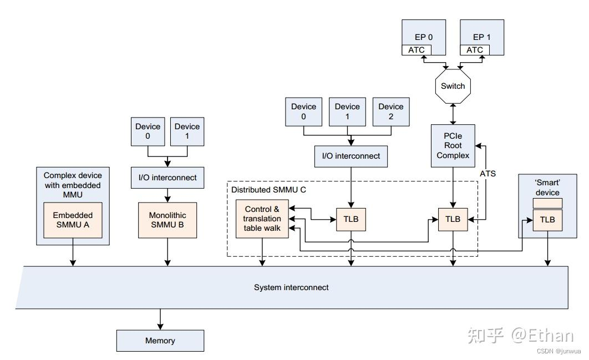

**

IOMMU**通常是实现在北桥之中，现在北桥通常被集成进 SOC 中了，所以 IOMMU 通常都放在SOC 内部了，用于提供设备端的地址翻译能力，它让具有 DMA（Direct Memory Access）能力的设备可以使用虚拟地址，然后经过 IOMMU 翻译成可以直接访问内存的物理地址。设备端的地址翻译功能（DMA 重定向）只是 IOMMU 的功能之一，IOMMU 另一个重要的功能是中断重映射。

RISC-V IOMMU 规范支持以下功能： 

- 基于内存的设备上下文，用于定位参数和地址转换结构。设备上下文使用硬件提供的唯一 device_id 定位。 支持的 device_id 宽度可达 24 位。 
- 基于内存的进程上下文，使用硬件提供的唯一 process_id 定位参数和地址转换结构。支持的 process_id最多为 20 位。 
- 16 位 GSCID（Guest 软件上下文标识符）和 20 位 PSCID（进程软件上下文标识符）。 
- 两阶段地址转换 
- RISC-V 特权规范[3]规定的基于页的虚拟内存系统，允许软件灵活地为 CPU MMU 和 IOMMU 使用通用页表，或为 IOMMU 使用单独的页表。 
- 最多 57 位虚拟地址宽度、56 位系统物理地址和 59 位Guest物理地址宽度。 
- 硬件更新 PTE Accessed 和 Dirty 位。 
- 使用 RISC-V 高级中断架构 [2] 指定的 MSI 页表，识别虚拟中断文件的内存访问和 MSI 地址转换。 
- Svnapot 和 Svpbmt 扩展。 
- PCIe ATS 和 PRI 服务 。支持根据转换请求将 IOVA 转换为 GPA，而不是 SPA。 
- 硬件性能监控器（HPM）。 
- MSI 和有线信号中断请求软件提供服务。 
- 用于软件请求地址转换的寄存器接口，以支持调试。 
IOMMU 支持的功能可通过第 5.3 节中的 capabilities 寄存器发现。 

参考资料：

- [【MMU】认识 MMU 及内存映射的流程](https://link.zhihu.com/?target=https%3A//www.baidu.com/link%3Furl%3DL1vEfm4XlhAHzZmZ3KLe3CeKaL-8tMdh4Ta6rAeTXZXJ50stHFFGO0SqH_ZeKm8K5LvXt2vbYrQGuiZOf_bAFPUcFtuAbK7i9nBeDdHdbjq%26wd%3D%26eqid%3De0dcac9b00605d500000000666839cef)
- RISC-V IOMMU Architecture Specification，Version 1.0-rc1, 03/2023: This document is in Frozen. Change is extremely unlikely. See [http://riscv.org/spec-state](https://link.zhihu.com/?target=http%3A//riscv.org/spec-state) for details
- Arm® System Memory Management Unit Architecture Specification SMMU architecture version 3
- [Hello小崔：4.8.2 SMMU介绍（2）——工作原理](https://zhuanlan.zhihu.com/p/105047627)
- [Tiffany的世界：【内存-MMU】图解SMMU原理与实现](https://zhuanlan.zhihu.com/p/661301982)
- [什么是mmu？为什么要用mmu？](https://link.zhihu.com/?target=https%3A//blog.csdn.net/KUNPLAYBOY/article/details/121157550)
- [smmu 知识架构学习](https://link.zhihu.com/?target=https%3A//blog.csdn.net/junwua/article/details/138972951)
- [SMMU介绍](https://link.zhihu.com/?target=https%3A//blog.csdn.net/weixin_50518899/article/details/136940280%3Fspm%3D1001.2101.3001.6650.5%26utm_medium%3Ddistribute.pc_relevant.none-task-blog-2%257Edefault%257EBlogCommendFromBaidu%257ERate-5-136940280-blog-130740197.235%255Ev43%255Epc_blog_bottom_relevance_base7%26depth_1-utm_source%3Ddistribute.pc_relevant.none-task-blog-2%257Edefault%257EBlogCommendFromBaidu%257ERate-5-136940280-blog-130740197.235%255Ev43%255Epc_blog_bottom_relevance_base7%26utm_relevant_index%3D8)
- [ARM SMMU的原理与IOMMU](https://link.zhihu.com/?target=https%3A//blog.csdn.net/21cnbao/article/details/108915163%3Fspm%3D1001.2101.3001.6650.5%26utm_medium%3Ddistribute.pc_relevant.none-task-blog-2%257Edefault%257EBlogCommendFromBaidu%257ERate-5-108915163-blog-136215305.235%255Ev43%255Epc_blog_bottom_relevance_base7%26depth_1-utm_source%3Ddistribute.pc_relevant.none-task-blog-2%257Edefault%257EBlogCommendFromBaidu%257ERate-5-108915163-blog-136215305.235%255Ev43%255Epc_blog_bottom_relevance_base7%26utm_relevant_index%3D10)