### MoE 主流结构

MoE，就是在层中加入动态路由

这部分总计来自，[A Survey on Inference Optimization Techniques for Mixture of Experts Models](https://link.zhihu.com/?target=https%3A//arxiv.org/abs/2412.14219)

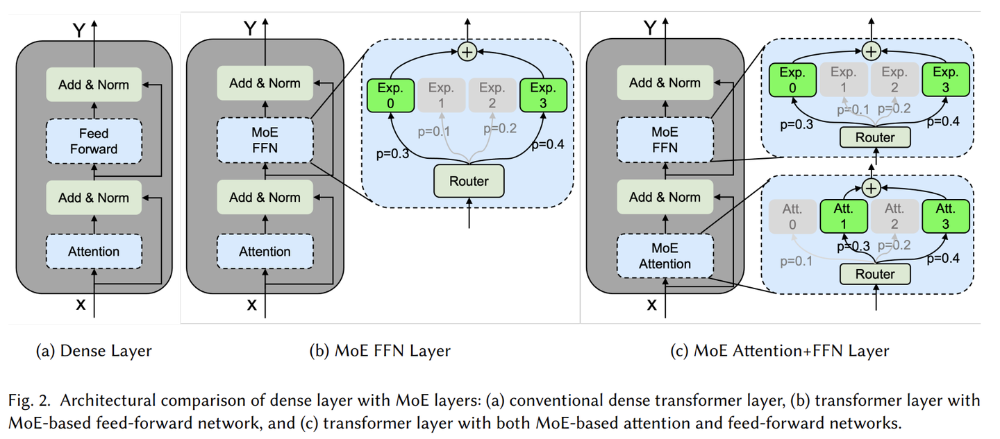

[1]显然的，MoE 会面临诸多挑战，可以分成算法（Model），系统（System），架构（Hardware）三个层面来考虑。下图给出了一个非常新的划分与总结。

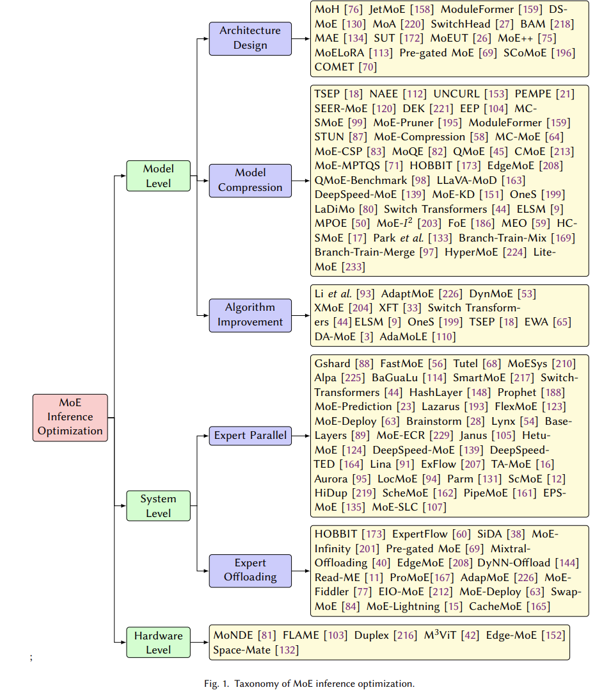

[1]我们讨论的互联问题，传统上是通过系统层级来解决的，而硬件层面则可以为其提供有力支持。其面向的核心问题，是 EP（专家并行）场景下的 All to All 互联问题。

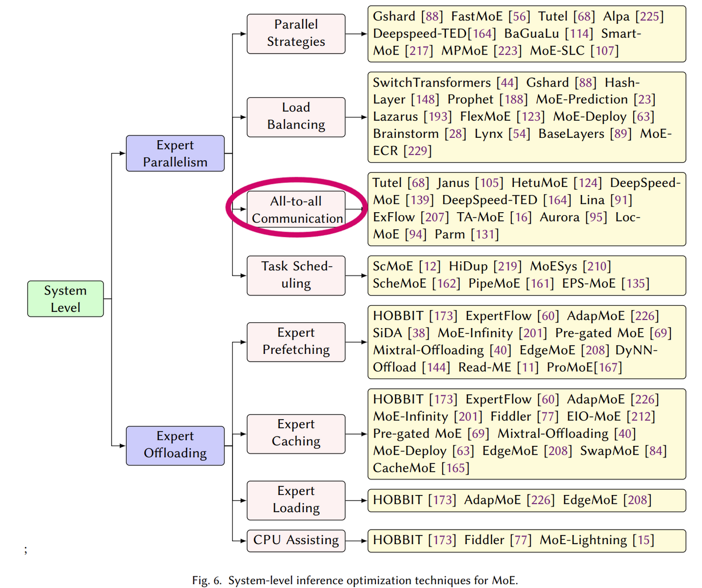

[1]**

### All to All 挑战

为什么会有 All to All 的挑战？究其根本原因，是因为我们想要在受限的单芯资源下，通过组合多芯形成体系，以便于我们实现更大规模的模型部署。因此，一个核心的问题就是如何处理这些多芯之间的通信问题使之形成体系，以便我们算法层的小伙伴可以快乐的使用池化后的资源。

先明确一个点，All to All，是指在我们的多芯体系下，每个芯片都需要与任意一个芯片完成通信而带来的挑战。那这个挑战从何而来呢？我们先看一下经典的 MoE 计算流程。

#### 经典 MoE 层的 6 个步骤

- 输入（tokens）**假设我们有一批 token ，第一步就是把这些 token 分发到我们各个计算芯片上。
- **门控（Gating）**在计算芯片上，这些 token 会通过一个小的路由网络（通常是单层全连接 + softmax），为每个 token 计算一组得分（看看这个 token 和哪个专家比较匹配），根据得分将选择一些专家负责其后续的计算（一般是选 Top-k 的专家）。
- **分发（Dispatch / 第一轮 All-to-All）**把 token 按专家分桶：属于 Expert 1 的发到 Expert 1，属于 Expert 2 的发到 Expert 2……如果专家分布在不同芯片，就要跨芯片传输（这就是 **A2A **的第一次出现）。如果 k=2，token 的向量会被复制两份，分别送到两个专家。
- **专家计算（Expert FFN）**每个专家就是一个独立的网络，不同专家的参数不同，所以整体参数量巨大。但注意：每个 token 只经过其中 1–2 个专家 → 计算是稀疏的。
- **回收（Combine / 第二轮 All-to-All）**专家算完的结果，要返回到 token 的“归属地”。**所以要再做一次通信，把结果按 token 排回原来的批次顺序。（这就是 A2A **的第二次出现）。
- **加权合并（Weighted Combine）**如果 token 路由到多个专家，就按 gating 得分做加权和（或拼接），得到 token 的最终输出。然后就像普通 Transformer 一样，把输出送去下一层。

### 路在何方？宏观来看解决方案

逻辑上来讲，All to All 的问题，根本上是 token 与 expert 间的关联横跨整个计算资源池，不可预测且数据规模庞大。

算法上，减少通信请求的次数，尽可能让通信集中在小范围内，可以修改模型结构，优化路由算法等方案。

系统上，优化通信的路径，可以压缩传输数据，设计分层互联等方案。

硬件上，提高带宽，可以通过 chiplet，异构堆叠，die to die 互联等方案。

### 算法层次的优化方案

算法层次有很多方法具有启发性

#### [M6-T: Exploring Sparse Expert Models and Beyond](https://link.zhihu.com/?target=https%3A//arxiv.org/abs/2105.15082) 专家分组

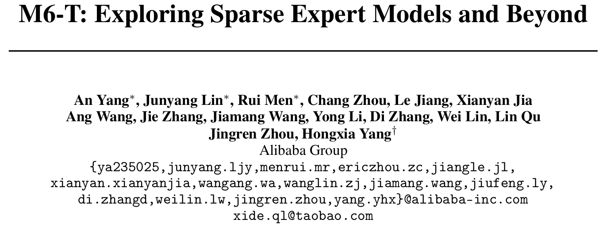

2105这篇文章提出MoE的负载不均衡不会显著影响模型质量，反而激活专家的数量k和专家的token容量C会产生显著影响。其提出，将模型划分为k个原型组，每个原型组中选top-1激活，以取代传统的top-k激活，提高模型质量。客观上减少了待选专家的范围，可以减少跨节点通信。

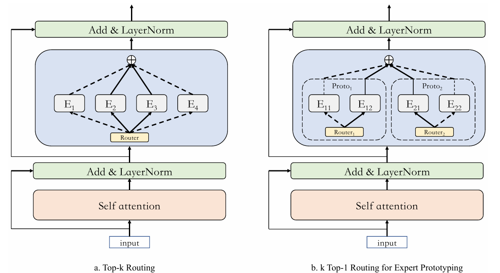

M6-T
#### [MoH: Multi-Head Attention as Mixture-of-Head Attention](https://link.zhihu.com/?target=https%3A//arxiv.org/abs/2410.11842) 专家分类

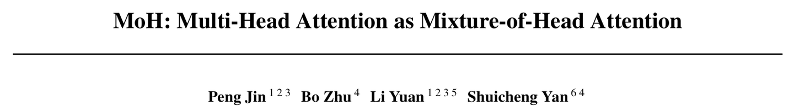

ICML 2025这篇文章优化MoA。其提出“共享注意力头（始终激活）”和“路由注意力头（路由激活）”，并加权求和。能在使用更少注意力头的情况下，达到更好的效果。客观上减少可选专家数目，缓解通信压力。

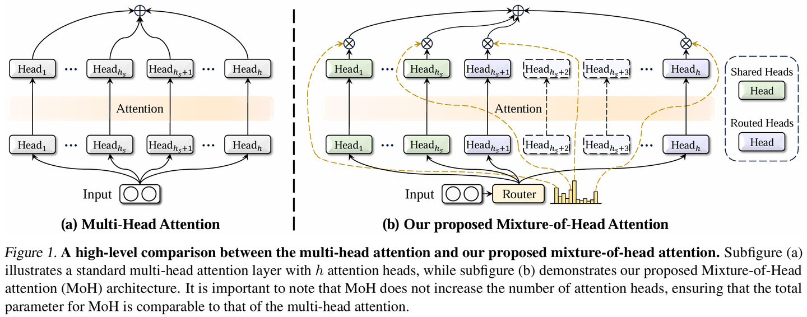

MoH还有一些剪枝，量化，低秩分解等方面的方法，可以减小数据量和参数量，也有一定的借鉴意义。

#### [DeepSeekMoE: Towards Ultimate Expert Specialization in Mixture-of-Experts Language Models](https://link.zhihu.com/?target=https%3A//arxiv.org/abs/2401.06066)

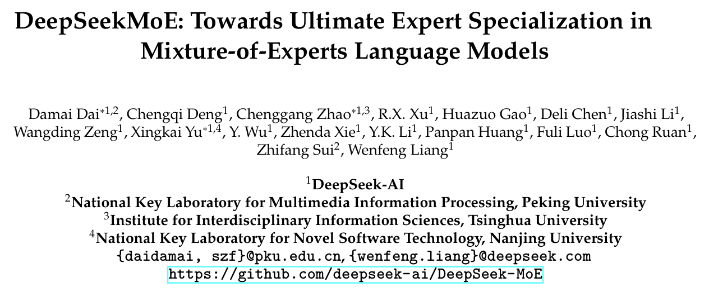

2401论文提出小数目专家存在知识杂交（每个专家知识不纯粹）和知识冗余（不同专家都包含一部分通用知识）两大问题。首先，文章将专家做了更细的划分，缩小专家规模并增加专家数目。其次，文章将一部分专家隔离出来作为共享专家，其余作为路由专家。最后，论文引入了设备级平衡损失，减缓设备间的负载不平缓问题。

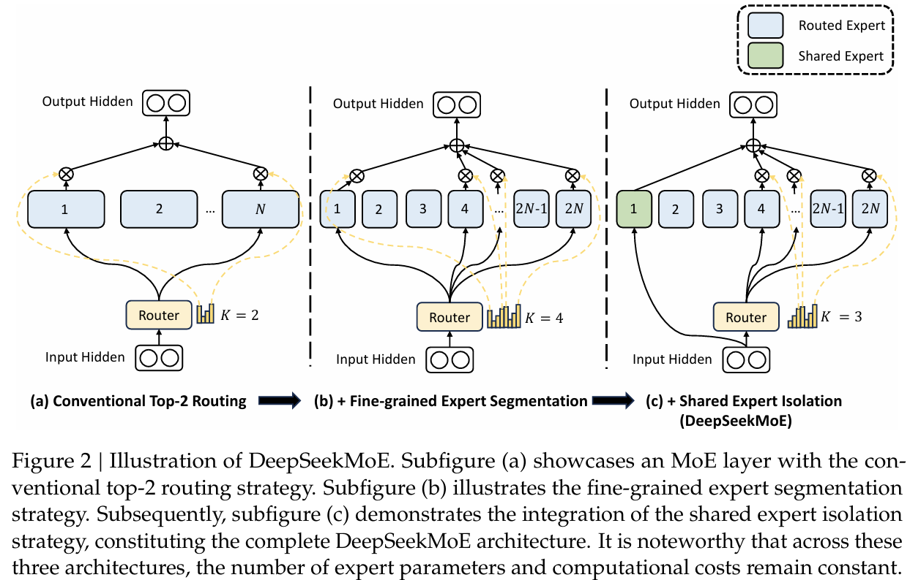

DeepSeekMoE 在不同规模下均展现出卓越的计算效率与性能对比优势：

- **2B 规模**：性能 ≈ GShard-2.9B（后者计算量高 1.5×），且接近同参数规模的稠密模型上限；
- **16B 规模**：性能 ≈ LLaMA2-7B，仅需 **40% 计算量**；
- **145B 规模**：性能稳定优于 GShard，且 ≈ DeepSeek-67B，仅用 **28.5%–18.2% 的计算量**。

### 系统层次的优化方案

### [DeepSpeed-MoE: Advancing Mixture-of-Experts Inference and Training to Power Next-Generation AI Scale](https://link.zhihu.com/?target=https%3A//proceedings.mlr.press/v162/rajbhandari22a.html%3Fref%3Dhttps%3A//githubhelp.com) 多层次互联

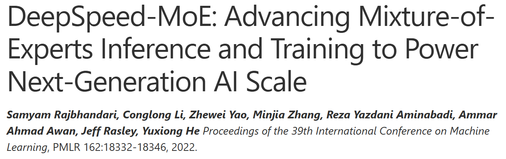

ICML 2023论文中提到了一种多层次的互联体系。其首先划分 GPU 节点，先进行节点内 A2A 通信，后进行节点间 A2A 通信。增加了通信量但是显著降低了延迟，有更好的扩展性。同时做了模型压缩的方案。

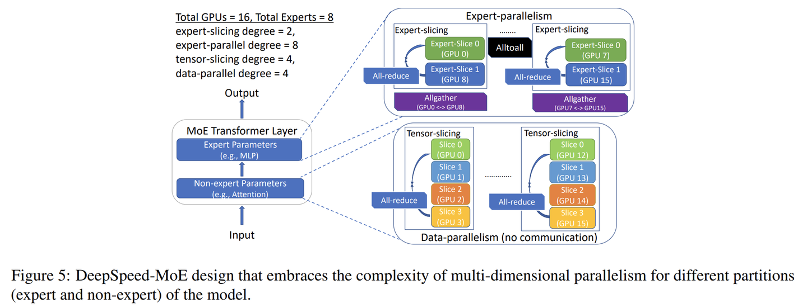

**DeepSpeed-MoE** 提供了一个完整的 MoE 训练与推理框架：模型规模缩小 **3.7×**； 推理系统实现 **7.3× 延迟与成本优化**； 相比同质量的稠密模型，推理 **4.5× 更快、9× 更便宜**。

### [Janus: A Unified Distributed Training Framework for Sparse Mixture-of-Experts Models](https://link.zhihu.com/?target=https%3A//dl.acm.org/doi/pdf/10.1145/3603269.3604869) 数据中心化

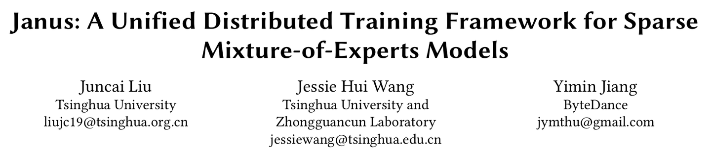

ACM SIGCOMM 2023,采用数据中心化方法，将专家（experts）在设备间迁移，而不是迁移 tokens，从而显著降低通信成本。主要面向训练，这是因为专家迁移范式把“传输对象”从动态生成、必须同步的激活数据换成了静态可预取、可复用的专家权重，从而实现异步通信和计算-通信重叠。

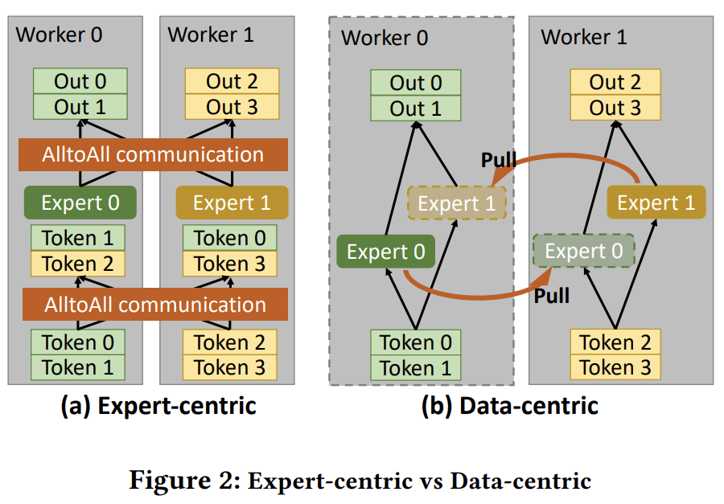

在 **32 张 A100 GPU 的集群**上进行评估时，**Janus** 能够将通信流量减少 **最高 16 倍**，并在性能上实现 **最高 2.06 倍的加速**，相比当前的 MoE 训练系统具有显著优势。

### [ExFlow: Exploiting Inter-Layer Expert Affinity for Accelerating Mixture-of-Experts Model Inference](https://link.zhihu.com/?target=https%3A//ieeexplore.ieee.org/abstract/document/10579139) Token一致性  跨层专家亲和性

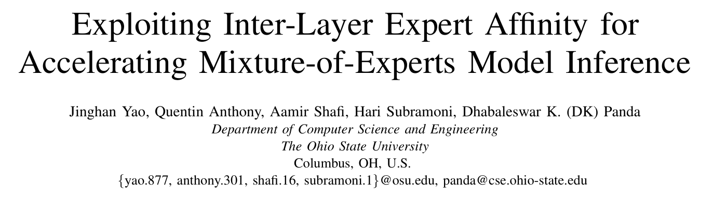

IPDPS 2024首先，通过**All-Gather**在所有GPU间共享所有的输入，使得其可以在任意节点上执行门控函数。之后利用Token一致性，让Token在节点间移动。去除第二次A2A回收步骤。（可能会造成Token慢慢集中在某些节点？也可能不会？这应该是认为不会，文中没有提及）

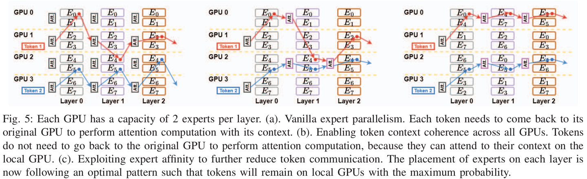

利用 **跨层专家亲和性（inter-layer expert affinity）**来缓解通信开销，同时给出了针对跨层专家亲和性的分析。将亲和的专家安排在同一个计算节点中，减少节点外 All to All 通信。

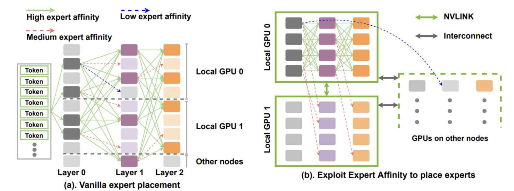

将 **ExFlow** 与现有先进的 MoE 推理框架进行了比较，实验覆盖了多种预训练 GPT MoE 模型。在 GPT MoE-16/32/64 模型上，ExFlow 分别实现了 **最高 56% / 65% / 67% 的 All-to-All 通信开销减少**。

### [Aurora: Optimizing Mixture-of-Experts Inference Time Combining Model Deployment and Communication Scheduling](https://link.zhihu.com/?target=https%3A//arxiv.org/abs/2410.17043) 双模型流水重叠

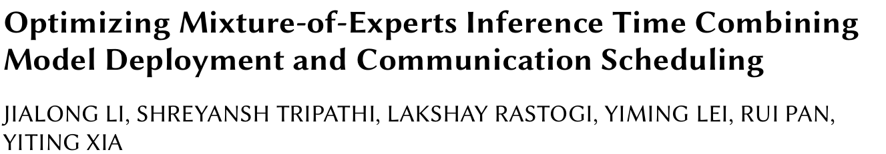

2410同时运行两个模型，可以将二者的计算与通信实现重叠，达到理论上的最大利用。

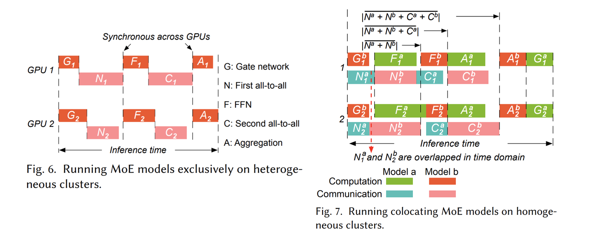

文章分析称，Aurora 在真实生产环境中能将推理时间加速 **2.38–3.54×**，并提升 GPU 利用率 **1.5×**，同时具备对统计噪声的鲁棒性。

#### [LocMoE: A Low-Overhead MoE for Large Language Model Training](https://link.zhihu.com/?target=https%3A//arxiv.org/abs/2401.13920) 鼓励本地专家

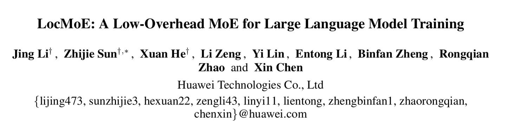

2401是盘古大模型（PanGu-Σ）的技术，使用参数正交的门控函数提高路由的效率与可解释性。增加局部损失，鼓励利用与训练本地专家，减少使用外部节点专家。并且下调了专家容量。

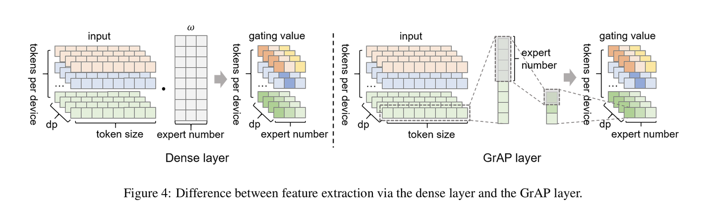

在应用上述改进后，**All-to-All 通信的耗时降低了 5.13%**。在不同规模的集群配置下（包含 8、16 和 32 个节点，分别搭载 64、128 和 256 张 Ascend 910A NPU，以下简称 64N、128N、256N），**每个 epoch 的训练时间最多减少了 22.24%**

#### [Parm: Efficient Training of Large Sparsely-Activated Models with Dedicated Schedules](https://link.zhihu.com/?target=https%3A//arxiv.org/abs/2407.00599)

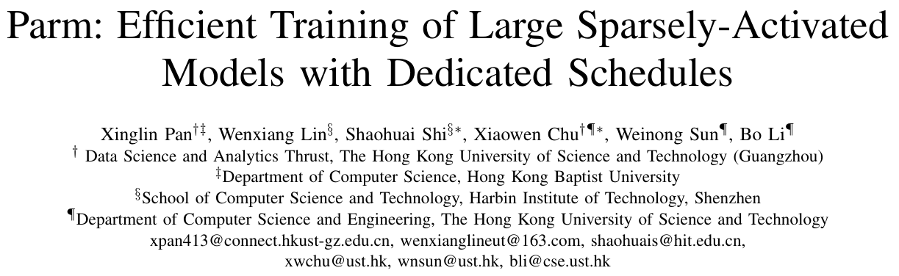

INFOCOM 2024**

### 硬件层次的互联方案

#### NVIDIA [NVLink 和 NVSwitch：卓越的 HPC 数据中心平台 | NVIDIA](https://link.zhihu.com/?target=https%3A//www.nvidia.cn/data-center/nvlink/)

首先不容忽视的互联方式就是 NVLink，作为大模型领域深度玩家的 NVIDIA，其开发的 NVLink 已经成功投产，并且深刻影响了现有的研究趋势。我们先简要梳理一下其技术路径，这里感谢下述几篇文章的讨论与总结

NVLink

发展概述nvlink

那些事……

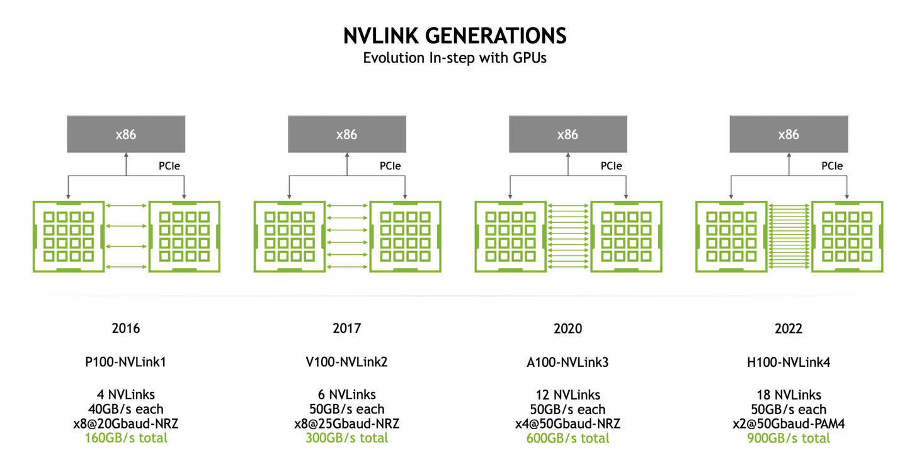

四代 NVLink，带宽显著提高。

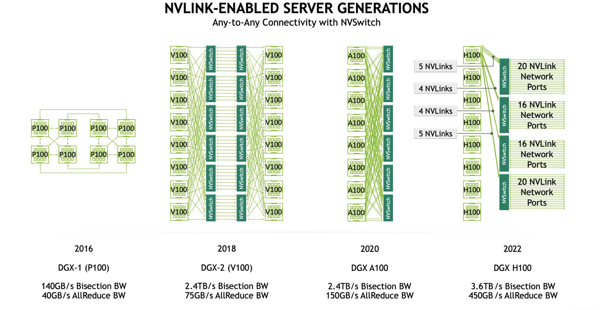

同时，可以发现，其从原先的计算模块与计算模块的直接互联转化为了计算模块与交换机的间接互联。在添加交换机后，可以显著减少计算模块对外互联的通路数目，使得每个通路的带宽增加，进而提高整体带宽。下面展示一下 NVIDIA 官方的对比。

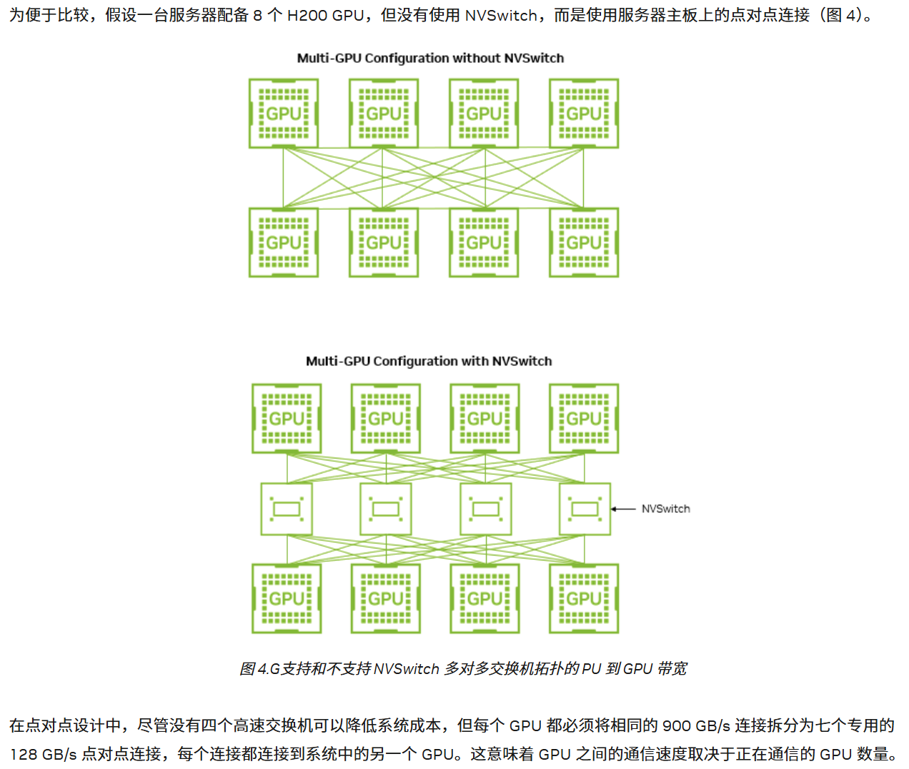

#### 华为 [灵衢社区](https://link.zhihu.com/?target=https%3A//www.unifiedbus.com/zh%3Futm_source%3Dchatgpt.com)

[[2503.20377] UB-Mesh: a Hierarchically Localized nD-FullMesh Datacenter Network Architecture](https://link.zhihu.com/?target=https%3A//arxiv.org/abs/2503.20377)

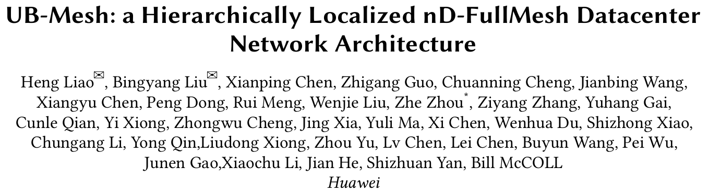

华为在最近新发布了自己的资源池方案，叫做灵衢（UnifiedBus），其内部的互联方案同样值得关注。华为的方案为了通用性做了妥协，使用了传统的总线方式。其将所有的计算与存储资源都挂载在了一条超级总线上。

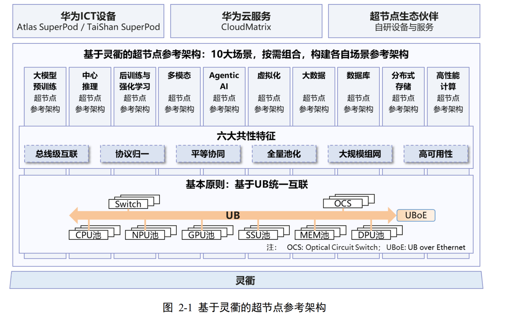

并且给出了一个概念化的预训练与推理结构，其还包含后训练，多模态等前沿内容

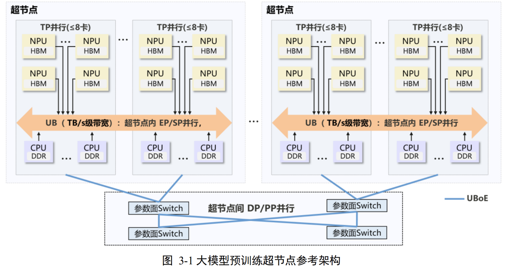

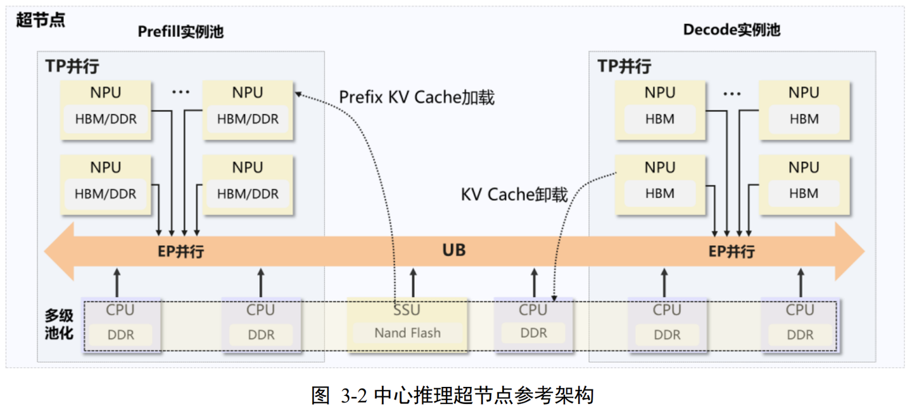

论文中，提出了一种多维度的算力堆叠构想。主要旨在增加短距离互联，减少交换机和光互联。

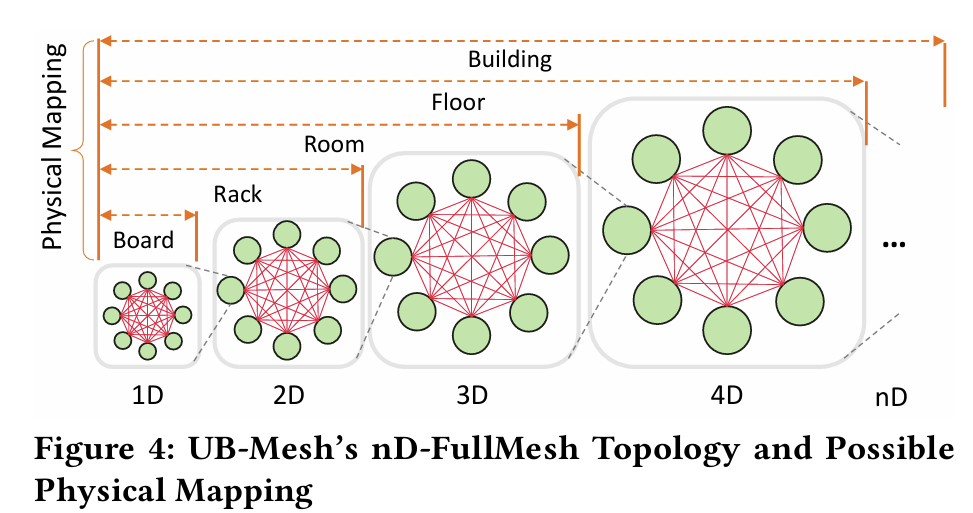

UB-Mesh 对于A2A的解决方案。其在横纵两个方向做全互联。

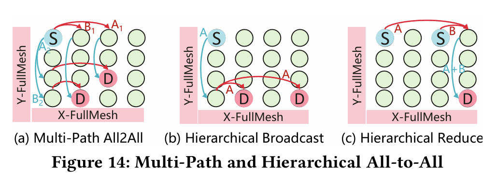

Inter-Rack Connection,主要采用横纵两套全连接方案，通过LRS与外界互联。

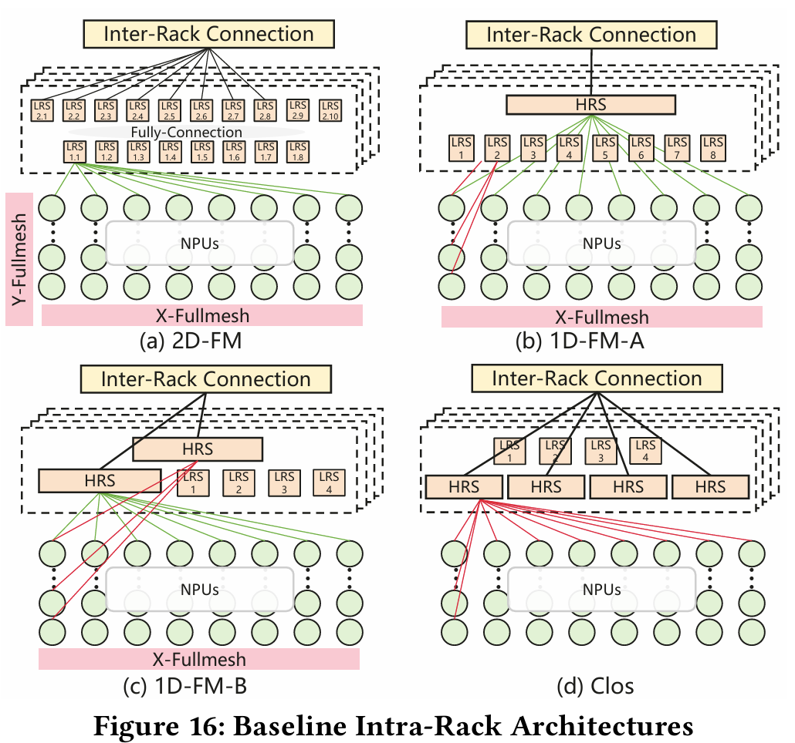

Intra-Rack Connection.机架间相互互联，通过互联通信。

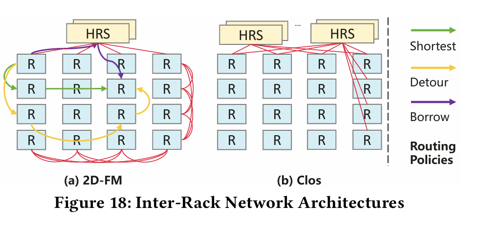

#### Google TPU

*如有帮助，点点赞同！***