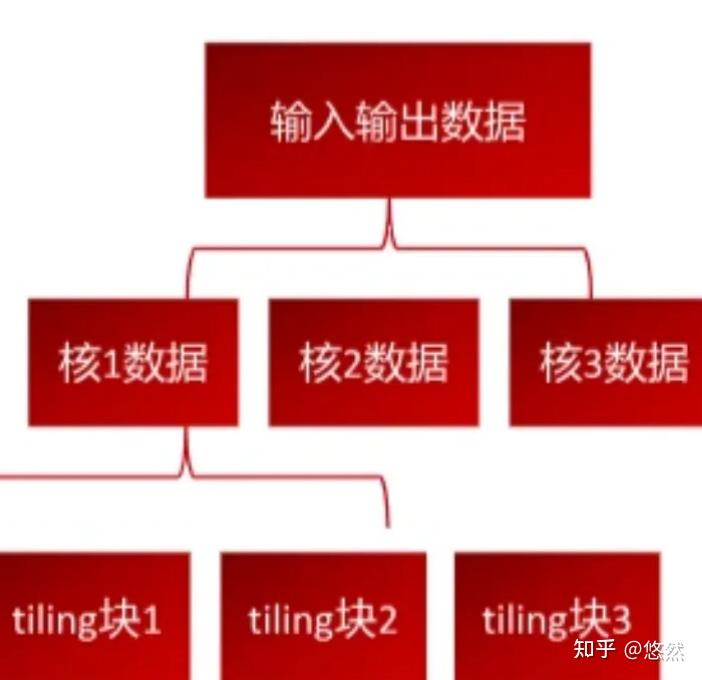
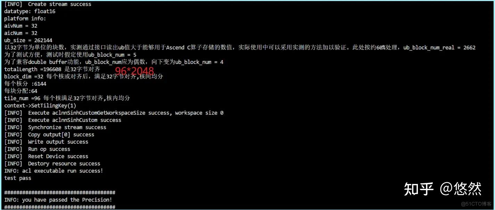
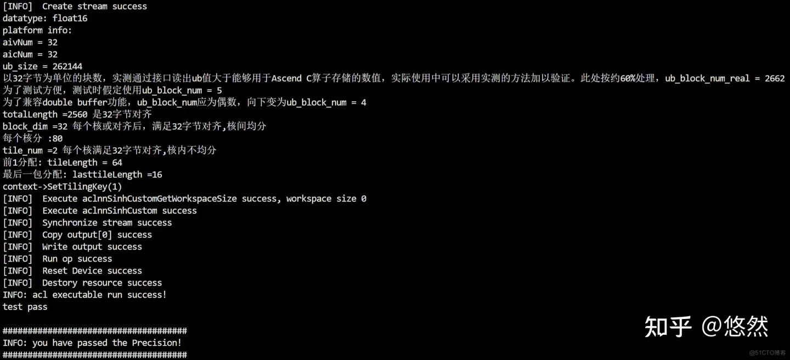
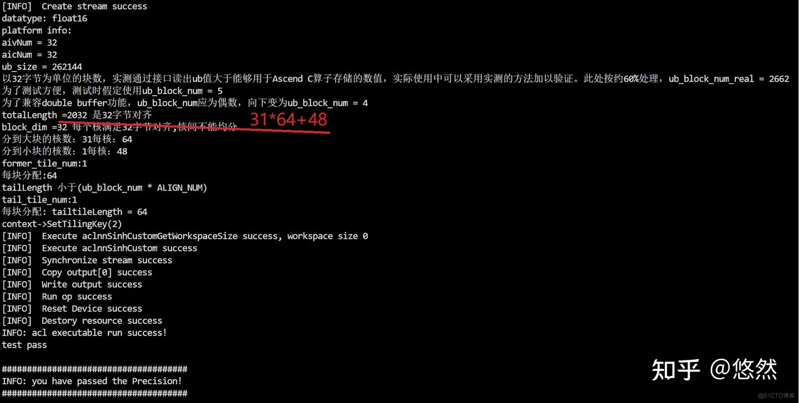
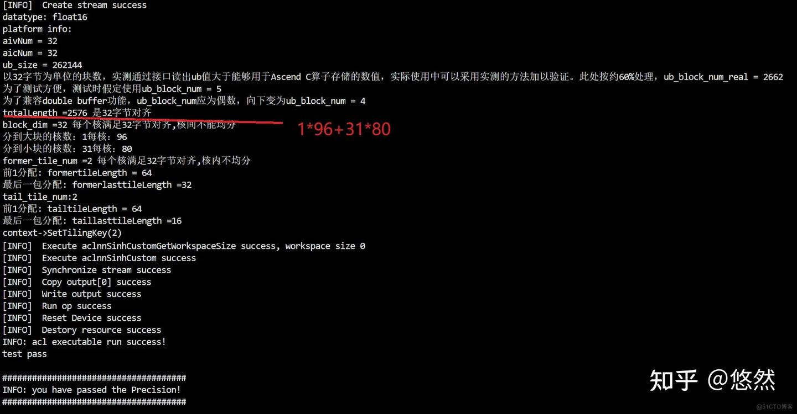
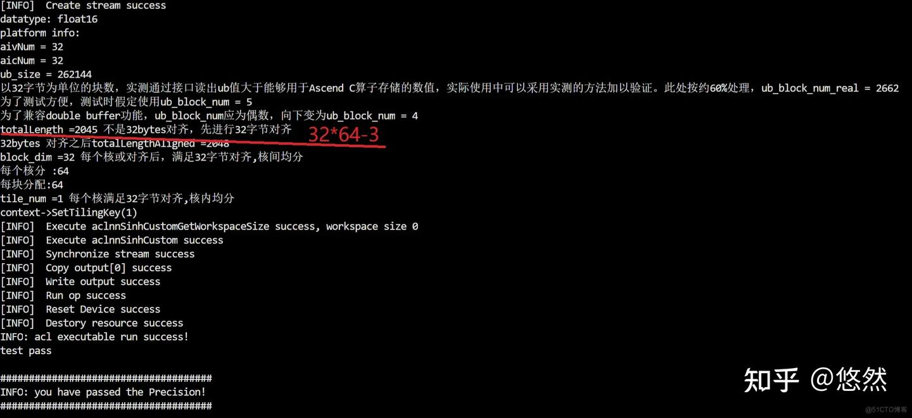
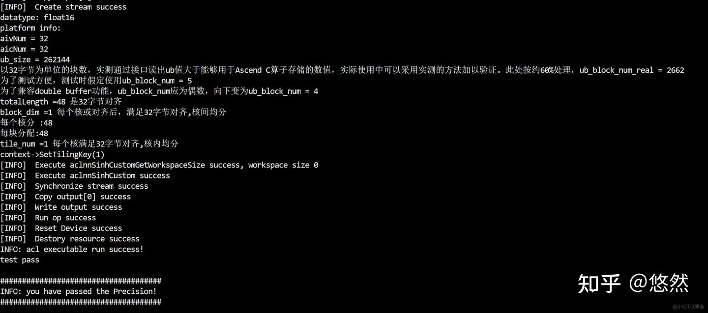
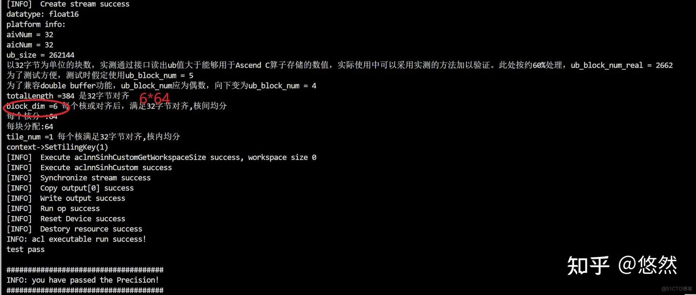

**Tiling的基本概念**

由于大多数情况下，Ai core的Local Memory的存储容量，无法完整的容纳下算子的输入与输出，因此需要先搬运一部分输入进行计算然后搬出，再搬运下一部分输入进行计算，直到得到完整的最终结果，这个数据切分、分块计算的过程称之为Tiling。根据算子的shape等信息来确定数据切分算法相关参数（比如每次搬运的块大小，以及总共循环多少次）的计算程序，称之为Tiling实现。Tiling实现完成后，获取到的Tiling切分算法相关参数，会传递给kernel侧，用于指导并行数据的切分。

从上图可以看出，切分可分为核间切分和核内切分两块内容。核间切分是将数据分配给NPU的多个Aicore，也就是上图第二行中核1数据、核2数据等；分配到某个核计算的数据，也需要分批处理，这就是核内切分，如上图中的tiling块1、tiling块2等。

**设计约束与策略**

1、由于AICore里Unified buffer上的物理限制，要求数据存储必须保持32Byte对齐。

        1）输入向量的shape不满足32字节对齐时，首先要进行32字节对齐。由于aclrtMalloc在Device（Global Memory）上申请线性内存时会，对用户申请的size向上对齐成32字节整数倍后再多加32字节。所以不需要担心对齐后会造成内存溢出。

        2）进行tiling有关计算时，以32字节为最小单位进行计算。

2、AI Core与外部数据交互需要经过CPU数据总线，频繁调度可能会导致性能瓶颈。为了减少AICore与外部数据的搬运频度。代码设计时应尽可能减少AI Core与外部数据搬运次数。对于NCHW数据较小时，可考虑一次搬入Unified Buffer空间，数据较大时，应该尽可能最大利用Unified Buffer空间。

3、充分利用多核/流水线技术

        1）昇腾AI处理器存在多个AI Core, 应该充分均衡利用多核计算能力，将计算部分均衡分配到多个AI Core上。

        2）充分利用从AI Core外部空间到Unified Buffer、Unified Buffer到外部空间可独立搬运的硬件特性。在输入向量shape比较大时，采取dobule buffer机制，减少Vector指令的等待时间，为了开启使用Double Buffer，外部数据需要可以分成偶数块。

4、减少kernel的标量运算量。合理设计Tilingdata（切分参数），尽量不让kernel侧进行除法、求余运算，少用乘法运算。

**Ascend C 实现逻辑**

首先，我们需要调用Ascend C “Host侧实现API”中的“PlatformAscendC类”的有关函数，获取与“Host侧的Tiling函数”有关的硬件平台的信息。常用的有获取当前硬件平台的类型，可用的Vector和Cube核心数，以及ub的存储容量等。

接着，调用API获取输入向量的shape和数据类型，并计算32字节对齐的数据量。比如输入的数据类型是float16，占用2个字节，这样16个float16作为最小的分配和计算单位，在代码中以ALIGN_NUM表示。

如果输入的shape不满足32字节对齐，还需要先进行32字节对齐，对齐后再进行Tiling计算。

接下来，我们就可以对shape进行分析，选取合适的切分变量，考虑host侧和device侧的具体实现。下述四种情形可以囊括所有的shape。

1、输入核间均分，核内均分，且均分后32字节对齐。

        需要三个切分变量：blockLength：每个核上总计算数据大小；tileNum：每个核上总计算数据分块个数；tileLength：每个分块大小。

2、输入核间均分，核内不均分，且均分后32字节对齐，根据尽可能最大利用ub的原则，只有最后一分块数据不满。此时在上述3个切分变量基础上，增加lasttileLength，表示最后一个分块的大小。

        采用四个切分变量：blockLength：每个核上总计算数据大小；tileNum：每个核上总计算数据分块个数；tileLength：每个分块大小；lasttileLength：最后一个分块大小。

        当lasttileLength=tileLength时，就是第1种核间均分，核内均分的情况。

        所以把上述两种情形，定义为TilingKey= 1。在host侧通过“context->SetTilingKey(1)”进行设置。在kernel侧的核函数中通过“TILING_KEY_IS(1)”进行解析，并通过临时变量“tilingKey”=1，传递给算子内的函数使用。

3、核间不均分，每个核内都均分的情形，需要区分分配到较多数据量的核和分配到较少数据量的核。

1）分配到较多数据量的核

formerNum：分配到较多数据量的核心数；formerLength：分配到数据数；formertileNum：多数据量核的核内切分数；formertileLength：核内每块数据量。

2）分配到较少数据量的核

tailNum：分配到较少数据量的核心数；tailLength：每核分到的数据量；tailtileNum：少数据量核的核内切分数；tailtileLength：核内每块数据量。

4、核间不均分，核内也有不均分的情况。参考2，给每个核增加一个变量表示最后一块数据量。formerlasttileLength：数据量多的核最后一个分块大小；taillasttileLength：数据量少的核最后一个分块大小。

3和4两种情况，在kernel侧的代码可以统一处理，定义为TilingKey= 2。此时

1）核间分配，原则是把所有的数据尽可能均匀地分配到每个核上，如果不能均分的话，那么会有部分核多算一个最小单位ALIGN_NUM，通过模的计算，可以得到多算一个最小单位的核的数量，也可以得到少算一个最小单位的核的数量。

2）核内分配的计算过程与上述的1和2两种情况类似。

        Double buffer的处理，是将输入数据分成大小相等的两块，充分利用Aicore，数据搬入、计算、数据搬出并行特性实现。因此要求外部数据需要可以分成偶数块。为了简化处理，我们约束Unified Buffer可容纳的输入向量长度满足是最小分块的偶数，如果不是，则减1，这样就可以保证一套代码兼容开启或不开启double buffer功能了。Double buffer开启与否的差异还在于Kernel侧数据和数据搬出，不开启double buffer时，只需要对最后一个分块的起始地址做处理；开启double buffer后，因为数据块编程原来的一半，所以需要对最后两个分块的起始地址做处理。

**结果验证**

验证硬件平台选择“Atlas 训练系列产品”，AiCore中的向量计算单元为32个；自定义算子为sinh；数据类型为float16；为了方便计算，ub能容纳的输入向量数定义为：128字节，即4个最小分配单元，每个最小分配单元16个float16，每次可容纳64个float16。由于double buffer开启是在kernel侧，无法从打屏，下述情况均在double buffer开启和不开启两种情况下测试。开启和不开启double buffer，需要修改kernel侧代码，并重新编译算子工程，并部署。

1、输入向量32字节对齐的情况

1）核间均分、核内均分——输入向量shape为96*2048

2）核间均分，核内不均分——输入向量shape为32*80

3）核间不均分，核内都均分——输入向量shape为31*64+48

4）核间不均分，核内有不均分的情形——输入向量shape为1*96+31*80

2、输入向量不满足32字节对齐的情况——输入向量shape为32*64-3

3、输入数据量较少时——分配到若干核，输入向量shape为1*48，8*64

