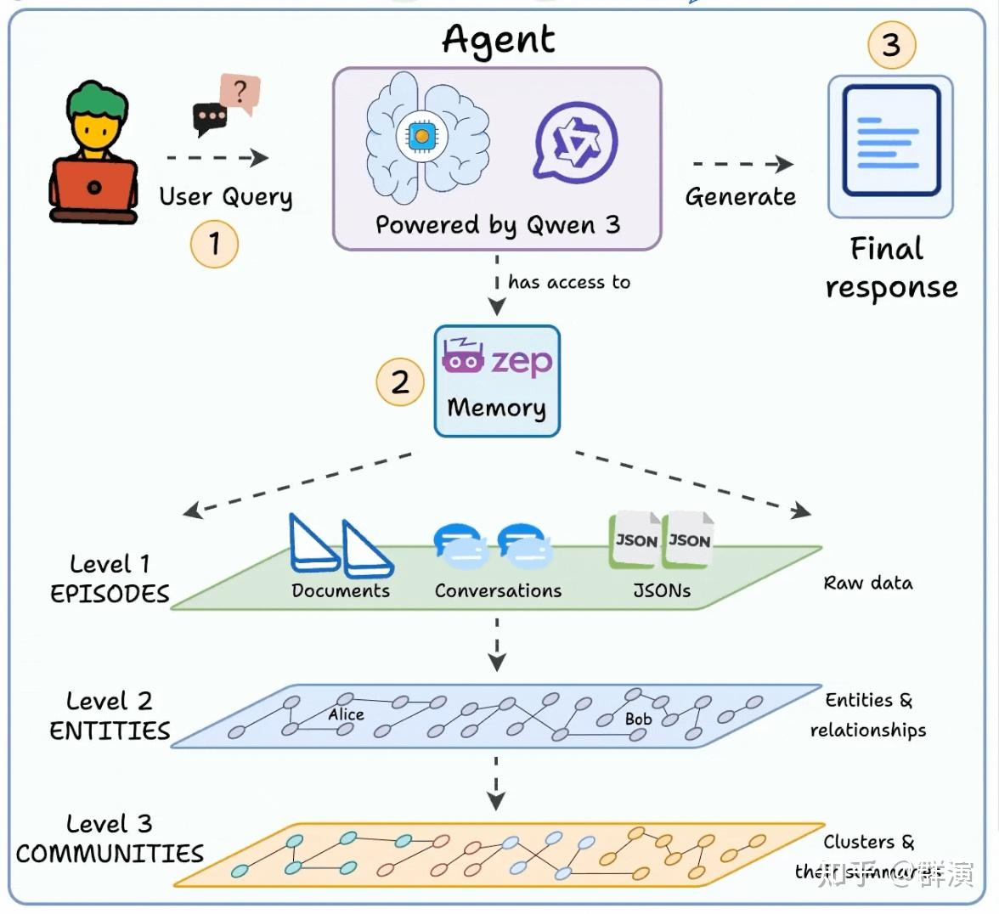
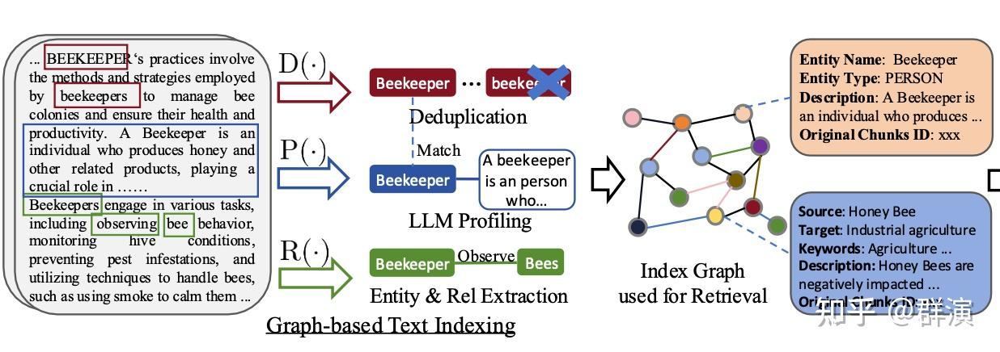
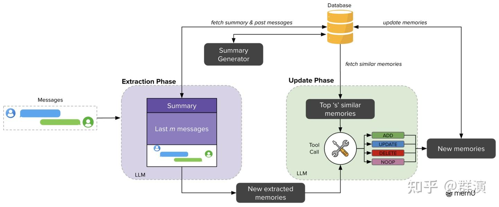
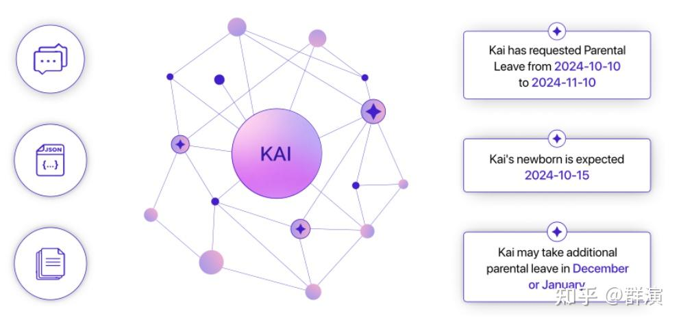
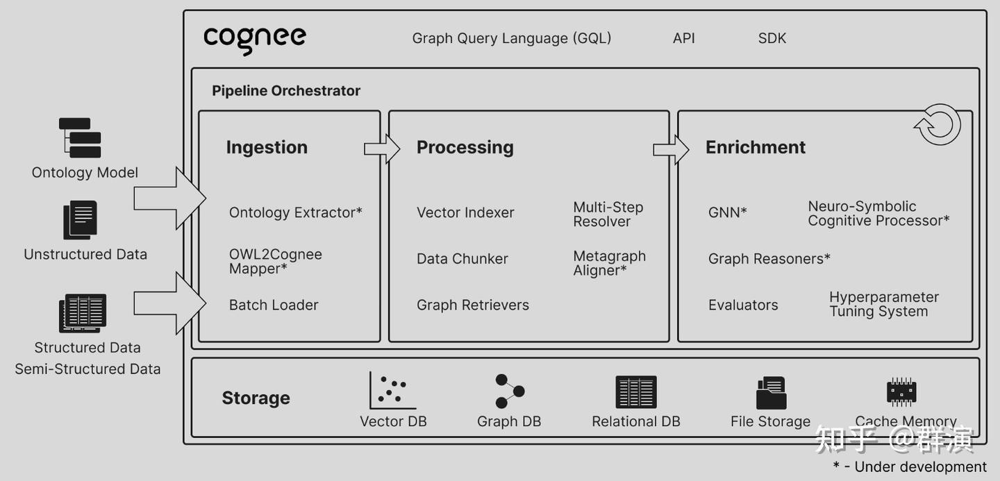
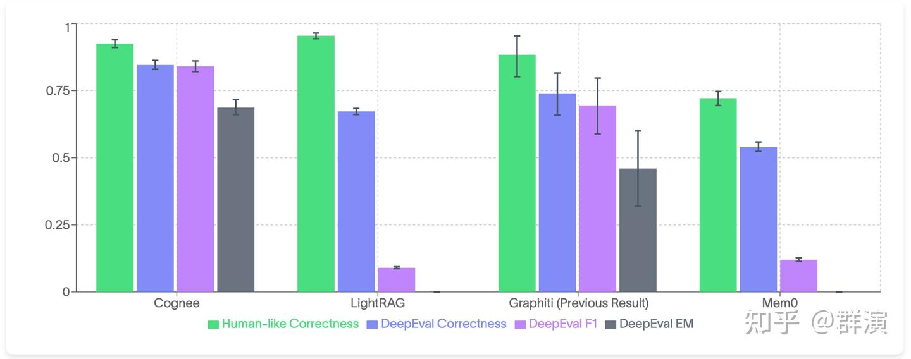
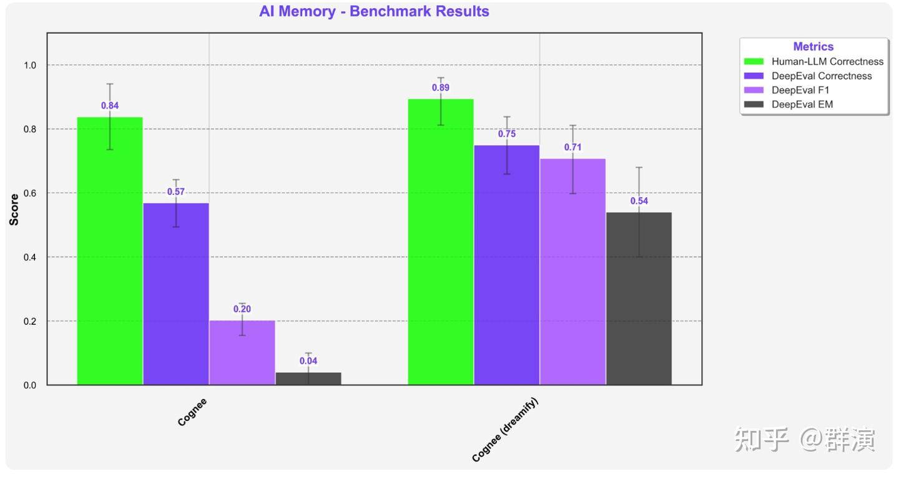

AI Agent落地最大瓶颈，大模型没有记忆。今天我们来看一下关于Agent Memory的一些工作，主要包括四个项目：LightRAG、Mem0、Graphiti (Zep)，以及当前效果最好的Agent记忆层：cognee。

#### 一、Agent记忆层是什么？

https://www.dailydoseofds.com/p/hands-on-build-an-ai-agent-with-human-like-memory/看这张图，我们可以清楚地理解Agent记忆层的本质。它就是让AI能够记住过往经验的核心组件。

当用户提问时，Agent不再是每次都从零开始思考，而是先从记忆层中调取相关信息。这个记忆层可能有多层架构，有原始数据（文档、对话、JSON等），有从原始数据提取出的关键实体和关系，也有根据原始数据或实体关系，进一步归纳总结形成的知识摘要等。

Agent记忆层的整个过程涉及四个关键环节：**知识提取**—从原始数据中识别重要信息，往往是构建知识图谱；**存储**—将知识结构化保存在向量数据库或图数据库中；**检索**—根据查询快速找到相关记忆；**更新**—随着新信息不断完善已有知识（比如用户之前说喜欢咖啡，现在又说戒了）。这样，Agent就具备了"学习"能力，能够基于历史经验做出更准确的判断。

本文所说的几个记忆层的工作，其实与底层存储是独立的。底层一般需要依赖关系数据库、向量数据库、图数据库等多种基础设施。当然，也可以我是上篇文章介绍的多模态融合的数据库。

#### 二、Agent记忆层相关工作

**1. LightRAG：更聪明的“检索增强”引擎**

传统RAG系统依赖扁平化的文本块检索，缺乏对实体间复杂关系的理解，导致回答零散、缺乏全局一致性。LightRAG使用LLM从文本中提取实体和关系，构建知识图谱。

LightRAG的核心创新在于**两级检索，除了基础的实体和关系、还总结抽象主题和全局信息**。它先利用大模型从问题中提取出关键词，然后不仅在具体的实体层面进行搜索，还会在更高层的主题和概念层面进行检索。擅长处理需要融合多篇文档信息的复杂查询，回答更具综合性。

**例如：**你问“电动汽车如何影响城市空气质量和公共交通？” LightRAG不仅会找“电动汽车”、“空气质量”的具体资料，还会检索“环保政策”、“城市规划”等更高层的主题，从而给你一个更全面、更有深度的回答。

**2. Mem0：专注对话的记忆管家**

Mem0是专为多轮对话Agent设计的记忆系统。它的目标是让Agent能记住跨会话的用户信息[。](https://zhuanlan.zhihu.com/write)它将记忆表示为有向图，支持复杂推理。

如上图所示，它会在对话过程中动态地提取记忆，并用一个大模型作为“裁判”，实时判断这条新记忆是需要**新增**、**更新**已有记忆、**否定**旧记忆，还是**忽略**。并且做到了以极低的延迟和token消耗。

**3. Graphiti (Zep)：企业级时序知识图谱**

Zep是一个商业化的记忆平台，其核心是名为Graphiti的时序知识图谱引擎，也是个开源项目。从知识图谱结构上与LightRAG类似，有**三层的图谱结构**，存储了原始对话的*情景层*、提取实体关系的*语义层*、自动聚类并总结的高层摘要层。相比上面两个工作，它还在工程方面做了更多工作。

- **三层知识图谱，**除了原始数据和实体关系的语义图谱，Graphiti还支持Community Subgraph 。这里的Community可能翻译成主题比较好理解。它自动将语义图谱中高度关联的实体聚类，形成一个Community(主题)，并为每个主题生成一个**摘要**。这相当于自动生成了知识的“目录”和“章节概要”，使得系统能够进行更**全局性、主题性的检索**，而不仅仅是实体关系检索。
- **双时间模型**，记录事实本身的发生时间和被系统录入的时间。当新信息与旧信息冲突时，Zep不是简单地删除旧记忆，而是**标记旧关系的失效时间**。例如，用户说“我住在北京”（生效日期：2023-01-01），后来又说“我搬到上海了”（生效日期：2024-01-01）。Zep会保留“住在北京”的关系，但为其设置一个失效日期，同时创建“住在上海”的新关系。这完整保留了历史记录，支持“你以前住在哪里？”这类时序推理。

#### 三、Cognee的架构与创新

就在大家在不同方向上探索时，Cognee另辟蹊径，取得了当前最好的综合评测效果。

**1. Cognee架构**

Cognee是一个开源的端到端知识图谱构建与检索框架。它的流程非常清晰，称为 **ECL（Extract-Cognify-Load）** 流水线：

- **Extract (提取)**：摄入文本、图片等各种格式的原始数据。
- **Cognify (认知化)**：利用大模型将从数据中提取出的实体和关系，转换成结构化的知识图谱。
- **Load (加载)**：将处理好的知识存储到图数据库、向量数据库等，以备检索。
**2. Cognee创新：系统性超参数优化框架**

从架构和流程上看，Cognee似乎与前面三个工作并没有什么不同。实际上，Cognee的核心贡献和创新在于超参调优。

做过RAG项目的同学肯定有这个经验，像分块大小、检索方式、提示词模板等这些**超参数**，对最终效果的影响很大，而以往这些大多依赖开发者的经验手动设置。Cognee论文中列了以下6个：

- `chunk_size`: 文本分块大小（例如：200, 500, 1000个token）
- `search_type`: 检索策略（例如：用矢量搜索文本块 vs 用图谱搜索三元组）
- `top_k`: 检索返回的项目数量（例如：3, 5, 10）
- `qa_system_prompt`: 用于生成答案的提示词模板（例如：模板A, 模板B, 模板C）
- `graph_prompt`: 用于构建知识图谱的提示词模板
- `task_getter_type`: 数据处理方式（例如：是否生成摘要）
其他工作（MemO, Zep, LightRAG）大多采用**启发式（heuristic）或默认**的参数配置（例如分块大小、检索数量、提示词模板）。Cognee则专门研究了这个问题，**把整条 KG-RAG-LLM 流水线当作“可优化目标函数”来做超参搜索**（上面的6个超参）。构建了超参数优化框架**Dreamify**，使用**Tree-structured Parzen Estimator (TPE)** 算法，对整个流水线的关键参数进行了**自动化、系统性的搜索和调优**。

- **自动化实验**：Dreamify会自动地用不同的参数组合（比如分块大小500还是1000？用A提示词还是B提示词？）去运行整个**Cognee流水线**，并使用评估框架对结果进行打分。
- **智能策略**：为了高效探索参数空间，找到最佳配置。它采用一种叫**TPE**的优化算法。**

- 初始阶段，TPE会先进行几轮（比如10轮）随机搜索**，以初步探索整个参数空间，积累一些初始数据。
- 迭代优化阶段，TPE会根据目前所有的历史实验结果，将结果分为“好”和“差”两组。例如，将得分最高的20%的实验划为“好配置”，剩下的80%划为“差配置”。然后计算每个参数的概率分布模型，**一个参数值在“好配置”中出现的概率越高，那它“期望提升”就越大，就越值得被尝试。**
- 随着实验次数的增加，TPE对概率分布的估计越来越准，它提议的参数也会越来越趋近于全局最优解附近。

- **结果导向**：Cognee的配置是**数据驱动和任务驱动**的，整个过程完全围绕特定任务（如多跳问答）的**评测指标**（如正确率）进行优化，确保调出的配置就是为高分而生的。
**简单说，Cognee的优势，在于它通过自动化实验迭代，为特定任务找到了一个“最优配置组合”**。

#### 四、评测结果

https://www.cognee.ai/research-and-evaluation-results这个是Cognee官网上的评测结果，Cognee展现出了显著的技术优势。在四个关键评估维度中，Cognee在DeepEval Correctness（0.84）、DeepEval F1（0.83）和DeepEval EM（0.68）三项指标上均取得最高分，体现了其在准确性和完整性方面的表现。

虽然LightRAG在Human-like Correctness单项指标上略胜一筹（0.955 vs 0.925），但其在其他关键指标上表现不佳，特别是DeepEval F1仅为0.08，显示出严重的不平衡问题。相比之下，Cognee在所有维度上都保持了稳定的高水准表现。

Cognee的这一表现得益于Dreamify的超参数优化技术，下图是初始状态和经过Dreamify优化的结果，对比提升明显。

> 对这些项目的评估，采用了HotpotQA 测试集*--由卡内基梅隆大学 (CMU)、斯坦福等机构联合提出，是最早被广泛使用的多跳问答数据集之一。给定一个问题，模型需要在 Wikipedia 文档集合中找到相关段落，往往需要结合多个文档中的事实才能得到答案（例如“X 的丈夫在哪所大学任教？”需要先找到 X 的丈夫是谁，再找到他在哪工作）。*
主要评估指标：
Human-like Correctness：是指由人工对结果进行手动标注，核查事实准确性。
DeepEval Correctness：利用 LLM 作为裁判，判断模型输出与标准答案在语义上是否一致。
DeepEval F1：衡量模型输出和标准答案在词级别上的重叠程度。
DeepEval EM：表示预测结果与标准答案完全一致的百分比。

#### 五、总结

虽然从评测结果看，Cognee的效果最好，其创新主要是在超参优化方面的工作，利用Dreamify对超参进行了多轮次的迭代调优，来达到最佳效果。实际上这四个项目各有侧重，LightRAG 的两级检索，Mem0的记忆更新机制，Graphiti (Zep)的三层知识图谱和双时间模型，都值得关注和尝试。

相关论文：

*[https://arxiv.org/pdf/2410.05779](https://link.zhihu.com/?target=https%3A//arxiv.org/pdf/2410.05779)*

*[https://arxiv.org/pdf/2504.19413](https://link.zhihu.com/?target=https%3A//arxiv.org/pdf/2504.19413)*

*[https://arxiv.org/pdf/2501.13956](https://link.zhihu.com/?target=https%3A//arxiv.org/pdf/2501.13956)*

*[https://arxiv.org/pdf/2505.24478](https://link.zhihu.com/?target=https%3A//arxiv.org/pdf/2505.24478)*