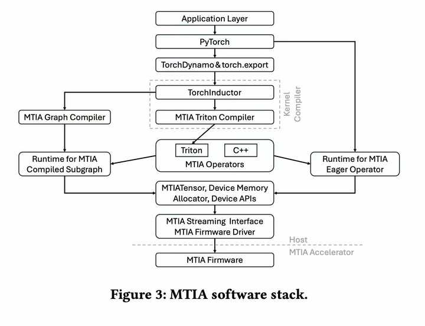
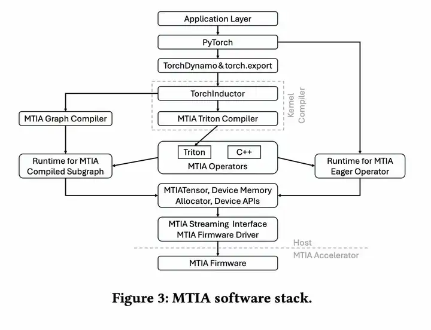
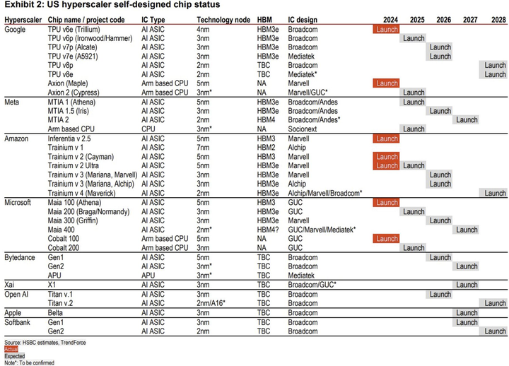
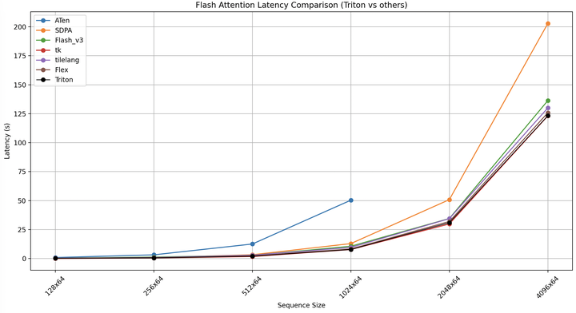
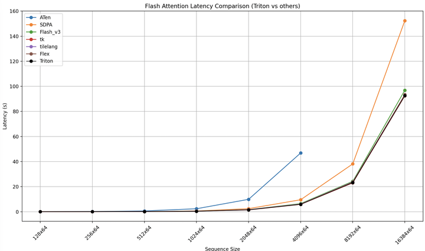
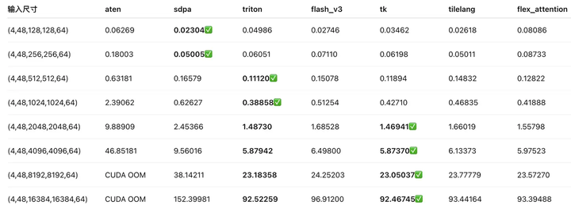
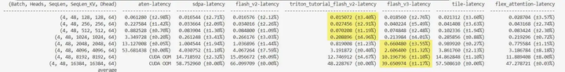
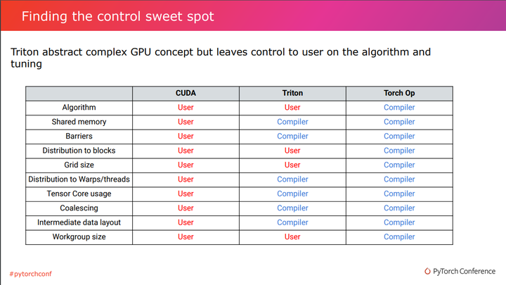
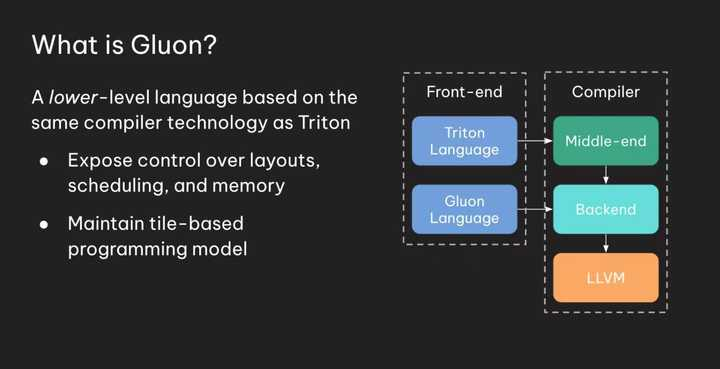
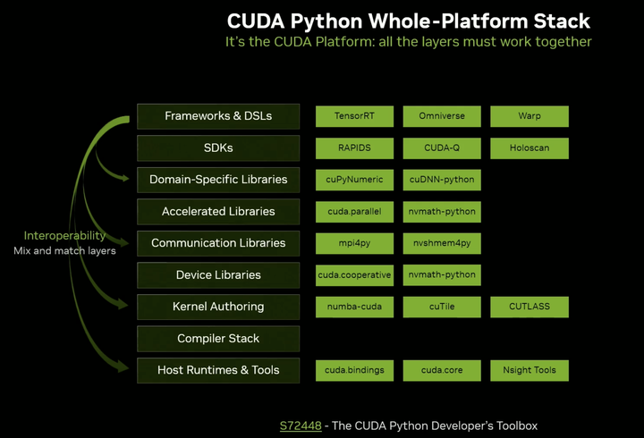

​目录

**冲击 **的意思是强烈影响、干扰、甚至动摇原有状态，可以看到CUDA从C/C++到拥抱Python了。另外冲击**不是取代**，硬件的秘密掌握在vendor手里，但是OpenAI利用Triton开源开了个窗口。顺便说一下Triton的核心开发者并不多，这是开源社区的力量。我幻想有一天硬件也能借助开源社区共同进步，具备研发实力的公司在 Triton 基础上进行扩展和定制，同样是非常有价值的。

作为一个Triton开发者+用户的角度来看，我认为是现在进行时。开发者层面我给Triton接入了一个backend，给upstream修复过bug；用户层面我写了四五十个Triton算子，进行过算子调优，诚然大多数情况是autotune和新feature的功劳。我有近3年编译器开发的经验，2023年5月我了解到Triton并开始关注，在此我写下我的看法。我去年的时候写了一篇Triton的执行流程分析文章，帮你揭秘下部分Triton源码，感兴趣可以去看看。

**2025.7.5更**

meta针对Triton再联合自己的Pytorch自研芯片MTIA的软件栈

还看到了一个来自于HSBC estimates, TrendForce的报告介绍了这些大厂在卷芯片，当然这些主要是内部使用的，部分信息对的上，但不全对也。不过Triton坚持自己的编程模型在商业逻辑上能解释得通了。

### 一、性能对比

测试基于[pytorch-labs/tritonbench](https://link.zhihu.com/?target=https%3A//github.com/pytorch-labs/tritonbench)，感谢作者的开源。

我的测试环境GPU H20 SXM 96GB * 1，CPU: 16 核， 内存: 154 GB。本机CUDA 12.8, Driver Version: 550.127.05。Conda内Python3.12.11，torch 2.8.0.dev20250623+cu128，pytorch-triton==3.3.1+gitc8757738(May 14, 2025)，flash_attn_3==3.0.0b1(Mar 5, 2025)，tilelang==0.1.3(Mar 23, 2025)，ThunderKittens(tk)用的是87fa717(Apr 8, 2025)。以下的原始bench json在[h20_test_json](https://link.zhihu.com/?target=https%3A//github.com/OpenMLIR/tritonbench/tree/add-h20-test-data/h20_test_json)

我们以flash_attention，head=128，batch=32 为例

aten：原始 PyTorch 实现，最慢，超大规模下会 OOM。

sdpa：torch.nn.functional.scaled_dot_product_attention（现代版本 PyTorch 内置优化）

我们可以看到Triton性能在开源kernel集里非常优秀。h20(中国特供)是被遗忘的hopper架构，flash_attention_v3并没有针对它优化，所以也不快

head=48，batch=4的数据

详细数据表

朋友在h100的详细数据表，flash_v3快起来了。还是得靠头部算子工程师

在一些不常见or旧卡上Triton的性能比较exciting非常正常，毕竟不是每个算子工程师都非常了解Nvidia的架构。来做这件一件事商业价值不高，直接用编译器工程师的优化经验吧。

### 二、Triton的设计哲学

Triton作者Tillet关于其设计的论文发表在MAPL2019，其设计了多层 tiling、自动优化等核心特性，希望通过 类C语言（MLIR重构后变Python）的DSL + 编译器 支持 tile 编程。Triton牺牲部分通用性换来DSL的简洁，Triton不用关心线程组织，只需要关心 tile 和 核心部分hardcode float的配置。Triton在不改变编程模型的前提下支持Nvidia显卡最新的feature也非常快，用户很容易拿到甜点性能。

在Triton代码的编写中我们更关心一个Block，用户不需要感知shared memory。Triton借助Layout设计以及Pass优化，能够减轻用户写kernel的负担，也能保证一定的性能，关于Triton和CUDA的对比如下图所示，来源[Pytorch2023会议](https://link.zhihu.com/?target=https%3A//static.sched.com/hosted_files/pytorch2023/2c/Triton_compiler.pdf)

**一句话解释** 关注影响性能的核心，避免过度关注硬件spec，让编译器去解决它能处理的abstract部分。

### 三、Triton的优点

#### 1、好写

Triton写起来好写吗，对于AI算法工程师可能几小时/天就入门了，写出Pytorch在tensor级别的实现，然后tile下，剩下的交给autotune和编译器。对于CUDA算子工程师确实看不上Triton的性能，Triton在部署方面不太行。另外你写的Triton kernel不一定比aten快，如果是新算子能快速验证还是挺好的。

#### 2、后端多

Triton的初衷是要中立的算子编译器，其中有[nvidia](https://link.zhihu.com/?target=https%3A//github.com/triton-lang/triton/tree/main/third_party/nvidia)、[amd](https://link.zhihu.com/?target=https%3A//github.com/triton-lang/triton/tree/main/third_party/amd)后端，还有一个triton-cpu的项目维护[cpu](https://link.zhihu.com/?target=https%3A//github.com/triton-lang/triton-cpu)后端，intel自己维护了[xpu](https://link.zhihu.com/?target=https%3A//github.com/intel/intel-xpu-backend-for-triton/tree/main/third_party/intel)后端。国产卡随着[FlagTree](https://link.zhihu.com/?target=https%3A//github.com/FlagTree/flagtree)的开源，有[华为昇腾](https://link.zhihu.com/?target=https%3A//gitee.com/ascend/triton-ascend/tree/master/ascend)、[摩尔线程](https://link.zhihu.com/?target=https%3A//github.com/FlagTree/flagtree/tree/main/third_party/mthreads)、[沐曦](https://link.zhihu.com/?target=https%3A//github.com/FlagTree/flagtree/tree/main/third_party/metax)、[昆仑芯](https://link.zhihu.com/?target=https%3A//github.com/FlagTree/flagtree/tree/main/third_party/xpu)、[ARM china](https://link.zhihu.com/?target=https%3A//github.com/FlagTreeZhouyi/flagtree-zhouyi/tree/master/third_party/aipu)、[清微智能](https://link.zhihu.com/?target=https%3A//github.com/FlagTree/flagtree/tree/triton_v3.3.x/third_party/tsingmicro)、[天数智芯](https://link.zhihu.com/?target=https%3A//github.com/FlagTree/flagtree/tree/main/third_party/iluvatar)、[寒武纪](https://link.zhihu.com/?target=https%3A//github.com/FlagTree/flagtree/tree/main/third_party/cambricon) 共8个开源后端。其他公司也有做，但是没开源。

#### 3、享受Python生态

由于是Python的，可以享受到Pytorch的无感接入，不需要malloc、launch等API，非常简洁。对答案非常方便，零拷贝。在此基础上接入各种各样的后端，你会发现编译器开发都变得简单起来了，因为我们开发的就是Pytorch的AI算子。正因为无缝衔接Python生态，Pytorch、vllm、sglang都接入了Triton。

#### 4、AI辅助

由于**抽象层级**比较高，简单的kernel AI直接能写，复杂的Kernel也能给你很好的提示。比困在CUDA里的感觉好很多，你关心的tile是核心的，虽然不一定是全局最优解。AI帮忙debug调优的水平也很高。

### 四、一些思考和缺点

#### 1、弯道超车

硬件厂商直接接入Triton听起来好像是件弯道超车的事情，Nvidia有自己打磨多年的CUDA编译器工具链，抛弃历史包袱直面最新的挑战。实际上No Silver Bullet，编译优化逃不掉的。国产卡为了活下去还是要手搓算子的，但是不预研Triton下个时代可能被淘汰。下一代架构的芯片在这个问题上就轻松的多，可以all in。

#### 2、保持硬件中立

有了这么多后端，Triton好像实现了统一GPU编程的前端的问题。目前依旧很中立，也许是OpenCL的前车之鉴吧。

Triton目前非常严格得控制着自己的编程模型。这一点有点像语言委员会，或许他们的心目中理想硬件就应该是他们坚守的编程模型模样。如果有一天Triton影响力足够大了，对着这套编程模型去设计硬件是件非常excting的事情。

#### 3、带来的限制

Triton现在不太好debug，而且为了中立感知不到其他warp，会带来一些限制，会影响性能。比如softmax一行处理的足够多，要么[单个Block规约](https://link.zhihu.com/?target=https%3A//github.com/OpenMLIR/LeetGPU/blob/main/12-softmax/Triton/reduce_in_one_block.py)，要么[多个kernel](https://link.zhihu.com/?target=https%3A//github.com/OpenMLIR/LeetGPU/blob/main/12-softmax/Triton/three_kernel.py)，还算快。比如Warp Specialize性能相对较弱，需要把底层的东西重新引入进来。

### 五、未来展望

#### 1、向下追求性能

用户写起来是爽到了，但是性能呢，在开源的kernel集里还可以，但是要继续压榨需要自己开发Triton源码。[facebookexperimental/triton](https://link.zhihu.com/?target=https%3A//github.com/facebookexperimental/triton/tree/tlx) meta在搞TLX (Triton Low-level Language Extensions)，把 warp-aware, hardware-near 带回Triton，以求拿到性能。把 Low-level 带回Triton也是有收益的，能拿到性能，缺点就是Triton也要变成NVIDIA的形状。

Triton upstream想到的办法是Gluon，使用其来进行内存，layout，调度等细粒度控制，本质是写Triton GPU IR。[https://github.com/triton-lang/triton/tree/main/python/tutorials/gluon](https://link.zhihu.com/?target=https%3A//github.com/triton-lang/triton/tree/main/python/tutorials/gluon)  这是官方的tutorials

#### 2、向上追求抽象/性能

NPU/DSA的粒度相比GPGPU要更粗，造一整套工具链轮子和打磨多年CUDA的竞争是非常难的，也可以直接在Triton上做适配。[microsoft/triton-shared](https://link.zhihu.com/?target=https%3A//github.com/microsoft/triton-shared) 最先对lower到linalg这个层级的dialect做了探索，拿到了不错的效果，后续的很多项目都基于此做了实现。另外当前Triton的Op定义对于这种粗粒度的硬件是**远远不够**的，[python/triton/language/standard.py](https://link.zhihu.com/?target=https%3A//github.com/triton-lang/triton/blob/main/python/triton/language/standard.py) 文件里我们可以看到有些函数如sigmoid是直接用的数学实现，这些在NPU/DSA往往有自己的lower路径，另外硬件可能提供了更多的函数抽象需要在Triton这边扩展。抽象`High-level Op`比提供`Low-level op`影响相对小一点，毕竟NPU/DSA声量也不够大，基本还在手搓算子甚至是IR。AI后时代可能就是`High-level` 的 比拼，我在去年9月也提出过一个观点“其他家在变成nv的形状，nv在变得像DSA”。

#### 3、Nvidia的行动

受到Triton的冲击后，Nvidia在拥抱Python，[CUDA: New Features and Beyond](https://link.zhihu.com/?target=https%3A//www.nvidia.com/en-us/on-demand/session/gtc25-s72383)。最近也是release了CuTeDSL，以CuTe抽象为中心，kernel在thread级别，性能会更好。暴露了一些接口，但是写kernel负担依旧很重。更值得算法工程师和普通开发者期待的是cuTile，是对标Triton的，期待vendor大力出奇迹。

### 六、Pythonic is future!

浙江每年能产出5w个**高考生**会写Python，大多数大学工科的编程语言也都换成了**Python**。Python势不可挡，别哪天成为**CS/SW/EE**的第一门编程课了。

**Pythonic is future!** 也许未来已来，让我们拭目以待。 

我的其他相关文章

[编辑于 2025-09-17 21:06](//www.zhihu.com/question/1919763006750975400/answer/1921121681612739823)・上海

​6 条评论​411 ​12 ​分享

​​

收起​