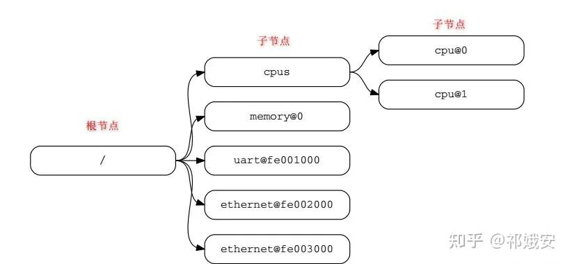
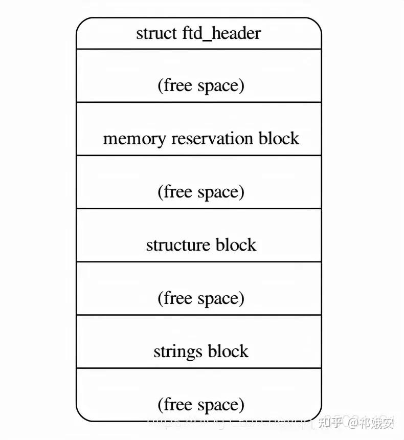
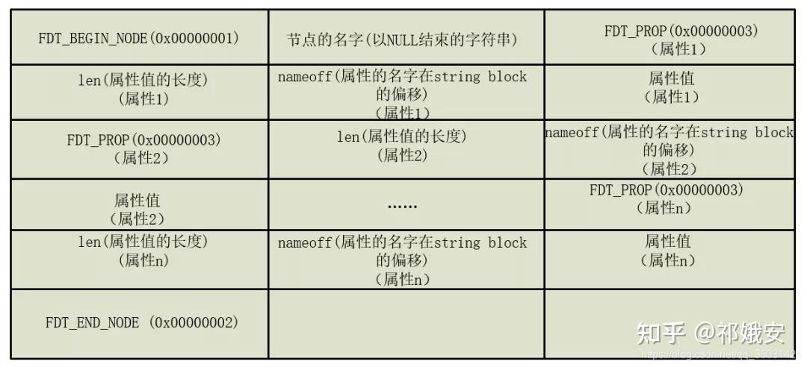
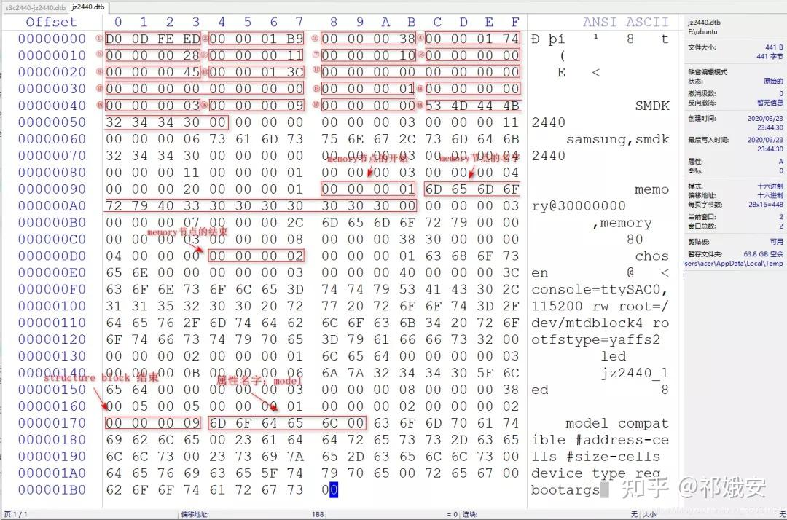
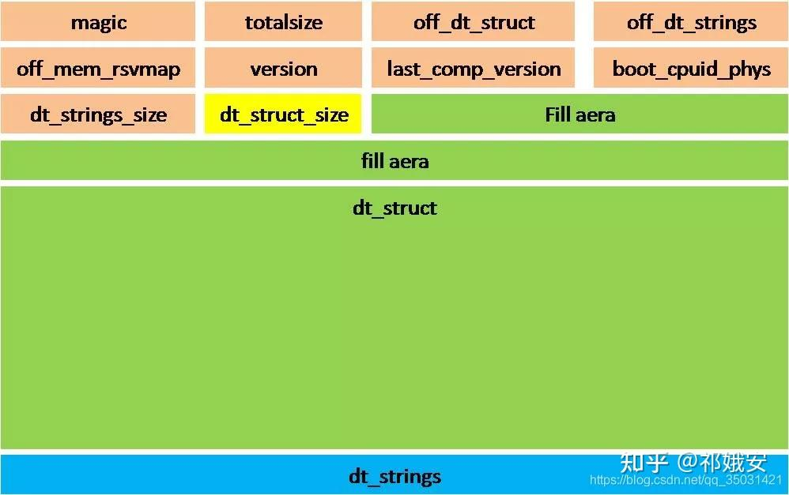
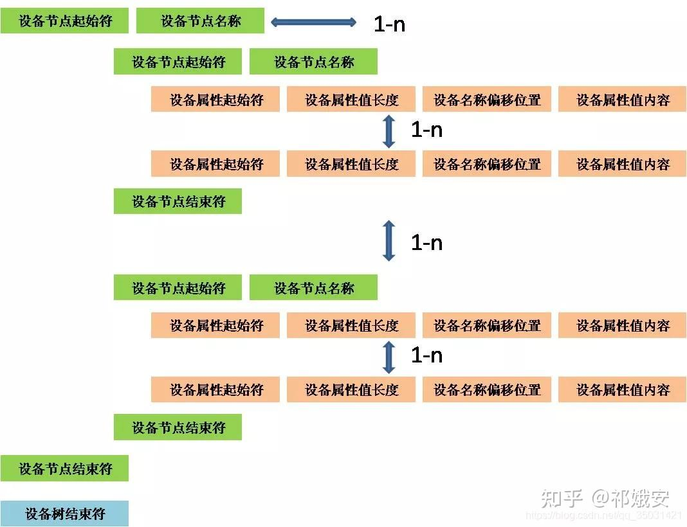

设备树是一种描述硬件的数据结构，它起源于OpenFirmware（OF）。

在Linux 2.6中， ARM架构的板极硬件细节过多地被硬编码在arch/arm/plat-xxx和arch/arm/mach-xxx中，采用设备树后，许多硬件的细节可以直接通过它传递给Linux，而不再需要在内核中进行大量的冗余编码。

### **1. linux设备树中DTS、 DTC和DTB的关系**

- (1) DTS：.dts文件是设备树的源文件。由于一个SoC可能对应多个设备，这些.dst文件可能包含很多共同的部分，共同的部分一般被提炼为一个 .dtsi 文件，这个文件相当于C语言的头文件。
- (2) DTC：DTC是将.dts编译为.dtb的工具，相当于gcc。
- (3) DTB：.dtb文件是 .dts 被 DTC 编译后的二进制格式的设备树文件，它可以被linux内核解析。

### **2. DTS语法**

### **2.1 .dtsi 头文件**

和 C 语言一样，设备树也支持头文件，设备树的头文件扩展名为 .dtsi；同时也可以像C 语言一样包含 .h头文件；例如：（代码来源 linux-4.15/arch/arm/boot/dts/s3c2416.dtsi）

`#include 
#include "s3c24xx.dtsi"
`

注：.dtsi 文件一般用于描述 SOC 的内部外设信息，比如 CPU 架构、主频、外设寄存器地址范围，比如 UART、 IIC 等等。

### **2.2 设备节点**

在设备树中节点命名格式如下：

`node-name@unit-address
`

**node-name：**是设备节点的名称，为ASCII字符串，节点名字应该能够清晰的描述出节点的功能，比如“uart1”就表示这个节点是UART1外设；**unit-address：**一般表示设备的地址或寄存器首地址，如果某个节点没有地址或者寄存器的话 “unit-address” 可以不要；注：根节点没有node-name 或者 unit-address，它被定义为 /。

设备节点的例子如下图：

**

在上图中：cpu 和 ethernet依靠不同的unit-address 分辨不同的CPU；可见，node-name相同的情况下，可以通过不同的unit-address定义不同的设备节点。**

### **2.2.1 设备节点的标准属性**

#### **2.2.1.1 compatible 属性**

compatible 属性也叫做 “兼容性” 属性，这是非常重要的一个属性！compatible 属性的值是一个字符串列表， compatible 属性用于将设备和驱动绑定起来。字符串列表用于选择设备所要使用的驱动程序。compatible 属性值的推荐格式：

`"manufacturer,model"
`

- ① manufacturer : 表示厂商；
- ② model : 一般是模块对应的驱动名字。
例如：

`compatible = "fsl,mpc8641", "ns16550";
`

上面的compatible有两个属性，分别是 "fsl,mpc8641" 和 "ns16550"；其中 "fsl,mpc8641" 的厂商是 fsl；设备首先会使用第一个属性值在 Linux 内核里面查找，看看能不能找到与之匹配的驱动文件；

如果没找到，就使用第二个属性值查找，以此类推，直到查到到对应的驱动程序 或者 查找完整个 Linux 内核也没有对应的驱动程序为止。

**注：一般驱动程序文件都会有一个 OF 匹配表，此 OF 匹配表保存着一些 compatible 值，如果设备节点的 compatible 属性值和 OF 匹配表中的任何一个值相等，那么就表示设备可以使用这个驱动。
#### 2.2.1.2 model 属性**

model 属性值也是一个字符串，一般 model 属性描述设备模块信息，比如名字什么的，例如：

`model = "Samsung S3C2416 SoC";
`

#### **2.2.1.3 phandle 属性**

phandle属性为devicetree中唯一的节点指定一个数字标识符，节点中的phandle属性，它的取值必须是唯一的(不要跟其他的phandle值一样)，例如：

`pic@10000000 {
    phandle = ;
    interrupt-controller;
};
another-device-node {
    interrupt-parent = ;   // 使用phandle值为1来引用上述节点
};
`

**注：DTS中的大多数设备树将不包含显式的phandle属性，当DTS被编译成二进制DTB格式时，DTC工具会自动插入phandle属性。
#### 2.2.1.4 status 属性**

status 属性看名字就知道是和设备状态有关的， status 属性值也是字符串，字符串是设备的状态信息，可选的状态如下表所示：

status值描述
#### **2.2.1.5 #address-cells 和 #size-cells**

#address-cells 和 #size-cells的值都是无符号 32 位整型，可以用在任何拥有子节点的设备中，用于描述子节点的地址信息。#address-cells 属性值决定了子节点 reg 属性中地址信息所占用的字长(32 位)， #size-cells 属性值决定了子节点 reg 属性中长度信息所占的字长(32 位)。#address-cells 和 #size-cells 表明了子节点应该如何编写 reg 属性值，一般 reg 属性都是和地址有关的内容，和地址相关的信息有两种：起始地址和地址长度，reg 属性的格式一为：

`reg = 
`

例如一个64位的处理器：

`soc {
    #address-cells = ;
    #size-cells = ;
    serial {
        compatible = "xxx";
        reg = ;  /*地址信息是：0x00004600 00005000,长度信息是：0x100*/
        };
};
`

#### **2.2.1.6 reg 属性**

reg 属性的值一般是 (address， length) 对，reg 属性一般用于描述设备地址空间资源信息，一般都是某个外设的寄存器地址范围信息。

例如：一个设备有两个寄存器块，一个的地址是0x3000，占据32字节；另一个的地址是0xFE00，占据256字节，表示如下：

`reg = ;
`

**注：上述对应#address-cells = ; #size-cells = ;。
#### 2.2.1.7 ranges 属性**

ranges属性值可以为空或者按照 (child-bus-address,parent-bus-address,length) 格式编写的数字矩阵， ranges 是一个地址映射/转换表， ranges 属性每个项目由子地址、父地址和地址空间长度这三部分组成：

- child-bus-address：子总线地址空间的物理地址，由父节点的 #address-cells 确定此物理地址所占用的字长。
- parent-bus-address：父总线地址空间的物理地址，同样由父节点的 #address-cells 确定此物理地址所占用的字长。
- length：子地址空间的长度，由父节点的 #size-cells 确定此地址长度所占用的字长。
`soc {
    compatible = "simple-bus";
    #address-cells = ;
    #size-cells = ;
    ranges = ;
    serial {
        device_type = "serial";
        compatible = "ns16550";
        reg = ;
        clock-frequency = ;
        interrupts = ;
        interrupt-parent = ;
        };
};
`

节点 soc 定义的 ranges 属性，值为 ，此属性值指定了一个 1024KB(0x00100000) 的地址范围，子地址空间的物理起始地址为 0x0，父地址空间的物理起始地址为 0xe0000000。

serial 是串口设备节点，

reg 属性定义了 serial 设备寄存器的起始地址为 0x4600，寄存器长度为 0x100。

经过地址转换， serial 设备可以从 0xe0004600 开始进行读写操作，0xe0004600=0x4600+0xe0000000。

#### **2.2.1.8 name 属性**

name 属性值为字符串， name 属性用于记录节点名字， name 属性已经被弃用，不推荐使用name 属性，一些老的设备树文件可能会使用此属性。

#### **2.2.1.9 device_type 属性**

device_type 属性值为字符串， IEEE 1275 会用到此属性，用于描述设备的 FCode，但是设备树没有 FCode，所以此属性也被抛弃了。此属性只能用于 cpu 节点或者 memory 节点。

`memory@30000000 {
    device_type = "memory";
    reg =  ;
};
`

#### **2.2.2 根节点**

每个设备树文件只有一个根节点，其他所有的设备节点都是它的子节点，它的路径是 /。根节点有以下属性：

属性属性值类型描述例如：compatible = "samsung,smdk2440","samsung,s3c24xx" ,内核会优先寻找支持smdk2440的machinedesc结构体，如果找不到才会继续寻找支持s3c24xx的machine_desc结构体(优先选择第一项，然后才是第二项，第三项……)

#### **2.2.3 特殊节点**

#### **2.2.3.1 /aliases 子节点**

aliases 节点的主要功能就是定义别名，定义别名的目的就是为了方便访问节点。

例如：定义 flexcan1 和 flexcan2 的别名是 can0 和 can1。

`aliases {
    can0 = &flexcan1;
    can1 = &flexcan2;
};
`

#### **2.2.3.2 /memory 子节点**

所有设备树都需要一个memory设备节点，它描述了系统的物理内存布局。如果系统有多个内存块，可以创建多个memory节点，或者可以在单个memory节点的reg属性中指定这些地址范围和内存空间大小。

例如：一个64位的系统有两块内存空间：RAM1：起始地址是0x0，地址空间是 0x80000000；RAM2：起始地址是0x10000000，地址空间也是0x80000000；同时根节点下的 #address-cells = 和#size-cells = ，这个memory节点描述为：

`memory@0 {
    device_type = "memory";
    reg = ;
};
`

或者：

`memory@0 {
    device_type = "memory";
    reg = ;
};
memory@10000000 {
    device_type = "memory";
    reg = ;
};
`

#### **2.2.3.3 /chosen 子节点**

chosen 并不是一个真实的设备， chosen 节点主要是为了 uboot 向 Linux 内核传递数据，重点是 bootargs 参数。例如：

`chosen {
    bootargs = "root=/dev/nfs rw nfsroot=192.168.1.1 console=ttyS0,115200";
};
`

#### **2.2.3.4 /cpus 和 /cpus/cpu* 子节点**

cpus节点下有1个或多个cpu子节点, cpu子节点中用reg属性用来标明自己是哪一个cpu，所以 /cpus 中有以下2个属性:

`#address-cells   // 在它的子节点的reg属性中, 使用多少个u32整数来描述地址(address)

#size-cells      // 在它的子节点的reg属性中, 使用多少个u32整数来描述大小(size)
                 // 必须设置为0
`

例如：

`cpus {
    #address-cells = ;
    #size-cells = ;
    cpu@0 {
        device_type = "cpu";
        reg = ;
        cache-unified;
        cache-size = ; // L1, 32KB
        cache-block-size = ;
        timebase-frequency = ; // 82.5 MHz
        next-level-cache = ; // phandle to L2
        L2_0:l2-cache {
            compatible = "cache";
            cache-unified;
            cache-size = ; // 256 KB
            cache-sets = ;
            cache-block-size = ;
            cache-level = ;
            next-level-cache = ; // phandle to L3
            L3:l3-cache {
                compatible = "cache";
                cache-unified;
                cache-size = ; // 256 KB
                cache-sets = ; // 1024
                cache-block-size = ;
                cache-level = ;
                };
            };
        };
    cpu@1 {
        device_type = "cpu";
        reg = ;
        cache-unified;
        cache-block-size = ;
        cache-size = ; // L1, 32KB
        timebase-frequency = ; // 82.5 MHzclock-frequency = ; // 825 MHz
        cache-level = ;
        next-level-cache = ; // phandle to L2
        L2_1:l2-cache {
            compatible = "cache";
            cache-unified;
            cache-size = ; // 256 KB
            cache-sets = ; // 1024
            cache-line-size = ; // 32 bytes
            next-level-cache = ; // phandle to L3
            };
        };
};
`

#### **2.2.3.5 引用其他节点**

#### **2.2.3.5.1 phandle**

节点中的phandle属性, 它的取值必须是唯一的(不要跟其他的phandle值一样)

`pic@10000000 {
    phandle = ;
    interrupt-controller;
};

another-device-node {
    interrupt-parent = ;   // 使用phandle值为1来引用上述节点
};
`

#### **2.2.3.5.2 label**

`PIC: pic@10000000 {
    interrupt-controller;
};

another-device-node {
    interrupt-parent = ;   // 使用label来引用上述节点, 
                                 // 使用lable时实际上也是使用phandle来引用, 
                                 // 在编译dts文件为dtb文件时, 编译器dtc会在dtb中插入phandle属性
};
`

#### **2.2.4 DTB格式**

.dtb文件是 .dts 被 DTC 编译后的二进制格式的设备树文件，它的文件布局如下：

从上图可以看出，DTB文件主要包含四部分内容：struct ftdheader、memory reservation block、structure block、strings block；

- ① struct ftdheader：用来表明各个分部的偏移地址，整个文件的大小，版本号等；
- ② memory reservation block：在设备树中使用/memreserve/ 定义的保留内存信息；
- ③ structure block：保存节点的信息，节点的结构；
- ④ strings block：保存属性的名字，单独作为字符串保存；
struct ftd_header结构体的定义如下：

`struct fdt_header {
    uint32_t magic; /*它的值为0xd00dfeed，以大端模式保存*/
    uint32_t totalsize; /*整个DTB文件的大小*/
    uint32_t off_dt_struct; /*structure block的偏移地址*/
    uint32_t off_dt_strings; /*strings block的偏移地址*/
    uint32_t off_mem_rsvmap; /*memory reservation block的偏移地址*/
    uint32_t version; /*设备树版本信息*/
    uint32_t last_comp_version; /*向后兼容的最低设备树版本信息*/
    uint32_t boot_cpuid_phys; /*CPU ID*/
    uint32_t size_dt_strings; /*strings block的大小*/
    uint32_t size_dt_struct; /*structure block的大小*/
};
`

fdtreserveentry结构体如下：

`struct fdt_reserve_entry {
    uint64_t address;  /*64bit 的地址*/
    uint64_t size;    /*保留的内存空间的大小*/
};
`

该结构体用于表示memreserve的起始地址和内存空间的大小，它紧跟在struct ftdheader结构体后面。

例如：/memreserve/ 0x33000000 0x10000，fdtreserve_entry 结构体的成员 address = 0x33000000，size = 0x10000。

structure block是用于描述设备树节点的结构，保存着节点的信息、节点的结构，它有5种标记类型:

- ① FDTBEGINNODE (0x00000001)：表示节点的开始，它的后面紧跟的是节点的名字；
- ② FDTENDNODE (0x00000002)：表示节点的结束；
- ③ FDTPROP (0x00000003) ：表示开始描述节点里面的一个属性，在FDTPROP后面紧跟一个结构体如下所示:
`struct {
    uint32_t len;       /*表示属性值的长度*/
    uint32_t nameoff;   /*属性的名字在string block的偏移*/
} 
`

注：上面的这个结构体后紧跟着是属性值，属性的名字保存在字符串块（Strings block）中。

- ④ FDT_END (0x00000009)：表示structure block的结束。
单个节点在structure block的存储格式如下图如所示：(注：子节点的存储格式也是一样)

总结：

- (1) DTB文件可以分为四个部分:struct ftdheader、memory reservation block、structure block、strings block；
- (2) 最开始的为struct ftdheader，包含其它三个部分的偏移地址；
- (3) memory reservation block记录保留内存信息；
- (4) structure block保存节点的信息，节点的结构；
- (5) strings block保存属性的名字，将属性名字单独作为字符串保存；

#### **2.2.5 DTB文件分析**

编译生成dtb文件的源设备树jz2440.dts文件如下：

`// SPDX-License-Identifier: GPL-2.0
/*
 * SAMSUNG SMDK2440 board device tree source
 *
 * Copyright (c) 2018 weidongshan@qq.com
 * dtc -I dtb -O dts -o jz2440.dts jz2440.dtb
 */

#define S3C2410_GPA(_nr)    ((0;
    #size-cells = ;

    memory@30000000 {
        device_type = "memory";
        reg =  ;
    };

    chosen {
        bootargs = "console=ttySAC0,115200 rw root=/dev/mtdblock4 rootfstype=yaffs2";
    };

    led {
        compatible = "jz2440_led";
        reg = ;
    };
};
`

jz2440.dtb 文件的内容如下：

接下来我们对应上图的编号逐一分析，其中编号①~⑩表示的是fdtheader 结构体的成员信息：

- ① 对应 magic，表示设备树魔数，固定为0xd00dfeed；
- ② 对应 totalsize，表示整个设备设dtb文件的大小，从上图可知0x000001B9正好是dtb文件的大小441B；
- ③ 对应 offdtstruct，表示structure block的偏移地址，为 0x00000038；
- ④ 对应offdtstrings，表示 strings block的偏移地址，为 0x00000174；
- ⑤ 对应 offmemrsvmap;，表示memory reservation block的偏移地址，为 0x00000028；
- ⑥ 对应 version ，设备树版本的版本号为0x11；
- ⑦ 对应 lastcompversion，向下兼容版本号0x10；
- ⑧ 对应 bootcpuidphys，在多核处理器中用于启动的主cpu的物理id，为0x0；
- ⑨ 对应 sizedtstrings，strings block的大小为 0x45；
- ⑩ 对应 sizedtstruct，structure block的大小为 0x0000013C；
- ⑪~⑫ 对应结构体 fdtreserve_entry ，它所在的地址为0x28，jz2440.dts 设备树文件没有设置 /memreserve/，所以address = 0x0，size = 0x0；
- ⑬ 所处的地址是0x38，它处在structure block中，0x00000001表示的是设备节点的开始；
- ⑭ 接着紧跟的是设备节点的名字，这里是根节点，所以为0x00000000；
- ⑮ 0x00000003 表示的是开始描述设备节点的一个属性；
- ⑯ 表示这个属性值的长度为0x09；
- ⑰ 表示这个属性的名字在strings block的偏移量是0，找到strings block的地址0x0174的地方，可知这个属性的名字是model；
- ⑱ 这个model属性的值是"SMDK2440"，加上字符串的结束符NULL，刚好9个字节；

#### **2.2.6 DTB文件结构图**

(1) dtb 文件的结构图如下：

Linux设备树语法规范 (2) 设备节点的结构图如下：

