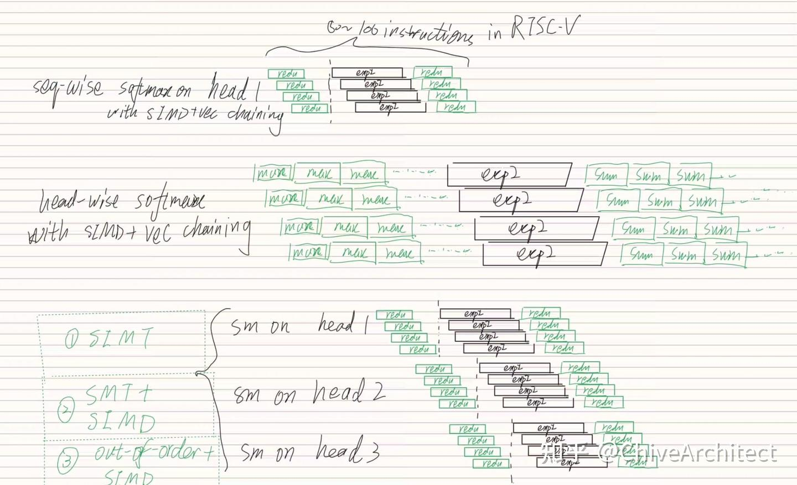

做 seq-wise softmax 典型的数据流是 reduce -> exp2 -> reduce。如果用 SIMD 来描述，做 reduce 的时候 exp2 闲置，做 exp2 的时候 reduce 闲置。Vector chaining 可以改善这种情况， 但是 reduce 没法 chaining，导致利用率还是上不去。是图里第一种情况。

MHA 和 MLA 里面，不同 head 的 softmax 是没有数据依赖的。因此，也可以选择对 head 维进行 vectorize，此时 reduce 操作就会变成 max 指令 和 sum 指令，但是顺序带来的 FU 闲置还是无法解决。是图里第二种情况。

总而言之，顺序的 vector SIMD core 没有足够的 instruction window 来挖掘 ILP 或者 TLP。

**

理论上，我知道 3 种技术路线可以同时从 seq-wise 和 head-wise 进行并行性挖掘：

- unroll 2 次的 SIMT，如果编译器足够智能
- 窗口足够大的 out-of-order + SIMD
- SMT + SIMD
假设 exp2 和 non-exp2 部分的时间对半开，那么顺序 vector core 的 FU 利用率只有上述三种方法的 1/2。在 满血 Flash attention 3 kernel 里，softmax 是需要匹配 fp8 gemm 算力的，softmax 的吞吐需求有可能会是 16 bit gemm 时代的 2 倍。

朋友，你有没有感觉回到了 Cray 那个时代**？out-of-order 最开始是用来提高 FU 利用率的，而不是用来克服 memory wall 的。

另外，从生态来讲，方法一在 CUDA 里面和写串行的代码没啥区别；方法二在足够牛 X 的乱序核里写 SIMD；方法三可能就必须让程序员写多线程的代码了。

还有一种思路：用 vector 拧巴地排多个 head 的指令，但是寄存器够不够用又是一个问题。生态？自然没有人愿意写这种代码……

这或许是一个缩影，解释了为什么 out-of-order 成为 CPU 的主流， SIMT 成为 GPGPU 的主流