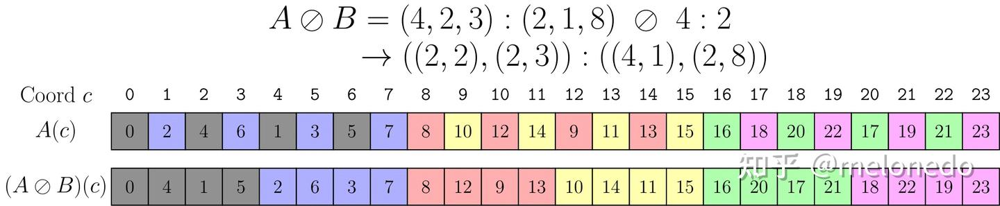
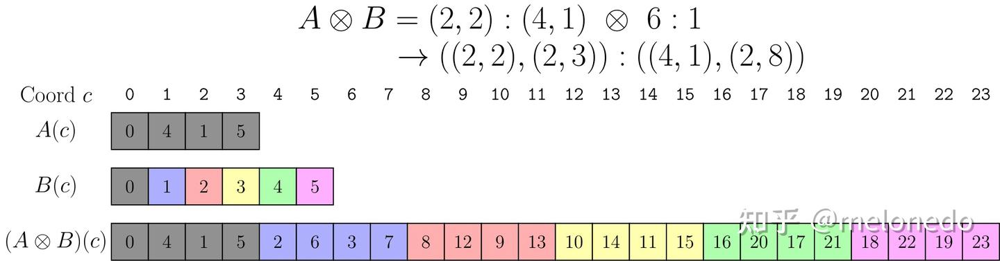

为了解决矩阵布局运算表达的困难，CuTe 使用了自己的[布局代数](https://link.zhihu.com/?target=https%3A//docs.nvidia.com/cutlass/media/docs/cpp/cute/02_layout_algebra.html)体系，但只作为一系列的记号，没有说明具体的使用范围等。这一体系在 Jay Shah 的论文 [A Note on the Algebra of CuTe Layouts](https://link.zhihu.com/?target=https%3A//research.colfax-intl.com/a-note-on-the-algebra-of-cute-layouts/) 里建立了较为完善的理论基础，不过稍显晦涩，[毛磊的博客](https://link.zhihu.com/?target=https%3A//leimao.github.io/article/CuTe-Layout-Algebra/)正好补充了这一点。

CuTe 布局涉及的布局类型很广泛，包括所有的整数的尺寸，只要在运算时合适即可。不过，实际使用时，核心的问题通常还是在 2 的幂次上表示，含有其他因子的维度通常语义较为简单，例如作为数组的一个维度表示 RGB 颜色，或是划分数组的上限，并不涉及复杂的运算。因此让我们聚焦 核心问题，借助 Triton 团队的[线性布局的论文](https://link.zhihu.com/?target=https%3A//arxiv.org/abs/2505.23819)，对比一下在 2 的幂次上布局运算在 CuTe 布局和线性布局都有哪些比较经典的运算。

### 布局定义

一个一维的布局是从一个整数到另一个整数的映射，而如果把输入输出的单个整数理解为多个维度，则也可以类似地定义成多维的布局，本文不作区分。 CuTe 中的布局由一对整数元组表示，记为L=S:D。例如L=(2,2,2):(2,4,1)表示将一个数连续除以 2（即形状的表达本身是列主序），得到的余数分别乘上 2、4、1。 同样的布局用线性布局表示为L=Mx=\begin{bmatrix}0 & 0 & 1 \\ 1 & 0 & 0 \\ 0 & 1 & 0\end{bmatrix}\begin{bmatrix}x_1 \\ x_2 \\ x_4\end{bmatrix}，意思是将输入拆成低位在前的二进制数，再左乘这个矩阵，这是一个定义在\mathbb F(2)上的线性映射，加法定义为异或。

在 CuTe 中，对于定义域以及陪域，用连续区间表示，定义了区间的大小分别为 size 和 cosize。size 显然根据 S 中的元素相乘即可计算。由于采取零开始的计数，因此陪域的大小是布局中最后一个元素加一，即cosize(L)=L(size(L)) + 1。最后一个元素显然是布局中最大的一个元素，因此 cosize 表示数组中元素最大是多少。 在线性布局中，由于区间大小都限定在了 2 的幂次，因此要计算定义域和陪域的大小，只需要查看这个数组的形状即可，行数对应陪域大小，列数对应定义域大小。

cosize是一个定义很不直观的概念，可以理解为一个布局占用的**连续**空间的大小，即使实际上只是每n个占用一个。

给定了定义域和陪域，对于值域的研究同样重要。在 CuTe 布局中，可以根据形状和跨度，计算出一个布局是否是满射或者是双射。而在线性布局中，可以根据矩阵中列的数量以及非全零的行的数量，也就是矩阵的秩进行判断。

### 布局运算

对于布局而言，最简单的运算是**拼接**（concatenation），在 CuTe 中通过`make_layout`函数实现，记为(L_1, L_2)。拼接的含义是，有两个的布局 L1 和 L2，将这两个布局合并为一个布局表示。这两个布局的定义域应该是互斥的，否则拼接运算可能并不太符合要求。 在 CuTe 中，可以直接通过拼接对应的 S 和 T 来完成，在线性布局中同样可以左右拼接两个布局对应的矩阵实现。或者，我更喜欢理解为也预先把这两个矩阵的对应位置填满零，然后用加法来表示拼接。

在 CuTe 中，由于布局的表达并不唯一，提供`coalesce`函数用于化简布局。

和所有的函数一样，布局的**复合**（composition）用\circ表示，可以将多个布局依次应用，来实现布局间的复杂变换。由于需要适应通用的定义域和陪域，因此 CuTe 的复合运算比较复杂，需要对形状和跨度逐个进行处理。相比之下，线性布局中的符合运算可以直接用矩阵相乘表示。

对于一个布局而言，我们经常关心这个布局是否是一个指定范围内的满射，例如判断一个布局能否遍历所有的内存。如果一个布局不是满射，经常需要将这个布局**补全**（complement）为到指定陪域的布局。 仍然以上述的L=(2,2,2):(2,4,1)为例，这是一个满射，如果我们把布局中的维度分为两半，L_1=2:4，L_2=(2,2):(2,1)，则L_1和L_2各自是在[0, 8)范围内的补，记为L_1=L_2^*。当然，我们接触到的大部分布局都是满射为主，这时候求补一般是因为要把陪域扩大到指定的大小，需要在布局的最后再补上若干个连续的维度。

在线性布局中，求补也是类似的，同样可以把上述矩阵分成L_1=\begin{bmatrix} 0 \\ 0 \\ 1\end{bmatrix} x_2和L_2=\begin{bmatrix} 0 & 0 \\ 1 & 0 \\ 0 & 0 \end{bmatrix} \begin{bmatrix}x_1 \\ x_4\end{bmatrix}，通过求取对应线性空间中缺失的基来补全。如果一个线性布局本身就是满射的，那么补全就只是往布局右下角填零L^*=\begin{bmatrix}M &  \\  & I\end{bmatrix}。

实际上，补全运算只能返回一个布局，但可以把陪域补满的布局有多种，因此会返回其中一个有序（sorted）的，这里不赘述。

给定了一个映射，那就有逆映射，并且分左逆和右逆。要注意的是，CuTe 布局虽然支持多维，但求逆时不考虑维度信息，因此求逆之后经常需要再右组合一个布局恢复成原始的输入。

### 线性布局中的分块运算

在线性布局中，定义了两个非常直观的分块运算。

- 乘法：L_1\times L_2=\begin{bmatrix}M_1&\\&M_2\end{bmatrix}，实际上就是这两个映射的直积，将小布局L_1根据L_2重复若干次。
- 左除：上述运算的逆运算，如果L=\begin{bmatrix}M_1&\\&M_2\end{bmatrix}，那么L/_l L_1=L_2。通过除法，可以判断两个布局是否兼容，即判断小布局L_1是不是一个大布局L的一部分。

### CuTe 中的分块运算

由于 CuTe 布局的诞生就是用于表达矩阵分块（tiling）的，因此定义了布局的除法和乘法，但我始终没有理解，这里借助线性布局尝试看看。

CuTe 中最常用的分块运算为除法，定义为A\oslash B=A\circ(B,B^*)，其中补全运算将 B 的陪域补到 A 的定义域。对于满射的布局而言，这个布局实际上是将 B 补到 A 的大小，然后再和 A 复合。 用线性布局来表示，如果A=\begin{bmatrix}A_1&A_2\end{bmatrix}，B又是满射，则A\oslash B=\begin{bmatrix}A_1&A_2\end{bmatrix}\begin{bmatrix}B&\\&I\end{bmatrix}=\begin{bmatrix}A_1B&\\&A_2\end{bmatrix}，可以看出是对 A 中对应于 B 的每个小块的布局根据 B 进行调整。如果 B 又是一个单位映射（即列主序），那么除法运算不会对形状造成影响。

即使除法对布局没有影响，CuTe 中仍然需要大量地应用除法，这主要是由于除法还可以将想要的分块相关的维度集中到一起，实现在 C++ 中非常麻烦的元组运算。例如[写给大家看的 CuTe 教程：tiled mma](https://zhuanlan.zhihu.com/p/1937145378446226159) 就分析了 tiled mma 中布局的计算，可以看到在示例的情况下，用了三次除法以及一次复合，将整个矩阵的维度`(M,N)`分解成了`((ThrV,(ThrM,ThrN)),(FrgV,(RestM,RestN)))`。

当然，除法更有意义的可能是在 B 不满射的情况下，此时可以将 A 中的元素间隔着聚到一起，例如教程中，不同的颜色对应着 B 布局，通过除法运算，将 A 中不同的颜色都聚到了一起。

CuTe divisionCuTe 中还定义了乘法运算，A\otimes B=(A, A^*\circ B)，补全将 A 的陪域补到了 A 的定义域与 B 的陪域的乘积，也就是保证A^*的定义域适配 B 的陪域。 用线性布局表示，则是\begin{bmatrix}A&\\&A^*B\end{bmatrix}。 显然，当 A 是满射时，A^*=I，这个运算和线性布局中的乘法A\times B定义相同。当 A 不是满射时，还会插空往空隙里填上 A 中没有没有的元素再和 B 复合。

CuTe product

通过上面和线性布局在特例下的对比，可以发现 CuTe 定义的乘法和除法并不构成逆运算的关系，我暂时也没有理解这两种定义的来源。