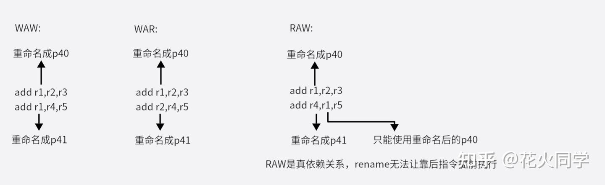
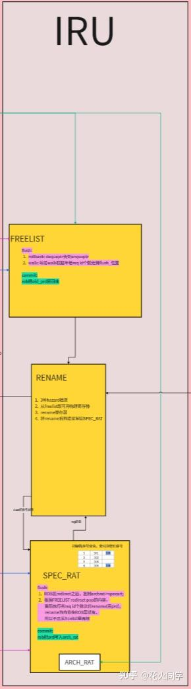
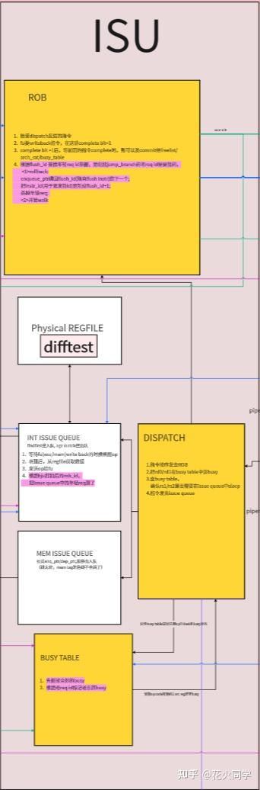
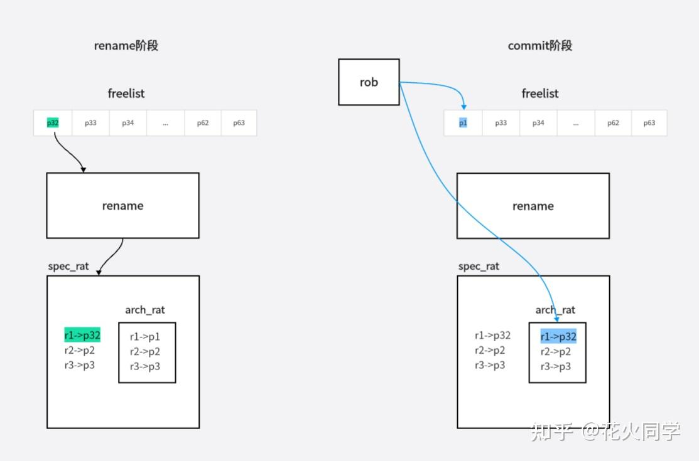
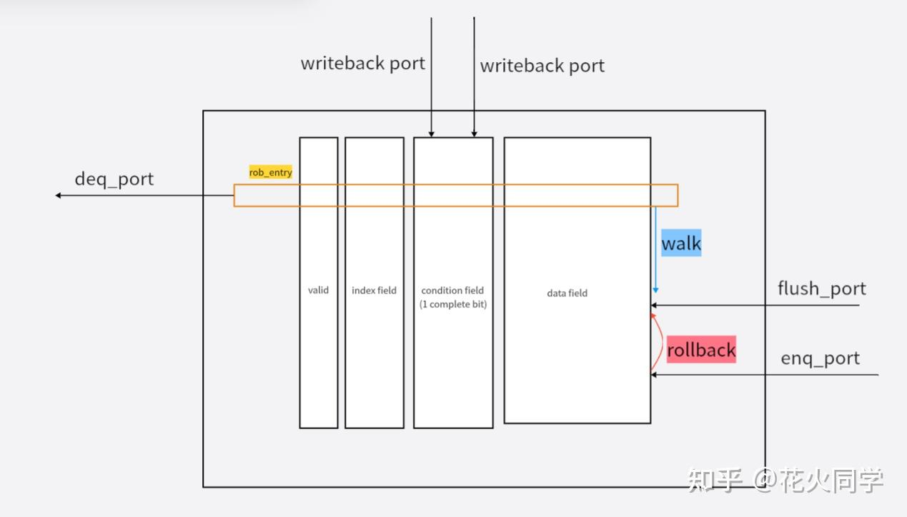
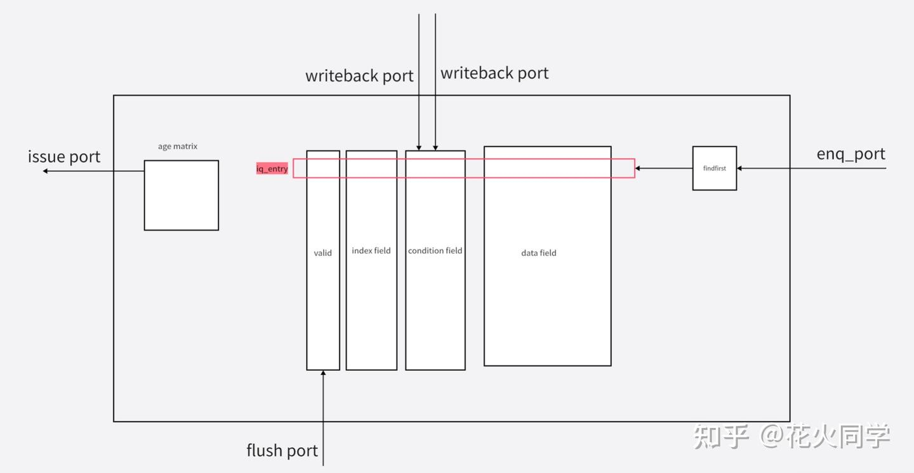

前面两篇讲完了L1 cache和分支预测怎么实现，现在来开始后端的改造。

### 一、IRU原理介绍

首先，五级流水中decode之后的步骤很简单，opcode直接送去exu和mem进行计算和访存就可以了。这是顺序core的过程，简单明了。

但如果我们要实现一个乱序双发的core呢，需要增加什么样的组件来实现这件事情呢？

我们可以把这个问题分解成两个问题，(1)怎么做乱序，(2)怎么做双发。

首先，乱序是什么，就是后面的opcode可以提前执行，那么要做到这点肯定就要解决opcode之前依赖项的问题。

依赖项问题是个老生常谈的问题了，在五级流水的顺序核中，因为一切指令都是顺序的，所以事情很简单，访存花的时间长，就用stall解决，写回再唤醒要多等一拍，就用bypass来处理。这些简单的内容在我很早前的五级流水文章里也有讲解。

到了乱序核，依赖项有了一个更优雅的方式来解决，就是rename。

我们都知道依赖项问题一共有3种，WAW/WAR/RAW，我们也都知道只有RAW才是真的依赖项，后面两种都只是恰巧寄存器序号相同，并不是真的逻辑上指令之间有依赖关系，所以对于后两种问题，我们可以通过改变寄存器序号来解决这个问题，具体看下图：

因此就引出了物理寄存器的概念，也就是说是架构寄存器为32的情况下，咱们可以让core中实际上用于充当寄存器的物理器件个数大于32，这样就能够让同一个序号的架构寄存器通过重命名，被不同的opcode写回不同的物理位置。这就是rename模块要做的事情，做依赖项检查，与进行重命名。

好了，现在架构寄存器32个，真实的物理寄存器个数呢，以我们这个trinity core举例，有64个。也就是说，在core刚启动的时候，有32个physical reg是自由的，还没有被映射成架构寄存器，很自然的，opcode流到rename模块的时候，rename模块需要知道32个自由的物理寄存器的序号是什么，并且从中拿一个出来，做rename。这个管理自由寄存器的模块就叫freelist。

> 让我想想怎么把这件事说到连幼儿园小朋友都能听懂，举个通俗的例子，rename模块就像是一个奴隶贩子，从decode来的一个个opcode就像是一个个奴隶，rename模块要做的就是给不同的奴隶脑门上盖上不同的印章，印章一共有64个，这个freelist就是管理所有印章的那个小弟。

现在rename这个动作本身已经完成了，比如一个add r1,r2,r3的r1被重命名成了物理寄存器p40,这时候后面来了一个opcode: add r4,r1,r5。请问后面这个指令怎么知道它该找哪个物理寄存器去索要r1的值呢？所以我们还需要一个表格来记录一下每次rename完成后的架构寄存器与物理寄存器的对应关系。这个表格就是speculative RAT（后面我们叫它spec_rat）,为什么叫speculative呢，因为这个对应关系不一定对，可能分支预测错误导致rename了不该执行的opcode，所以我们还会有一个non-speculative的对应关系表，它是根据commit操作来更新的，这个表就叫architecture RAT，后面都简称arch_rat。

以上就是IRU的所有组件内容：

1. rename模块

2. Freelist

3. Spec_RAT

4. Arch_RAT

如下图所示：

严格从功能分类上来说，服务于乱序功能的还有rob和busy_table，不过这俩放在ISU中讲。

###  二、ISU原理介绍

接下来要解决的问题是如何做双发。双发意味着我们要能够同时把两个opcode发去intblock和memblock模块。这就需要有一个能够同时双发的issue queue或者两个issue queue来分别在同一时刻来进行opcode发射。

如果我们需要实现两个issue queue，不同issue queue对应的function unit不同，那么很自然的，我们需要一个模块来负责给不同的opcode分类，不同类型的opcode要进到对应的issue queue才行，这个模块就是dispatch。

现在我们知道了，opcode是从dispatch发送去issue queue的。我们要实现的是乱序核嘛，所以opcode进issue queue的动作是顺序，但出去的顺序就是乱的了。因此很自然的，我们需要一个地方来记录顺序的opcode顺序，这样执行完了之后，我们才有办事实现顺序commit，这个模块就是大名鼎鼎的rob。

另外，由于opcode之间是有依赖关系的，有些opcode在进入issue queue的时候，他们的src reg还没计算完成，那么这些opcode是要sleep的，直到等到他们依赖的寄存器被计算完成了(writeback)，这些opcode才能够发射出去，也就是说我们需要有一张表来记录各个寄存器是否还没完成（即它们正处于busy的状态），这个模块我们叫它busy_table，在每个opcode进入issue queue的时候，要查一下这个busy_table，从而确定这个opcode是否应该一进issue queue就sleep。

从上面的描述我们知道，一个opcode刚进issue queue的时候，此刻它的src reg对应的physical reg里的值不一定正确的，因为可能还没被计算出来，只有在它被发射出去的时候，它的src reg才是确定正确了的，所以opcode只有在被发射出去的时候，才能去读取它的src reg。因此，reg file(physical reg file)咱们就挨着issue queue来放，所以也放在ISU中。

以上就是ISU的全部组件：

1个rob

2个issue queue，一个对应mem操作，一个对应int操作。(图里只画了一个isq)

1个dispatch模块

1个physical reg file

1 个busy_table模块

如下图所示：

### 三、IRU内部模块介绍

#### 1．Freelist

Freelist本质就是一个circular queue，circular queue就是一个enq_ptr/deq_ptr可以回环的queue，每个entry里面放着可供rename模块取用的自由物理寄存器序号，core启动的时候，所有entry的valid bit都是1，32个entry里面存着自由物理寄存器序号为32-63。每次rename模块取走一个自由物理寄存器序号，deq_ptr+1，对应valid bit=0。当commit的时候，enq_ptr+1，把commit归还的旧寄存器序号写入entry,对应valid bit=1。

#### 2．Spec_RAT / Arch_RAT

Spec_RAT / Arch_RAT就是两张32entry的表，0-31个entry的内容分别是0-31号架构寄存器对应的物理寄存器序号。Spec_RAT就是刚rename就更新的对应关系，Arch_RAT是rob进行commit的更新的对应关系。

#### 3．Rename

当Rename模块一周期只接受1个opcode的时候，它只需要判断该指令是否要写回，如果要写回，就去找freelist获取自由的物理寄存器序号，并用该值进行重命名（所谓重命名就是把物理寄存器的序号替代decode传来的架构寄存器序号往ISU阶段传），然后把重命名后的新对应关系写入speculative RAT中。

如果rename模块一周期可以接受2个以上的opcode，那么它还需要做的事情一个是hazard检查，如果几个opcode之间有hazard关系，那么hazard情况很自然会影响靠后opcode的寄存器序号。同时这种hazard检查结果也是要往dispatch模块传的，因为这决定了靠后opcode时候一进issue queue就要sleep。

做hazard检查的代码本身很简单的，假设rename一次来俩opcode都时候，就像下面这样：

`// RAW Hazard Detection for rs1
// A RAW hazard occurs if Instruction 1's rs1 reads a register that Instruction 0 writes to.
assign raw_hazard_rs1 = instr0_lrd_valid && instr1_lrs1_valid && 
                        (instr0_lrd == instr1_lrs1) && (instr0_lrd != 5'd0);

// RAW Hazard Detection for rs2
// A RAW hazard occurs if Instruction 1's rs2 reads a register that Instruction 0 writes to.
assign raw_hazard_rs2 = instr0_lrd_valid && instr1_lrs2_valid && 
                        (instr0_lrd == instr1_lrs2) && (instr0_lrd != 5'd0);

// WAW Hazard Detection
// A WAW hazard occurs if both Instruction 0 and Instruction 1 write to the same register.
assign waw_hazard = instr0_lrd_valid && instr1_lrd_valid &&
                   (instr0_lrd == instr1_lrd) && (instr0_lrd != 5'd0);`

同时我们还要注意一个事情，hazard检查只是为设sleep服务的，不是是否做重命名的条件。我们是无脑对所有需要writeback的rd寄存器都做重命名的，因为rename一次可以看到的opcode数量是有限的，它不可能知道"是否只针对某些opcode做rename就够了"这件事，所以就直接无脑全rename了事，反正freelist就在那，做全部重命名根本没什么代价。

重命名的过程可以看下面这个图的左半边 (右半边的commit下一篇会讲)

### 四、ISU内部模块介绍

#### 1．Dispatch

这是opcode到达ISU后进入的第一个模块，它最主要的职责有四个。

第一个任务是把opcode按顺序写入rob中，同时从rob中获取一个robid(我俩亲切地称之为萝卜id,hhh)，这个robid非常重要，它相当于的opcode的身份证，从opcode被写入rob开始就要伴随一个opcode的终生（opcode的生命在commit时终结），后面重定向flush的时候要根据各个opcode的robid大小来判断各个opcode的年龄，从而决定哪些opcode要被重定向删掉。

第二个任务是把opcode分个类，让opcode分别去到int isq和mem isq，注意robid也是要送过去的。

第三个任务是在busy_table中查询发往issue queue的opcode的src reg是否busy，如果busy，就需要让这些opcode在issue queue中的sleep bit置1，即让他们进入休眠状态。

第四个任务是dispatch需要把opcoede中需要写回的寄存器在busy_table中标为busy状态，这样后续的opcode来了才能找到前面的opcode对应的结果寄存器还在计算中嘛。

当dispatch模块可以同时接受多个opcode的时候，它还要顺便做个小事情，就是根据hazard关系决定靠后的opcode是否要sleep。

dispatch模块本身是个纯组合逻辑。

#### 2．ROB

好了，我们终于来到了整个后端的精华，rob。

rob其实说穿了也不复杂，本质就是一个circular queue，每次dispatch把指令写入rob的时候，enq_ptr+1，valid bit置1。当function unit计算完结果后，将结果写回rob，这会将entry中的complete bit置1，我们如何确保rob的commit(退休)是顺序的呢，就是当deq_ptr指向的那条entry的complete bit=1时，此时该entry才能退休，deq_ptr+1，valid bit置0。

这里注意，由于circular queue是可以回环的，所以entry的index会比普通的buffer序号多一位，比如像咱们这个trinity core里，rob一共64个entry，index一共是7位，而不是6位。多出来的一位，我们叫它flag位的存在可以帮助我们比较出现环情况下两个entry的新老顺序，这点在redirect发生导致要删entry的时候很有用。

总结一下，rob有一个入队口(enqueue)，来自dispatch。两个写回口(writeback)，来自两个function unit(intblock/memblock)打拍后输出。一个出队口(dequeue,也就是commit)，commit会通向issue queue/busy_table/freelist/arch_rat。一个flush口，来自intblock的bju打拍后的输出。

 ROB一个简单的示意图如下，图中rollback和walk暂时可以不用管，下一篇讲重定向的时候会讲的。

#### 3．Issue queue

Issue queue，它实际就是个顺序入队，乱序出队的buffer。每个entry内部除了存rename传来的各种信息外，还要有两个sleep bit，用来表示该entry的opcode的两个src reg是否正在计算中，当计算完成，writeback口将对应sleep bit置0，两个sleep bit都为0，表示这个opcode的素材都备齐了，它可以下锅了，也就是可以被选择出队去做计算了。同时为了效率考虑，如果一个周期有多个opcode已ready了可以送去function unit，应该根据age matrix从ready的entry中选择最老的哪个opcode去执行。

age matrix就是一个矩阵，它的核心意思是这样的，如果有一个列元素全为0，那么这个列的序号就是issue queue中最老opcode的entry序号。

具体执行方式是这样，entry被写入的，矩阵的entry序号的行元素全置0，列中已被老opcode占据的entry对应位置写1，这样当我们一列列地去看这个矩阵时，只要一列中有1存在，就说明issue queue中1元素所在行的opcode有比当下这列对应的opcode要更老，如此以来，我们就可以实现用age matrix来记录新老顺序的目的。

Age matrix的控制模块还有点意思，我们单独包装了一下，如下：

` `include "defines.sv"
module age_deq_policy_ooo (
    input wire                           clock,
    input wire                           reset_n,
    input wire [ `ISSUE_QUEUE_DEPTH-1:0] iq_entries_ready_to_go,
    input wire [ `ISSUE_QUEUE_DEPTH-1:0] iq_entries_valid,
    /* ------------------------------ enqueue fire ------------------------------ */
    input wire [ `ISSUE_QUEUE_DEPTH-1:0] iq_entries_wren_oh,
    input wire [`ISSUE_QUEUE_LOG -1 : 0] enq_ptr,
    /* ------------------------------ dequeue fire ------------------------------ */
    input wire [ `ISSUE_QUEUE_DEPTH-1:0] iq_entries_clear_entry,
    input wire [   `ISSUE_QUEUE_LOG-1:0] deq_ptr,

    output reg                          oldest_found,
    output reg [`ISSUE_QUEUE_DEPTH-1:0] oldest_idx_oh

);

    // age_matrix[i][j] = 1 => "entry i" is older than "entry j"
    // reg   [`ISSUE_QUEUE_DEPTH-1:0] age_matrix[0:`ISSUE_QUEUE_DEPTH-1];
    reg [`ISSUE_QUEUE_DEPTH-1:0][`ISSUE_QUEUE_DEPTH-1:0] age_matrix;
    reg [`ISSUE_QUEUE_DEPTH-1:0]                         needflush_dec;

    // ----------------------------------------------------------
    // Combinational logic: find the oldest ready entry (for dequeue)
    // ----------------------------------------------------------

    reg [`ISSUE_QUEUE_DEPTH-1:0]                         any_j_older;
    always @(*) begin
        integer i;
        integer j;
        // Check if there's any j that is older than i
        any_j_older = 'b0;
        for (i = 0; i 

有了age matrix来确保出队总是出所有已ready opcode中最老的那个。那么入队就可以随便乱入了，通过一个简单的findfirst逻辑，直接往找到的第一个有空的entry入队就完事了。

总结一下，issue queue有一个入队口，一个出队口，2个writeback写口，一个flush口。一个大致的示意图如下所示：

#### 4．Busy_table

Busy_table就是一个简简单单的64 entry buffer，每个entry对应一个物理寄存器的busy状态。

Busy_table有两个读口，用来让dispatch读取一个opcode的两个src reg的busy状态。同时有2个writeback写口，分别来自两个function unit，当一个需要opcode 执行到写回阶段的时候，通过writeback口来让busy bit=0。Busy_table还有一个flush口。

####  5．Physical regfile

物理寄存器堆本身没什么可以说，实现很简单，唯一要注意的是，它的更新应该在commit阶段还是在writeback阶段呢？首先commit阶段肯定是没问题的，那么writeback阶段可不可以呢，答案是可以的，不过这一篇已经比较长了，后面的内容放到下一篇讲吧。

下一篇还是后端，集中讲讲writeback/commit和redirect的内容。