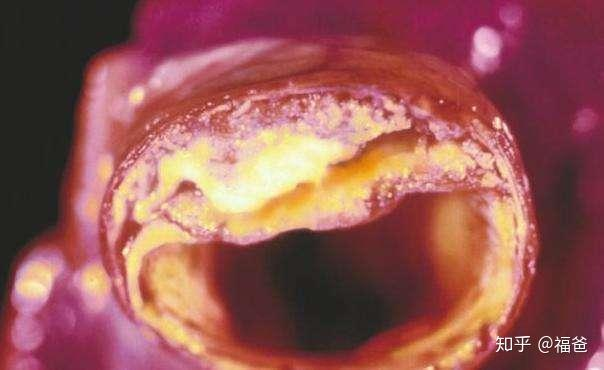
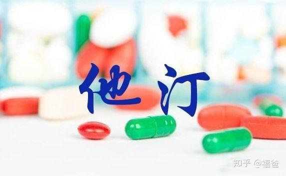

大家好！我是福爸，执业医师，专注研究体重管理和疾病营养治疗二十余年。希望我的文章对您有用。

一说到低密度脂蛋白，大家就认为这是一种坏胆固醇。低密度脂蛋白表示自己很冤枉，因为低密度脂蛋白是人体的一种正常的脂蛋白，它的生理作用是将胆固醇输送进入细胞内。只有当低密度脂蛋白升高的情况之下，才会对血管内膜造成不好的影响，加速动脉粥样硬化。

一旦发现低密度脂蛋白升高，就说明身体的代谢已经出了问题，临床上称之为代谢综合征。同时也预示着动脉粥样硬化进程加快，非常容易出现严重的心脑血管疾病。但是低密度脂蛋白高，并不能直接反应血管堵塞的情况，而是说动脉硬化的速度会比正常人快。

那么低密度脂蛋白高了该怎么办呢？首先要知道一点，那就是低密度脂蛋白的标准不是一成不变的，对于不同的人有不同的标准。

- 正常人低密度脂蛋白的安全水平是小于3.37mmol/L
- 糖尿病高血压患者没有发生心脑血管病时，低密度脂蛋白应控制在2.6mmol/L以下
- 心脑血管病及慢性肾病等患者，低密度脂蛋白的控制目标更应严格在1.8mmol/L以下

​对于健康人群，如果低密度脂蛋白只是轻度升高，建议改善生活和饮食习惯，包括戒烟戒酒、适度运动、劳逸结合、规律作息、均衡营养等多种措施。

低密度脂蛋白升高是代谢紊乱的结果，改善生活方式和饮食习惯降低低密度脂蛋白的作用很缓慢，而且幅度有限。所以对于低密度脂蛋白升高明显，或者合并糖尿病、高血压，甚至已经确诊心脑血管病的人来说，单独靠生活方式和饮食习惯的改良是不够的，必须使用药物治疗，首选他汀类药物。

有大量临床资料证实，服用他汀类药物严格控制低密度脂蛋白，能够大幅度减少严重的心脑血管事件，例如心肌梗塞、脑卒中等。

我是福爸，执业医师，专注研究体重管理和疾病营养治疗二十余年。觉得我说得有道理，就关注我呗，这里有不少实用有趣的营养健康知识。