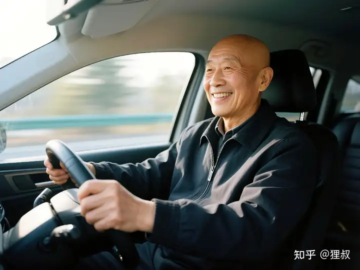

[收录于 · 混银行░变美变帅 升职加薪

](https://www.zhihu.com/column/c_1870108903083237378)465 人赞同了该回答

每年单位都会颁「行长特别奖」，连续2年，都颁给了夏师傅。

夏师傅是个驾驶员，快退休了，也是单位给我配的出行搭档。

「行长特别奖」是年度最重要奖项，奖金1W，去年给他的颁奖词是这么写的：

「夏师傅虽属后台部门，工作繁忙，但他学习能力强，人脉广，产品营销热情高涨，能力突出，成效显著，2024年办理信用卡285张，累计拓展代发工资1850人，超过了所有零售专业营销人员，2024年高师傅光办信用卡一项，就得了9块手机、1台电视、2台洗衣机和花不完的E卡，连续2年获得市行行长特别奖！」

银行信用卡搞营销活动都很猛，贯年头穿年尾，主持人读出这些数字，285-1850-9-1-2-花不完，引得大家啧啧称奇，惊叹声一片。

在强劲的背景音乐烘托下，夏师傅披绶带、挂红花走上舞台，他满脸羞红、憨态可掬，接受一把手的奖杯奖金和大家雷鸣般的掌声。

夏师傅是大家对他的敬称，打心底那种，没有任何人认为他是开车的就瞧不起他，在单位他可是神一般的存在。

他69年的，还有几年就退了，是单位年龄最大的员工，刚当了姥爷，每天都是乐呵呵的样，说话不紧不慢，有礼貌，言出必行，给人信任的感觉。

3年前，接人事调配驾驶员通知时，我是有些抵触的，公司业务日常繁重、开会多、出差多、加班、熬夜正常事，有个精干的小伙子更妥。

但单位小，一个萝卜一个坑，夏师傅原来一直服务前任行长，行长高升之后空缺，就安排给我了。

选无可选，只能接受。

不到半小时，夏师傅就到我办公室报到。

「领导好！以后就我给您服务了！」

我抬头一看，尽管是多年的同事，忽然有种陌生感，看着夏师傅半秃的光头和诚挚的语气，我竟有些失神。

我忙起身，「以后就得多麻烦夏师傅了！对公业务多、事情杂，估计会很辛苦！」

「没事没事！都应该的！」，他眼神坚定，答应着。

看到他有些老态的身形，我打心底里尊敬，革命工作只有分工不同，没有高低贵贱之分。

当天开始，他就成了我的出行搭档，掌握着来来回回、进进出出的方向。

他人情练达，只要是我想去的政府机关、企业，几乎不带下车登记的，刚开始我以为是因为挂的双0开头的车牌缘故，到后来才知道，原来他哪哪都是熟人。

无论党政机关、大型国企，还是餐饮饭店、小区会所，张哥、李姐、小赵都认识，畅通无阻。

下了车，我去沟通高层的银企关系，他一般就跟公司保安、办公室人员吐云吐雾，相谈甚欢，如多年好友，他的煊赫门一天2包以上，1.5包是给别人递的。

三年多我俩互敬互助，相互理解，配合默契，引得一众羡慕。

随着日常接触增多，我越来越发现，这个整天乐呵呵的夏师傅，确有独到之处。

他非常勤快，无论刮风下雨、打雷下雪，车里车外都会干干净净，就跟刚从洗车店出来一般。

刚开始我就纳闷，就问咋保持的？他随口说，早晨来的早，就胡乱抹拉几把。

后来我慢慢发现，他年龄虽大但是精力旺盛，每天早晨七点左右就到单位了，一边听着新闻，哼着小曲，把车内车外清洁一遍。他听的都是权威媒体，《新闻和报纸摘要》每天必听，这一点倒是挺符合他的年龄段。

每次出门，我会提前跟他说去哪里，尽管他熟门熟路，但他都喜欢打开导航，说要躲避拥堵。

他开车是出了名的又快又稳，神行太保再世，跟传说中的山东航空一样，无论何时出发，只会提起到达。

我们距省行平常跑1小时10分钟的路，只要有需要，他40分钟都可以到，还不带违章的，只不过乘客得备好塑料袋防呕。

偶尔闲下来，他要么刷B站视频、要么看小红书、知乎，要么用得物买东西，我十分惊诧他竟然用零零后的软件，他嘿嘿一笑，说都是孩子下好的软件，就随手点开看，慢慢都习惯了。

我默默看了看，自己手机里的抖音、快手、今日头条，跟他的代差有点大。

一般红绿灯的时候，他就开始回微信，偶尔进来的电话他会挂断，然后回信说忙，一摸一划熟练的很，打字速度也很快，绿灯开启前他又熟练的滑到导航界面。

除了要戴老花镜，光看他噼里啪啦的手速，根本联想不到这是一个快退休的老头。

我很理解他的忙，因为他主要岗位虽是驾驶员，但还要负责很多事，单位公车管理、物业、保洁、花卉绿植，给排水，对外联系公安、城管。。。

摆在公车GL8前方支架上的，是最新款水果手机，他上个月从华为Mate70 刚换回来的，我还问他两个系统会不会不适应？

当然这都是办信用卡送的，一年捞那么多手机，除了家里换着用，很多他都直接卖掉换现金了。

这样算下来他的工资远高于一般驾驶员，他跟家里嫂子都是农村人，没啥学历，但都是乐善好施、待人真诚的性格，膝下一儿一女，置办了四五套房子，有一大群好友，去年儿子结婚，愣是摆了130桌，把我们惊呆的不行。

我就问，夏师傅，你这个月办几张信用卡了？

他嘿嘿一笑，这个月不太行，才办了12张，自己分6张。

我天，这还不行？都啥营销环境了！

我知道这12跟6的关系，他跟客户经理都是合伙制办卡，他负责牵头营销，后续各种开卡、促销费的工作都由客户经理完成，双方五五分账，特殊时候四六。

这是一个合理的狠招，很多人都排着队想跟他合作，因为这好处实在是稳定、诱人。

五五分账的比例是他定的，偶尔他也乐善好施，要四，但按行规营销人员一般占大头。

客户经理自然也满意，关键客源太稳定了，大家一口一个高师傅喊着，给他送茶买烟，他也不会仅仅跟一个人合伙，只要有合适的，来者不拒。

趁等绿灯机会，他说领导，一会去这个单位需要谈多久？

我心领神会，说最少得一个小时，你去办你的事就好了。

他连忙道谢，说昨天听说今天要来这里，跟这边办公室主任提前联系了，今天把谈好的信用卡办了，行里的营销人员都在赶来的路上了。

真厉害！我去公司找老板谈1亿元的贷款，他见缝插针，去办10张信用卡，两不耽误，我都习惯了。

他能拿到半块手机的奖励，我这1亿元低价贷款说不定得赔钱。。。

我内心苦笑，看到他积极努力的样，我倒有些惭愧。

我说，这个单位我们也就来过两三趟，你是怎么联系到办公室主任的？原来就认识么？

他又是嘿嘿一笑，原来不认识，就上次您来的时候，他陪着老板下楼来接，你们上楼之后，我们相互递了根烟，就聊到一起了。

期间他正好接电话，说周末公司搞团建，要找大车，但是价格高、还也没有合适的车型。

我就帮他找人问了一下，没想到便宜了不少，还是最新的考斯特，他和老板都满意，就算成朋友了。

夏师傅是有名的「老司机」，从部队开始就捣鼓车，是半个修理员，管着单位的公车十多年，什么车辆维保、洗护、保险、大车租赁等，只要是跟车有关系的事，都熟悉。

「昨天听说要来这里，我就打电话给他，说有信用卡任务，能不能组织员工办点，还有丰富礼品，他很爽快答应了，说一定帮着组织好！」

「我一会专门提点礼品，再去他哪走一趟，让他再费费心多搞点！」

高明！朴实！却穿透力极强的营销思维和手段！

帮了别人的忙，敢于开口再找别人帮忙，这是关系深化的重要一步。

无论谈恋爱，还是搞商务关系道理都想通，只有双向奔赴才会更牢固。

虽然第一次是他帮了对方，但这次提着礼品，提前去答谢沟通，感谢人家的牵线搭桥和组织，我想这一上午20张信用卡都不止了！

这一招营销技巧，我听了无数遍，跟客户经理讲了无数遍，但是真正用到的却没有几个。

人脉，人脉，难道这不就是人脉么？能办事的才叫人脉，不能办事只能是叫认识吧。

我在老板办公室喝茶聊天，故意拖了一下时间，快11点半的时候谢绝了老板的午饭邀请，打电话给夏师傅，说准备往回走。

一上车他满脸喜悦，说感谢领导，今天上午行里派了6个人过来，目前已经办23张了，利用中午吃饭的时间估计还能办一阵子。

我说都是你厉害，回头我组织个专题会议，你跟客户经理好好讲讲怎么拓展客户的。

他瞬间涨红了脸，说话有点结巴，哎领导，你可别给我出洋相了，我没啥本事，讲不出来的。

我说别谦虚，你一定能讲的很好。

这时候他又接到电话，他回头示意，说接电话，我说接吧。

是营业部负责人的电话，很着急的样子，说刚才区城管大队来了，正门口的大广告牌违章，要马上撤掉，不然要罚款了，夏师傅也没有多说什么，说陪着领导在外面，回去再说，挂了电话。

广告牌的事我知道，预算2W多，上党委会讨论决定的，单位换新址，很多客户找不到路。

我说，你赶紧处理就行，都行里的事。

他说好，车辆速度不减，神情专注，好像在思索什么。

过了会，趁着红绿灯机会，他拨了一个电话，电话很快接通。

「魏局长，最近挺好吧？老太太的脚咋样了？贴膏药管用么？」

对方可能在开会，好像跟他说不太方便，但是让他继续说，可以听。

「魏局长，我们单位门口的一个广告牌，前几天刚立起来。单位刚换地，很多客户都找不到，花了好几万才置办起来，今天你们来了个人说要立即撤掉，你看看咋办？这事归我负责，办不了领导得凶我了！」

就说了这么多，电话挂断。

听他说话的口气，并不是很客气，随意的有点像跟多年的哥们说话那味，甚至有点要挟之意。

我就说，他们领导很熟啊？

「认识好多年了，处的不错，上个月她老母亲摔断腿了，说要保守治疗，我就从老家找了整骨医院的大夫，是我发小，上门给老太太敷了膏药，后来又换过一次，然后我从网上给他买了一些土鳖，应该是挺管用。」

啊？发小？上门服务？换药？土鳖？

我又是一连串的问号，看来发小和局长跟他的关系，都不一般啊。

都到半路时，电话打进来，是那个魏局长，隔着好远我都能听到他的道歉声。

「哎吆，夏哥，大水冲了龙王庙，我那个下属是刚来的，不知道情况，这样你赶紧让单位打个申请上来，你们是区里的纳税大户，领导早就有交代，要给纳税人服务好！」

夏师傅简单回了一句：

「行，魏局长，谢谢了！我下午就让人把申请打过去」，就挂了电话。

我又一次愕然，我擦来，这天大的难事就这么办妥了？如果公事公办，没有十天半月绝对无果。

「厉害啊！夏师傅，你这是用自己的关系解决公家的麻烦啊！」

我真心恭维着。

他又是一笑，让领导看笑话了，都是从小到大的关系，不用白不用，他又加了一下油门，马上12点了，不能耽误回去吃午饭。

下车的时候，一个零售客户经理等在门口，是找夏师傅，我还以为是上午办信用卡的事情。

客户经理说，夏师傅，我那车保险，你给我找人录了吧，快到期了。

夏师傅听了，倒是一脸严肃：

「你把所有的保险公司都问了么？咱不能让人坑了！」

「问了，都问了，最低就报到3350」，客户经理解释到。

「那好，我马上找我朋友，估计3200差不多，你等我消息吧。」

夏师傅这个本事我知道，他有一个同学是做保险经纪的，两个人关系铁的很，保险价格很低，行里很多员工买保险都找他。

他是纯帮忙，每次都让员工尽可能的跟各家公司砸价，谈到最低价的时候，他再出马找他同学。

多了不说，同样的险种组合，再便宜个150-200块很平常，也不知道其中有什么猫腻，但对于员工来讲，都像捡了大便宜。

他负责公车管理多年，什么修车店、洗车店、加油站、保险公司、汽车租赁店都熟络的很，单位上大部分员工的私家车问题都会找他，他不主动揽活，但只要找他，都会积极帮忙。

临下班的时候，单位工会群里，发了一条消息：

「园区中石油洗车店新开业酬宾，凭我们的工作牌，可以办理优惠洗车，原价10次/450元，现价10次/360元，欲办从速！」

我知道，这一定又是夏师傅的杰作，跟大国企都能谈出大折扣，这本事无他了，个人去办是一点也没有优惠的。

最后回应题主的问题，没有人脉怎么办？我想夏师傅这个人的「所作所为」，能解释这个问题。

狸叔基层银行从业20年在职，非富即贵又靓的你，一定需要个靠谱的银行朋友，狸叔就是，欢迎关注 @狸叔

，听更多银行的秘密故事。

♦狸叔这人很有意思，不信你看他主页。

（全文完）

送礼物

还没有人送礼物，鼓励一下作者吧

[所属专栏 · 19 小时前 更新](https://zhuanlan.zhihu.com/c_1870108903083237378)[混银行░变美变帅 升职加薪

狸叔

​法律职业资格证持证人

185 篇内容 · 35536 赞同

](https://zhuanlan.zhihu.com/c_1870108903083237378)订阅[最热内容 ·

体制内你见到最狠的是什么样？

](https://zhuanlan.zhihu.com/c_1870108903083237378)[编辑于 2025-09-18 17:21](//www.zhihu.com/question/610568094/answer/1941807698480969209)・山东

​67 条评论​173 ​3 ​分享

​​

收起​