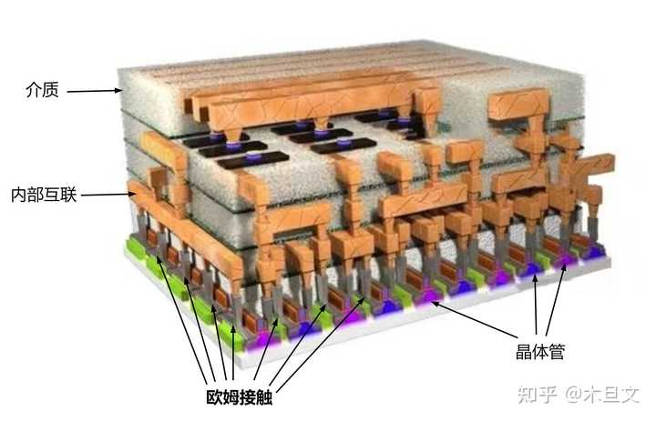
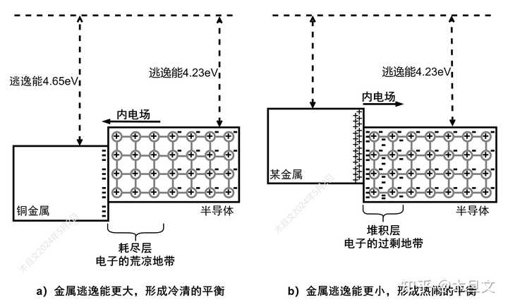
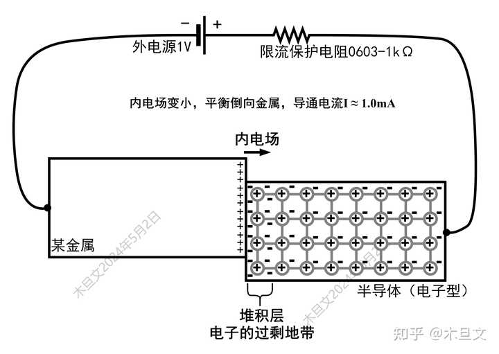
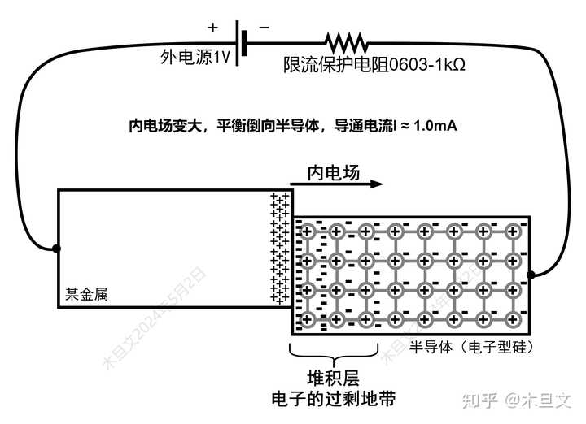
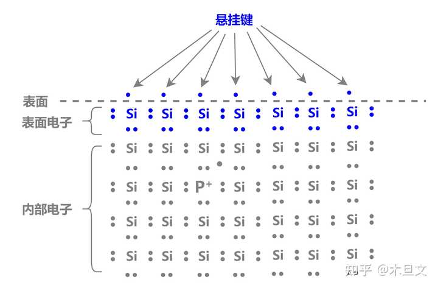
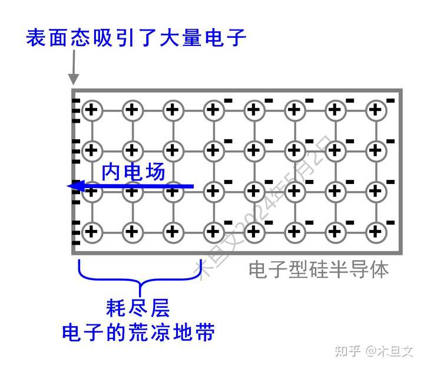
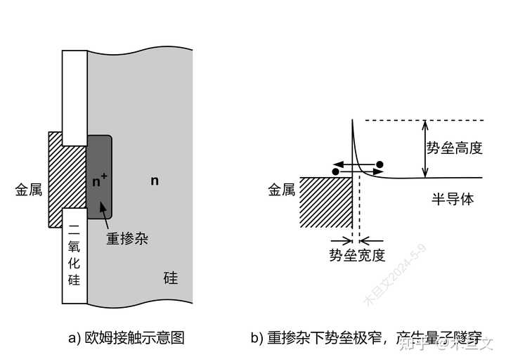
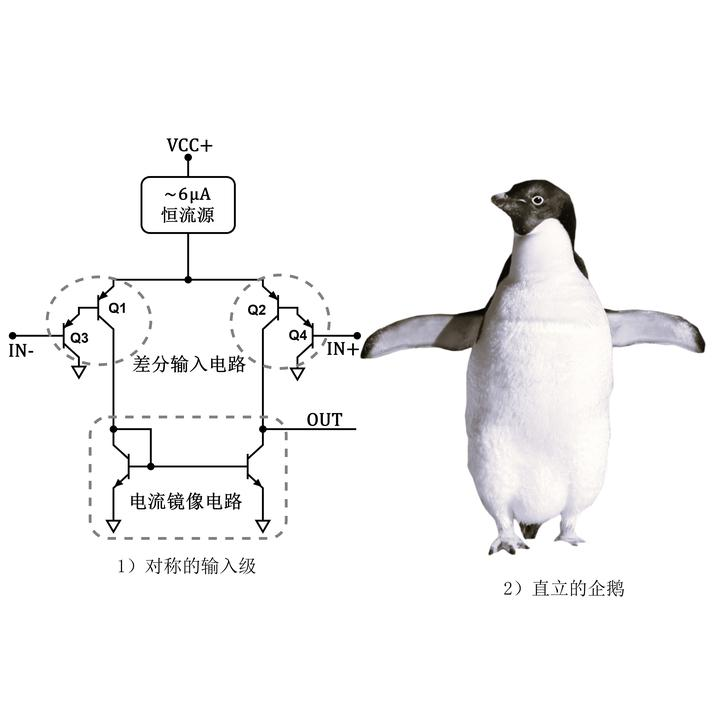

[收录于 · 「漫谈半导体器件原理」

](https://www.zhihu.com/column/c_1331017961692549120)180 人赞同了该回答

### 原创新作《二极管7：金半欧姆接触原理漫谈》

### 目录：

**一、欧姆接触，进入半导世界的门户**

**二、动态平衡，亦分多寡**

**三、拨动平衡，双向导通**

**四、表面态，半路杀出个程咬金**

**五、重掺杂，用魔法打败魔法**

**六、欧姆接触，窥探量子世界的窗户**

### 正文：

金半欧姆接触，并不是一种器件，但绝不能因此而轻视它。

（全文以电子型硅半导体为例）

### 一、欧姆接触，进入半导世界的门户

孕育任何一种全新的半导体，都必须经历的两个大的阶段：

1）是材料，其中最关键的是，提炼出足够纯、足够大的单晶体，否则，巧妇难为无米之炊；

2）是器件，其中最关键的是，开发出与新材料匹配的、电阻足够小的欧姆接触；否则，进出器件的信号受阻，进不去、也出不来。如图1所示。新手第一次留片，不少就栽在这里，忘了给引脚做欧姆接触工艺。

图1 集成芯片内部构造，有大量的欧姆接触「**两个关键」一旦突破了，各类芯片将喷涌而出**。而且，进一步的升级迭代，比如芯片制程，从几百纳米发展到几十纳米、甚至几纳米，还是要从「两个关键」着手。制程尺寸越小：

1）对单晶体的精度要求必然越高，99.999999%的纯净度不够，那要再加两三个9；

$2）对欧姆接触的要求也越高， 10^{-6}\Omega cm^{2}的电阻率不够，那就减小到 10^{-7}\Omega cm^{2}。$

无论是经典的锗、硅、砷化镓，还是当前热门的氮化镓、碳化硅，亦或是未来之星的金刚石，都经历过、或正在经历着对「两个关键」的突破、或一轮又一轮的升级。

**所以说，欧姆接触，是进入半导世界的门户。**

欧姆接触，是低阻的、通畅的；但是，认识与实现的过程，是艰难的、曲折的。因为，**欧姆接触，与其说是一门科学，更像是一门艺术**。不同的实验室，不同的芯片代工厂，都摸索出了一整套独特的、饱经检验的欧姆接触制作工艺，各有各的秘方。

本文聚焦其中基础的、共性的部分。

### 二、动态平衡，亦分多寡

**逃逸能之差，派生内建电场。**

**内建电场生，必成动态平衡。**

当金属的逃逸能更大，半导体失电子显正电，形成一个指向金属的内建电场；且平衡稳定后，**双向电子流量都极小，是微流量的、冷清的动态平衡**。上一篇详细介绍过，其正向导通，反向截止，形成的是整流接触。

图2 金半接触，都会派生内建电场，都会形成动态平衡，有的冷清，有的热闹当金属的逃逸能更小时，在接触面上，半导体对电子的吸引力大于金属，在电子的争夺战中胜出，半导体得到大量电子显负电，形成一个指向半导体的内建电场，并不断扩大。直到，内建电势大小，恰好等价于半导体与金属的逃逸能之差。因为半导体中的大量电子经过内建电场加速后，能量增加了，增加的量就是半金逃逸能之差；且方向就是冲向金属，即，刚好可以跃入金属中。

所以说，内建电场改变了原来一边倒的局面。

最后形成动态平衡。一个方向上，逃逸能之差作为第一动力，驱动着大量电子从金属中「坠落」进入半导体中；另一方向上，内建电场的驱赶下，大量电子从半导体中「跃升」进入金属中。两个方向上，电子流量相同。所以，**这个动态平衡是双向大流量的平衡，是热闹的、繁忙的平衡**。

**冷清的平衡，诞生了整流接触。**

**热闹的平衡，意味着欧姆接触。**

### 三、拨动平衡，双向导通

无论是正向通电，还是反向通电，外电源影响的都是落在半导体一侧的内建电场，不会明显影响由金属向半导体的坠落。

1）正向通电，即半导体侧接外电源正极。此时，电源产生的电场，与内建电场相反，内建电场被削弱。即，半导体发射电子的能力被削弱。所以，平衡被打破，金属侧又拿到主导权，电子涌入半导体，实现导通。如图3所示。

图3 外加正向电压，内建电场被削弱，金属占据主导，正向导通2）反向通电，即半导体侧接外电源负极。此时，电源产生电场的方向，与内建电场相同，加强了内建电场。即，半导体发射电子的能力被加强。即，平衡又被打破，这一次是半导体获得主导权，大量电子跃入金属，实现导通。

图4 外加发向电压，内建电场被加强，半导体占据主导，发向导通所以，正向、反向都可以导通，即形成的就是欧姆接触。

热闹的平衡，外力倒向哪边，哪边就占据主导，都能实现导通；哪怕是很小的外力，都能决定局面。这恰恰就是欧姆接触的本质。

### 四、表面态，半路杀出个程咬金

理论很清晰，但是现实更复杂。

要实现欧姆接触，还需要跨越一个大障碍，即表面态。历史上历经多次挫折，才逐渐意识到其存在和重要。

**表面态的实质就是「悬挂键」**。硅晶体最外一层的原子，与内部的原子不同，无法做到每个原子都配满4个共价键，只有3个共价键。配不了对的就是抻到外侧的那一个外层电子，因为外侧是空的，没有配对的对象，只能孤零着，共不价，这就是悬挂键。如图5所示。所以，通俗的将，悬挂键就是没吃饱的键，表面态就是表面坑。

图5 半导体表面存在的悬空键图5 半导体表面存在的悬空键

悬挂键的数量极大，是喂不饱的。硅表面的原子密度约为 10^{15}cm^{-2} ，每个硅原子产生一个悬挂键，即理想情况下，悬挂键的密度同样约为 10^{15}cm^{-2} 。这是一个很大的值，与内部电子来比较：硅的掺杂浓度典型值10^{15}cm^{-3}，以典型的1um的有效厚度来计算，即电子数为10^{11}cm^{-2}，相差4个数量级。即内部的电子，全部用上，也只能填满表面悬挂键的万分之一。

**「悬挂键」可以派生电场**。硅表面的悬挂键是残缺的、不安分的、渴望完整的、有较大吸引的，必定会大量捕获晶体内部的电子。一个悬挂键可以捕获一个电子，所以也称为一个表面态。被捕获的电子，没有之前那么自由了，当然也没有共价电子那么束缚，而是介于两者之间，是半自由半束缚的状态，可称之为「半自由电子」。由此，表面吸附了大量电子显负电，内部产生一段耗尽层显正电，一个由硅内部指向表面的内建电场诞生了。

图6 表面态派生内建电场需要强调的是，这个电场是由表面效应派生的，纯粹的个体作品，不是联合创作，不需要与金属接触，也不需要与另一种半导体结合。

**金属从主角变成了跑龙套的**。金半接触时，金属中的电子本来是要坠入硅晶体内部的，但是经过表面时绝大部分都就被截留了，用来填补表面那海量的悬挂键。即，金属的影响力，被硅的表面态给屏蔽了，很难进入硅内部；金属的功函数是大、是小，都不重要了，金属变成了配角。硅的表面态才是主角，主导了硅内部内建电场的形态，即指向表面，是耗尽层，是冷清的的动态平衡，也就意味着是整流接触。

所以，由于表面态的捣乱，原本是欧姆接触，变成了整流接触。

### 五、重掺杂，用魔法打败魔法

如何得到欧姆接触？

**思路一：干掉表面态。**

不行。「钝化」倒是可以消除表面态，就是在硅表面形成一层氧化层，即二氧化硅，氧原子与硅表面的悬挂键形成共价，表面态就没有了。场效应管的栅极，就是这么处理的，效果极好。但是，二氧化硅是绝缘的，这就更实现不了欧姆接触，丢掉了真正的目标。

**思路二：干不掉，那就无视它，冲过去。**

这个行。效果上确实是这样，相当神奇，绝招就是「重掺杂」。

在接触区，硅表面先做重掺杂处理，再沉积金属，金半接触中间插入了一段重掺杂层。即，与金属接触的，由常规的中等掺杂变成了重掺杂硅晶体。区别就是，重掺杂下势垒宽度极小，此时两侧的大量电子能够直接穿过去，实现欧姆接触。

势垒还在，高度不变，只是变窄了，为什么就挡不住电子了？

**因为量子隧穿**。重掺杂下，势垒宽度大幅减小，小到量子效应显现并占主导；此时，电子不再需要越过势垒，而是有一定概率直接穿过势垒。如图7所示。

图7 欧姆接触结构与量子隧穿示意图这就是量子隧穿现象，微观世界中的「崂山道士穿墙术」。势垒越薄、越低，发生隧穿的概率越大。

### **六、欧姆接触，窥探量子世界的窗户**

**电子是粒子，也是波，这是波粒二象性的要求**。

有必要做一些定量的估算。

常温下，电子热动能E=1.5kT≈0.04eV，硅晶体中电子的有效质量约为原来的0.26倍，即只有原来的四分之一，则可计算出，电子的波长约为12.0nm。可以作为量子效应门槛尺寸的一个参考，但是还不够准确，因为还没有计入很关键的势垒高度。

金半接触产生的内建电势，取典型值0.4V，即电子遭遇的势垒高度是0.4eV。但是，电子热动能常温下只有0.04eV，差额是0.36eV。用这个差额能量，还有电子的有效质量，也可以估算出一个波长，本文称之为「差额等效波长」，约为4.0nm。以此为门槛更准确，势垒越窄、越接近4.0nm，量子隧穿效应越显著。

不同掺杂浓度下，半导体中耗尽层的宽度如下（一个硅原子的直径约0.236nm）：

$1）中掺杂，如 5\times10^{15}cm^{-3}时，耗尽层宽度约320nm，横跨约1400个硅原子；$

$2）高掺杂，如 5\times10^{17}cm^{-3}时，耗尽层宽度约32.0nm，横跨约140个硅原子；$

$3）重掺杂，如 5\times10^{19}cm^{-3}时，耗尽层宽度约3.20nm，横跨约14个硅原子。$

势垒宽度，可取为耗尽层宽度的一半，因为耗尽层势垒是尖状三角形的。即，重掺杂时，势垒宽度为3.20nm/2=1.60nm，显著小于门槛值、即「差额等效波长」的4.0nm，隧穿电流成为主导。进一步计算，此时**隧穿概率约为0.91%≈1%，每一百个电子中就有一个隧穿了**，这个概率足够大了。

**微观世界，最不缺的是数量，最不怕的是概率。**

$且看，隧穿的电子浓度，约为5\times10^{19}cm^{-3}\times0.01=5\times10^{17 }cm^{-3}，依然够大。进一步计算，可得最大的障碍、即耗尽层这一段的电阻，只有约为 10^{-8}\Omega cm^{2}，远小于欧姆接触要求的典型值 10^{-6}\Omega cm^{2}。另一方向，即从金属到半导体方向，初步估算，隧穿的电子浓度还要大1~2个数量级，即电阻还要再小1~2个数量级，更满足要求。$

所以，通过重掺杂，就可以召唤出隧穿这种顶级的量子魔法。双向隧穿、双向畅通无阻。

所以，重掺杂，是实现欧姆接触的最有效、最通用的手段。当然还有一些其他的辅助手段，例如不同的合金配方、不同的退火工艺等。

**全文小结：**

一直以来，多少次的尝试，内心始终没能真正接纳量子物理、特别是量子隧穿，感受到的，不像是客观的真理，更像是遥远的、虚幻的神话传说。

转机出现了。最近的一个多月来，在对欧姆接触的思考、对表面态遮挡与重掺杂隧穿的研究、对大量数据的分析与演算的过程中，逐渐有了身临其境的感觉：宏观与微观的距离不再那么巨大，现实与魔法的隔离不再那么厚重。半扇观察量子世界的窗户，就这样在我面前徐徐展开。

我无法确定，几千年来，是否真的有过那么一两位崂山道士，参透玄机，练就过穿墙之术。

但是，此刻我可以确定，在我前面的手机或电脑的处理器中，有着数以亿计的晶体管、即有数以亿计的欧姆接触点；每一个接触点中，都有数以亿计的电子正在隧穿，悄无声息、又浩浩荡荡。在这里，隧穿是普遍的、稀松平常的。

在量子世界中，第一次有了踏实的感觉，弥足珍贵。

**金半欧姆接触，不仅是通往半导世界的门户，还打开了观察量子世界的半扇窗户。**

很快，就发现了若干有趣的「隧穿法则」，但是限于主题与篇幅，不便展开。

                        木旦文 @木旦文

                                   2024年立夏 广州

（本文是本人原创，欢迎赞同、收藏、分享、评论；谢绝转载）

送礼物

还没有人送礼物，鼓励一下作者吧

[所属专栏 · 2025-12-30 09:23 更新](https://zhuanlan.zhihu.com/c_1331017961692549120)[「漫谈半导体器件原理」

木旦文

61 篇内容 · 9023 赞同

](https://zhuanlan.zhihu.com/c_1331017961692549120)订阅[最热内容 ·

三极管的原理书上都讲不清楚，为什么能被制造出来?

](https://zhuanlan.zhihu.com/c_1331017961692549120)[编辑于 2024-06-05 17:53](//www.zhihu.com/question/51971022/answer/3492704094)・广东

​24 条评论​646 ​24 ​分享

​​

收起​