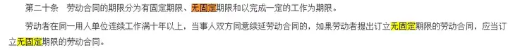

1233 人赞同了该回答

以前在一些回答过零星聊过一些，这里也算是一个整理，

**首先声明：****1、我没干过专职HR，没有干过正式任命的管理人员，只是从12年的华为工作亲身经历来聊；****2、时代在发展，社会在变化，时过境迁，很多事情放在2010年是那样，到2020年就变了，经供参考；**
### 第一章 华为特色8年换工号

这是华为为了规避劳动法的无固定期合同搞的一个手段，阳谋，不要说别人阴险啥的...

法律原文是这样的：

所以华为的每个合同4-5年，不违规不违法，

然后两轮合同和，赔一次N+1，相当于合同到期不续约，该赔赔，

然后再入职就是“新人”，新工号了，

不要质疑华为法务的能力，抠字眼的能力肯定是把控住了的，

“连续工作”，“同一用人单位”，

要知道，华为有很多子公司，还有华为技术有限公司总公司...

各位宝子们可以看看每次签约的合同是哪个...

反正我签约的合同是终端、华技轮着来的~！懂了吧...

合同到期后，本来也是双向选择了啊：

**1）你选择继续打工，要接受这个换工号，无法签无固定期合同的的风险，拿N+1补偿；
2）你选择不打工，拿N+1补偿，一拍两散；
3）公司不续签合同，给N+1赔偿，合法合规；所以在当前的法律框架下，这一点真没有可以黑的...

### 第二章 没有长期的饭票...达摩克斯之剑

正是基于第一条的合法性，所以，

在华为除了法人代表外，没有人有长期饭票的，哪怕EMT也是，

你看看刘江峰当年是多少级，怎么走的？

不管说不说斗争啥的...

哪怕是斗争站队，在有长期饭票的地方，失败了不会身死国灭，还能苟延残喘，

在这里，大概率就只能黯然滚蛋了...

所以，在这个合同4~5年一签的达摩克斯之剑的威胁下，

只能充分内卷，而且最有意思的是，

在华为，拼关系是下等...拼情商、拼能力、拼体力才是上策，

不是说关系没有用...下面章节会详细讲，

最终直接决定这个饭票是否可以续命的就是华为的KPI文化：结果为导向，

进一步而言就是：年度绩效为导向，

八仙过海各显神通，不管什么手段，

1个合同期内，有3个以上B+/A的，肯定安全，

有两个连续B的，特别是最近2年的绩效，再叠加高龄debuff的，就危险了，

有C的，应该是直接劝退的...

真正到了生死关头，还是有一些金牌保命的，比如天龙人（没错...天龙人也就仅仅是个保命而已），

天龙人不能保证绩效，你摸鱼划水不干活，还是可能绩效B/C的...

而这个B+的比例，以前是前50%，最近2年才扩大到了70%-75%，

为什么会扩大？也可能是为了人才堤坝做准备，劝退释放一部分人才去堤坝的温和手段罢了，下面会讲...

所以这个逻辑是：长期保持在前50%的绩效，这个达摩克斯之剑才没有威胁...

### 第三章 关于高龄debuff，一个奇特的公式：级别×2

经常各种疯传什么35岁啊，什么华为带头啊，

其实都没摸到本质，

本质上是公司HR政策内部做的一条潜规则，

原始公式很复杂，是HR的高级专家郑某提出来的，还掺杂了一些工作时长、绩效等..

这里用简化版，

级别×2 = 系数，**

这个系数 > 年龄，就证明你潜力强；反之，就是大龄低能的人员了...

举个例子，华为内部定义的高级工程师是16-17级，对应的系数就是32和34，

意思就是，如果你34岁了，还没到17级，就是低能人员了...

为什么会这样定义？

因为35岁-38岁，应该是在工作了10-15年的精英人士，

华为只要精英，不要平庸的人，

而17级，高级工程师，也就是：能够独当一面做一些局部工作，但是没法主持大局；

一般到了18-19级，主任工程师和专家水平，才能主持大局，负责一个大项目，

要是对标BAT的M管理序线，起步是18级...

换个角度想想，你要是37-38岁了，级别还是16级，

这个级别对应的水平是新入门的：高级工程师，

还在一个比你小2-3岁的，18级的主任工程师指导下工作，

这样的情况正常么？

所以有了这一个潜力公式...（年龄歧视）

潜力公式会影响年度绩效的...

同样的工作，同样的级别，干的结果差不多的情况，

30岁可能能得A，但是35岁可能就是B了，

就是这么残酷...

佛罗里达州不养闲人...

这也是间接的体现出了三个年龄指标线：

1、35岁没达到17，18级的危险...

2、40岁没达到18，19级的危险...

3、45岁没达到19，20级的危险...

### 第四章 拼什么？拿什么拯救你，我的绩效

华为其实比较“公平”，这里拼关系，居然是最低一档的...

因为这个达摩克斯之剑是从上到下都悬挂的，不存在什么，到了管理层就安全了啥的...

其实管理层更危险，小兵的C比例是5%，管理层是10%，只不过管理层C了可以降成普通员工，有一层马甲...

华为的关系只有两种：

1）皇亲国戚：以及跟皇亲国戚有关的最近一个圈子的人，EMT成员都不算，那是工作同事...

2）其他

皇亲国戚是不受到规则约束的，毕竟这是私企...

其他：关系再硬，也要受到KPI这个达摩克斯之剑的约束...

为什么？你的关系再硬，也有自己的KPI，

层层分担下来还是需要有人分担的，不管你在哪一层，终究要分担一部分工作...

如果干得不好，没有人给你擦屁股，最终影响的是一条线的人绩效...

所以关系的正确用法是：

1）把人放到一个容易出绩效，摘果子的岗位，但是还是得干活...

2）把人放到KPI没有那么严格的岗位，安安稳稳B+就好...

也就这样了...

其实华为绩效并不是拼加班，而是结果导向拼贡献，

不管你是通过PPT胶片PUA到领导，还是真才实学有落地产品、项目，让一线给你点赞，

只要有领导给你站台，茶壶里的饺子倒出来了，就能获得好的绩效，

当然，获得好的绩效的一个重点前提还是...

你的摸清楚自己的主管、主管的主管的重点工作/难点工作是啥，啥事高绩效工作...

这个我记得是透明的，因为内网上是可以查到直系领导的KPI的...

所以大家理论上都有机会争取重点工作露露脸的...

最后一种，才是拼体力，

所谓的没有功劳也有苦劳，

刷脸多了加班多了，还是可以有一些效果的，

怎奈内卷的人多了，绩效B+就那么多，还是最终有些卷王只能得B...

### 第五章 逃出生天，张良计、过墙梯

除了长期卷，保持良好绩效外，华为还是很人性地给了两个平稳出局的路子：

#### 1、40-45岁，办理内部退休：

很多前期能力不错，后期增长不足的人才，卡在16-18级很久了，

只要能熬到40岁，就可以申请办理内部退休了，

所谓内部退休，其实就是体面裁员，保留虚拟受限股的分红权，

这里我不扩展开讲虚拟受限股的知识，只简单的说一下，

你投资了100w在公司，每年可以根据公司的收益效益获得分红，

根据历史经验，这个值大约是15%~20%的税后年化收益率，

不管是22本科还是25岁硕士，能干到40，45岁的还没被淘汰的，

大概率会有100~200w价值的股票，

也就是“退休”后能保留15~40万/年税后的现金流，

这个钱可比大部分外部工作的收入多...

如果没有房贷，不鸡娃的，完全可以从华为退休开始躺平生活了...

#### 2、人才堤坝：

这是最近几年推出来的新政策，原因有以下几个：

1）制裁之后，经济雪上加霜，非要大裁员，都是人才，培养7-8年，10年的不容易，裁了可惜；

2）裁员太多会引发口碑雪崩...

所以给了这个出路：

1）放弃高薪，自愿降薪，从“专家型人才”转变为“事务员”，有点像从干部变成群众/工人；

2）相对考评变成了绝对考评，理论上只要正常干活，达到以前的绩效B，就不会主动裁员；

这样一来，给很多卷王释放了压力，虽然有降薪，但是有活路...

具体降多少，每个岗位不一样的，但是顶多也就是腰斩，

华为收入的腰斩，都比我现在国企的薪资高...emm...

也不是什么角色都能选“事务员”的，主要是真的事物偏多的， 比如HR、IT、行政等等...

上面唠嗑了这么多，其实中心原则就两个：

1、没有永久的饭票，需要自己工作去争取；

2、华为没有那么冷酷无情，可以说比中国私企99%以上好太多，社会上华为黑子都是无脑黑；

[发布于 2024-12-24 20:04](//www.zhihu.com/question/553638649/answer/63009209945)・广东

​228 条评论​878 ​37 ​分享

​​

收起​