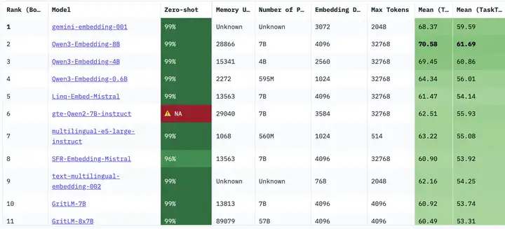
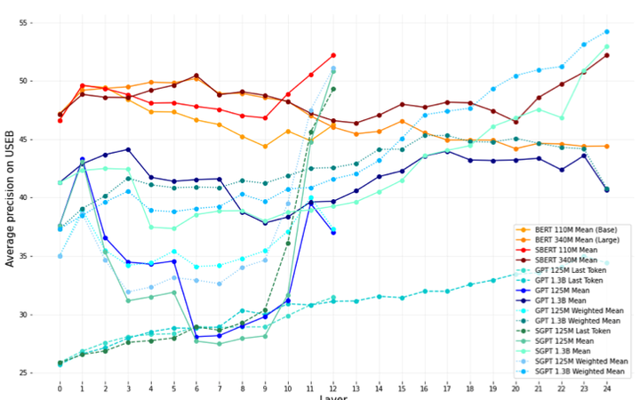
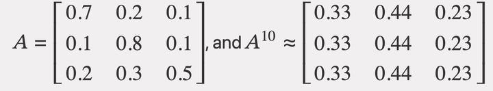
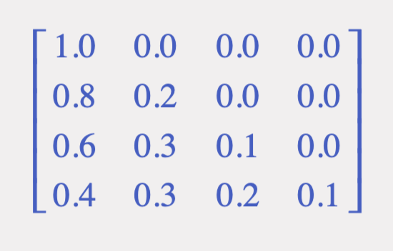
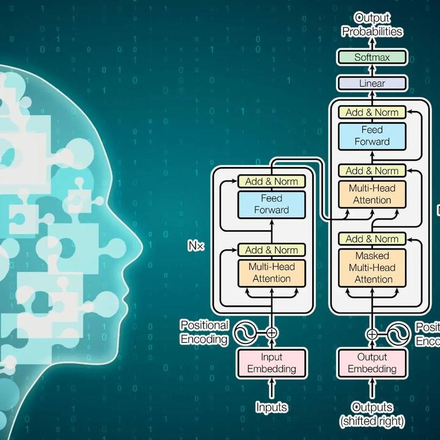

问题是好问题，不过这个问题居然是2025年提出来的有点让人惊讶。

因为提出这个问题最好的时机是2020年，那个时候OAI路线Decoder-only的「大模型」才发展到GPT-2，和Encoder-Only 以及Encoder-Decoder模型相比，在参数上还没有天壤之别。这个时候问区别会更加的有意义，因为两者的Embedding用途确实有显著的不同；而在2025年这个时间节点上，即便是RAG也基本上不再使用Word2Vec，FastText和GloVe这样的词向量模型了，专门用来生产embedding的模型也已经被各种大模型屠榜了。

不过我也无意用上面这个表格直接论证问题不成立回答完毕，因为我知道题主想问什么，**那就是专门用来生产embedding的模型，是不是和直接用来predict next token的模型有区别？如果有，是什么区别？**

因为embedding是人类无法直接理解的，所以专门用来生产embedding的模型其产出本来也不是给人看的，一般是用来计算向量之间相似度的。那么这个需求就意味着模型需要在两个维度上提高：

- 对句子的充分的理解；
- 相似度能有一个良好的分布性质。

#### 今天你对我爱答不理，明天我让你高攀不起

在小参数时代，Encoder的双向自注意力是比Decoder的单向自注意力在对句子的表达上有显著优势的。从下面这个图就能看出来，BERT 110M个参数的效果，就超过了 GPT 1.3B 个参数的效果。表面上看双向注意力的CLS对应位置的输出（第一个token）和单向注意力的SEP对应位置的输出（最后一个token）都浓缩了所有的信息，但是效果明显是第一个要好的多。

这也给了当时Google坚守Encoder的信心，因为Google是做搜索的，搜索的后台有大量需要进行相似度计算匹配的东西。从Google的角度，显然Encoder是更像智能的未来。

但是后来，单向注意力越做越大，到现在已经基本上对冲掉了同样参数下双向模型更高效的优势。因为双向模型要做大，比单向要难很多。双向注意力矩阵在多次相乘之后，就很难满足满秩条件：

每次注意力机制都是进行一个加权，做太多次就会导致每个词对其他词的注意力权重差不多。但是单向注意力因为有因果掩码(causal mask)，是一个三角矩阵，那么无论怎么乘，都是满秩的矩阵。

三十年河东，三十年河西，当年的障碍成为了如今的优势。

#### 真情难换人怜惜，只有套路得人心

另外一个缺点，是所有专注于预测的模型，无论大小都有的，那就是区分度的问题。真用BERT做过业务的人会发现，经常相似度需要比较到小数点后好几位，因为人类看起来很不同的句子，BERT一算都是80%以上。

这个主要是因为BERT并没有单独针对「相似度」优化，而是根据预测训出来的，而在d维高斯分布里，向量范数本来会集中在 \sqrt{d} 附近，也就是几乎所有点都会落在一个薄壳上。并且，BERT学到的词向量会让高频词的 embedding 很稳定且权重大。

因为高频词几乎出现在所有句子里，而且自注意力机制会让它们在汇聚过程中反复参与加权，结果就是句子的embedding等于高频词成分加上少量语义差异。 而大量的句子共享高频词，意味着他们有相当大的权重是重合的，那自然拉不开差距。在BERT时代就有人发现，如果对BERT的向量做主成分分析然后去掉主成分，那么算出来的相似度还是可以拉的很开的。

很早人们就意识到了这个问题，所以开始让模型学会「推拉」，也就是Contrastive Learning。也就是构造出负样本，无关的句子推远，有关的句子拉近，用特殊的损失函数单独来训练embedding表达。

这个损失函数当然有很多种，用的比较多的有InfoNCE类，就是对每个训练用样本（锚），构造一个正样本，然后同batch其他的作为负样本。而loss function的作用就是让锚在所有候选中，把正样本的 Softmax 概率推到最大。

 $$\mathcal{L} = -\log \frac{\exp\left(\frac{\mathrm{sim}(a, p)}{\tau}\right)} {\exp\left(\frac{\mathrm{sim}(a, p)}{\tau}\right) + \sum_{n \in \mathcal{N}} \exp\left(\frac{\mathrm{sim}(a, n)}{\tau}\right)}   $$

上面这个式子里面，p是正样本，n就是这一个batch里面的其他样本（负样本）。要让这个loss function最小化，那自然是锚样本和正样本相似度越高越好，和负样本越低越好。

模型不但学会了拉进，也学会推远。这样就比较适合计算相似度了。

现在这些专门计算embedding的大模型，和专门和人对话的大模型，其主要的区别就是在上面说的这些，是更在意相似度的表达，还是更在意下一个token预测准确率；前者可以很好的进行RAG和聚类，但是用它生产出来的向量进行预测可能不怎么样；后者能够很好的生产出人类理解的答案，但是它的语义向量空间结构不一定良好。

送礼物

还没有人送礼物，鼓励一下作者吧

[所属专栏 · 2026-02-12 00:52 更新](https://zhuanlan.zhihu.com/c_1897361938603825066)[人工智能和因果推断

司马懿

​新知答主

13 篇内容 · 6588 赞同

](https://zhuanlan.zhihu.com/c_1897361938603825066)订阅[最热内容 ·

如何理解attention中的Q,K,V？

](https://zhuanlan.zhihu.com/c_1897361938603825066)[编辑于 2025-08-09 20:10](//www.zhihu.com/question/663835334/answer/1937600628709896563)・北京

​12 条评论​502 ​19 ​分享

​​

收起​