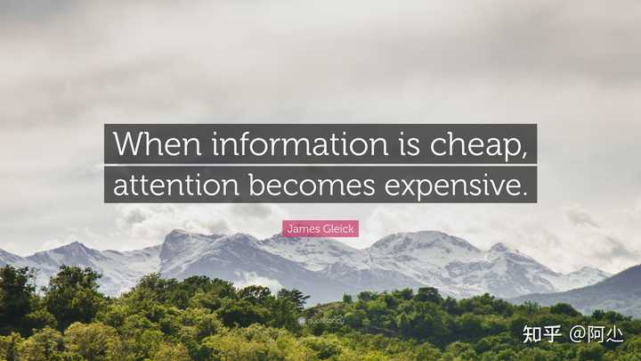

雨飞 等 6.9 万人赞同了该回答

### **越后面越精华，慢慢翻。**

**

> 一个社会的进步，在于每个人能否接受和掌握这个社会积累和创造的知识。要最大限度地达到这个目标，就要使每个人都能最简便、最迅速地得到知识和观念，无论是历史的遗产还是现今的创造。——摘自《美国反对美国》王沪宁 著**[[1]](#ref_1)

**

1）文献**

Google学术搜索

**2）对某些领域的入门了解**

维基+知乎+Quora

**3）对某些领域的深入了解**

就得看一些相对垂直的独立站了，这个不展开了，入门以后自然就知道怎么去找，举个栗子，比如你对业余无线电感兴趣随着慢慢接触，自然而然会知道 [QRZ.com](https://link.zhihu.com/?target=https%3A//www.qrz.com/)

**4）新闻**

新闻每个人感兴趣的都不一样。如果你对新闻不感冒，轻度阅读推荐[喷嚏网](https://link.zhihu.com/?target=https%3A//www.dapenti.com/blog/index.asp)（一个大佬推荐的），**如果你是有重度浏览新闻资讯需求的用户，建议自己搞RSS**[[2]](#ref_2)[[3]](#ref_3)，但配置过程过于繁琐且可能会遇到一定的代码门槛

一些相对靠谱的新闻网站：

- [后续](https://link.zhihu.com/?target=https%3A//houxu.app/) 强烈推荐，会对一手新闻源进行核查，并且对新闻持续跟踪报道。
- [有据 | 国际新闻事实核查](https://link.zhihu.com/?target=https%3A//chinafactcheck.com/) 会对国际热点新闻进行真假验证，并公示。
- [国际调查记者同盟](https://link.zhihu.com/?target=https%3A//www.icij.org/) 虽然较专业，但可能涉及立场倾向问题，请对内容进行谨慎判断。
**5）Blog**

直接知乎搜大牛博客，能找到像吴军、风云、鸟哥、阮一峰等大牛博客列表[[4]](#ref_4)

看到这里有朋友会想，这些都是开发大牛啊，写的技术博客我又看不懂，我看他干嘛？

别急，你慢慢翻会发现他们写过很多人生感悟和书评，这些人是社会中0.0001%那一撮，看看他们怎么想的，对提升认知非常有帮助。

**6）医学常识**

**千万别去搜索引擎搜！**

**千万别去搜索引擎搜！**

**千万别去搜索引擎搜！**

- [默沙东诊疗手册](https://link.zhihu.com/?target=https%3A//www.msdmanuals.cn/)
- [丁香医生](https://link.zhihu.com/?target=https%3A//dxy.com/)
- [妙佑医疗国际（原梅奥诊所）](https://link.zhihu.com/?target=https%3A//www.mayoclinic.org/zh-hans)
- [ClinicalKey 临床精钥](https://link.zhihu.com/?target=https%3A//clinicalref.cn/)
可通过以上这四个网站进行基础的了解，但最好的方式还是前往**正规公立医院**就医。

- [中国政府网服务频道 医生执业注册信息查询](https://link.zhihu.com/?target=http%3A//www.gov.cn/fuwu/bmfw/wjwyszyzgcx/index.html)
- [中华人民共和国国家卫生健康委员 全国医疗机构查询](https://link.zhihu.com/?target=http%3A//zgcx.nhc.gov.cn%3A9090/unit/index)
**7）行业数据**

- [CEIC](https://link.zhihu.com/?target=https%3A//www.ceicdata.com/zh-hans) 
- [北京大学开放研究数据平台](https://link.zhihu.com/?target=https%3A//opendata.pku.edu.cn/)
- [Crunchbase 企业融资数据库](https://link.zhihu.com/?target=https%3A//www.crunchbase.com/)
- [UN Comtrade 联合国商品贸易统计数据库](https://link.zhihu.com/?target=https%3A//comtrade.un.org/data/)
- [CNNIC 中国互联网络信息中心](https://link.zhihu.com/?target=https%3A//www.cnnic.net.cn/)
更多可以看这篇知乎[[5]](#ref_5)

**8）调研报告及行业趋势**

- [普华永道](https://link.zhihu.com/?target=https%3A//www.pwccn.com/zh.html)
- [贝恩](https://link.zhihu.com/?target=https%3A//www.bain.cn/new_list.php)
- [埃森哲](https://link.zhihu.com/?target=https%3A//www.accenture.cn/cn-zh)
- [德勤](https://link.zhihu.com/?target=https%3A//www2.deloitte.com/cn/zh.html)
- [艾瑞网](https://link.zhihu.com/?target=https%3A//report.iresearch.cn/)
- [发现报告](https://link.zhihu.com/?target=https%3A//www.fxbaogao.com/)
- [艾媒网](https://link.zhihu.com/?target=https%3A//www.iimedia.cn/c400)
- [标准网](https://link.zhihu.com/?target=https%3A//www.biaozhun.org/)
- [IDC](https://link.zhihu.com/?target=https%3A//www.idc.com/)
- [Counterpoint Research](https://link.zhihu.com/?target=https%3A//www.counterpointresearch.com/)
**9）音乐**

- [麦田音乐网](https://link.zhihu.com/?target=https%3A//www.mtyyw.com/tag/rock/)
- [国家大剧院古典音乐频道](https://link.zhihu.com/?target=https%3A//www.ncpa-classic.com/index.shtml)
**10）文艺类**

- [中国诗歌网](https://link.zhihu.com/?target=https%3A//www.zgshige.com/jts/)
- [古诗文网](https://link.zhihu.com/?target=https%3A//www.gushiwen.org/wenyan/)
- [国家哲学社会科学学术期刊数据库](https://link.zhihu.com/?target=http%3A//www.nssd.cn/)
- [中国作家网](https://link.zhihu.com/?target=http%3A//www.chinawriter.com.cn/)
**11）消费品**

- [Consume Rreports](https://link.zhihu.com/?target=https%3A//www.consumerreports.org/cro/index.htm)
- [亚马跌](https://link.zhihu.com/?target=https%3A//www.ymdie.com/%3Fs%3DCD)
- 消协帮你选（微信小程序）
- [CMM智库 (monitor.com.cn)](https://link.zhihu.com/?target=https%3A//www.monitor.com.cn/report.aspx%3Fid%3D433)
- [Maigoo](https://link.zhihu.com/?target=https%3A//www.maigoo.com/)
- [什么值得买](https://link.zhihu.com/?target=https%3A//www.smzdm.com/)
- [凯利蓝皮书 （Kelley Blue Book）](https://link.zhihu.com/?target=https%3A//www.kbb.com/)
- [Rtings](https://link.zhihu.com/?target=https%3A//www.rtings.com/)
以上几个网站中什么值得买毕竟是上市企业所以商业化较重，内容相对良莠不一（乱用成语）与混杂，**浏览时注意甄别**。

其他的都比较靠谱，特别是消协帮你选（微信小程序）是官方背景，强推。剩余的几个网站如果你是行业内人士可以多了解了解（比如汽车业是一定要玩转凯利蓝皮书，估计八成“车评人”都没听说过吧，什么？你说什么之家？那是啥玩意，逃）。

**

#### 泛科技数码网站（中文）：

- [chiphell](https://link.zhihu.com/?target=https%3A//www.chiphell.com/) 
- [机核GCORES](https://link.zhihu.com/?target=https%3A//www.gcores.com/)
- [V2EX](https://link.zhihu.com/?target=https%3A//www.v2ex.com/) 
- [数字尾巴](https://link.zhihu.com/?target=https%3A//www.dgtle.com/)
- [mobile01](https://link.zhihu.com/?target=https%3A//www.mobile01.com/)
- [全球主机交流论坛](https://link.zhihu.com/?target=https%3A//hostloc.com/forum-45-1.html) 
- [少数派](https://link.zhihu.com/?target=https%3A//sspai.com/)
- [装备前线](https://link.zhihu.com/?target=https%3A//www.zfrontier.com/)
- [外设堂](https://link.zhihu.com/?target=http%3A//www.weistang.com/)
- [koolshare](https://link.zhihu.com/?target=https%3A//koolshare.cn/portal.php)
- [人人都是产品经理](https://link.zhihu.com/?target=http%3A//www.woshipm.com/)
- [通信世界](https://link.zhihu.com/?target=http%3A//www.cww.net.cn/index.jsp)
- [通信百科](https://link.zhihu.com/?target=https%3A//baike.c114.com.cn/index.asp)
- [PMCAFF](https://link.zhihu.com/?target=https%3A//www.pmcaff.com/) 
- [SegmentFault 思否](https://link.zhihu.com/?target=https%3A//www.google.com/url%3Fsa%3Dt%26rct%3Dj%26q%3D%26esrc%3Ds%26source%3Dweb%26cd%3D%26cad%3Drja%26uact%3D8%26ved%3D2ahUKEwjmwf-03e_xAhVCqZ4KHaQdDdEQFjAAegQICRAD%26url%3Dhttps%253A%252F%252Fsegmentfault.com%252F%26usg%3DAOvVaw1hasMB7nLhlovD1vgkmyrI) 
- [硬鹅](https://link.zhihu.com/?target=https%3A//apps.apple.com/cn/app/%25E7%25A1%25AC%25E9%25B9%2585-%25E6%2595%25B0%25E7%25A0%2581%25E7%2594%259F%25E6%25B4%25BB%25E7%25A4%25BE%25E5%258C%25BA/id1565476915)
- [说明书之家](https://link.zhihu.com/?target=http%3A//www.mydigi.net/)
- [恩山无线论坛](https://link.zhihu.com/?target=https%3A//www.right.com.cn/forum/portal.php) 
- [极客公园](https://link.zhihu.com/?target=https%3A//www.geekpark.net/)

#### 泛科技数码网站（英文）：[[6]](#ref_6)

- [BusinessInsider](https://link.zhihu.com/?target=https%3A//businessinsider.com/)
- [FastCompany](https://link.zhihu.com/?target=https%3A//www.fastcompany.com/)
- [Tom’s Guide](https://link.zhihu.com/?target=https%3A//www.tomsguide.com/)
- [Wired](https://link.zhihu.com/?target=https%3A//www.wired.com/)
- [NYT Tech](https://link.zhihu.com/?target=https%3A//www.nytimes.com/section/technology)
- [The Information](https://link.zhihu.com/?target=https%3A//www.theinformation.com/)
- [Recode](https://link.zhihu.com/?target=https%3A//www.vox.com/recode)
- [MIT Technology Review](https://link.zhihu.com/?target=https%3A//www.technologyreview.com/)
- [OneZero](https://link.zhihu.com/?target=https%3A//onezero.medium.com/)
- [Engadget](https://link.zhihu.com/?target=https%3A//www.engadget.com/)
- [CNET](https://link.zhihu.com/?target=https%3A//www.cnet.com/news/)
- [TheVerge](https://link.zhihu.com/?target=https%3A//www.theverge.com/)
- [Gizmodo](https://link.zhihu.com/?target=https%3A//gizmodo.com/)
- [TechCrunch](https://link.zhihu.com/?target=https%3A//techcrunch.com/)
- [Mashable](https://link.zhihu.com/?target=https%3A//mashable.com/)
- [Ars Technica](https://link.zhihu.com/?target=https%3A//arstechnica.com/)
- [TheNextWeb](https://link.zhihu.com/?target=https%3A//thenextweb.com/) 
- [How To Geek](https://link.zhihu.com/?target=https%3A//www.howtogeek.com/)

#### 杂七杂八优秀网站推荐

- [wolframalpha](https://link.zhihu.com/?target=https%3A//www.wolframalpha.com/) 知识型计算引擎，当你碰到难题，可以试试它**
- [wikihow](https://link.zhihu.com/?target=http%3A//wwww.wikihow.com/) **问题指南网站，文章质量很高，还有许多专业认证，支持中文，强推**
- [prosettings.net](https://link.zhihu.com/?target=http%3A//prosettings.net/) **如果你打竞技游戏，例如 CSGO、守望先锋、PUBG、堡垒之夜诸如此类，可以收藏一下这个网站，有最全的职业选手的外设配置说明与游戏参数设置**
- [IPv6发展监测平台目录服务](https://link.zhihu.com/?target=http%3A//ipv6c.cn/ipv6WebMonitor.do)
- [torrentkitty磁力下载](https://link.zhihu.com/?target=https%3A//cn.torrentkitty.app/search/) 
- [微步云沙箱](https://link.zhihu.com/?target=https%3A//s.threatbook.cn/) **云引擎**
- [射手网](https://link.zhihu.com/?target=https%3A//assrt.net/about) **快速查找电影字幕**
- [钛盘](https://link.zhihu.com/?target=https%3A//app.tmp.link/%3Fref%3Dappinn) **不限速网盘，可做文件临时中转**
- [国家安全信息泄露共享平台](https://link.zhihu.com/?target=https%3A//www.cnvd.org.cn/) 
- [Windy](https://link.zhihu.com/?target=https%3A//www.windy.com/%3F29.878%2C121.549%2C5%2Ci%3Apressure) **查天气，数据全**
- [可视化看中国](https://link.zhihu.com/?target=https%3A//vis.pku.edu.cn/vis4china/%23/) **北大多个部门联合做的项目，还蛮有意思的**
- [pudding.cool](https://link.zhihu.com/?target=https%3A//pudding.cool/) **很酷的网站，每天文章都能让你从另一个角度思考世界，值得收藏 **
- [Stanford Encyclopedia of Philosophy](https://link.zhihu.com/?target=https%3A//plato.stanford.edu/index.html) **斯坦福哲学百科全书，比较权威了**
- [万词王](https://link.zhihu.com/?target=https%3A//wantwords.thunlp.org/home/) **清华最顶级实验室做的项目，试试就知道**
- [wordhippo](https://link.zhihu.com/?target=http%3A//wordhippo.com/) **英文版“万词王”**
- [全历史](https://link.zhihu.com/?target=https%3A//www.allhistory.com/) **可视化历史进程解析，喜欢历史的朋友千万不能错过**
- [visualcapitalist](https://link.zhihu.com/?target=https%3A//www.visualcapitalist.com/) **国外知名可视化数据网站**
- [archive.org](https://link.zhihu.com/?target=https%3A//archive.org/) **这个可能很多朋友都知道，大名鼎鼎的互联网档案库**
- [TOP500](https://link.zhihu.com/?target=https%3A//www.top500.org/) **世界超级计算机排名网站，能查到历年排名与超算的详细数据，很专业**
- [怡口水质地图](https://link.zhihu.com/?target=https%3A//www.ecowater.com.cn/service-and-support/eco-water-quality/) **怡口自己做的数据可视化水质地图，很直观，但注意怡口是商业化公司**
- [STARSHIP DIMENSIONS](https://link.zhihu.com/?target=https%3A//www.merzo.net/indexSD.html) **如果你是飞行器爱好者或者科幻迷，一定要看看这个网站，超有意思，这个网站在中文互联网应该找不到任何介绍。是作家杰夫·罗素创办的电子档案馆，将许多科幻作品中的前卫飞行器单拎出来进行了整理记录，观看时容易产生巨物恐惧症，小心 T-T**
- [BetaWiki](https://link.zhihu.com/?target=https%3A//betawiki.net/wiki/Main_Page) **软件史的开放百科全书，从浏览器到操作系统再到虚拟机，每个版本的详细记录，非常硬核**
- [华为IP知识百科](https://link.zhihu.com/?target=https%3A//info.support.huawei.com/info-finder/encyclopedia/zh/index.html) **可以查询到关于通讯、计算机网络的一些专业词条，好像都是华为内部工程师编写的，所以内容还是蛮翔实**
- [同示范文本库 - 国家市场监督管理总局](https://link.zhihu.com/?target=https%3A//cont.12315.cn/) **不知道怎么写合同？看看这个**
**

### 关于学习**

网上的信息大部分都是碎片和失真的，从一堆垃圾信息中找到价值信息是挺麻烦的，多看书特别是教科书...才能学到东西，偶尔可以刷刷纪录片什么的，切记勿沉迷在被情绪驱动的事情之中。

真正的知识是免费的，只要你愿意学，什么都能找到。

**

小学+中学+高中重点知识点笔记，这是偶然在网上找到的，感觉非常不错，内容很细致。**

- [小学、初中、高中全科思维导图+知识点](https://link.zhihu.com/?target=https%3A//www.aliyundrive.com/s/qtpYQ8yN71d) 
**

找教科书推荐这两个网站，国内是高教书苑，国外是 OpenStax Textbooks 。很多高校教材是本校自己编写的，请根据情况到高校官网查找。Coursade 是一个比较靠谱的慕课检索网站。**

- [高教书苑](https://link.zhihu.com/?target=https%3A//ebook.hep.com.cn/ebooks/index.html%23/)
- [OpenStax Textbooks](https://link.zhihu.com/?target=https%3A//cnx.org/)
- [Coursade](https://link.zhihu.com/?target=https%3A//www.coursade.com/)
**

计算机技术的学习是愈发火热。这里也推荐几个非常棒的网站帮助大家自学计算机技术。**

- [菜鸟教程](https://link.zhihu.com/?target=https%3A//www.runoob.com/) 最最最合适CS入门学习的网站。
- [Developer Roadmaps](https://link.zhihu.com/?target=https%3A//roadmap.sh/) 这是一个关于程序员需要掌握技能的图谱与学习路径介绍的网站，相当翔实，推荐！
- [CS自学指南](https://link.zhihu.com/?target=https%3A//csdiy.wiki/) 据说这份指南完美覆盖了北大信科培养方案中的所有课程，我看了下确实全面，基础内容扎实，强推。
- [清华大学计算机系课程攻略](https://link.zhihu.com/?target=https%3A//github.com/PKUanonym/REKCARC-TSC-UHT) 有北大怎么能没清华呢？（笑），这份清华计算机系课程可谓非常全面详细。
- [Coursera](https://link.zhihu.com/?target=https%3A//www.coursera.org/) 是吴恩达博士创办的在线教育平台，很多大企业的都认可这个平台的学习履历，学习CS到一定程度后可以尝试尝试上面课程。（**前段时间，吴恩达博士 **@吴恩达

** 开通了知乎，在他的每一篇回答和文章的结尾都是请继续学习！Keep learning!**）
- [100+Data Science And Machine Learning Cheat Sheets（With PDF）](https://link.zhihu.com/?target=https%3A//www.theinsaneapp.com/2020/12/machine-learning-and-data-science-cheat-sheets-pdf.html) 超大份的关于数据科学和机器学习的重点提要分享，越晚看到越亏~
**

掌握英语！**

- [英语真题在线](https://link.zhihu.com/?target=https%3A//zhenti.burningvocabulary.com/) **这个网站内容包括历年考研英语、历年专八、历年四级、历年六级。简洁明了，很不错！**
- [世界最好的日常用语指南](https://link.zhihu.com/?target=https%3A//zh.speaklanguages.com/) **日常用语的学习网站，内容非常简洁明了。**
- [英语听力课程在线平台 English Listening Lesson Library Online](https://link.zhihu.com/?target=https%3A//www.elllo.org/%3FcontinueFlag%3Dee3bce3b972807b68a89ed0463db16f8) **有不同阶段的听力测验，内容比较贴近生活。**
- [Captcha Challenge](https://link.zhihu.com/?target=https%3A//quizlet.com/zh-cn) **背单词的网站。虽然是商业化的平台， 但是做的确实不错，可以选择不同专业学科的单词，十分易用和万词王有的一拼。**
- [Visuwords](https://link.zhihu.com/?target=https%3A//visuwords.com/) **可视化字典，很少见的字典形态。大概就是把相近词根词缀的单词通过可视化的网状图联系起来，如果听我这么说还是没明白的话点进去看看就知道了，挺新奇的。**
**

学好数学！**

- [Maths is Fun](https://link.zhihu.com/?target=https%3A//www.mathsisfun.com/)
- [数学乐（Maths is Fun中文版网站）](https://link.zhihu.com/?target=https%3A//www.shuxuele.com/index.html)
- [微软数学求解器](https://link.zhihu.com/?target=https%3A//mathsolver.microsoft.com/zh) 这个实在太吊了，从加减乘除到微积分，求解过程解析，强推。
- [数学帝国](https://link.zhihu.com/?target=https%3A//zh.numberempire.com/) 科学计算集大成者。
**

了解统计学。**

- [看见统计](https://link.zhihu.com/?target=https%3A//seeing-theory.brown.edu/cn.html%234thPage) **有意思的统计学入门网站，可交互的可视化教学演示，极其推荐！**
- [中国家庭追踪调查（China Family Panel Studies，CFPS）](https://link.zhihu.com/?target=https%3A//www.isss.pku.edu.cn/cfps/) 数据有“官方”授权。
- [统计之都](https://link.zhihu.com/?target=https%3A//cosx.org/) 杂志+论坛的形式，比较小众，交流内容质量高。
- [中国信息统计网](https://link.zhihu.com/?target=http%3A//www.tjcn.org/)
- [世界银行公开数据](https://link.zhihu.com/?target=https%3A//data.worldbank.org.cn/)
**

一些比较靠谱并真实的人生经验，搜索格式：XX大学+生存/飞跃手册。**

举例：

- [上海交通大学生存手册](https://link.zhihu.com/?target=https%3A//survivesjtu.gitbook.io/survivesjtumanual/)
- [安徽大学飞跃手册](https://link.zhihu.com/?target=https%3A//www.ahu.wiki/%23/)
**

其他**

- [Engineering ToolBox](https://link.zhihu.com/?target=https%3A//www.engineeringtoolbox.com/gas-air-systems-t_22.html) 理工科的同学一定要收藏这个网站，至于为什么你点进去看看就知道了。
- [arXiv](https://link.zhihu.com/?target=https%3A//arxiv.org/) 这个还是挺常见的，刚步入科研的同学可以看看，全球最大预印本网站[[7]](#ref_7)
**

### 如何输出？**

信息输入很重要，输出也同样重要。

小弟我常用的敲字软件：[Effie](https://link.zhihu.com/?target=https%3A//www.effie.co/)+[Notability](https://link.zhihu.com/?target=https%3A//notability.com/zh-Hans)+[Typora](https://link.zhihu.com/?target=https%3A//typora.io/)

软件使用体验比较主观，没有最好的一说，多用多试，寻找适合自己的。

发现很多年轻人（包括我自己）打字的时候格式错误满天飞，标点符号乱用，不忍直视。

特别是很多人喜欢打中字穿插英文句号.还以为很有逼格.求求你别这样用了.谢谢你了.

- [Requirements for Chinese Text Layout 中文排版需求](https://link.zhihu.com/?target=https%3A//w3c.github.io/clreq/)
- [中文技术文档写作风格指南](https://link.zhihu.com/?target=https%3A//zh-style-guide.readthedocs.io/zh_CN/latest/%25E6%25A0%2587%25E7%2582%25B9%25E7%25AC%25A6%25E5%258F%25B7/%25E4%25B8%25AD%25E8%258B%25B1%25E6%2596%2587%25E6%25B7%25B7%25E7%2594%25A8%25E6%2597%25B6%25E6%25A0%2587%25E7%2582%25B9%25E7%2594%25A8%25E6%25B3%2595.html)
- [中英文混用时标点符号用法](https://link.zhihu.com/?target=https%3A//zh-style-guide.readthedocs.io/zh_CN/latest/%25E6%25A0%2587%25E7%2582%25B9%25E7%25AC%25A6%25E5%258F%25B7/%25E4%25B8%25AD%25E8%258B%25B1%25E6%2596%2587%25E6%25B7%25B7%25E7%2594%25A8%25E6%2597%25B6%25E6%25A0%2587%25E7%2582%25B9%25E7%2594%25A8%25E6%25B3%2595.html)
- [中文文案排版指北（简体中文版）](https://link.zhihu.com/?target=https%3A//mazhuang.org/wiki/chinese-copywriting-guidelines/)
- [产品方案：我的 PRD 撰写规范](https://link.zhihu.com/?target=https%3A//coffee.pmcaff.com/article/2777389161554048/pmcaff%3Futm_source%3Dforum%26newwindow%3D1)
- [spellcheckplus](https://link.zhihu.com/?target=https%3A//spellcheckplus.com/) 英文拼写检查
- [标点符号用法 - 中华人民共和国教育部](https://link.zhihu.com/?target=http%3A//www.moe.gov.cn/ewebeditor/uploadfile/2015/01/13/20150113091548267.pdf)
- [参考文献写法说明](https://link.zhihu.com/?target=https%3A//sites.google.com/site/westchinatmer/can-kao-wen-xian-xie-fa)
- [申论生成器](https://link.zhihu.com/?target=https%3A//sojo.im/slscq/)（混入了奇怪的东西
- [鲁迅博物馆资料查询在线检索系统](https://link.zhihu.com/?target=http%3A//www.luxunmuseum.com.cn/cx/) （讯哥：我真的没说过
**

### 如何线上找书？**

- [PDF Drive](https://link.zhihu.com/?target=https%3A//www.pdfdrive.com/)
- [鸠摩搜书](https://link.zhihu.com/?target=https%3A//www.jiumodiary.com/) 确实很优秀，不过为了资源的广泛性，下载渠道并非统一。
- [BookZZ](https://link.zhihu.com/?target=https%3A//www.bookzz.ren/) 最近发现的，这个好像是通过反代镜像，优点是不用登录，文献更多，缺点网站数据管理做的不行，经常下载A书但给的是B的页面。
很多网站放不了，放了回答就没了。

**

#### 最后，如何高效获取信息？**

这里分享两个小技巧，养成习惯后能高效帮助你进行信息获取。

第一，利用好搜索引擎。很多朋友可能用了一辈子搜索引擎都不知道，其实搜索引擎是有简易的搜索语法的。

用谷歌举例，常见的就是“+”和“-”号。

“+”号表示搜索关键词的强行关联，比如输入“冬奥 直播”，搜索结果只会显示具有冬奥直播相关内容。“+”号无需用明文来输入，一般情况下单击空格即可，当然用也无碍。

“-”号表示搜索时去除某关键词，比如输入“冬奥 -直播”，搜索结果不会显示任何与直播相关内容。

关于还有很多搜索语法技巧例如 Filetype、Site、Intitle 等等，各位可以自行搜索相关教程。

其他搜索引擎也是如此，都有和谷歌大同小异的搜索语法，学会了之后对快速查找信息非常帮助。

- [Google Guide 谷歌搜索语法指南](https://link.zhihu.com/?target=https%3A//www.googleguide.com/advanced_operators_reference.html)
- [Bing 高级搜索关键字](https://link.zhihu.com/?target=https%3A//help.bing.microsoft.com/%23apex/18/zh-CHS/10001/-1)
**

第二，看官方文档。其实很多官方文档蕴含了大量专业知识并且写的通俗易懂，非常适合快速了解行业、企业和产品。这个方式非常推荐！！！**

例如，苹果就有几项关于隐私的官方文档（[Transparency Report](https://link.zhihu.com/?target=https%3A//www.apple.com/legal/transparency/)、[Apple 隐私政策](https://link.zhihu.com/?target=https%3A//www.apple.com/legal/privacy/szh/)）就很有意思，能从其中看出非常多的东西，包括苹果的立场与产品政策还有不同国家的法律法规与文化。

放一张我平常无聊收藏的各种官方文档，以供参考。

**

开头用了一段书摘，结尾也来一段，送给浮沉在无用信息海洋中的你和我。**

> 信息越便宜，专注越昂贵。
When information is cheap, attention becomes expensive. —— James Gleick[[8]](#ref_8)

### 参考

- [^](#ref_1_0)美国反对美国 王沪宁. 第1版 ed., 上海文艺出版社, 1991.
- [^](#ref_2_0)基于 RSS 的信息体系构建  [https://sspai.com/post/68486](https://sspai.com/post/68486)
- [^](#ref_3_0)维基百科—RSS [https://zh.wikipedia.org/zh-cn/RSS](https://zh.wikipedia.org/zh-cn/RSS)
- [^](#ref_4_0)作为一个程序员，你都关注那些大牛的博客？ [https://www.zhihu.com/question/20864305](https://www.zhihu.com/question/20864305)
- [^](#ref_5_0)大家都是在哪些网站找数据？ [https://www.zhihu.com/question/27692329/answer/1323609882](https://www.zhihu.com/question/27692329/answer/1323609882)
- [^](#ref_6_0)主流英文科技媒体有哪些？ [https://blog.shuziyimin.org/1128](https://blog.shuziyimin.org/1128)
- [^](#ref_7_0)维基百科——arXiv [https://zh.wikipedia.org/wiki/ArXiv](https://zh.wikipedia.org/wiki/ArXiv)
- [^](#ref_8_0)James Gleick, (2011). The Information: A History, a Theory, a Flood. New York: Knopf Doubleday Publishing Group.
[编辑于 2023-12-21 15:59](//www.zhihu.com/question/36809525/answer/1965470820)・浙江

​945 条评论​30.6 万​3.1 万​分享

​​

收起​