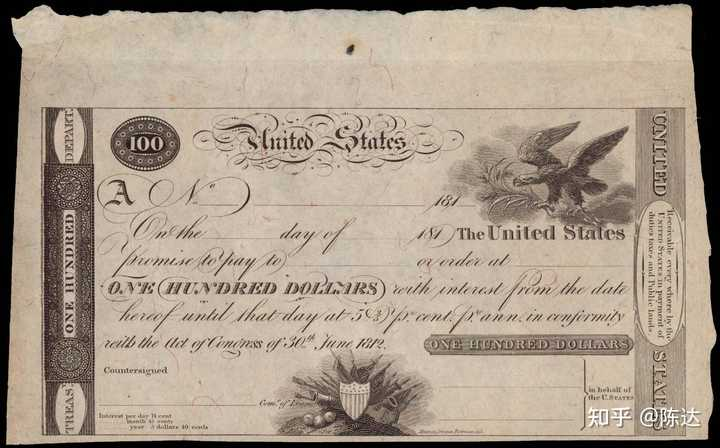
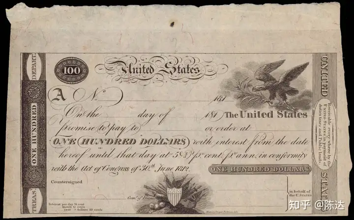
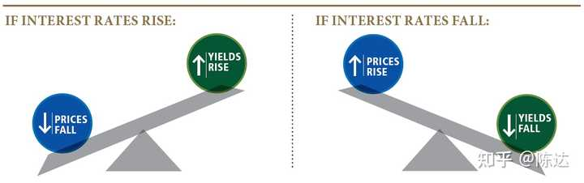
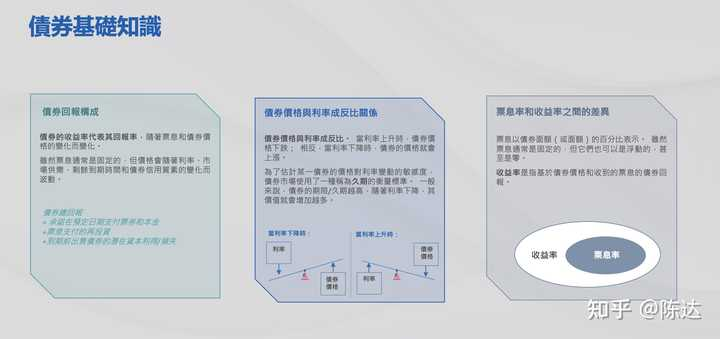
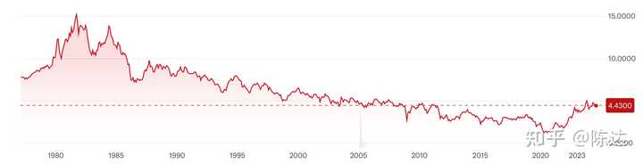
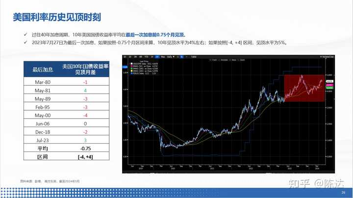
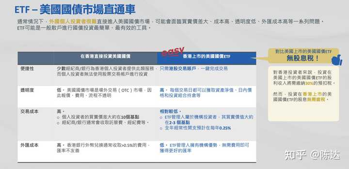
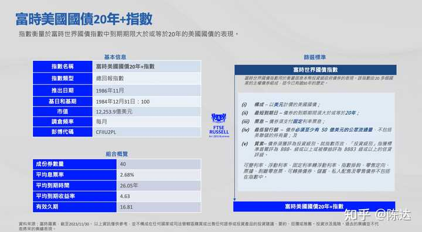

158 人赞同了该回答

交易降息

---

**所有资产的价格都不过是利率的倒影。**

—— 阿南达·美第奇

**

------------------

一、 国债往事**

（上图：美国早期国债，根据1812年法案发行的短期国债凭证。期限、受让人等均为空白可填写，年利率5.4%。)

考虑到读者未必人均金融专业，讲交易降息之前，我想先唠两句国债（treasury bonds）**这个大家最陌生的熟悉人**。**国债就像是无花果，所有人都听过，但很少人吃过**。许多人投过高收益债或者可转债（况且转债有强股性），而真正投资过国债的人，应该是凤毛麟角。

国债，本质上是某国政府以信用背书，向你借钱，按约定支付本息。约定可以五花八门，甚至可以约定只还利息不还本金到永远；**比如英国就有永续国债叫consols，一直派息一直派息直到世界的尽头。**虽然支付无限但其价值其实有限，用一个简单的**PV = C/r公式**就可以算出来，所以不要以为买了永续债券，你家的铁王座就能基业长青。

最早的国债除了虚无缥缈的信用以外，还有真金白银的抵押物，其抵押物就是税收。**毕竟Securities（证券）的字面含义就是安全、保全，其在15世纪就是指“贷款抵押物”，古早的证券一般都有抵押物。**比如被民间成为“风流快活欢乐王”的查理二世（他爸是因为缺钱而不息孤注一掷而被做掉的查理一世），他的斯图亚特王朝就以税收作为抵押，向著名的“金匠银行家”们借钱，将收上来的税，直接转入（redirect）债主们的账户，以支付利息。

**可惜快活王也是赖皮王，这哥们在1672放弃要脸，完成了英国漫长历史上唯一的政府违约**：拒绝偿还本金，税给收上来后也不redirect了，给皇家海军造船造炮，史称国库大刹器（the Stop of the Exchequer）。这次危机导致大批惨遭背刺的“金匠银行家”破人亡，在之后的很长一段时间里，愿意再借钱给王室的圈子，就萎缩到了小得你都能将其泡在浴缸里淹死的程度。**这也直接催生了英国央行的诞生——皇家信用拉胯，促使英格兰银行成立，接管政府融资，发行公债。**这跟美联储不一样，美联储不负责发行国债；你可以想象一个既能够印钞、同时又能够发债的央行，有多可怕。

时光荏苒，云卷云舒，这种情况下国债必将像长江下游的泥沙，越积越多。**到了跟拿破仑作战的时候，英国债务占GDP的比重一度高达200%，十倍于同期法国**。所以有人把联军最终能击溃不可一世的拿破仑，一部分归功于**国债发行带来的战争阔绰**。

时光荏苒，云卷云舒，再到后来，国债违约尤其是强国国债违约这种荒唐事，就鲜有发生。而全球经济霸主也从英国易帜到了美国，作为全球单极经济强国，美国的国债，你可以认为其违约风险无限趋近于零，**以至于无论是在书本上还是实践上，基本被市场当做唯一的无风险资产**。

但此无风险仅仅是“无违约风险”，如果你认购或者买入国债后并不会持有到期，而是会在二级市场上卖出的，那么对于你而言美债不是无风险的，因为你卖出的时候债价完全可能低于你买入的时候，你是可能亏损本金的。**美国国债最大的风险叫做久期风险（duration risk）。**

**那么这读起来不太丝滑、佶屈聱牙的“久期风险”**

**到底是什么？**

**二、久期：一头是利率，一头是价格**

关于国债的价格，如果你比较陌生，只需要知道一件事情，假设信用违约这个风险不变，国债价格就是一个跷跷板，一头是现行利率，另一头是债券价格。现行利率上升，债券价格就下跌；先行利率下降，债券价格就上涨。**他们的关系就有点像电阻与电流**。

原理可以从两个角度理解：角度一，**从现金流折现的角度**，现行利率作为未来本金与票息（coupon，债券的票面利率）的折现率的一部分，折现率高了分母就高了，分子不变，自然价格就低了。角度二，**从机会成本的角度来看**，利率提高，说明现在新发行的国债利息高吸引力高，那原来的债券的吸引力就打折，市场供需关系就会自发调整体位，价格自然就要下降。

**而债券的久期（duration）是指，债券持有者收回其全部本金和利息的平均时间**。久期风险，很多人理解为债券到期时间长短的风险；对了一部分也不全对。**久期风险最精准的定义，应该是债券市场价格受到利率变化的敏感性，而造成的风险**。这里有几个基本结论：

**久期越短，债券价格的波动越小，利率风险越小。**

**久期越长，债券价格的波动越大，利率风险越大。**

**利率上升，债券价格下降，其中久期长的债券比久期短的债券下降幅度大。**

**利率下降，债券价格上升，其中久期长的债券比久期短的债券上升幅度大。**

有人会说国债价格波动很小，不如股票刺激，其实不然。一个国债资产组合最重要的是久期，最重要的风险管理是久期管理。哪怕是美国国债，通过对久期的调整，也可以出现很高的波动。比如大家喜闻乐见于交易的美股市场上的20+年以上美国国债ETF-iShares（代码为TLT），过去52周的最低价82块4，而最高价将近104，这个波动区间不比麦当劳的股价小。

久期就是通过以利率为锚，来投资交易债券事后最重要的信息。举个例子。

**20+年美国国债ETF-iShares（代码为TLT），目前投资组合的有效久期（effective duration ）是16.5 年。因此，如果利率下降 1%，TLT 的价格可能就要上涨 16.5%。（作为背景信息参考，美国长期通胀平均值约为 3.2%，而20 年期国债收益率约为 5.2%。）。如果利率上涨，则反方向下跌。再比如南方东英富时美国国债20年+（代码为3433），久期为16.81年，如果利率下降 1.0%，其价格可能就上涨16.81%，vice versa.**

所以投资与交易国债，就是一方面玩久期，另一方面猜利率。

（资料来源：南方东英）

**三、 什么是再投资风险？**

除了久期风险以外，你投资固定收益，还有另外一个风险是再投资风险（reinvestment risk），就是你无法以原先的条件投资。**举个例子，你存款有5%的利率，但降息后存款就没有那么高的利息，你锁不住高利率。**降息周期中，再投资风险会增大。而投资者可以购买期限更长的债券以锁定现有的高额票息，同时享受长久期债券，在降息周期中的本金增值的回报。

**从2000年至今，一共有三轮3次降息周期，20年+美债平均总回报约37%，要显著大于1-3年和7-10年的短、中期债券总回报的13%和25%。**

**四、 降息预期如何？**

美联储降息预期可以说比较确定，it is not a matter of if but a matter of when。2024年以来，**G7 七国集团（美、德、英、法、日、意、加） 里，目前只剩美、日、英三家没降息。**而日本刚结束负利率时代，无所谓降息不降息。所以现在硬挺着不降息的，就美、英两家。英格兰银行已经刷刷刷释放信号，至于美联储，虽然扭捏，但迟早还是要乖乖就范，最新出来的冰凉的CPI数据，也为降息铺平了道路。

**所以对于降息，现在市场的分歧就是早降还是晚降，大降还是小降。比**如以木头姐认为“经济数据表象“下的美国经济衰退已经非常严重，外强中干，她认为今年会出人意料地大降（surprisingly large rate cuts ）**；而鲍叔最近的发言依然谨慎，信息增量薄如蝉翼，强调要“看情况”；美联储给的点阵，今年1次，明年4次；CME利率期货，市场的预期是今年两次，9月降25个基点的概率大于50%。**

（30年期美国国债收益率变化，随着美联储迅猛加息，目前收益率水平算是21世纪的高位水平，来源：yahoo!finance）

但即使从经济数据上来说，虽然总体上看起来不错，但边际变化上是开始疲软，强弩之末的感觉，从经济回顾和展望来看，经济和就业数据的前瞻性指标都出现走弱迹象；而另一边的通胀，突然遇冷，应该会维持逐渐下行趋势不变（到3%后可能会长期徘徊），**并未出现二次通胀，软着陆可期。**虽然，外强但不知道中干不干的美国经济，或许不支持美联储进入大幅降息周期，但继续加息的风险已大幅减弱甚至趋近于无，小小降息的紧迫性，市场倒逼鲍叔出牌。

**五、如何交易降息预期？——既要关注利率，也要管理久期。**

根据过去四十年8次加息周期，长端美债利率，会在最后一次加息前后4个月期间见顶。2023年7月最后一次加息，10年期美债在9月达到约5%的本轮最高点。目前10年期利率在4.3%左右，在开始降息之前，美债利率升高的可能性和空间都较为有限。

**所以，请划重点这个以历史经验推导出的结论：最后一次加息和开始降息之间，这个时间窗口，是买入长端美债的好时机。**

（资料来源：南方东英）

**国债投资或交易，建议使用ETF。**一来管理美债久期是一个专业性非常高的技术活，你很难自己来；二来ETF本身会节省你的大量摩擦成本。所以我不建议你直接认购或直接从二级市场上买入美债，除非你想持有到期，与其相守半生。

许多投资者会用美股市场上的TLT来投资、交易久期比较长的国债组合。

**美股市场有TLT，而港股市场有南方东英富时美国国债20年+指数ETF(3433.HK)；几乎复制策略，一个久期16.5年，另一个人久期16.8年，risk profile（风险侧写）非常接近。**港股3433还有个好处，交易成本低，另外相比TLT派息的税务预扣（香港投资者预扣30% 内地投资者预扣10% ），3433并**不会有税务预扣的忧虑**。

（资料来源：南方东英）

（资料来源：南方东英）

**南方东英除了香港市场上的长久期3433，还有一个短久期的南方东英精选美元债券基金（968153）**，相对波动更小，算是一个更稳健的选择。有些投资者没有港股账户，而这个产品在境内有一个USBD的互认产品，虽然之前境内的额度已经卖光了 不过最近有政策可能会放开额度，大家可以先关注起来。这个产品年初在利率下行后，没有急于加久期，从而避免了年初利率反弹带来的大幅回撤。二季度利率逐渐上行后，基金开始逐步增加久期。总体来看，基金在控制回撤和波动的前提下，给投资者提供了稳定上升的收益。截止5月31日，整体组合收益率达5.2%，久期为3.84年。

所以啊所以，门槛不高，你有港股账户，甚至通过人民币账户，也能交易美股的降息预期，从中获得确定性较强的本金收益。而且别忘了，债券本身，还有派息。美债交易，无虑违约风险，管理久期风险，控制再投资风险**；对于投资，有风险就有回报，完全无风险就几乎没有回报，风险本身，就是我们最赖以为生的生产资料。**

———————————

利益披露：作者持有20+年美国国债ETF多头仓位

本文不构成任何投资建议

[发布于 2024-06-14 20:21](//www.zhihu.com/question/598949790/answer/3530680603)・上海

​13 条评论​311 ​10 ​分享

​​

收起​