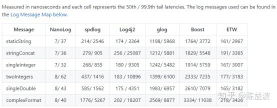
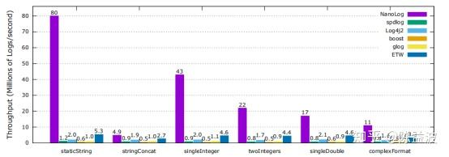
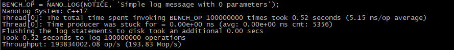
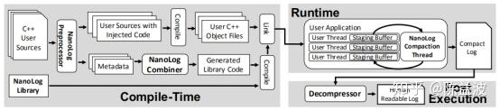

本文将介绍一款**延迟很低吞吐量很高的日志工具Nanolog，该日志系统较其他常用日志系统延迟低一到两个数量级，吞吐量高一到两个数量级**。

日志在系统中起到非常重要的debug作用，出core后debug离不开日志的帮助。但是一般的日志又比较慢，对于速度有极致追求的系统，开发人员不得不删除或关闭部分甚至全部日志运行系统，但这样又会导致出bug时难以定位。为了更好的解决这一问题。斯坦福大学的大神们开发了一款延迟极低的开源日志工具Nanolog。

Nanolog在低延迟和高吞吐两方面做了几点精妙的改进。**非常值得对低延迟技术有兴趣的朋友进行深入学习**。

**1.** **Nanolog有多快**

C++日志系统有很多开源的项目，如log4clpus、glog、spdlog、boostlog等。相对这些常见的Log库，Nanalog快一到两个数量级。

如上图所示，Nanolog的调用开销中位数为个位数纳秒。其他几款知名开源log的调用则需要耗时几百甚至上千纳秒。**Nanolog的中位数和99.9分位的延迟要比其他的小一到两个数量级。**

上图为不同日志库打印吞吐率对比，紫色的为Nanolog，比其它日志系统**每秒吞吐量高几倍到几十倍。**

上图为本人跑的**Benchmark测试结果**，输出1亿条日志仅耗时0.52秒，吞吐率到达了1.9亿条日志每秒，平均5.15ns输出一条。另外，本人测试了**输出字串加整形加浮点这样一条日志，发现延迟也仅为5ns每条**。

**2.** **Nanolog 快的原因**

首先为了降低写延迟，Nanolog用到的第一个编程技术就是**无锁编程**。这里说的无锁编程是真的**完全没有锁**。而非有的文章中写的将基于CAS锁的编程称为无锁编程。在低延迟的世界里，CAS锁也是锁。无锁编程使得任何写线程都能在较确定性的时间内非常快的完成调用，不会因为不同线程竞争资源而卡住不确定的时间。

**

通过基于GCC内置的线程局部存储设施 __thread 关键字**，Nanolog为每一个线程创建了一个独立的无锁环形队列，该关键字作用应该是和C++11标准引入的thread_local一致，__thread变量每一个线程有一份独立实体，各个线程的值互不干扰。内存屏蔽是多线程能同步的基础，基于内存屏蔽可以实现无锁队列，**单生产者单消费者可以用一个无锁队列来实现无锁编程**，这个是无锁编程的一个基础，再**通过多个无锁队列就可以做到多生产者单消费者的无锁编程**。这也是低延迟编程必用的技能。

降低延迟的第二个关键点便是**尽量减少cache miss**。低延迟系统要应对的头号敌人就是cache miss，**低延迟系统要尽量避免cache miss**。为了减少队列生产者和消费者多线程造成队列头尾指针判断时的cache miss。生产者端会缓存消费者线程在环形队列中的尾的位置。只有当空间不足时才重新读取一次队尾位置。这样就不会每次写入都可能发生cache miss，而是只有写满一次环形队列时，才会发生一次cache miss。编写多线程低延迟系统时要合理规划结构体的内存布局，按线程对变量的读写情况规划变量定义顺序，尽可能按线程访问顺序定义结构体顺序，同一线程的放一起，**不同线程间会改变的变量中间加一个cache line长度的空间进行分开，避免因false sharing导致cache miss**。比如该项目中的环形队列中作者便放了两条cache line长度的定义进行隔离（参考RuntimeLogger.h中的char cacheLineSpacer[2*Util::BYTES_PER_CACHE_LINE]）。这里为什么不是一倍而是两倍长度，本人也有点费解，有谁了解的希望能指点一二。

第三点，当讨论的是纳秒级别的延迟时，**任何慢速的函数调用都要尽可能避免**。通过系统接口去取时间就会显得偏慢，Nanolog**采用的是记录系统的tsc寄存器的数值来记录时间**。再将这个数值在日志处理线程中还原成日历时间。这一方法使得日志写线程的时间获取延迟降低为读寄存器级别。同样也是低延迟交易系统中必用的技巧。低延迟系统应当尽可能的避免使用慢速接口调用。**比如gettimeofday对低延迟系统来说就是慢速调用，在核心线程中要避免使用**。

把变量转成字符串这样的格式化转换是一个很耗时的操作，Nanolog把格式化操作放到副线程里执行。如果要想实现系统低延迟，就**尽可能的避免在核心线程中出现格式化处理**，比如把数值转成字串，能避免的一律避免。统统放到辅助线程中处理。

第四点值得学习的是，**在某些耗时最大的环节可以通过对信息进行压缩再解压来提升速度**。对于日志系统来说，写文件就是一个瓶颈。但是考虑到大多时候日志不需要实时去看。可以先写入压缩格式的日志文件来降低写入量。在要查看日志时再解压成人眼可读的格式即可。同时有大量静态字符串日志信息是重复不变的，没有必要每次调用都写入相同的静态字符串，只需要记录一次或者预编译时记录。Nanolog提供了两种版本，预编译版本便是在预编译时就进行了处理。**运行时不会重复写入静态字串**，**只写入变量信息，如整形，浮点型字串变量**。并且在写入日志时进行了压缩操作只写入压缩后的二进制信息以提高IO吞吐率。在日志完成后，通过后续解压缩来还原成人眼可读的文本文件。这一思路也是很值得学习的，比如网络传输时，要把异地交易所的信号进行跨网络传输。考虑到CPU处理速度通常远远快于专线的网络传输速度。可以**先将数据先做压缩，收到后解压再使用**。

**3. Nanolog 源码以及论文**

Nanolog基于C++17标准开发，源代码地址如下: [https://github.com/PlatformLab/NanoLog](https://link.zhihu.com/?target=https%3A//github.com/PlatformLab/NanoLog)

注意，github上有一个基于C++11标准开发的同名开源项目，不要搞错了，那个C++11的项目测试过延迟比这个正真对应的结果慢大约100倍。

论文于2018 USENIX年度技术会议，下载地址：

**4.改进**

最后提供一个无压缩版本的代码供参考。Nanolog压缩的特性使得对于要tail -f 实时看日志变得不是那么方便。考虑到某些场景只追求调用的低延迟，不追求高吞吐。每次查看log还需要解压的话使用起来就不够方便了。对于这一点，我们可以修改代码，把辅助线程中的压缩存储这步改为直接输出人眼可读的结果。这样的修改不会增加调用的延迟，只是会降低吞吐率。对于不关注吞吐率只关注低延迟的应用可以参考朱大牛修改的直接输出版本，github链接：[zwzw1/NanoLog](https://link.zhihu.com/?target=https%3A//github.com/zwzw1/NanoLog)

作者往期文章列表：

