### 2.1 MOSFET的结构

MOS器件简图：

对称器件，S极和D极可以互换（物理意义）。

**注意：NMOS中的N指的是N沟道，而不是N衬底！**

n型MOS（NMOS）器件的简化结构图：

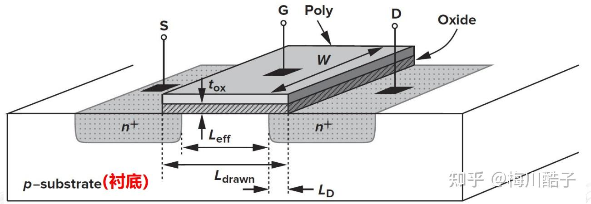

Poly：指多晶硅 

Oxide：指氧化层

特征尺寸：

$W（珊宽）、L_{drwan}（珊长） (eg:如果是18微米尺寸的工艺，那么 L_{drawm}\ge18\quad微米 ）$

L_{eff} 是有效栅宽， L_{drawn} 是总长度， L_{D} 是横向扩散的长度（定义： L_{eff} = L_{drawn}-2L_{D} ）

t_{ox} ：氧化层厚度

**

器件的衬底：**

     MOSFET是一个四端器件，因为经典的MOS工作中，源（S）和漏（D）结二极管都必须反偏，所以我们认为NMOS晶体管的衬底被链接到系统的最低点位。

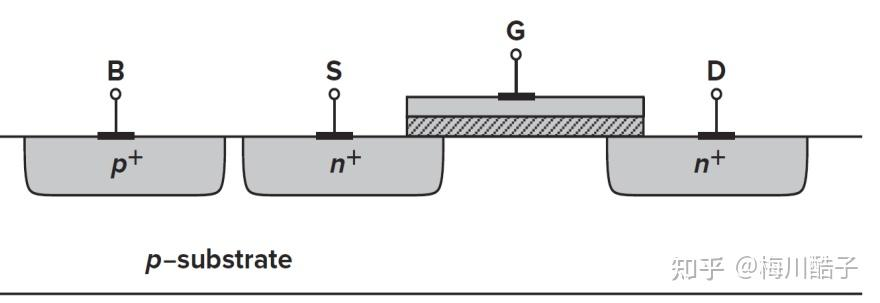

NMOS加上电压后，电压高的一侧是D极，电压低的一侧是S极，PMOS则相反

- G: gate（栅极）
- S: source（源极）
- D:Drain（漏极）
- B:  body
    在互补MOS（**CMOS**）技术中同时使用到了NMOS和PMOS，而在实际生产中，二者必须做在同一晶片上（即同一衬底）。

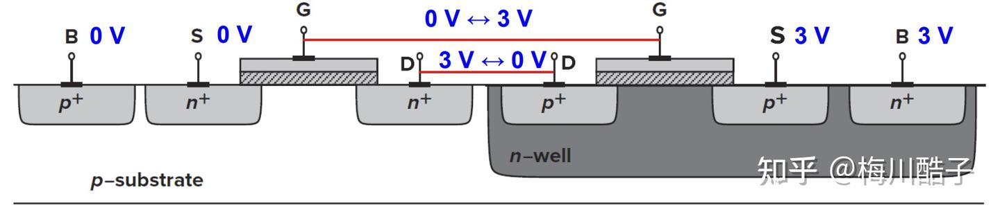

如图，在P衬底上制作一个隔离的n阱区域来做PMOS。其中的n-well称为n阱。    由图可以看出来：不同的NMOS的衬底（B极）都只能接在一起的（因为是做在整块P衬底上），通常是接地。而不同PMOS的B极可以隔离，因为PMOS可以做在衬底的许多地方，它们的 V_B 可以不同。

- 工艺上称为：double well（双阱工艺：实际上p衬底也做了一层薄薄的p阱）。
- 通常来说，NMOS的衬底（B）接最低电位，PMOS的衬底（B）接最高电位
- 因为NMOS的衬底不是理想的导体，存在一定电阻，所以电位就不是理想的，会导致：cross-talks（互扰）,解决方案：“深n阱”

### 2.2 MOS的I-V特性

#### 2.2.1 I-V特性

**(1):器件工作在"线性区"**

此时： V_{TH}">V_{GS}>V_{TH} 

$$漏极电流 I_D 的表达式： I_D = \mu_nC_{ox}\frac{W}{L}[(V_{GS}-V_{TH})V_{DS}-\frac{1}{2}V_{DS}^2]   \tag{1}$$

其中：

\mu_n 是电子的迁移率

C_{ox} 是单位面积的栅氧化层电容

W  是栅极宽度

L 是有效沟道长度

V_{OD} = V_{GS}-V_{TH} :被称为"**过驱动电压(overdrive voltage)"**

**

I-V曲线：

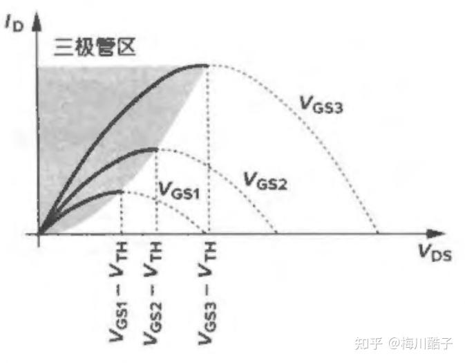

VGS不同时根据（1）式得到的抛物线由图可知：

- 器件的“电流能力”随着 V_{GS} 的增大而增加
- 每条抛物线的极值发生在： V_{DS} = V_{GS}-V_{TH} 
$$- 且峰值电流为： I_{D,max} = \frac{1}{2}\mu_{n}C_{ox}\frac{W}{L}(V_{GS}-V_{TH})^2 \tag{2} $$
     如果在式中 V_{DS} （当 V_{DS} 时，即靠近原点处，我们说器件工作在深三极管区），我们有：

$$I_{D}\approx \mu_{n}C_{ox}\frac{W}{L}(V_{GS}-V_{TH})V_{DS} $$

可以看出，此时漏极电流是 V_{DS} 的线性函数，在V_{DS} 较小时可以从上图的曲线中很明显地看出来。我们可以将每条抛物线用一条直线来近似，这种线性关系表明源漏之间的通道可以用一个线性电阻来表示：

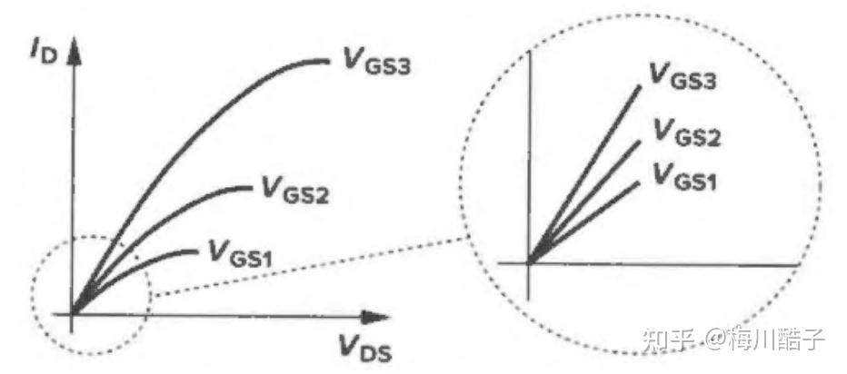

$$深三级管区的线性工作即：                                  R_{on} = \frac{1}{ \mu_{n}C_{ox}\frac{W}{L}(V_{GS}-V_{TH})} \tag{3} $$

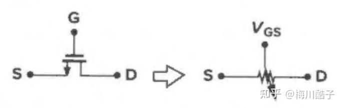

作为可空线性电阻的MOSFET(2)器件工作在"饱和区"**

此时 V_{GS}-V_{TH}">V_{DS}>V_{GS}-V_{TH} ：

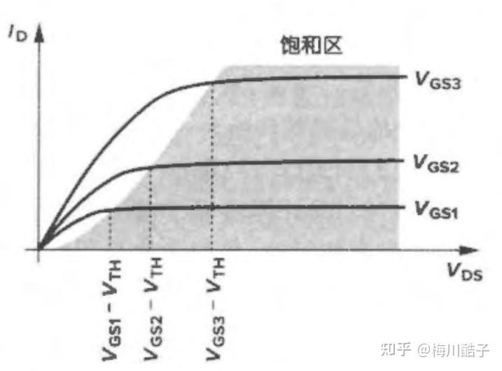

漏电流的饱和此时漏极电流不遵循抛物线特性，且 I_D  相对恒定。

我们可以从器件的夹断特性来理解：

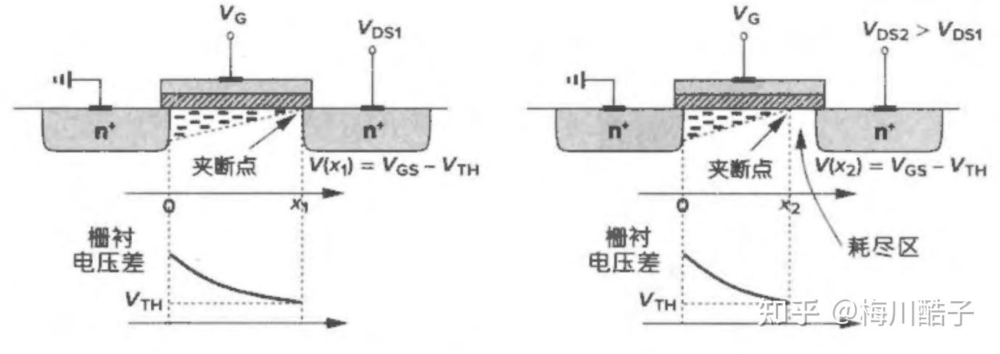

夹断特性如图，如果 V_{DS} 略大于 V_{GS}-V_{TH} ，则反型区将在 x\le L 处终止，称为：**”沟道被夹断“**

随着V_{DS} 的进一步升高， Q_d 等于0 的点将逐渐向源移动。因此，在沟道长度方向的某些点处，栅和氧化层-硅界面之间的电势差不足以产生反型层。

有：

$$I_{D} = \frac{1}{2}\mu_{n}C_{ox}\frac{W}{L'}(V_{GS}-V_{TH})^2 \tag{4}  这里的 L' 是 Q_d 下降到0的点，即上图右侧的x2.$$

**

对于PMOS器件：**

线性区和饱和区的电流特性：

$$I_D = -\mu_nC_{ox}\frac{W}{L}[(V_{GS}-V_{TH})V_{DS}-\frac{1}{2}V_{DS}^2]   \tag{5}$$

$$和 I_{D,max} = -\frac{1}{2}\mu_{n}C_{ox}\frac{W}{L'}(V_{GS}-V_{TH})^2 \tag{6} 这里出现符号是由于假设 I_D 从漏极流向源，而空穴沿着相反的反向移动。**注意，对于导通的PMOS器件， **V_{GS} 、V_{DS}和V_{GS}-V_{TH}** 都是负的。**由于空穴的迁移率约为电子的一半，所以PMOS器件具有较低的”电流驱动“能力。$$

**

      若L为常数，那么工作在饱和区的MOSFET构成一个链接源和漏的电流源。（注意：NMOS电流源向地注入电流而PMOS电流源从 **V_{DD}** 抽取电流）**

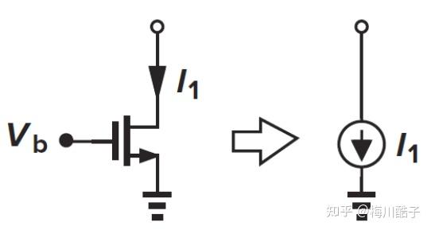

NMOS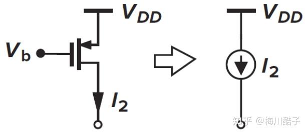

PMOS于此（1）（4）（5）（6）表示N(P)MOS器件的大信号特性，即只要晶体管导体，就可以利用这些式子计算栅、源和漏在任意偏压下的漏电流。而由于电流特性的非线性特性带来的困难，后面常采用线性近似（小信号模型）分析电路。

**

#### 2.2.2 MOSFET的跨导

$$在信号处理过程中，我们将漏电流的变化量除以栅源电压的变化量定义为“跨导”（通常定义在“饱和区”）,并用 g_m 表示：  g_m  = \frac{\partial I_D}{\partial V_{GS}}|_{V_{DS,const}}  \\= \mu_n C_{ox} \frac{W}{L}(V_{GS}-V_{TH}) \\ = \frac{2I_D}{V_{GS}-V_{TH}} \\ = \sqrt[]{2\mu_n C_{ox}\frac{W}{L}I_D} \tag{7}  g_m 代表了器件的灵敏度，单位是1/ \Omega 或西门子(S)。（可以发现饱和区的 g_m 等于深三极管区 R_{on} 的倒数）$$

在上述表达式中， I_D 和 V_{GS}-V_{TH} 是偏置量，在小信号模型分析中，我们可以假定因为信号的幅值很小，以至于偏置量都不发生改变。

（在三级管区时也存在跨导，可以用前面的式子对 V_{GS} 求偏导求得。）

$$对于PMOS，饱和区的跨导可表示为：  g_m   =- \mu_n C_{ox} \frac{W}{L}(V_{GS}-V_{TH}) \\ = -\frac{2I_D}{V_{GS}-V_{TH}} \\ = \sqrt[]{2\mu_p C_{ox}\frac{W}{L}I_D} \tag{7}  $$

### 2.3 二级效应

#### 2.3.1 沟道长度调制效应

由之前的分析过程我们可以知道，当栅和漏之间的电压差增大时，实际的反型沟道长度逐渐减小。也即，L'实际上是 V_{DS} 的函数（见式：（4））。这一效应称为：“沟道长度调制**”。

 $定义 L' = L-\nabla L ，即 1/L' \approx (1+\nabla L/L)/L ，并且假设 \nabla L/L 和 V_{DS} 之间的关系是线性的$

则在饱和区，我们可以得到：

$$I_D  \approx \mu_n C_{ox}\frac{W}{L} (V_{GS}-V_{TH})^2(1+\lambda V_{DS}) \tag{8}$$

式中的 \lambda 是沟道长度调制系数。

如图：

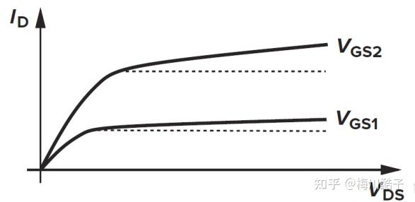

沟道长度调制效应所引起的饱和区有限斜率这种现象使得I-V特性曲线在饱和区出现非零斜率，因而使D和S之间电流源非理想。

参数 \lambda 表示给定的 V_{DS} 增量所引起的沟道长度的相对变化量。因此沟道越长， \lambda 值越小。

（注意：在三极管区是不存在沟道长度调制效应的）

$$考虑到沟道长度调制效应，跨导的表达式需要被修正：（第二个等式保持不变）  g_m   =- \mu_n C_{ox} \frac{W}{L}(V_{GS}-V_{TH})(1+\lambda V_{DS}) \\ = -\frac{2I_D}{V_{GS}-V_{TH}} \\ = \sqrt[]{2\mu_p C_{ox}\frac{W}{L}I_D（1+\lambda V_{DS}）} \tag{9}  $$

由此我们有以下结论：

$$\lambda \propto 1/L\\ \frac{\partial I_D}{\partial V_{GS}}|_{V_{DS}=const}=g_m \propto \lambda/L\propto1/L^2\\ r_0\propto L/I_D $$

#### 2.3.2 体效应（衬底调制效应）

  由于在实际的集成电路中，MOS管共用衬底，无法像分立原件中那样衬底和源极相连（ v_{BS} = 0 ）若再将源极与衬底相连，就相当于所有MOS管的源极并接在一起，这是不现实的。但为了保证导电沟道与衬底的隔离，就要求沟道和衬底之间的PN结始终处于反偏状态，即要求NMOS管的衬底接电路的最低电位( v_{BS}\le 0 ),而PMOS管的衬底接电路的最高电位( v_{BS}\ge 0 )。

设 V_{TNO} 表示 v_{BS}=0 的阈值电压。在NMOS管衬底为负偏压 v_{BS}\le0 情况下，沟道与衬底间的耗尽层加厚，致使 v_{GS} = V_{TNO} 时，不能形成导电沟道，意味着此时的 V_{TNO}">V_{TH}>V_{TNO} 。

v_{BS} 对增强型NMOS管的转移特性的影响如图：

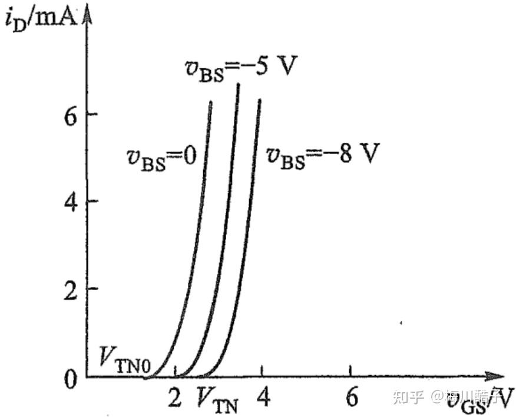

具有衬底调制效应的转移特性曲线示意图|v_{BS}| 越大，则 V_{TH} 就越大。这种现象被称为**衬底调制效应**。衬底B因此又被称为背栅。

可以证明，考虑体效应后， V_{TH}  为：

$$V_{TH}=V_{TH0}+\gamma(\sqrt[]{|2\Phi_F+V_{SB}}|-\sqrt[]{|2\Phi_{F}|})\tag{9.1}$$

其中

\gamma 称为体效应系数

V_{SB} 是源衬电势差

### 2.4 器件的电容

在第六章研究信号的高频特性时，MOS器件电容的存在就不可忽略。

我们认为电容存在于MOSFET的四个端子中任意两个之间：

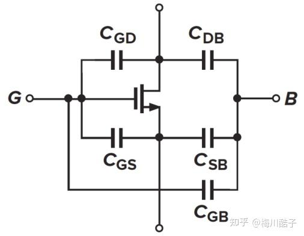

MOS电容**可以注意到图中只显示了五个电容，但是照排列组合四个端口应该会有六个电容。实际上S和D之间的电容是可以忽略不计的，这和制造MOS的工艺有关。感兴趣的同学可以去了解一下相关工艺。注意，做题时可能会将几个电容等效为一个电容，比如做题时题目图中不会显示电容 C_{GB} 那很有可能是与电容 C_{GS} 串联而等效成一个电容了。

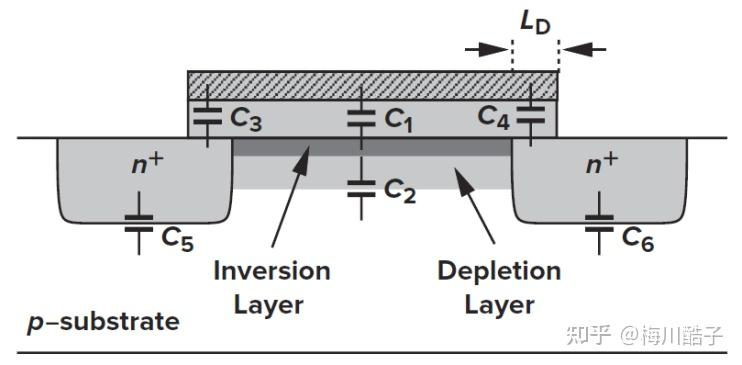

直观图C_{GB}">C_1+C_2-->C_{GB} C_{GS}">C_3 -->C_{GS} 

C_{GD}">C_4 -->C_{GD} C_{SB}">C_5-->C_{SB} C_{DB}">C_6-->C_{DB} 

了解到器件存在电容之后还要能画出包括器件电容在内的完整的小信号模型（其实先画小信号模型再画电容，同时把可以合并电容合并在一起即可）

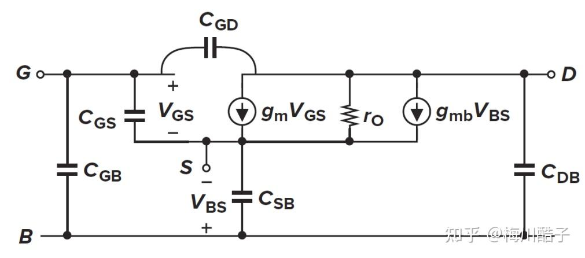

完整的MOS小信号模型
### 2.5 MOS小信号模型

之前的平方特性以及以上得到的与电压相关的电容构成了MOSFET的大信号模型。在对信号会显著影响偏置工作点的电路进行分析时，尤其是要考虑非线性效应的情况下，这一模型被证明是不可缺少的。

而如果信号对偏置的影响小，那么就可以用小信号模型简化计算。由于在许多模拟电路中MOSFETs偏置在饱和区，我们可以导出其相应的小信号模型。

（a）理想MOSFET的小信号模型**

我们让栅源端产生一个电压增量 \nabla V = V_{GS} （小信号量），该电压增益引起的漏电流的增量为： g_m V_{GS} ，可以用链接在栅源之间的压控电流源来模拟。栅电流非常小，其变化可以忽略。

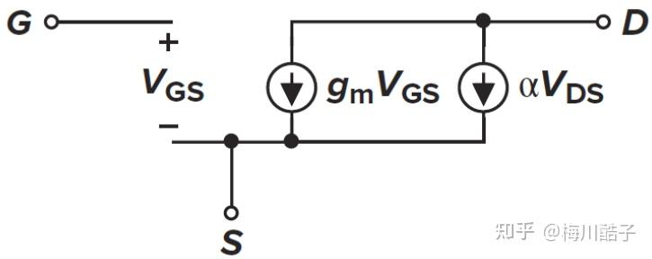

**（b）用独立电流源来表示沟道长度调制效应**

由于沟道长度调制效应，漏电流也随着漏-源电压变化，这一效应也可以用一个压控电流源模拟：

独立电流源来表示沟道长度调制效应（c）用电阻来表示沟道长度调制效应

如果一个电流源的电流值与它两端的电压成线性关系，则该电流源就等效于一个线性阻抗。

$$r_0 = \frac{\partial V_{DS}}{\partial I_D} = \frac{1}{\frac{1}{2}\mu_n C_{ox} \frac{W}{L}(V_{GS}-V_{TH})^2 \lambda} \approx \frac{1+\lambda V_{DS}}{\lambda I_D} $$

$假定 \lambda V_{DS} \le 1 ，有：$

 $$r_0 \approx \frac{1}{\lambda I_D}  \tag{10} $$

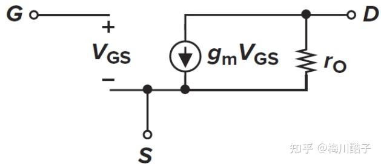

用电阻来表示沟道长度调制效应**（d）体效应用独立电流源表示**

由前可知，衬底电势影响阈值电压，因而也影响栅-源过驱动电压。在所有其他端子保持恒定电压的情况下，漏电流是衬底电压的函数，也就是说衬底相当于第二个栅。用链接于D和S之间的电流源模拟这一关系，其电流值为： g_{mb}V_{bs} ，式中 g_{mb} = \partial I_D/\partial V_{BS} ，有

 $g_{mb} = \eta g_m \tag{11}$

$式中 \eta = g_{mb}/g_m ,典型值为0.25。（当 V_{SB} 增加时，体效应的效果会变弱）$

注意, g_m V_{GS} 和 g_{mb}V_{BS} 有相同的极性，也就是说，增大栅电压与增大衬底电压效果相同。

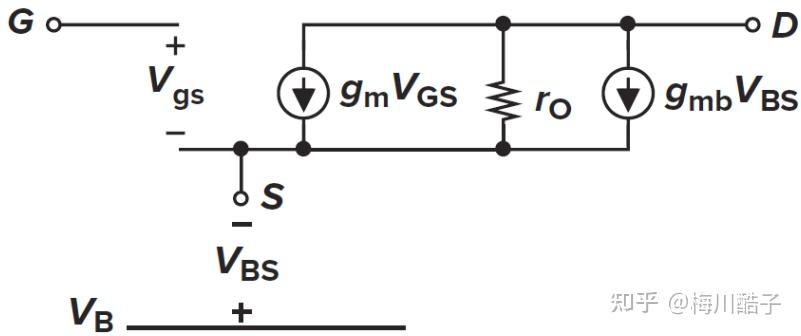

体效应用独立电流源表示**PMOS小信号模型：**

虽然两者的画法差异较大，但是要记住NMOS器件和PMOS器件的小信号模型是相同的！

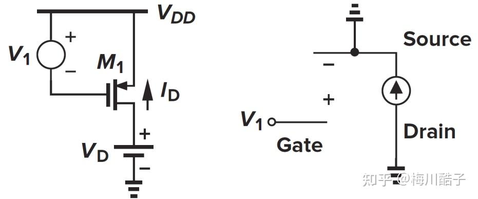

PMOS小信号模型

假设 V_1 变得更正，使 V_{GS} 更负，晶体管具有更大的过驱动电压，通过晶体管的电流变大，因而I_D 变得更负了（按图中方向使负的，因为实际的空穴方向是从源到漏）。因此负的 V_{GS} 产生 \Delta I_D 负,反过来说正的 V_{GS} 产生正的 \Delta I_D ,如同NMOS器件一样。

### 附 MOS SPICE模型

在求MOS管的本征增益时，我们通常会用到一些工艺模型参数的经典值。

下面给出NMOS和PMOS器件的模型参数：

**NMOS：**

V_{TH0} = 0.7(V) 

$$\gamma = 0.45(V^{1/2}) $$

$$\lambda = 0.1(V^{-1}) $$

2\Phi_F = 0.9 (V) 

$$t_{ox} = 9\times10^{-9}(m) $$

**PMOS：**

V_{TH0} =- 0.8(V) 

$$\gamma = 0.4(V^{1/2}) $$

$$\lambda = 0.2(V^{-1}) $$

2\Phi_F = 0.8(V) 

$$t_{ox} = 9\times10^{-9}(m) $$

**参数定义：**

V_{TH0}:V_{SB}=0时的阈值电压 

\gamma:体效应系数 

\lambda  : 沟道长度调制系数

$2\Phi_F:用于求考虑体效应时的V_{TH}(见公式（9.1）） $

t_{ox}：栅氧厚度 
 

（有问题欢迎指出，本文省略了很多内容和证明过程，同时不能代表期末考点！！仅用于复习回顾）