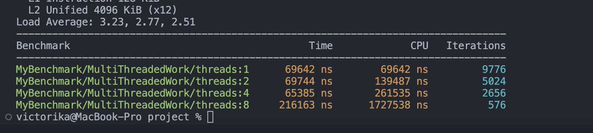
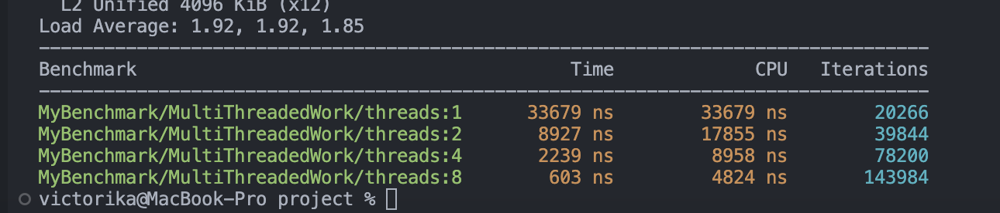
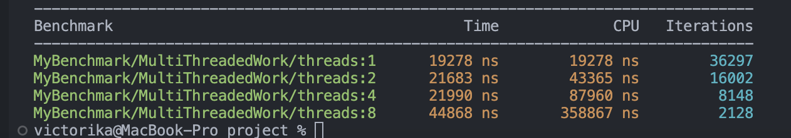
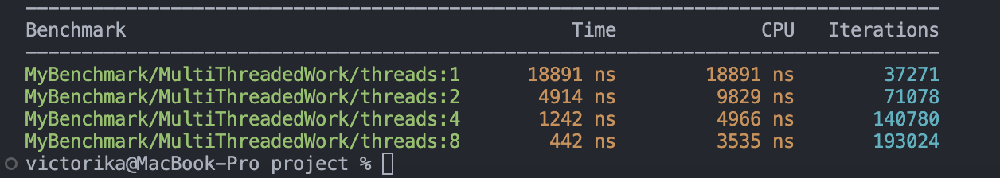
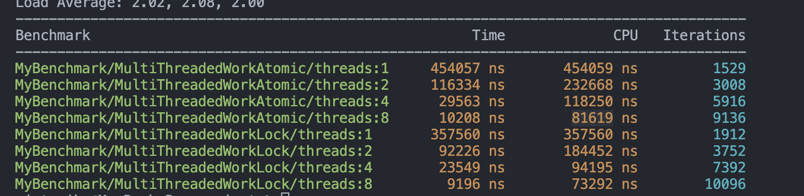
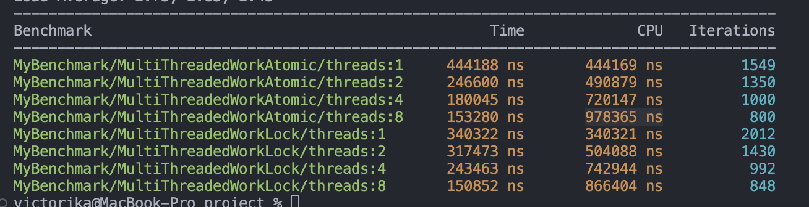
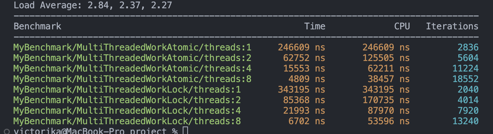
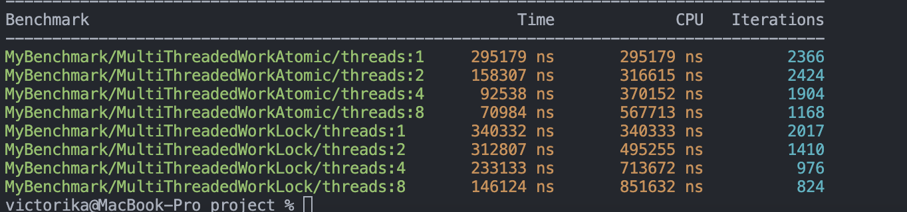
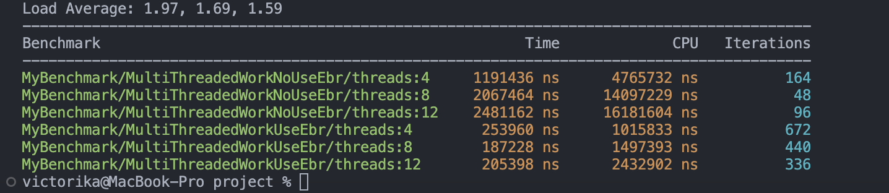

作者：weiqiangwu

在现代软件开发中，多线程编程已成为提升应用程序性能和响应速度的关键技术之一。尤其在C++领域，多线程编程不仅能充分利用多核处理器的优势，还能显著提高计算密集型任务的效率。然而，多线程编程也带来了诸多挑战，特别是在性能优化方面。本文将深入探讨影响C++多线程性能的一些关键因素，比较锁机制与原子操作的性能。通过这些内容，希望能为开发者提供有价值的见解和实用的优化策略，助力于更高效的多线程编程实践。

先在开头给一个例子，你认为下面这段benchmark代码结果会是怎样的。这里的逻辑很简单，将0-20000按线程切成n片，每个线程在一个Set里查找这个数字存不存在，存在则计数+1。

`#include **
#include 
#include 
#include 
#include 

constexpr int kSetSize = 10000;

class MyBenchmark : public benchmark::Fixture {
 public:
  void SetUp(const ::benchmark::State& state) override {
    std::call_once(flag, [this]() {
      s = std::make_shared>();
      for (int i = 0; i insert(i);
      }
    });
  }

  std::shared_ptr> GetSet() { return s; }

 private:
  std::shared_ptr> s;
  std::once_flag flag;
};

BENCHMARK_DEFINE_F(MyBenchmark, MultiThreadedWork)(benchmark::State& state) {
  for (auto _ : state) {
    int size_sum = kSetSize * 2;
    int size_per_thread = (size_sum + state.threads() - 1) / state.threads();
    int sum = 0;
    int start = state.thread_index() * size_per_thread;
    int end = std::min((state.thread_index() + 1) * size_per_thread, size_sum);
    for (int i = start; i count(i) > 0) {
        sum++;
      }
    }
  }
}

// 注册基准测试，并指定线程数
BENCHMARK_REGISTER_F(MyBenchmark, MultiThreadedWork)->Threads(1);
BENCHMARK_REGISTER_F(MyBenchmark, MultiThreadedWork)->Threads(2);
BENCHMARK_REGISTER_F(MyBenchmark, MultiThreadedWork)->Threads(4);
BENCHMARK_REGISTER_F(MyBenchmark, MultiThreadedWork)->Threads(8);

BENCHMARK_MAIN();
`

跑出来的结果如下：

将任务切分成多个片段并交由多线程执行后，整体性能不仅没有提升，反而下降了，且性能与线程数成反比。那么，问题来了：导致这种结果的原因是什么？如何才能实现合理的并行执行，从而降低CPU的执行时间？在接下来的部分，笔者将为你揭示答案。

#### 影响多线程性能的因素

笔者认为，影响多线程性能的主要因素有以下两个：

1.Lock Contention。** **2.Cache Coherency。**

Lock Contention对应使用锁来处理多线程同步问题的场景，而Cache Coherency则对应使用原子操作来处理多线程同步问题的场景。

#### Lock Contention

在多线程环境中，多个线程同时尝试获取同一个锁（Lock）时，会发生竞争现象，这就是所谓的锁竞争（Lock Contention）。锁竞争会导致线程或进程被阻塞，等待锁被释放，从而影响系统的性能和响应时间。大多数情况下，开发人员会选择使用锁来解决线程间的同步问题，因此锁竞争问题也变得广为人知且容易理解。由于锁的存在，位于临界区的代码在同一时刻只能由一个线程执行。因此，优化的思路就是尽量避免多个线程同时访问同一资源。常见的优化方向有两种：

**1.减少临界区大小：临界区越小，这段代码的执行时间就越短，从而在整体程序运行时间中所占的比例也越小，冲突也就越少。** **2.对共享资源进行分桶操作：每个线程只会在某个桶上访问资源，理想情况下，每个线程都会访问不同的桶，这样就不会有冲突。**

减少临界区大小需要开发者对自己的代码进行仔细思考，将不必要的操作放在临界区外，例如一些初始化和内存分配操作。

对共享资源进行分桶操作在工程实践中也非常常见。例如，LevelDB的LRUCache中，每个Key只会固定在一个桶上。如果hash函数足够优秀且数据分布足够随机，这种方法可以大大提高LRUCache的性能。

#### Cache Coherency

缓存一致性（Cache Coherency）是指在多处理器系统中，确保各个处理器的缓存中的数据保持一致的机制。由于现代计算机系统通常包含多个处理器，每个处理器都有自己的缓存（如L1、L2、L3缓存），因此在并发访问共享内存时，可能会出现缓存数据不一致的问题。缓存一致性协议旨在解决这些问题，确保所有处理器在访问共享内存时看到的是一致的数据。

当我们对一个共享变量进行写入操作时，实际上需要通过缓存一致性协议将该变量的更新同步到其他线程的缓存中，否则可能会读到不一致的值。实际上，这个同步过程的单位是一个缓存行（Cache Line），而且同步过程相对较慢，因为涉及到跨核通信。

由此引申出两个严重影响性能的现象：

**1.Cache Ping-Pong。** **2.False Sharing。**

#### Cache Ping-Pong

缓存乒乓效应（Cache Ping-Pong）是指在多处理器系统中，多个处理器频繁地对同一个缓存行（Cache Line）进行读写操作，导致该缓存行在不同处理器的缓存之间频繁地来回传递。这种现象会导致系统性能下降，因为缓存行的频繁传递会引起大量的缓存一致性流量和处理器间通信开销。

讲到这里，其实就可以解释为什么开头那段代码会随着线程数量的增加而性能反而下降。代码中的变量 s 是一个共享资源，但它使用了 shared_ptr。在复制 shared_ptr 时，会引起引用计数的增加（计数+1），多个线程频繁对同一个缓存行进行读写操作，从而引发缓存乒乓效应，导致性能下降。最简单的修改方式就是去掉 shared_ptr，代码如下，同时还可以得到我们预期的结果，即CPU时间随着线程数的增加而降低：

`#include **
#include 
#include 
#include 
#include 

constexpr int kSetSize = 10000;

class MyBenchmark : public benchmark::Fixture {
 public:
  void SetUp(const ::benchmark::State& state) override {
    std::call_once(flag, [this]() {
      for (int i = 0; i & GetSet() { return s; }

 private:
  std::unordered_set s;
  std::once_flag flag;
};

BENCHMARK_DEFINE_F(MyBenchmark, MultiThreadedWork)(benchmark::State& state) {
  for (auto _ : state) {
    int size_sum = kSetSize * 2;
    int size_per_thread = (size_sum + state.threads() - 1) / state.threads();
    int sum = 0;
    int start = state.thread_index() * size_per_thread;
    int end = std::min((state.thread_index() + 1) * size_per_thread, size_sum);
    for (int i = start; i  0) {
        benchmark::DoNotOptimize(sum++);
      }
    }
  }
}

// 注册基准测试，并指定线程数
BENCHMARK_REGISTER_F(MyBenchmark, MultiThreadedWork)->Threads(1);
BENCHMARK_REGISTER_F(MyBenchmark, MultiThreadedWork)->Threads(2);
BENCHMARK_REGISTER_F(MyBenchmark, MultiThreadedWork)->Threads(4);
BENCHMARK_REGISTER_F(MyBenchmark, MultiThreadedWork)->Threads(8);

BENCHMARK_MAIN();
`

#### False Sharing

伪共享（False Sharing）实际上是一种特殊的缓存乒乓效应（Cache Ping-Pong）。它指的是在多处理器系统中，多个处理器访问不同的数据，但这些数据恰好位于同一个缓存行中，导致该缓存行在不同处理器的缓存之间频繁传递。尽管处理器访问的是不同的数据，但由于它们共享同一个缓存行，仍然会引发缓存一致性流量，导致性能下降。

为了更好地理解这一现象，我们可以对上面的代码进行一些修改。假设我们使用一个 vector 来记录不同线程的 sum 值，这样虽然不同线程修改的是不同的sum，但是还是在一个缓存行上。使用 atomic 是为了强制触发缓存一致性协议，否则操作系统可能会进行优化，不会立即将修改反映到主存。

`#include 
#include 
#include 
#include 
#include 
#include 

constexpr int kSetSize = 10000;

class MyBenchmark : public benchmark::Fixture {
 public:
  void SetUp(const ::benchmark::State& state) override {
    std::call_once(flag, [this, &state]() {
      for (int i = 0; i >(state.threads());
    });
  }

  const std::unordered_set& GetSet() { return s; }
  std::vector>& GetSums() { return sums; }

 private:
  std::unordered_set s;
  std::once_flag flag;
  std::vector> sums;
};

BENCHMARK_DEFINE_F(MyBenchmark, MultiThreadedWork)(benchmark::State& state) {
  for (auto _ : state) {
    int size_sum = kSetSize;
    int size_per_thread = (size_sum + state.threads() - 1) / state.threads();
    int sum = 0;
    int start = state.thread_index() * size_per_thread;
    int end = std::min((state.thread_index() + 1) * size_per_thread, size_sum);
    for (int i = start; i  0) {
        benchmark::DoNotOptimize(GetSums()[state.thread_index()]++);
      }
    }
  }
}

// 注册基准测试，并指定线程数
BENCHMARK_REGISTER_F(MyBenchmark, MultiThreadedWork)->Threads(1);
BENCHMARK_REGISTER_F(MyBenchmark, MultiThreadedWork)->Threads(2);
BENCHMARK_REGISTER_F(MyBenchmark, MultiThreadedWork)->Threads(4);
BENCHMARK_REGISTER_F(MyBenchmark, MultiThreadedWork)->Threads(8);

BENCHMARK_MAIN();
`

可以看到，尽管不同线程没有使用同一个变量，但由于 sums 里面的元素共享同一个缓存行（Cache Line），同样会导致性能急剧下降。

针对这种情况，只要我们将 sums 中的元素隔离，使它们不在同一个缓存行上，就不会引发这个问题。一般来说，缓存行的大小为64字节，我们可以使用一个类填充到64个字节来实现隔离。优化后的代码如下：

`#include 
#include 
#include 
#include 
#include 
#include 

constexpr int kSetSize = 10000;

struct alignas(64) PaddedCounter {
  std::atomic value{0};
  char padding[64 - sizeof(std::atomic)];  // 填充到缓存行大小
};

class MyBenchmark : public benchmark::Fixture {
 public:
  void SetUp(const ::benchmark::State& state) override {
    std::call_once(flag, [this, &state]() {
      for (int i = 0; i (state.threads());
    });
  }

  const std::unordered_set& GetSet() { return s; }
  std::vector& GetSums() { return sums; }

 private:
  std::unordered_set s;
  std::once_flag flag;
  std::vector sums;
};

BENCHMARK_DEFINE_F(MyBenchmark, MultiThreadedWork)(benchmark::State& state) {
  for (auto _ : state) {
    int size_sum = kSetSize;
    int size_per_thread = (size_sum + state.threads() - 1) / state.threads();
    int sum = 0;
    int start = state.thread_index() * size_per_thread;
    int end = std::min((state.thread_index() + 1) * size_per_thread, size_sum);
    for (int i = start; i  0) {
        benchmark::DoNotOptimize(GetSums()[state.thread_index()].value++);
      }
    }
  }
}

// 注册基准测试，并指定线程数
BENCHMARK_REGISTER_F(MyBenchmark, MultiThreadedWork)->Threads(1);
BENCHMARK_REGISTER_F(MyBenchmark, MultiThreadedWork)->Threads(2);
BENCHMARK_REGISTER_F(MyBenchmark, MultiThreadedWork)->Threads(4);
BENCHMARK_REGISTER_F(MyBenchmark, MultiThreadedWork)->Threads(8);

BENCHMARK_MAIN();
`

#### Lock VS Atomic

#### Lock Atomic Benchmark

很多人都认为锁（lock）比原子操作（atomic）要更慢，那么实际上真的是这样吗？下面我们通过两个测试来进行对比。

公平起见，我们将使用一个基于 atomic 变量实现的自旋锁（SpinLock）与 std::mutex 进行性能对比。自旋锁的实现摘自 Folly 库。其原理是使用一个 atomic 变量来标记是否被占用，并使用 acquire-release 内存序来保证临界区的正确性。在冲突过大时，自旋锁会使用 sleep 让出 CPU。代码如下：

`#pragma once

#include 
#include 

class Sleeper {
  static const uint32_t kMaxActiveSpin = 4000;
  uint32_t spin_count_;

 public:
  constexpr Sleeper() noexcept : spin_count_(0) {}

  inline __attribute__((always_inline)) static void sleep() noexcept {
    struct timespec ts = {0, 500000};
    nanosleep(&ts, nullptr);
  }

  inline __attribute__((always_inline)) void wait() noexcept {
    if (spin_count_ load(std::memory_order_relaxed) == LOCKED);
    }
  }

  inline __attribute__((always_inline)) void unlock() noexcept {
    AtomicCast(&lock_)->store(FREE, std::memory_order_release);
  }

 private:
  inline __attribute__((always_inline)) bool cas(uint8_t compare, uint8_t new_val) noexcept {
    return AtomicCast(&lock_)->compare_exchange_strong(compare, new_val, std::memory_order_acquire,
                                                       std::memory_order_relaxed);
  }

  inline __attribute__((always_inline)) static std::atomic* AtomicCast(uint8_t* value) {
    return reinterpret_cast*>(value);
  }

 private:
  uint8_t lock_;
};
`

在第一个benchmark中，我们测试了无竞争情况下的性能。也就是说，原子变量的CAS操作只会执行一次，不会进入 sleep 状态。在这种情况下，自旋锁（SpinLock）等价于一次原子 set 操作。 代码如下：

`#include 
#include 
#include 
#include 
#include 
#include 
#include "spin_lock.h"

constexpr int kSetSize = 10000;

// struct alignas(64) PaddedCounter {
//   std::atomic value{0};
//   char padding[64 - sizeof(std::atomic)];  // 填充到缓存行大小
// };

struct alignas(64) PaddedCounterLock {
  int value{0};
  char padding[64 - sizeof(std::atomic)];  // 填充到缓存行大小
};

class MyBenchmark : public benchmark::Fixture {
 public:
  void SetUp(const ::benchmark::State& state) override {
    std::call_once(flag, [this, &state]() {
      for (int i = 0; i (state.threads());
      sum_lock = std::vector(state.threads());
    });
  }

  const std::unordered_set& GetSet() { return s; }
  std::vector& GetSumsAtomic() { return sums_atomic; }
  std::vector& GetSumLock() { return sum_lock; }

 private:
  std::unordered_set s;
  std::once_flag flag;
  std::vector sums_atomic;
  std::vector sum_lock;
};

BENCHMARK_DEFINE_F(MyBenchmark, MultiThreadedWorkAtomic)(benchmark::State& state) {
  SpinLock m;
  for (auto _ : state) {
    int size_sum = kSetSize;
    int size_per_thread = (size_sum + state.threads() - 1) / state.threads();
    int sum = 0;
    int start = state.thread_index() * size_per_thread;
    int end = std::min((state.thread_index() + 1) * size_per_thread, size_sum);
    for (int i = start; i  0) {
        std::lock_guard lg(m);
        benchmark::DoNotOptimize(GetSumsAtomic()[state.thread_index()].value++);
      }
    }
  }
}

BENCHMARK_DEFINE_F(MyBenchmark, MultiThreadedWorkLock)(benchmark::State& state) {
  std::mutex m;
  for (auto _ : state) {
    int size_sum = kSetSize;
    int size_per_thread = (size_sum + state.threads() - 1) / state.threads();
    int sum = 0;
    int start = state.thread_index() * size_per_thread;
    int end = std::min((state.thread_index() + 1) * size_per_thread, size_sum);
    for (int i = start; i  0) {
        std::lock_guard lg(m);
        benchmark::DoNotOptimize(GetSumLock()[state.thread_index()].value++);
      }
    }
  }
}

// 注册基准测试，并指定线程数
BENCHMARK_REGISTER_F(MyBenchmark, MultiThreadedWorkAtomic)->Threads(1);
BENCHMARK_REGISTER_F(MyBenchmark, MultiThreadedWorkAtomic)->Threads(2);
BENCHMARK_REGISTER_F(MyBenchmark, MultiThreadedWorkAtomic)->Threads(4);
BENCHMARK_REGISTER_F(MyBenchmark, MultiThreadedWorkAtomic)->Threads(8);

BENCHMARK_REGISTER_F(MyBenchmark, MultiThreadedWorkLock)->Threads(1);
BENCHMARK_REGISTER_F(MyBenchmark, MultiThreadedWorkLock)->Threads(2);
BENCHMARK_REGISTER_F(MyBenchmark, MultiThreadedWorkLock)->Threads(4);
BENCHMARK_REGISTER_F(MyBenchmark, MultiThreadedWorkLock)->Threads(8);

BENCHMARK_MAIN();
`

benchmark结果：

第二个benchmark是对比竞争激烈时的性能，代码如下：

`#include 
#include 
#include 
#include 
#include 
#include 
#include "spin_lock.h"

constexpr int kSetSize = 10000;

class MyBenchmark : public benchmark::Fixture {
 public:
  void SetUp(const ::benchmark::State& state) override {
    std::call_once(flag, [this, &state]() {
      for (int i = 0; i & GetSet() { return s; }
  void SpinLockAndAdd() {
    std::lock_guard lg(m1_);
    count_++;
  }

  void MutexLockAndAdd() {
    std::lock_guard lg(m2_);
    count_++;
  }

 private:
  std::unordered_set s;
  std::once_flag flag;
  uint32_t count_;
  SpinLock m1_;
  std::mutex m2_;
};

BENCHMARK_DEFINE_F(MyBenchmark, MultiThreadedWorkAtomic)(benchmark::State& state) {
  for (auto _ : state) {
    int size_sum = kSetSize;
    int size_per_thread = (size_sum + state.threads() - 1) / state.threads();
    int sum = 0;
    int start = state.thread_index() * size_per_thread;
    int end = std::min((state.thread_index() + 1) * size_per_thread, size_sum);
    for (int i = start; i  0) {
        SpinLockAndAdd();
      }
    }
  }
}

BENCHMARK_DEFINE_F(MyBenchmark, MultiThreadedWorkLock)(benchmark::State& state) {
  for (auto _ : state) {
    int size_sum = kSetSize;
    int size_per_thread = (size_sum + state.threads() - 1) / state.threads();
    int sum = 0;
    int start = state.thread_index() * size_per_thread;
    int end = std::min((state.thread_index() + 1) * size_per_thread, size_sum);
    for (int i = start; i  0) {
        MutexLockAndAdd();
      }
    }
  }
}

// 注册基准测试，并指定线程数
BENCHMARK_REGISTER_F(MyBenchmark, MultiThreadedWorkAtomic)->Threads(1);
BENCHMARK_REGISTER_F(MyBenchmark, MultiThreadedWorkAtomic)->Threads(2);
BENCHMARK_REGISTER_F(MyBenchmark, MultiThreadedWorkAtomic)->Threads(4);
BENCHMARK_REGISTER_F(MyBenchmark, MultiThreadedWorkAtomic)->Threads(8);

BENCHMARK_REGISTER_F(MyBenchmark, MultiThreadedWorkLock)->Threads(1);
BENCHMARK_REGISTER_F(MyBenchmark, MultiThreadedWorkLock)->Threads(2);
BENCHMARK_REGISTER_F(MyBenchmark, MultiThreadedWorkLock)->Threads(4);
BENCHMARK_REGISTER_F(MyBenchmark, MultiThreadedWorkLock)->Threads(8);

BENCHMARK_MAIN();
`

benchmark结果：

可以看到，无论是哪一种情况，std::mutex 的性能都更优。当然，这个测试结果可能会因不同的操作系统而有所不同，但至少可以得出一个结论：这两者的性能是一个量级的，并不存在 atomic 一定比 std::mutex 更快的说法。这其实是因为现代 C++ 中的 std::mutex 实现已经高度优化，其实现与上面的自旋锁（SpinLock）非常相似，在低竞争的情况下并不会陷入内核态。

那么，按上面的说法，是不是我们根本不需要 atomic 变量呢？先来分析一下 atomic 的优点。

atomic 的优点有：

1.可以实现内存占用极小的锁。** **2.当临界区操作可以等价于一个原子操作时，性能会更高。**

对于第二个结论，我们可以做个测试。同样，拿前面的例子稍作修改。

case 1如下:

`#include **
#include 
#include 
#include 
#include 
#include 
#include "spin_lock.h"

constexpr int kSetSize = 10000;

class MyBenchmark : public benchmark::Fixture {
 public:
  void SetUp(const ::benchmark::State& state) override {
    std::call_once(flag, [this, &state]() {
      for (int i = 0; i & GetSet() { return s; }

 private:
  std::unordered_set s;
  std::once_flag flag;
};

BENCHMARK_DEFINE_F(MyBenchmark, MultiThreadedWorkAtomic)(benchmark::State& state) {
  std::atomic sum = 0;
  for (auto _ : state) {
    int size_sum = kSetSize;
    int size_per_thread = (size_sum + state.threads() - 1) / state.threads();
    int sum = 0;
    int start = state.thread_index() * size_per_thread;
    int end = std::min((state.thread_index() + 1) * size_per_thread, size_sum);
    for (int i = start; i  0) {
        benchmark::DoNotOptimize(sum++);
      }
    }
  }
}

BENCHMARK_DEFINE_F(MyBenchmark, MultiThreadedWorkLock)(benchmark::State& state) {
  std::mutex m;
  uint32_t sum = 0;
  for (auto _ : state) {
    int size_sum = kSetSize;
    int size_per_thread = (size_sum + state.threads() - 1) / state.threads();
    int sum = 0;
    int start = state.thread_index() * size_per_thread;
    int end = std::min((state.thread_index() + 1) * size_per_thread, size_sum);
    for (int i = start; i  0) {
        std::lock_guard lg(m);
        sum++;
      }
    }
  }
}

// 注册基准测试，并指定线程数
BENCHMARK_REGISTER_F(MyBenchmark, MultiThreadedWorkAtomic)->Threads(1);
BENCHMARK_REGISTER_F(MyBenchmark, MultiThreadedWorkAtomic)->Threads(2);
BENCHMARK_REGISTER_F(MyBenchmark, MultiThreadedWorkAtomic)->Threads(4);
BENCHMARK_REGISTER_F(MyBenchmark, MultiThreadedWorkAtomic)->Threads(8);

BENCHMARK_REGISTER_F(MyBenchmark, MultiThreadedWorkLock)->Threads(1);
BENCHMARK_REGISTER_F(MyBenchmark, MultiThreadedWorkLock)->Threads(2);
BENCHMARK_REGISTER_F(MyBenchmark, MultiThreadedWorkLock)->Threads(4);
BENCHMARK_REGISTER_F(MyBenchmark, MultiThreadedWorkLock)->Threads(8);

BENCHMARK_MAIN();
`

benchmark结果：

case 2如下:

`#include 
#include 
#include 
#include 
#include 
#include 
#include "spin_lock.h"

constexpr int kSetSize = 10000;

class MyBenchmark : public benchmark::Fixture {
 public:
  void SetUp(const ::benchmark::State& state) override {
    std::call_once(flag, [this, &state]() {
      for (int i = 0; i & GetSet() { return s; }
  void AtomicAdd() { atomic_count_++; }
  void MutexLockAndAdd() {
    std::lock_guard lg(m);
    count_++;
  }

 private:
  std::unordered_set s;
  std::once_flag flag;
  uint32_t count_;
  std::atomic atomic_count_;
  std::mutex m;
};

BENCHMARK_DEFINE_F(MyBenchmark, MultiThreadedWorkAtomic)(benchmark::State& state) {
  for (auto _ : state) {
    int size_sum = kSetSize;
    int size_per_thread = (size_sum + state.threads() - 1) / state.threads();
    int sum = 0;
    int start = state.thread_index() * size_per_thread;
    int end = std::min((state.thread_index() + 1) * size_per_thread, size_sum);
    for (int i = start; i  0) {
        AtomicAdd();
      }
    }
  }
}

BENCHMARK_DEFINE_F(MyBenchmark, MultiThreadedWorkLock)(benchmark::State& state) {
  for (auto _ : state) {
    int size_sum = kSetSize;
    int size_per_thread = (size_sum + state.threads() - 1) / state.threads();
    int sum = 0;
    int start = state.thread_index() * size_per_thread;
    int end = std::min((state.thread_index() + 1) * size_per_thread, size_sum);
    for (int i = start; i  0) {
        MutexLockAndAdd();
      }
    }
  }
}

// 注册基准测试，并指定线程数
BENCHMARK_REGISTER_F(MyBenchmark, MultiThreadedWorkAtomic)->Threads(1);
BENCHMARK_REGISTER_F(MyBenchmark, MultiThreadedWorkAtomic)->Threads(2);
BENCHMARK_REGISTER_F(MyBenchmark, MultiThreadedWorkAtomic)->Threads(4);
BENCHMARK_REGISTER_F(MyBenchmark, MultiThreadedWorkAtomic)->Threads(8);

BENCHMARK_REGISTER_F(MyBenchmark, MultiThreadedWorkLock)->Threads(1);
BENCHMARK_REGISTER_F(MyBenchmark, MultiThreadedWorkLock)->Threads(2);
BENCHMARK_REGISTER_F(MyBenchmark, MultiThreadedWorkLock)->Threads(4);
BENCHMARK_REGISTER_F(MyBenchmark, MultiThreadedWorkLock)->Threads(8);

BENCHMARK_MAIN();
`

benchmark结果：

接下来结合这两个优点来看，链式数据结构的场景非常适合使用 atomic 变量。

1.内存占用少：即使每个节点都实现一个自旋锁（SpinLock），也不会浪费太多内存。** **2.链式数据结构的临界区通常可以优化成一个指针的 CAS 操作。**

#### Epoch Based Reclamation

虽然如此，但要写一个高性能的并发安全的链式数据结构是非常困难的，这主要是因为写操作包含了删除操作。举个最简单的例子：

假设有一个链表 A->B->C，一个线程正在读B节点，另一个线程正在删除B节点，如何保证读线程在读B节点期间不会被另一个线程给删掉？

再举个更复杂的例子：

假设有一个链表 A->B->C。一个线程正在读取 B 节点，另一个线程正在修改 B 节点。显然，最简单的实现是锁住 B，同时只允许一个操作，但显然这样从各方面来看性能都不是最佳的，这是第一个方法。

第二个方法是类似于 Copy On Write（COW）。写操作时先重新构造一个节点 B1，再修改对应的数据，最后通过 CAS 操作修改指针连接 A->B1。

我们来分析一下为什么第二个方法远比第一个方法要好。

首先，上锁会触发原子写，意味着即便是你只是为了读数据，也会触发一次 Cache Line 一致性同步的问题。而且在找到 B 节点之前的每一个节点都要依次上锁来保证读取的正确性，这意味着极大概率会发生 Cache Ping-Pong 问题。

再来看写操作，写操作除了上锁以外还需要修改节点的数据。第二个方法需要先构造一个新的节点再修改，意味着这个节点在插入链表之前一定不在其他线程的 Cache 里（排除刚好有某个变量和这个新节点的内存在同一个 Cache Line 的情况）。而第一个方法修改的节点已经在链表里，这表示在之前一定有线程已经访问过这个节点，那么它很可能在 Cache 里面，从而触发一次 Cache Line 一致性同步的问题。

然而事情没有这么简单。试想一下，在修改完指针 A->B1 后，B 节点需要被丢弃释放，这时候其他线程有可能正在访问 B 节点而导致崩溃。

可以看出这些问题都是因为删除操作引起的，这个问题有几个著名的解决方案，比如 Epoch Based Reclamation 和 Hazard Pointer 等。这里只介绍其中的 Epoch Based Reclamation，感兴趣的话请自行搜索了解其他实现方式。

该算法的思路是删除操作会尝试触发版本 +1，但只有当所有线程都是最新版本 e 时才能成功，成功后会回收 e-1 版本的内存。因此，最多会累积 3 个版本未释放节点的内存。是个以空间换时间，轻读重写的方案。

首先，每个线程维护自己的线程变量：

**1.active：标记该线程是否正在读数据。** **2.epoch：标记该线程当前的版本。**

全局维护变量：

**1.global_epoch：全局最新的版本。** **2.retire_list：等待释放的节点。**

读操作：

**1.首先把线程 active 标记为 true，表示正在读数据。** **2.然后把 global_epoch 赋值给 epoch，记录当前正在读的版本。** **3.如果线程需要删除节点，则把节点放到全局的 retire_list 末尾。** **4.结束读后，将 active 标记为 false。**

写操作：

**1.如果要删除节点，则把节点放到全局的 retire_list 末尾，并且尝试增加版本。** **2.增加版本时检查所有线程的状态，当所有线程满足 epoch 等于当前版本 e 或者 active 为 false 时，进行版本 e = e + 1 操作。** **3.清空 e-2 版本的 retire_list。**

这里给出一个简单的实现，代码如下：

`#pragma once

#include 
#include 
#include 
#include 
#include 

constexpr uint8_t kEpochSize = 3;
constexpr uint8_t kCacheLineSize = 64;

template 
class ThreadIDManager;

template 
struct ThreadID {
  ThreadID() { tid = ThreadIDManager::GetInstance().AcquireThreadID(); }
  ~ThreadID() { ThreadIDManager::GetInstance().ReleaseThreadID(tid); }
  uint32_t tid;
};

template 
class ThreadIDManager {
 public:
  ThreadIDManager() : tid_list_(kReadThreadNum) { std::iota(tid_list_.begin(), tid_list_.end(), 1); }
  ThreadIDManager(const ThreadIDManager &) = delete;
  ThreadIDManager(ThreadIDManager &&) = delete;
  ThreadIDManager &operator=(const ThreadIDManager &) = delete;
  ~ThreadIDManager() = default;

  static ThreadIDManager &GetInstance() {
    static ThreadIDManager inst;
    return inst;
  }

  uint32_t AcquireThreadID() {
    std::lock_guard lock(tid_list_mutex_);
    auto tid = tid_list_.back();
    tid_list_.pop_back();
    return tid;
  }

  void ReleaseThreadID(const uint32_t tid) {
    std::lock_guard lock(tid_list_mutex_);
    tid_list_.emplace_back(tid);
  }

 private:
  std::vector tid_list_;
  std::mutex tid_list_mutex_;
};

struct TLS {
  TLS() : active(false), epoch(0) {}
  TLS(TLS &) = delete;
  TLS(TLS &&) = delete;
  void operator=(const TLS &) = delete;
  ~TLS() = default;
  std::atomic_flag active;
  std::atomic epoch;
} __attribute__((aligned(kCacheLineSize)));

template 
class EbrManager {
 public:
  EbrManager() : tls_list_(), global_epoch_(0), update_(false), write_cnt_(0) {
    for (int i = 0; i  &) = delete;
  EbrManager(EbrManager &&) = delete;
  EbrManager &operator=(const EbrManager &) = delete;
  ~EbrManager() { ClearAllRetireList(); }

  void ClearAllRetireList() {
    for (int i = 0; i obj = object;
    do {
      node->next = retire_list_[epoch].load(std::memory_order_acquire);
    } while (!retire_list_[epoch].compare_exchange_weak(node->next, node, std::memory_order_acq_rel));

    auto write_cnt = write_cnt_.fetch_add(1, std::memory_order_relaxed);
    if (write_cnt > kReadThreadNum) {
      if (!update_.test_and_set(std::memory_order_acq_rel)) {
        TryGC();
        update_.clear(std::memory_order_release);
      }
    }
  }

 private:
  inline TLS &GetTLS() {
    thread_local ThreadID thread_id;
    return tls_list_[thread_id.tid];
  }

  inline void TryGC() {
    auto epoch = global_epoch_.load(std::memory_order_acquire);
    // TODO 优化记录上一次搜索到的位置
    for (int i = 0; i obj);
      auto *old_node = retire_node;
      retire_node = retire_node->next;
      delete old_node;
    }
    retire_list_[index].store(nullptr, std::memory_order_release);
  }

  struct RetireNode {
    RCObject *obj;
    RetireNode *next;
  };
  std::array start_padding_;
  std::array tls_list_;
  std::atomic global_epoch_;
  std::array mid_padding_;
  std::atomic_flag update_;
  std::atomic write_cnt_;
  std::atomic retire_list_[kEpochSize];
  std::array end_padding_;
};
`

这里再给出一个benchmark，对比一下使用 Epoch Based Reclamation（EBR）和不使用 EBR 的区别。由于笔者时间有限，只能写一个非常简单的版本，仅供参考。

`#include 
#include 
#include "ebr.h"
#include "spin_lock.h"

struct Node {
  Node() : lock(), next(nullptr) {}
  int key;
  int value;
  Node *next;
  SpinLock lock;
};

class NodeFree {
 public:
  NodeFree(Node *node) { delete node; }
};

/*
 * 快速测试起见，简单写了个list版本的kv结构，里面只会有3个元素，然后只支持Get和Modify，Modify也必定会命中key。
 * 不是直接把key，value，next设置成atomic变量而是使用SpinLock的原因是模拟复杂情况，真实情况下会存在Add和Remove操作，实现没有如此简单。
 */
class MyList {
 public:
  MyList() {
    Node *pre_node = nullptr;
    auto *&cur_node = root_;
    // 这里虽然插入了10个元素，但后面的实现会假设第一个key 9作为header是绝对不会被修改或者读到的。
    for (int i = 0; i key = i;
      cur_node->value = i;
      cur_node->next = pre_node;
      pre_node = cur_node;
    }
  }

  int Get(int key, int *value) {
    root_->lock.lock();
    auto *cur_node = root_->next;
    auto *pre_node = root_;
    while (cur_node != nullptr) {
      cur_node->lock.lock();
      pre_node->lock.unlock();
      if (key == cur_node->key) {
        *value = cur_node->value;
        cur_node->lock.unlock();
        return 0;
      }
      pre_node = cur_node;
      cur_node = cur_node->next;
    }
    pre_node->lock.unlock();
    return 1;
  }
  int Modify(int key, int value) {
    root_->lock.lock();
    auto *cur_node = root_->next;
    auto *pre_node = root_;
    while (cur_node != nullptr) {
      cur_node->lock.lock();
      pre_node->lock.unlock();
      if (key == cur_node->key) {
        cur_node->value = value;
        cur_node->lock.unlock();
        return 0;
      }
      pre_node = cur_node;
      cur_node = cur_node->next;
    }
    pre_node->lock.unlock();
    return 1;
  }

  int GetUseEbr(int key, int *value) {
    ebr_mgr_.StartRead();
    auto *cur_node = root_->next;
    while (cur_node != nullptr) {
      if (key == cur_node->key) {
        *value = cur_node->value;
        ebr_mgr_.EndRead();
        return 0;
      }
      cur_node = cur_node->next;
    }
    ebr_mgr_.EndRead();
    return 1;
  }

  int ModifyUseEbr(int key, int value) {
    root_->lock.lock();
    auto *cur_node = root_->next;
    auto *pre_node = root_;
    while (cur_node != nullptr) {
      cur_node->lock.lock();
      if (key == cur_node->key) {
        auto *new_node = new Node;
        new_node->key = cur_node->key;
        new_node->value = value;
        new_node->next = cur_node->next;
        pre_node->next = new_node;
        cur_node->lock.unlock();
        pre_node->lock.unlock();
        ebr_mgr_.FreeObject(cur_node);
        return 0;
      }
      auto *next_node = cur_node->next;
      pre_node->lock.unlock();
      pre_node = cur_node;
      cur_node = next_node;
    }
    pre_node->lock.unlock();
    return 1;
  }

 private:
  Node *root_;
  EbrManager ebr_mgr_;
};

class MyBenchmark : public benchmark::Fixture {
 public:
  void SetUp(const ::benchmark::State &state) override {}

  MyList &GetMyList() { return l; }

 private:
  MyList l;
  std::once_flag flag;
};

constexpr int kKeySize = 10000;

BENCHMARK_DEFINE_F(MyBenchmark, MultiThreadedWorkNoUseEbr)(benchmark::State &state) {
  for (auto _ : state) {
    auto &mylist = GetMyList();
    if (0 == state.thread_index()) {
      // modify
      for (int i = 0; i Threads(4);
BENCHMARK_REGISTER_F(MyBenchmark, MultiThreadedWorkNoUseEbr)->Threads(8);
BENCHMARK_REGISTER_F(MyBenchmark, MultiThreadedWorkNoUseEbr)->Threads(12);

BENCHMARK_REGISTER_F(MyBenchmark, MultiThreadedWorkUseEbr)->Threads(4);
BENCHMARK_REGISTER_F(MyBenchmark, MultiThreadedWorkUseEbr)->Threads(8);
BENCHMARK_REGISTER_F(MyBenchmark, MultiThreadedWorkUseEbr)->Threads(12);

BENCHMARK_MAIN();
`

benchmark结果：

