之前看了几篇做稀疏的加速器设计，其中 **merger** 电路设计在 **OP** 和** GP** 的数据流中都十分重要。然而 **MatRaptor 和 SpArch **等加速器中的排序电路都非常的别扭，于是决定看一下**排序电路的高效实现，**以期优化。

参考《Sorting it out in Hardware: A State-of-the-Art Survey》、《A survey of network-based hardware accelerators》、《Hardware solution to sorting algorithms: A review》

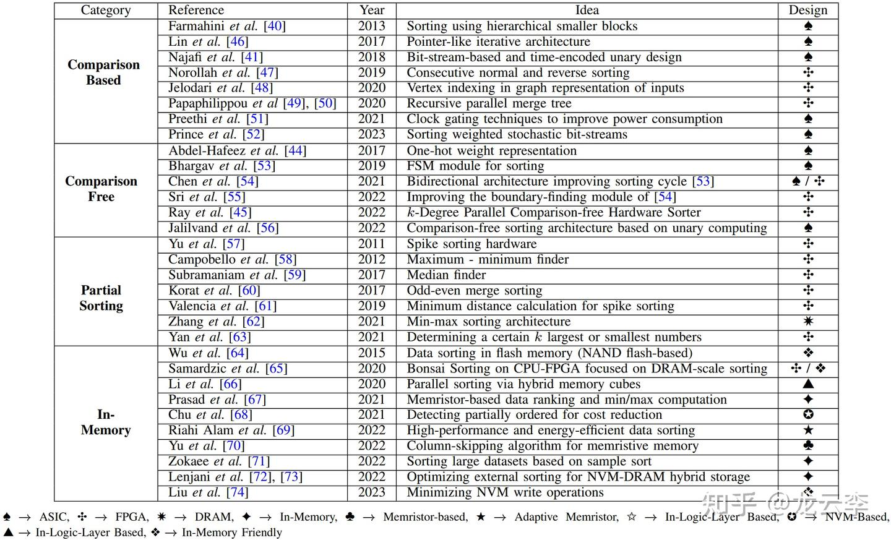

文献
### 1. Conventional Approach

参考[wikipedia](https://link.zhihu.com/?target=https%3A//en.wikipedia.org/wiki/Sorting_network)

#### 1.1  Inserting/Bubble Sort Network

**基本单元compare-swap unit**：

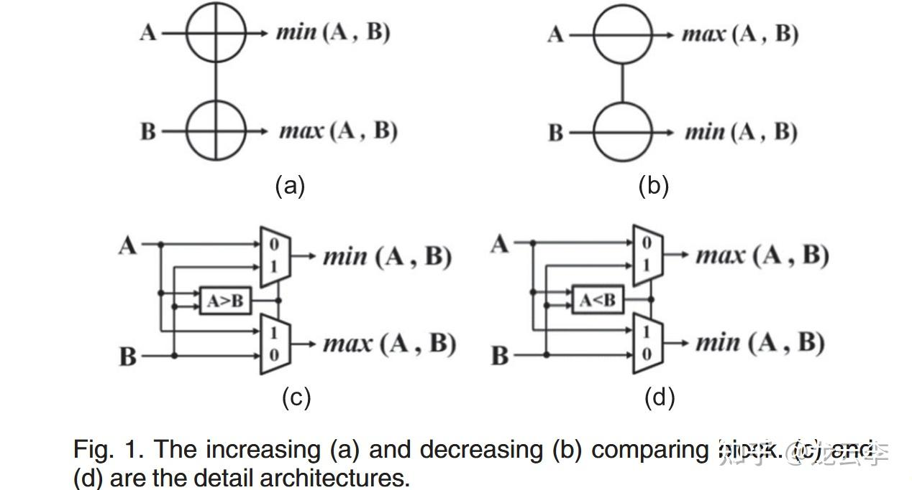

基本单元 compare-swap unit以 compare swap unit 为节点可以构建** Sorting Network**。

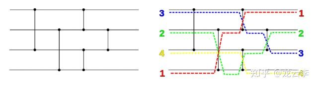

基于简单Sorting Network的例子以 compare swap unit 为节点，构建 **insertion sort 和 bubble sort**。在并行系统中这两者是等效的。

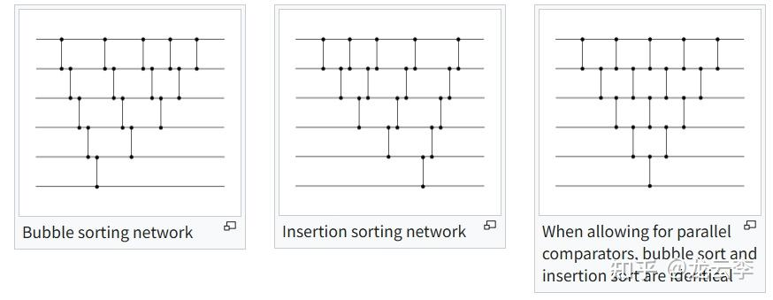

构建 inserting/bubble sorting network这种简单尝试就成功的将运行时间变成 2M-3 级流水线，时间复杂度成为O(M)。

#### 1.2 Odd-Even Transposition Sort Network

参考[博客园](https://link.zhihu.com/?target=https%3A//www.cnblogs.com/jia66wei/articles/2271164.html)。Odd-Even Transposition Sort Network 的 size 复杂度是 O(n^2) .depth 复杂度是 O(n) .

如何证明一个网络是排序网络？**根据 0-1 原则，**只需要证明，这个网络可以将一个**长度为 n **的** 0-1 序列**完成排序，他就是一个完备的排序网络。我们用归纳法证明 Odd-Even Transposition Sort Network 是一个排序网络。

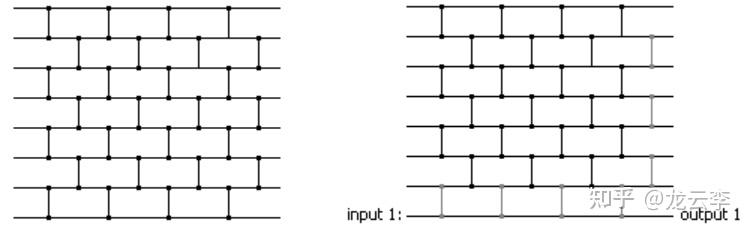

Odd-Even Transposition Sort Network假设一个7输入的网络是排序网络，那么再加入一个输入，根据** 0-1 **原则，只要证明新输入为 0 或 1 时可以完成排序即可。当新输入为1时，如上图右所示，无需改变任何位置，因此可以完成排序。

当新输入为0时，情况如下所示，也可以完成排序：

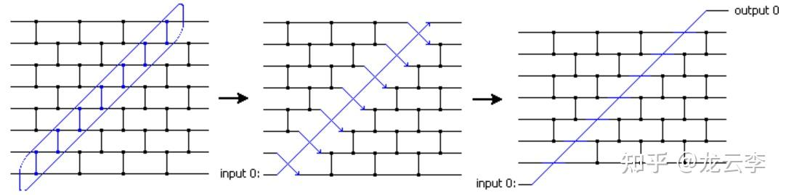

新输入为0时的 Odd-Even Transposition Sort Network奇偶移项排序网络的深度降为 M。

#### 1.3 Batcher odd–even mergesort

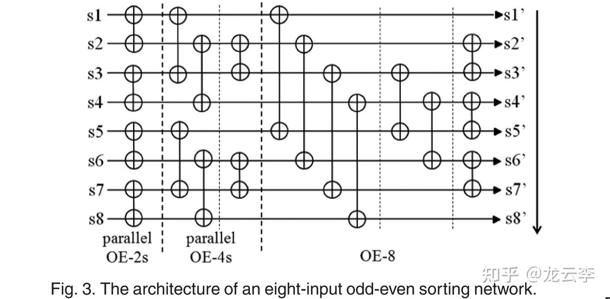

Batcher odd–even mergesortBatcher odd–even mergesort 的算法将排序网络优化到 size O(n (log n)^2)  and depth O((log n)^2) 

Batcher odd–even mergesort 是一种**归并排序**，如上图 OE-2s 先将输入排序为若干个长度为 2 的子序列，OE-4s 将输入排序为若干个长度为 4 的子序列，依次类推。该方法在 GPU 中亦有记载[Chapter 46. Improved GPU Sorting | NVIDIA Developer](https://link.zhihu.com/?target=https%3A//developer.nvidia.com/gpugems/gpugems2/part-vi-simulation-and-numerical-algorithms/chapter-46-improved-gpu-sorting)。

`# note: the input sequence is indexed from 0 to (n-1)
for p = 1, 2, 4, 8, ... # as long as p  n
  for k = p, p/2, p/4, p/8, ... # as long as k >= 1
    for j = mod(k,p) to (n-1-k) with a step size of 2k
      for i = 0 to min(k-1, n-j-k-1) with a step size of 1
        if floor((i+j) / (p*2)) == floor((i+j+k) / (p*2))
          compare and sort elements (i+j) and (i+j+k)`

#### 1.4 Bitonic sorter

和 Batcher odd–even mergesort 的 size depth 复杂度相同。其算法原理是归并地排序为一个双调序列。因为 Bitonic sorter 的局部性更好，因此应用更广泛，尤其在 GPU 等大量同步并行的硬件中。

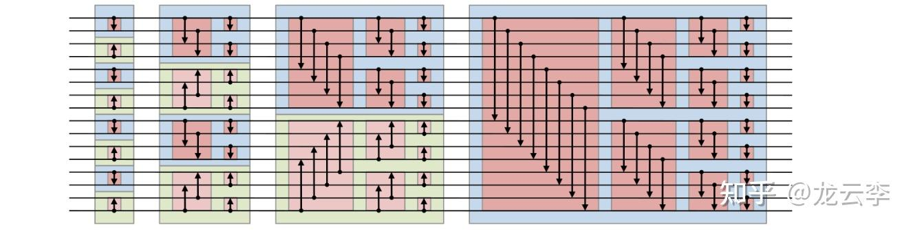

Bitonic sorter**Although the absolute number of comparisons is typically higher than Batcher's [odd-even sort](https://link.zhihu.com/?target=https%3A//en.wikipedia.org/wiki/Odd%25E2%2580%2593even_sort), many of the consecutive operations in a bitonic sort retain a [locality of reference](https://link.zhihu.com/?target=https%3A//en.wikipedia.org/wiki/Locality_of_reference), making implementations more cache-friendly and typically more efficient in practice.有些应用场景中无需对所有元素排列而是 partial sorting network**，因此可以如下右所示切掉一些比较器。

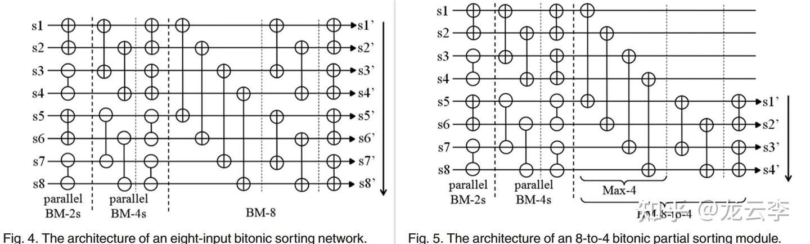

传统 Bitonic network 和 partial sorting networkBitonic 也可以看作由两部分构成，前半部分是 sorter，后半部分是 merger。如果是 partial merger 则可以将 merger 电路进行裁剪。

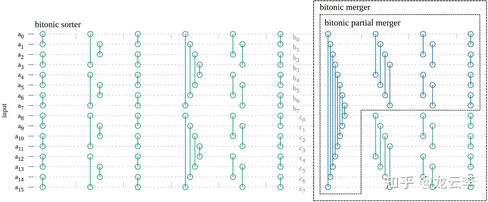

bitonic sorting network--sorter & merger
#### 1.5 Tree-based sorter

作为数字电路的老朋友**树形结构的电路**当然也不能少。下图就是一种基于胖树的树形结构排序电路。随着级数增加节点也越来越胖。

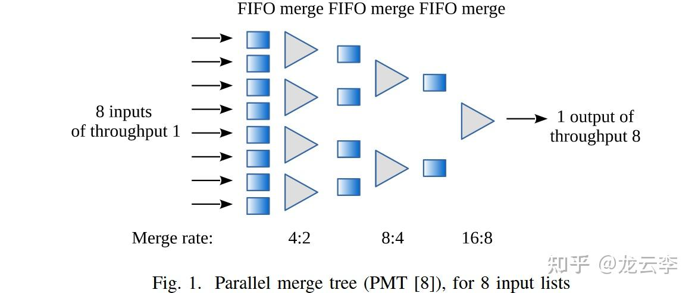

基于胖树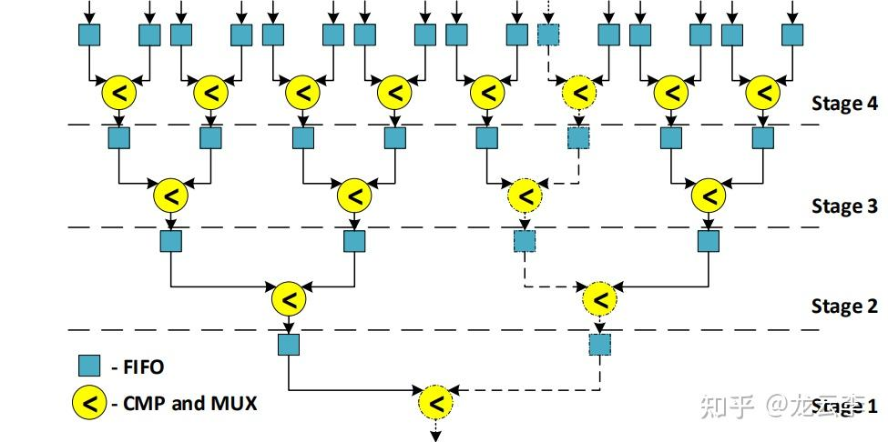

不基于胖树
### 2. Comparison-based sorting

#### 2. 1 Index-based

参考《Hardware Design of Low-Power  High-Throughput Sorting Unit》

在以往的电路中通常都是对元素进行操作，在**元素很多或位宽很大**时会消耗大量能量。因此可以只对** index **排序，可以将翻转信号从 M 变为 log_2M .

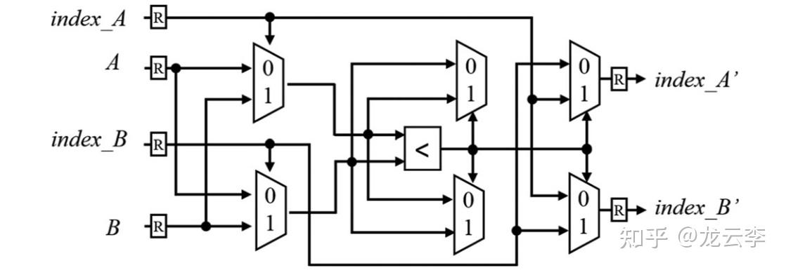

基于 index 的基本排序电路然后可以逐步推广，并进一步搭建基于 index 的 Bitonic sorting network：

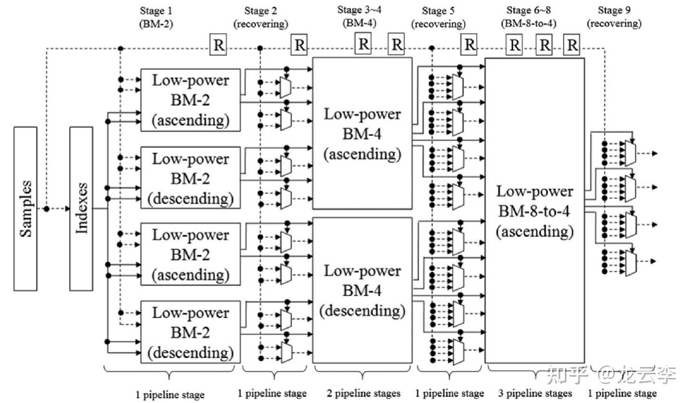

数据通过 MUX 进行分发和合并同时，为了应对**变长序列**，以及低功耗的需求，即从变长的序列中选出最大的 N 个数的 partial sorting，本文提出了一种低功耗循环电路。

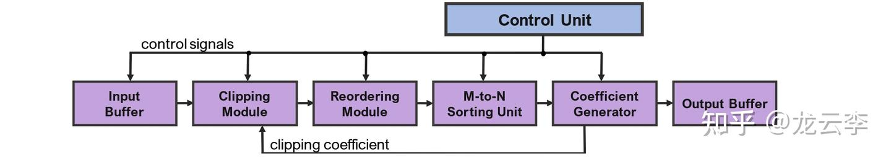

低功耗变长序列排序电路Clipping Module 根据后级的 clipping coefficient，可以将输入的 M 个数进行屏蔽为0，从而减少翻转：

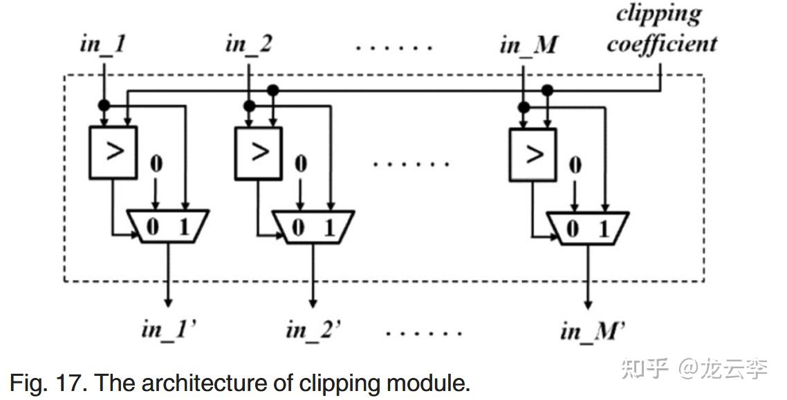

Clipping ModuleReordering Module 进行 index 分发，同时把0值集中，避免**随机放置导致额外动态翻转。**但这个电路实现应该是一个 crossbar，也挺头疼的：

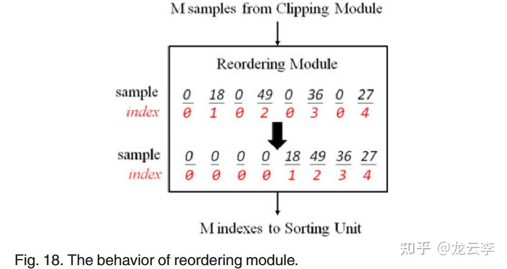

Reordering ModuleCore Module 如上文所示采用一种级联的基于 **index **的排序电路：

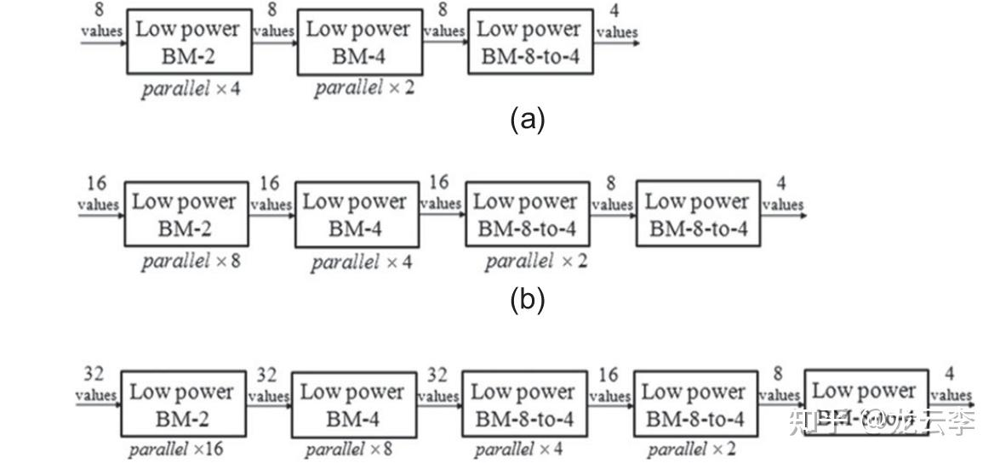

Core ModuleCoefficient Generator 内部有一个 **2N-N **的排序器。这个模块的目的就是产生上文提到的 clipping coefficient。本模块会保存**之前计算中最大的 N 个值**以及**本次迭代得到的 N 个最大值**，然后做排序，选出**第 N 个最大的值**。因为核心任务是从变长序列中选出最大的 N 个值，所以小于 clipping coefficient 的值自然就不用进行排序。因此可以在 Clipping Module 中屏蔽掉，从而减少翻转降低功耗。

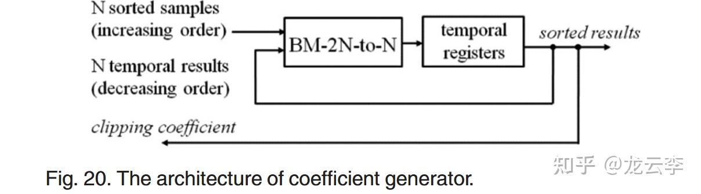

Coefficient Generator个人觉得这个工作有**自耦**的问题（即 clipping coefficient 在后级流水线中才会更新）。**长流水线中发生自耦**会对效率产生一定的影响。

#### 2.2 Unary-based

参考《Low-Cost Sorting Network Circuits Using Unary Processing》

Unary-based 是一种独特的编码方式，1序列后面跟着0序列，其所有比特位的权都是相同的。例如在 real domain 可以根据**1占比**来决定其值，在 integer domain 中可以根据**1的个数**决定其值。于是 MAX 和 MIN function 就可以直接使用 AND 和 OR 来实现。

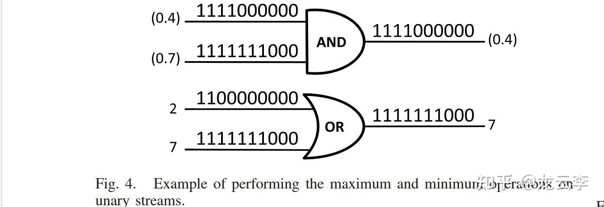

Unary encoding 后的 MAX MIN function这种编码格式可能在某些 sensor 的**模拟 IO** 上应用会更广一点，使用**占空比**来表示其值。

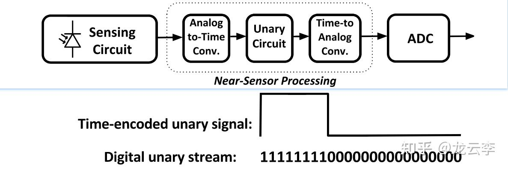

时域编码与传感器应用不少文章都是基于这种编码做优化，还有一些**存算文章**在应用。

#### 2.3 Multidimensional-based

参考《RTHS: A Low-Cost High-Performance Real-Time  Hardware Sorter, Using a Multidimensional  Sorting Algorithm》

Bitonic 存在以下缺点：1. 资源占用多 2. 不是 in-place sort，占用大量内存 3. 任务不可分解，对实时系统不友好

从算法角度看，对于两个长度相同的序列，一个递增一个递减（互为双调）

X_1=[x_1^1,x_2^1,...,x_{M-1}^1,x_M^1]\\X_2=[x_1^2,x_2^2,...,x_{M-1}^2,x_M^2]\\ **可以得到一个非常简单的表示**：

x_i^{max}=max(x_i^1,x_i^2)\\ x_i^{min}=min(x_i^1,x_i^2)\\

基于此，本文提出了一种**任务可分解**的**多维矩阵排序电路算法。**为了利用双调性，在 Row Sorting Phase 时相邻两行互为双调：

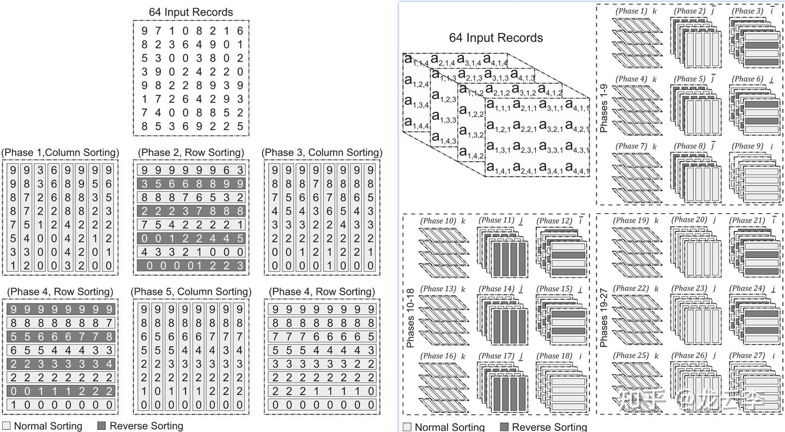

二维情况下有6个phase，三维情况下有27个case如何满足 Normal Sorting 和 Reverse Sorting 的硬件兼容性呢？在 compare-swap unit 加一个异或门就可以：

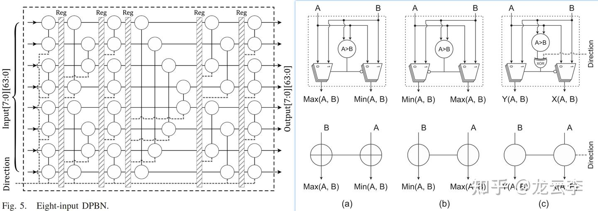

可变换方向的 compare-swap unit 及 dual-mode pipeline bitonic network 实现然后可以搭建多个 DPBN 来构成计算阵列，同时因为相邻的 phase 间，一个行排一个列排，因此需要一个 implicit switch 来进行交换。

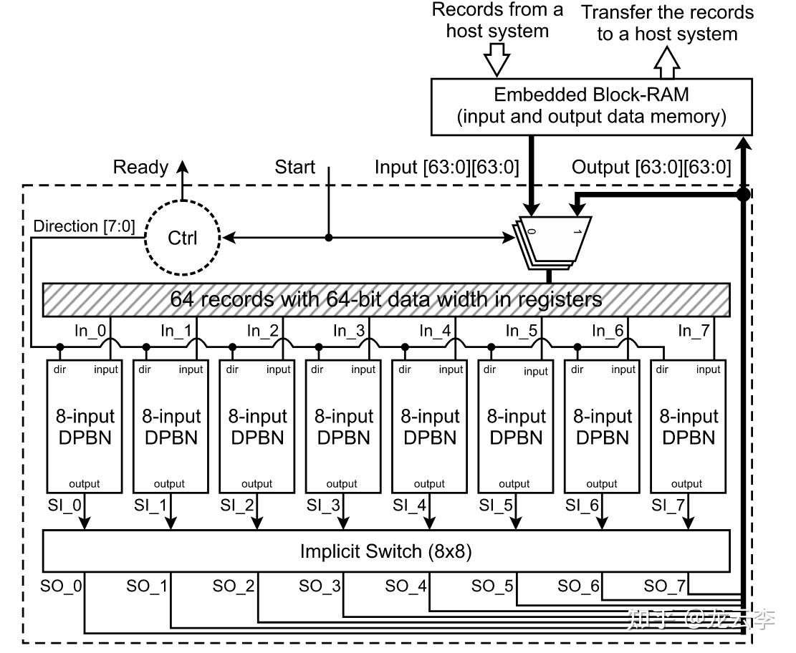

DPBN 阵列switch 把元素顺序重排：

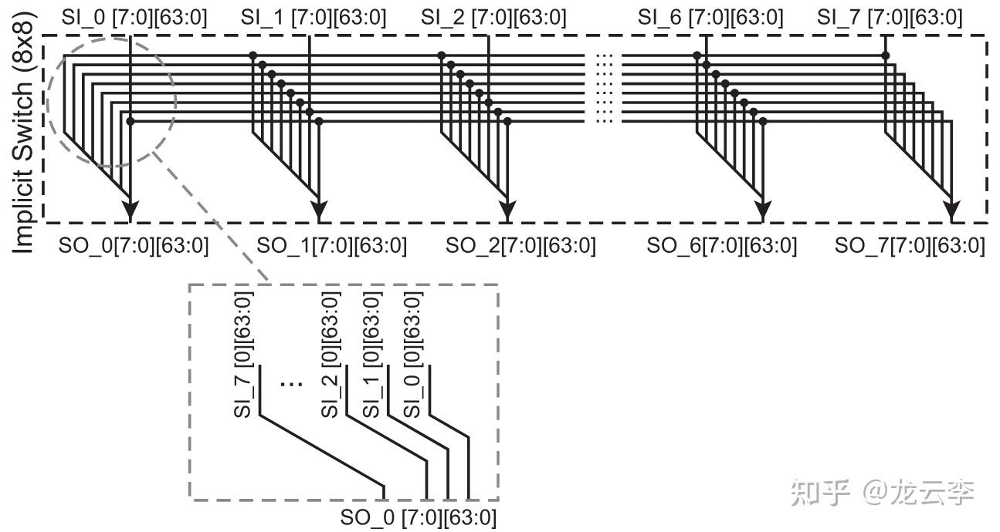

implicit switch
#### 2.4 Graph-based

参考《An O(1) time complexity sorting network for small number of inputs with hardware implementation》

在**输入量较少**且对**延迟敏感**的应用中可以使用如下的全连接排序电路。顶点上的0/1代表比**相连**的顶点值大还是小。通过对该顶点上的值进行**求和**即可知道该值排序后处在**第几个**。有点意思

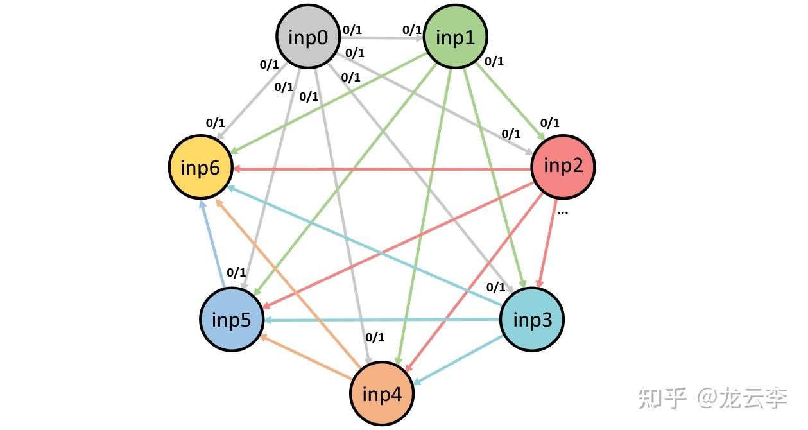

graph
#### 2.5 Linear-based

Linear-based 方法应用在**变长序列**，且对输入输出带宽要求不高的应用场景中。基于一种类 FIFO 结构，新输入的数据广播，通过 insertion 的排序方式来构建算法：

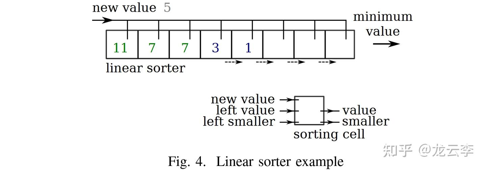

Linear sorter
#### 2.5 Selector-based

参考《**FLiMS**: Fast Lightweight Merge Sorter》开源在[merge](https://link.zhihu.com/?target=https%3A//philippos.info/merge/)，不错不错。这部分的目的都是高效 **merge**，因此我觉得可以应用在 **OP 或 GP **的稀疏加速器中，**非常符合我的出发点**。不错不错

核心是针对 Bitonic 的 merger 进行优化，即对**双调序列**的**合并电路**做出优化：

**merging two sorted lists residing in banked (or multi-ported) memory.在上文提到的《Hardware Design of Low-Power  High-Throughput Sorting Unit》中，有一个 Coefficient Generator 的模块。实际上在所有的变长流排序**问题中都会存在这样一个电路。会导致其 feedback 的路径过长。本文的电路也优化了这个问题。

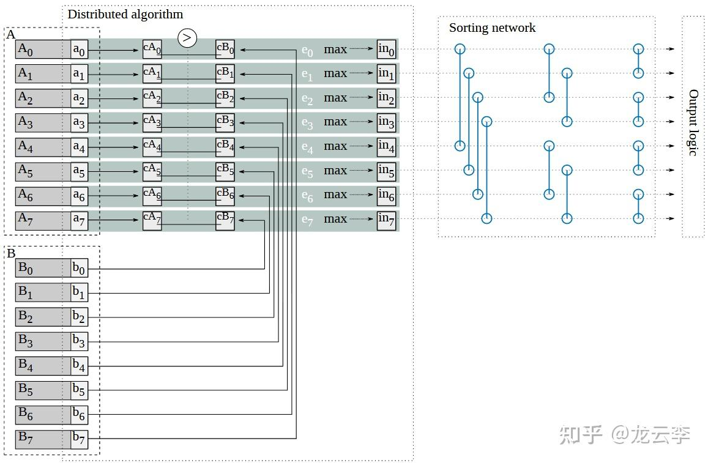

电路结构上图是在并行度 P 为 8 时的例子，于是 A 和 B 各有8个FIFO来提供并行度。在 distributed algorithm 阶段共有 8 个比较器，每个比较器**对应**一个 A 和 B 的 FIFO。每拍选出大的输出给 sorting network。

在 P = 4 时例子如下：

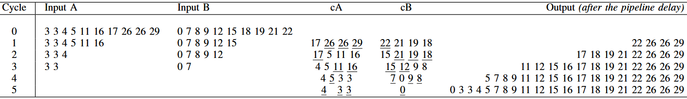

P=4时的例子这个电路不是和 ExTensor 中的 scanner 一模一样吗。。同一个创新点，要在**体系结构，ASIC，FPGA **中分别发一次，才算过时吗。。。

但这个电路也有一个非常致命的漏洞，就是**负载不平衡**。在恶劣的情况下容易出现有些输入提前空导致 Sorting network **利用率低**的情况。Extensor 中用 **SkipRange** 解决了这个问题，但这个电路并没有。

《An Adaptable High-Throughput FPGA  Merge Sorter for Accelerating Database Analytics》基于前面的文章继续搞，将要 merge 的有序 list 从2扩展到了多个。

首先对 Linear-based sorter 进行拓展，在每个 cell 中记录数的**同时记录数所在的 source list**，然后和 FLiMS 类似，在最小的数离开 sorter 后，再向**此数对应的 source list 请求新的数**。这样就拓展为可以对**多个有序序列**进行 merge 的结构：

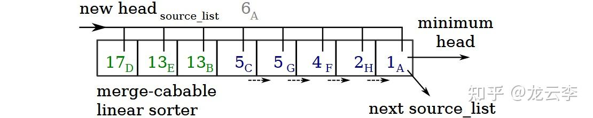

Linear-based merger整体电路如下：

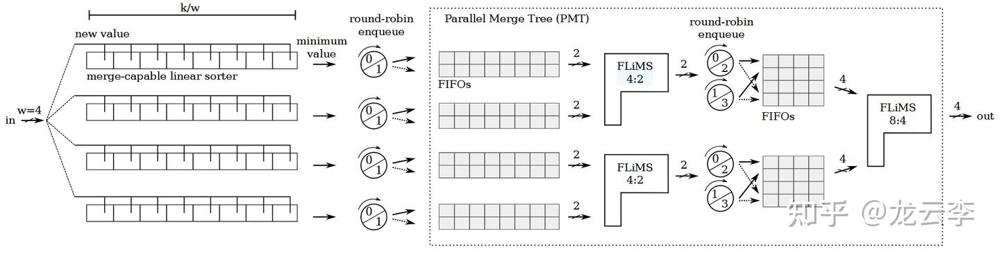

整体电路其中，并行度用 \omega 表示。此电路的前半段**是 **\omega** 个长度为 **K/\omega** 的** Linear-based merger，后半段是用** FLiMS 搭建的树形结构**。有两种功能，显而易见：

- 将一个总长度为 k 的 list 进行排序
- 将 k 个变长有序序列进行 merge
这个电路看上去比 MatRaptor 和 SpArch 中的 merge 电路好多了

### 3. Comparison-free sorting

comparison-free 的方法如下所示，有点意思但不多：

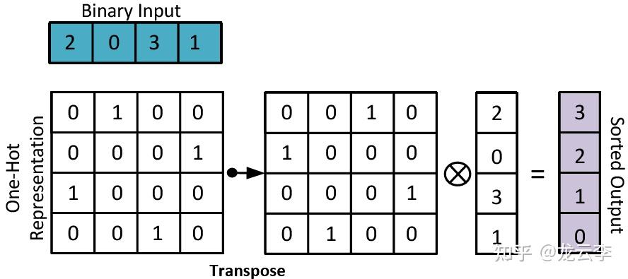

基于独热码与乘法的排序方法将 Binary 转成独热码然后做 GEMV 即可。那你要这么说那确实。

路由问题其实也可以转换成对目的地端口号的排序问题，也可以使用本文的方法解决。

### 4. 在稀疏加速器中应用

2025.8.2 遇到一个需求，需要设计一个支持**英伟达 4/8 稀疏格式**的 tensor core，因此需要从输入的8字节数据中根据**字节掩码**选择出需要计算的4个字节，问题和下面的描述类似：[实现根据掩码选择数据输出](https://link.zhihu.com/?target=https%3A//bbs.eetop.cn/thread-978273-1-1.html)

传统的实现方式，可以通过** leading-one detection 电路**来求出第一个1的位置，然后将这个位置掩掉，继续求第二个1的位置，以此类推，然后通过4个 8-1MUX 进行选择输出。

**资源消耗**上，需要四个 leading-one detection 电路和4个 8-1 MUX。关键路径上，是四个串行 leading-one detection 和一个 8-1MUX，效果一般。

于是可以使用本文中提到的** top-4 bitonic 排序网络**实现根据掩码选择数据输出的需求。