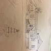
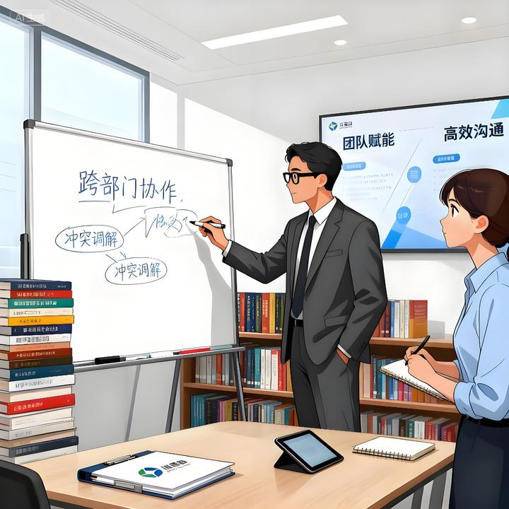

HR和其他岗位最大的不同，就是能知道一个岗位谁上来谁不上来最真实的考量因素，所以以下文字一定是你比较少能看得见的经验分享，一共3600字，掰碎了仔细的给你说清楚为什么。

建议先收藏，有空多拿出来琢磨。

先说结论：

**本质原因是：你压根不清楚游戏规则，试图以一套玩法打通关。**

**从底层一直晋升到高管层，至少要经历三个阶段，每个阶段的游戏规则和玩法都不一样。**

你如果没有过来人的指点，或者指点了没有领悟，又或者领悟了但是做不到，那都是没有用的。

**在正式展开三个阶段的游戏规则描述之前，先说一说最常见的两种思维误区：**

**1、保持着学生时代的天真，坚信努力就会有回报，能力好业绩高就能有晋升。**

你就是996加班，卷死自己，业绩结果突出，绩效此次拿A，也不一定能晋升。

**2、深受「关系人脉」理论的毒害**

你沉迷于搞关系、搞人脉，讨好领导，觉得想要爬上去，能力不重要，找个好靠山，抱上大腿才是关键。

以上两种心态，都是极端状态，大部分会徘徊在这两者之间，一直找不到正确的路径。

但是现实告诉你，有人没有人脉也能升到高管，也有人有强大的人脉和后台，依然在底层趴着纹丝不动。

这时候，你就会迷茫，把晋升看成一门玄学，感觉完全无规律可循，最后变成听天由命。

**第一个阶段，也是第一道门槛，是从基层员工升为基层管理者。**

这道门槛，大部人只要找到通关的关键点，就有机会一跃而过，这一关基本和人脉、背景没什么关系。

**这关的游戏规则是：基础门槛过关+隐形潜质合格。**

基础门槛是你的业绩和做事能力。

在基层，你的价值核心体现在执行力上，能有把事做成、摆平的基本能力。

这一点，我相信你很容易达成，接下来大家要比拼的就是隐形的管理特质。

**从员工升为基层管理者，有三个基础的管理特质必须要过关：**

**1、冲突的解决能力。**

这既包括你与下属的冲突、也包括与跨部门协作的冲突。

资源有限，想法各异，如何在纷繁复杂的利益交割中，化解矛盾，求同存异，是一大考验。

这背后往往意味着情绪管理能力、沟通表达能力、逻辑思维能力、自我的认知和对周围环境的敏锐度。

以上这些，有些人天生会好一些。

但是即使你不行，通过刻意的练习也能达到合格的水平。

**2、安排他人做事的能力**

很多人从学习时代到成为业务骨干，已经习惯了单打独斗，对于带人干活天然觉得麻烦，还没有自己一个人干的快。

如何合理的分工，把自己的哪些工作分出来，哪些任务留下来，是管理的基本学问。

然后就是如何跟进、监督、辅导、评价分出来的事情怎么样，如何做到分出去的活儿依然能够自如的掌控在自己手里。

如何让他人愿意按照你的分配干活，且能把活干好。

**以上层层问题，背后就是基础的管理技巧，牵扯到目标设定、任务拆解、追踪、结果评估、复盘等一系列基本管理动作要求。**

**我见过很多人在这一关迈不过去，或者准确的说，是嫌麻烦、复杂、委屈、难受，而主动选择了放弃。**

很多人都不想一想，如果你没有指挥几个人作战的经验和教训，怎么会有机会爬上更高层的位置呢？

**3、向上汇报的能力**

员工在做执行，而基层管理者就要承担上传下达的任务了。

如何有效的向上汇报与沟通，是另一门要学的技能。

除了汇报技巧的练习，还要求你时刻关注公司重点，上级关心的重点，时刻保持政治敏感度，能够分清重点。

**我曾见过一个下属，专业能力很强，但是却因为汇报能力太差，很难被提拔上来。**

举个例子：

我已经很明确的告诉他，最近几周我会非常关注销售总监岗位的招聘进度，因为老板盯得紧，比较着急。

但是，第一周她的工作汇报中，我看不见任何关于此事的进度和信息。

第一次，我直接电话给她，问她这件事的实际进度和情况（反馈说安排简历筛选及初试中），然后告诉她，下一次汇报时附上此事的最新进度。

第二次汇报，进度有了，但是措辞和第一周相差无几，既没告诉我简历筛选情况，也没告诉我初试的候选人通过情况。

这一次，我会再教教她，要给我具体的信息，让我对进度有所把握和了解，知道困难和卡点在哪。

第三次汇报，给我了问题和卡点，说现在市面上合适的候选人不多，且薪酬吸引力不强。

这一次，我需要主动问她做了哪些动作来解决这些问题。

其实，这个下属专业能力很强，所有的卡点及问题她都在想法解决问题。

但是，她的汇报能力实在是不过关，连基本的「问题-方案-需求」的基本汇报框架结构都运用的不熟练。

**我后来发现：有些人不是真的学不会汇报，而是对于向上汇报有排斥心理，总觉得事情我都干了，你又不是看不到，非要搞个形式主义。**

这种情况下，可想而知晋升的机会是多么渺茫。

**第二个阶段，是从基层管理岗位向中层管理岗位跳跃。**

你如果在基层管理岗位熬了很久，我想大概率办事能力和管理能力已经磨炼的差不多了。

**这个阶段，你想要跃迁上去的门槛就一个：机会。**

**这个阶段的破局之道是：找到自己的稀缺性，并以此主动去寻找机会。**

**很多人都是死死的卡在这一步，苦等岗位空缺，束手无策，坐等天上掉馅饼。**

这也是为什么很多人升到中层会说自己运气好。

比方说，如果你所在公司几年都业绩横盘，位置空不出来，那你怎么等也不可能升上去。

我就见过一家中型公司，业绩常年横盘在20亿左右，说大不大，说小不小，很多区域经理就是在公司时间长了，舍不得离开。

上面明显就那么几个或十几个大区总的位置，他们不动，业绩又没扩张，整个公司的管理层都陷入的死寂，没有流动。

这个时候，一定要琢磨自己这些年攒下来，有哪些经验是和市场需求匹配的，是稀缺的，然后找到这个机会，以跳槽换取晋升的机会。

**这里面对于稀缺性会有几个点，需要澄清：**

1、稀缺≠冷门，你在某方面的技能、专业、或经验处理上能做到相对他人的极致，就是稀缺的。

2、稀缺不是什么都算的，稀缺带来的是产出价值，要能给公司或组织带来贡献。

3、稀缺还意味着要有难度要是别人难以模仿的，至少是短时间内难以模仿，或者他不愿意模仿的。

**从我的经验来看，你想要找到自己身上的稀缺性，除了技能、经验、个性、能力之外，可以增加行业、企业类型、规模大小等交叉因素，精准找到自己最会被需求的点。**

比如，你说自己是一个薪酬绩效专家，一定也是有市场稀缺性的，但是如果你能挖掘出来以下组合，稀缺性可能就更加明显以及吸引人了：

我的稀缺性=零售行业+民企+500人以上规模性公司+从0到100实战经验+薪酬绩效专家。

另外一条路，就是你也可以曲线救国。

比如说：从中小型公司，跳到中大厂去重新开始，给履历加分、镀金，哪一天带着大厂的光环，也一样会有稀缺性增加，增加跃迁到中层干部的机会。

**第三个阶段，就是从中层管理者往高管层的晋升**

这个阶段和第二个阶段有一个共同点，就是机会继续在变少。

但是这不是关键，关键是往上再走一步的门槛是什么？

**这个阶段的游戏规则是：你有资源，且能通过资源整合解决问题。**

高管阶段，个体能力让位于资源。

比方说，

你有行业的人脉资源，尤其是顶尖专家人脉资源，随时能拉齐一个顶尖队伍；

你有投资人/银行的关系资源，能够为企业带来资金；

又或者你有政府、监管机构等方面的资源，熟悉监管政策，能摆平很多事情。

你看到的是家里有背景的人坐上了高管，以为他依托于关系，实际其本质上是其背后资源的调动能力。

这也是为什么很多背景看上去还不错的人升不上去：他实际上调动不了多少背后的资源。

那么，资源这个东西要如何做呢？

**对于普通人来讲，你最好攒的资源就是人脉资源。**

**而人脉资源的积累，依托于你在对等的位置，手上有相应调动部分资源的能力。**

这也是为什么很多大厂的大头兵哪怕工资平行，坑也很大，依然选择要跳出来去中型公司做个部门负责人。

**有时候 ，到了这一层级，不能光看薪资，要看自己拥有什么样位置和权力。**

**举个例子：**

你现在是大厂的大头兵，说话权利小，调动资源少，和一个10亿-20亿左右公司的某部门负责人相比。

也许你到手的现金、加上股权激励，收入在短期内要高于后者，但是可能后劲可能不如后者。

因为你的位置及资源调动能力，决定了你无法如后者一样积累到更多同类型的人脉关系。

**在职场，位置所附带的权力，有时候远远大于表面上看来的现金收入。**

**这些位置上能给你带来 人脉、资源的积累，也远远超过短期现金带来的好处。**

（当然，极个别大厂能股票涨了成百上千倍的神话，但那是另一种幸运，是小概率事件。）

最后，总结下这个问题的答案：

**别用一套游戏规则打通关，也不要带着学生思维或者江湖思维看职场。**

- 要升到底层的时候就踏踏实实干好事，聚焦业绩达成，有机会多带带人历练下管理能力；
- 想要晋升到中层的时候，就多盘点反思自己的稀缺性在哪，怎么样才能增加稀缺性，别为了每月不到两三千元的薪资差异而反复横跳，这个阶段，历练而带来的稀缺性，才是你博取未来晋升机会的关键。
- 到了最后去冲击高层的时候，多积累些资源，比如多参加下行业协会/社群、多去能接触的高级圈子里混一混、也可以花钱参加MBA商学院、或者在线上认识更多牛人来扩展渠道。
**总而言之，从底层爬上来，一定要明白这是一场价值评价维度不断在变化的游戏，从出卖自己的体力，到卖脑力，再到卖资源，层层升级。**

**理解了游戏规则，接下来就看你能不能做的到了，那又是关于能力边界的另一个话题。**

以上，与君共勉。

送礼物

1 人已送礼物

[所属专栏 · 2026-01-13 17:52 更新](https://zhuanlan.zhihu.com/c_1950942747725902306)[职场管理与人际洞察

子佳看职场

​旅行/住宿行业 人力资源总经理

122 篇内容 · 3026 赞同

](https://zhuanlan.zhihu.com/c_1950942747725902306)订阅[最热内容 ·

什么人一打眼，就知道工作能力很强?

](https://zhuanlan.zhihu.com/c_1950942747725902306)[发布于 2025-09-05 18:34](//www.zhihu.com/question/655516220/answer/1947367041486033567)・上海

​68 条评论​2001 ​67 ​分享

​​

收起​